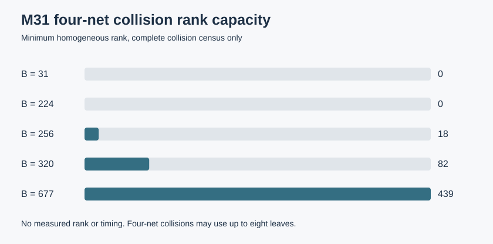

# Four-net collision-rank capacity on the fixed M31 group

2026-11-25; parent 40526d0864dbea99446ea02fa97b581d624cd1ea; PR #5131. Written producer mathematics, [pcc:unverified]. No new group arithmetic or randomized trial. This is a validation floor for a *complete* collision census, not a method for constructing that census efficiently.

## Scope and sources

Inherited public fixture: p=2147483647, a=847514846, b=2087444724, subgroup order r=2147446831, cofactor one, G=(625037715,2100627251). Coordinate field is F_p; coefficient spans are over F_r. The archived B31 injectivity is conditional on historical census correctness. The larger B values below refer to size-only statements on this same group, not new or reconstructed bases.

Previous pair_collision_rank_followup/GATE.md (blob 34371cec6a3ea415183507827827a3382461aca8) established a pair-only dimension bound; historical_collision_reconciliation/GATE.md (blob 5bbbbb76276b11d806194147a698c4719dd5f7c0) establishes the even-net count and archived B31 alignment. Merged #4955 gives representation expectations, not collision-span rank. The existing #5128 owns current-root qualification. Sources checked: O'Bryant, Constructing Thick B_h-Sets, arXiv:2308.12406; Kovačević–Tan, Improved Bounds on Sidon Sets via Lattice Packings of Simplices, arXiv:1610.01341 (primary abstracts); standard injective-sum packing context, not a proof of the present signed-span statement. Bounded open PR search for homogeneous four rank surfaced other lanes, no exact matching gate observed. KB/Conductor unavailable; no novelty claim.

## Rank-capacity lemma

Let phi:F_r^B -> G be the additive map sending e_i to public P_i. Assume prime r>8. Let N4(B) consist of integral vectors of even l1 norm at most four, reduced in F_r^B. These are all normalized four-leaf nets (including cancellations). Let W4 be the F_r-span of differences v-w for v,w in N4(B) with phi(v)=phi(w), including identity. Put h4=dim W4 and k=B-h4.

For any v,w in N4(B), equality of their quotient classes modulo W4 is equivalent to equality of their group images: the forward implication uses W4 subset ker(phi); the reverse holds by definition. Select k coordinate images forming a basis of the quotient. All N4(k) nets supported on those coordinates give distinct quotient classes, since the coordinate coefficient differences have absolute values at most eight and r>8. Thus

    |phi(N4(B))| >= |N4(k)| = (2 k^4+10 k^2+3)/3.

The count follows by summing signed compositions of each even weight: for positive j, choose t nonzero coordinates, choose signs and a composition of j into t positive parts. Add the identity once. In particular N4(k)<=r. This uses no random-factor-base or independence model.

For the strict-only family V4(B) of four distinct indices and signs, define Ws using only differences between strict vectors mapping to the same point. The identical quotient argument gives |phi(V4(B))| >= 16 binom(B-dim Ws,4), with binomial zero for dimensions below four. The strict bound does not require adding the zero vector or including repeated leaves. Ws subset W4. Both ranks are homogeneous collision ranks, not the rank of known-RHS target rows. Differences may have up to eight signed leaves; do not mistake the result for a floor on rank from zero sums of exactly four leaves.

## Exact capacity at the inherited r

N4(238)=2139217305 <= r < N4(239)=2175396165.
Strict V4(239)=2121016016 <= r < V4(240)=2156965440.

Consequently h4 >= max(0,B-238) and dim Ws >= max(0,B-239). Also h4 <= B-1 for a nonzero source map. The unrestricted formal count at B677 is 140045175925; average normalized net multiplicity over all r points is >65, so some fibre has at least 66 nets. Strict count is 138805851600, so some strict fibre has at least 65 nets. These are pigeonhole bounds, not measurements of target distribution, maximum multiplicity or independent-rank trajectories.

| B | Full normalized nets | Strict signed nets | Full collision rank floor | Strict collision rank floor |
|---:|---:|---:|---:|---:|
| 31 | 618885 | 503440 | 0 | 0 |
| 224 | 1678587905 | 1633830016 | 0 | 0 |
| 238 | 2139217305 | 2085517840 | 0 | 0 |
| 239 | 2175396165 | 2121016016 | 1 | 0 |
| 240 | 2212032001 | 2156965440 | 2 | 1 |
| 256 | 2863529985 | 2796682240 | 18 | 17 |
| 320 | 6990848001 | 6860184320 | 82 | 81 |
| 677 | 140045175925 | 138805851600 | 439 | 438 |

At B31 the rank floor is zero, consistent with archived injectivity (not independently replayed here). At B677, the full collision span necessarily has at least 439 dimensions; even strict-only collisions necessarily span at least 438. A full exact census with smaller ranks is impossible under the assumptions. This does NOT guarantee that sampling, first-witness output, or a partial collector attains those ranks.

## Validation and cost boundary

The reference census would require representing all requested nets or a separately proved rank-equivalent contraction. Direct enumeration is Theta(B^4) formal labels, before point additions, canonicalization, collision comparison and coefficient elimination. Neither the proof nor the integer floor computes group points or finds a single collision. It cannot qualify a fast extractor. Partial streams, cross-curve or x-only comparisons without sign alignment, omitted identity, or using F_p instead of F_r are not equivalent contracts. Do not transfer the B31 collision-free reporting and rank-budget conclusions to larger bases above the exact capacity threshold.

The accompanying CHECK.py compares the closed count with a signed-composition count and checks the finite threshold and table by exact integer arithmetic. Same-coordinator arithmetic, not an independent proof. No new Rust/native validation, seed manifest, paid jobs, signatures, formal verification or merge. No native worker dispatch; coordinator performed parallel read-only repository operations and deterministic arithmetic. No Space mutation. Current #5131 remains open draft; #4977/#4979 merged. Preserve branch and main journal histories on integration.

Impact score: 3/10 — exact group-capacity constraints give nonzero universal collision-rank floors for the larger public M31 base sizes, conditional on complete normalized collision semantics. They do not supply collision witnesses, a fast method, or a measured gain. [pcc:unverified]
