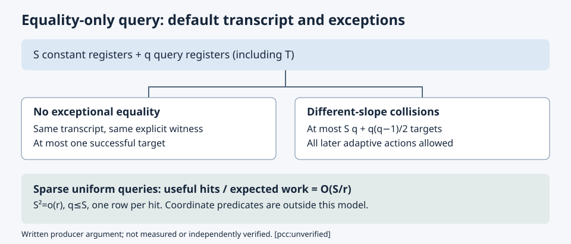

# Equality-only pair-spectrum query: collision coverage and useful-hit throughput

2026-11-24 UTC; PR #5131; parent 9a726c2c8e74ad7ca5700299f7e876008a1495f4. Written producer argument [pcc:unverified]. No experiment or new curve.

## Exact model and result

Let G be the inherited cyclic prime-order group, r=2147446831, on M31 p=2147483647, a=847514846, b=2087444724, cofactor 1, generator (625037715,2100627251). These parameters are inherited from squareclass_selector_followup/GATE.md, not newly verified. Let A be the actual signed base of size 2B, W=A+A (including O), H=W+W, and h=|H|. The theorem uses neither randomness nor generic position of A. No support census is supplied.

Consider a deliberately restricted equality-only group-register model. Target-independent preprocessing leaves at most S distinct constant group registers, plus arbitrary target-independent ordinary data. Every new constant group element made during the query must also be counted in S, or counted among the query-generated registers below. A query gets uniform T in G, may add/subtract, negate, or multiply group registers by known scalars, compare registers for equality at no charge, and branch on equality outcomes. Ordinary computation and even scalar advice independent of T are free. It cannot inspect coordinate bits or numerical encodings, use field predicates, or call an oracle revealing scalar labels of T. Count q>=1 query registers including the input T, counting all newly generated group registers, including freshly produced constants. Repeated registers may be kept; count each creation. The output is either no witness, or explicit signed leaf indices whose sum equals T; a sound algorithm never reports a false witness. A bound for full reporting follows because it must in particular find one witness on a hit. This is not the full Shoup random-encoding model or a cell-probe lower bound.

Fix preprocessing, ordinary advice and query coins. Write each formal register as [a]T+C with a in F_r and C in G, without computing log(C). Follow the default transcript on which two forms with unequal a never collide; same-a comparisons have outcomes determined by their constants, independent of T. The transcript is well-defined even when unattainable; truncate at a declared query cap. Distinct-slope forms can agree at exactly one target because r is prime. On the default transcript, at most S q + q(q-1)/2 target values cause any such collision: every comparison with a preprocessed constant or another query register is covered. This overcounts repeated or redundant comparisons and includes both signs and identity tests. Let C be the union of those exceptional targets, c=|C|.

Every target outside C follows the same default transcript. If it produces an explicit witness, that fixed witness can sum to only one target. Thus for every sound capped extractor,

    number of successfully answered targets <= min(h, S q + q(q-1)/2 + 1).

An exact membership-only algorithm (no output witness) instead obeys

    min(h,r-h) <= S q + q(q-1)/2.

Indeed its default Boolean answer is constant outside C; whichever class disagrees with it is contained in C. A cap ending in INDETERMINATE is not an exact Boolean algorithm. The same success bound holds after averaging independently chosen query coins when soundness holds for each coin choice. If only almost-sure soundness is known, finiteness of G permits discarding the union of the finitely many null sets of false-witness coins.

## Consequences for the actual pair-scan control

The existing iteration9 chart builds B² nonzero oriented-up-to-sign pair entries, retaining collision buckets. Its distinct signed group support plus identity has 2D+1 elements, D<=B². An equality-only complement scan stores W and computes T-P for each P in W; it reports pairs by equality and expands the stored leaf buckets. This costs O(D) group operations plus output under dictionary bookkeeping. The zero subtotal is included through O. It is an exact generic control, not a claimed improvement.

If h=Theta(B^4), S=O(B²), and q=o(B²), the collision budget is o(B^4); hence exact witness reporting cannot achieve such a q in this model. This implication is conditional on the actual support size, NOT inferred from D=Theta(B²). For membership-only use additionally h<=r/2. A compressed additive support may be much smaller; Cauchy-Davenport alone does not imply a quartic support. No generic lower bound for the actual D is asserted without the needed support hypothesis.

There is a second conclusion that needs no lower bound on h. On uniform blind targets the success probability of any sound extractor with default-path q is at most (S q+q(q-1)/2+1)/r. If q<=S, S>=1, this is O(S q/r). In a growing sparse family S²=o(r), the probability of the default transcript is 1-o(1). Its q registers are actually created on every such target (including the initial input as one unit). Thus expected query cost in this register metric is Omega(q), and success probability divided by expected cost is O(S/r). This remains true conditional on any history that fixes the preprocessing/table and leaves the next target uniform and fresh, if the same bounds hold at each query. With randomized query coins, condition on coins and average the inequality between success probability and expected cost. Fixed caps and variable default-path lengths are both covered. Nonterminating or capped incomplete paths must be accounted for as failure, not exact EMPTY.

Under the conventional one-useful-independent-row-per-success model, obtaining B useful independent rows therefore requires expected total register work Omega(B r/S), if the algorithm reaches that milestone almost surely with finite expected work. Proof: sum the conditional success-versus-cost inequalities over attempted queries; use nonnegative sums and stopping-time indicators measurable before each attempt. Each useful row is at most one success. With S=O(B²), the bound is Omega(r/B) regardless of whether the attempted query has q=B^tau, tau<1, or a smaller support. For the proposed sparse-family beta<1/4, r=Theta(p), this exceeds sqrt(p). This is a restricted throughput obstruction, not a universal IC complexity theorem. Multiple useful rows per target, nonuniform/structured target generation, a growing cross-query state violating S, large q or larger setup, field-coordinate operations and non-equality predicates are not covered. It also does not assert the cost of linear algebra or total scalar recovery.

## Challenge / validation preparation

- Default transcript proof allows adaptive choices, including on previous equality outcomes. After the first exceptional equality all subsequent behavior is unrestricted, and the union bound already counts that target.
- Free equality between all stored points and all query registers is intentionally generous. Equality of raw opaque labels is allowed; numerical hash bucketing or arbitrary functions of encoding bits are not. Hash dictionary implementation of the same exact equality predicate is compatible, but using a bucket as an informative predicate is not.
- Constant outputs cannot cover two distinct targets. Returning only YES, a symbolic formula for the unknown leaf indices, or a target-dependent group element is not a completed explicit witness.
- Taking q=1 covers target lookup against all S constants and the possible single fixed witness. q includes the target so no division by zero arises in the throughput proof. If the default path is unrealizable in a nonsparse regime the finite cap bound remains a collision-cover bound, but the expected-cost conclusion is not claimed there.
- A real S3 contraction is non-generic: even one field arithmetic predicate can reveal a class of targets far larger than one exceptional collision. This gate does not exclude rank-three zero tests, algebraic root selection or adaptive coordinate-based indexes. It says that replacing the exact coordinate problem with only black-box point additions and equality cannot realize the desired sparse uniform throughput under this storage/row model.

## Sources and next gate

Source: iteration9/PAIR_SPECTRUM_RESULTANT.md blob e2348e91dc08141a663c5adb9798b6ca8f09424e; named problem blob 2c98ef25c8ae6fb815776720571800587889dad5; squareclass_selector_followup/GATE.md blob e14c9184ecc44dc5ea73d3d15893a632c2ad5274. Related classical affine collision counting: Shoup, generic group lower bounds (EUROCRYPT 1997); Hhan, A New Approach to Generic Lower Bounds, https://arxiv.org/abs/2402.11269; Corrigan-Gibbs, Henzinger and Wu, The Structured Generic-Group Model (EUROCRYPT 2026), https://people.eecs.berkeley.edu/~henrycg/pubs/structured-generic-groups/ (abstract checked; no transfer of their theorem to this model asserted). Corrigan-Gibbs and Kogan, The Discrete-Logarithm Problem with Preprocessing (EUROCRYPT 2018), https://people.eecs.berkeley.edu/~henrycg/pubs/eurocrypt18discrete/ studies a different advice model. Chung and Larsen, Stronger 3SUM-Indexing Lower Bounds (SODA 2023), https://doi.org/10.1137/1.9781611977554.ch19 studies cell-probe indexing, not this theorem. No novelty claim for the collision method. Bounded three-repo search returned adjacent iteration9 and FASS quotient-query work; no exhaustive novelty audit. No native worker dispatch, Conductor/KB capability, signed independent verification or original-root build run in this session. Coordinator parallelized repository reads, then performed written derivation and challenge. No random draws, native tests, paid compute, seed changes, or performance claim. Next: identify an actual coordinate predicate that groups many target values with charged construction, exact signed output and empty-target cost; retain the equality-only control. [pcc:unverified]

