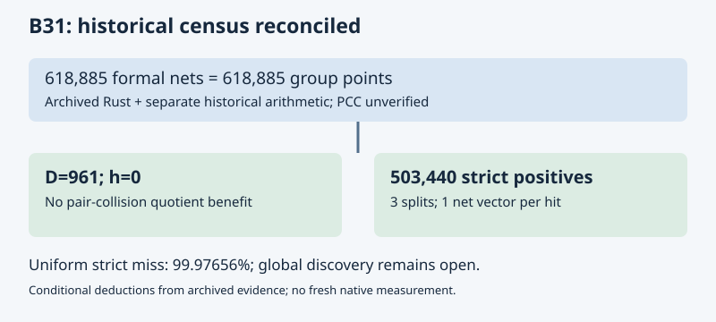

# Reconcile the historical B31 four-sum census with homogeneous rank

2026-11-24; PR #5131; parent 566cd4045964a82d6dc599607e3f654812f1c84b. Historical evidence audit and new written consequences, [pcc:unverified]. No new field computation, randomized experiment, timing or spending.

## Exact source alignment

Inherited p=2147483647, a=847514846, b=2087444724, r=2147446831, G=(625037715,2100627251), cofactor one. The original native library blob 42e1e7c1912be43190959c5be8f84cf59c867786 is identical at current parent, historical native source 1df714645aa683cf975bc76fcacb9842cb4780fd, and archive 2af748ace3eff34b63c9f06950fd4fcd3dcc47b6. Both the present guard and historical native oracle call Base::build(PRIME31,6). That routine uses a deterministic seed scan, sorted full fibre, and smaller-y representatives, not random draws. The native historical raw Dickson panel's ordered 31 x coordinates equal the older arithmetic audit's complete ordered x list exactly. No fresh group arithmetic or private scalar use.

Sources at the parent:
- [Historical census report](../../../prime31_ic_20261115/native/S9_B31_FOUR_PLUS_FOUR_ORACLE_ARITHMETIC_RESULT_20261116.md) (blob 824a4fca36d3d01e55960dd6982959675094ed56), and JSON audit S9_B31_INDEPENDENT_BIGINT_ARITHMETIC_AUDIT_20261116.json (blob 0c401f169d05be20663620a2ea1f55cb86df0288). This is a historical separate producer BigInt check, not new Rust or signed PCC.
- Historical native B31_DICKSON_FIRSTX_FULL_COST_RAW_20261117.json (blob 093b3988c1c3023df08a28f7ad1012b3c728c025), run [44215701063](https://github.com/isogeny-labs/crypto/actions/runs/44215701063), exact workflow head 7ecdf941daad3368ea1898070788a5e42c20e5ea. Its Dickson panel reports 618885 distinct four-group points, 618885 formal signed four nets, zero extra signature collisions. The historical evidence is corroborative, not a newly replayed experiment. Its older fixed seeds and panel are not a prospectively qualified independent-seed performance study under today's protocol. Do not reuse its scalar witnesses as solver inputs.
- Previous pair-rank and homogeneous quotient notes, especially homogeneous_quotient_followup/GATE.md blob c0ce8350ac0e9affa6f5457e3b83027bcb7fe5a8.
- Prior art: O'Bryant, Constructing Thick B_h-Sets, JIS 27 (2024), https://cs.uwaterloo.ca/journals/JIS/VOL27/OBryant/obry7.html ; ordinary unique-sum property. Do not call the symmetric signed set an ordinary B_4 set (cancellation creates multiple token multisets). Bounded code search across crypto, cryptanalysis and crypto-autoresearcher; KB and Conductor unavailable. No novelty assertion.

## Consequences of the historical census

For A={±P_i}, let N4 be the integer coefficient vectors of l1 norm 0,2,4. The four-token sum map from N4 to G has |N4|=(2B^4+10B^2+3)/3=618885 at B31. The archived exact image count equals this maximum; hence the map is injective, conditional on the accuracy of the archived census. The pair map is its restriction to N2 of norms 0,2. This yields exactly 1922 nonidentity signed pair points, D=B²=961 abscissae, every normalized signed nonzero pair fibre singleton, and W=0 (h=0). The previous conditional collision compression and rank improvement has no collision to exploit on this specific fixture. The distinct-index pair chart has D4=B(B-1)=930. These are deductions from source-matched historical evidence, not a new measured census. The earlier note's statement that D/h was unmeasured in this lane must be read with this reconciliation.

Moreover any zero group relation with an even integer l1 norm at most eight is zero as a net vector: split its signed tokens into two even-length groups of size at most four and negate one group. They produce equal images of two N4 vectors, forcing equality, hence the original vector is zero. This is not a statement about odd-weight relations, arbitrary coefficient modular relations, or higher arity. Known-RHS training remains possible.

For distinct-index four leaves, the image has exactly 16*C(31,4)=503440 nonidentity points. Each positive has one net vector and precisely three unordered admissible pair splits (six ordered), all producing the same row. Proof: any such split partitions the same four signed distinct indices; the pair map is injective. A miss has zero splits. Therefore the forest and W-based post-match contraction do not reduce useful rows beyond ordinary canonical dedup on this base; a one-output contract may stop after any valid witness, while full semantic reporting still needs to account for its requested multiplicity. This is not a global lookup improvement.

## Natural-target calibration (exact conditional arithmetic)

Uniform independent nonidentity T on the same subgroup, with replacement:
- Full unrestricted support: 618884/(r-1)=0.0002881952611604358, miss 99.9711804739%, expected 3469.87 trials to first positive.
- Strict distinct-index support: 503440/(r-1)=0.00023443653783036854, miss 99.9765563462%, expected 4265.55 trials; probability of at least one hit in 50 = 0.0116547521378223.
- For any proper coefficient span choose a nonzero annihilating functional and an index i with nonzero coefficient. Among four-distinct supports containing i, flipping its sign shows at least half of 16 signs are outside the span. Thus at least 8*C(30,3)=32480 different rank-extending nonidentity targets, using archived injectivity; this sharpens the earlier multiplicity-8990 based guarantee of three. It is a worst-case conditional lower bound, not a measured rank trajectory. Known-RHS relation generation and public-input custody remain separate.
- A uniformly sampled four-distinct signed coefficient vector maps bijectively to the distinct-index positive stratum, so evaluator-only planted positive cases sampled by this exact distribution can represent uniform conditional hits on this particular base. Arbitrary ordered or repeated-token planting is not the same contract. Natural miss timing and correct mixture weights remain necessary; the evaluator must not reveal witnesses and must preserve independent held-out seeds. This does not authorize a run.

## Decision and checks

Prioritize global miss cost and deduplicated rank reporting rather than paying to build a collision quotient on the frozen B31 base. Do not extrapolate injectivity to B677 or other fibres, and retain broader collision controls as independent fixtures. Validate the historical image count and exact base hash at admitted original Rust source before independent promotion. #4977 and #4979 merged; #5131 open draft at parent; #5128 open owns root qualification. No duplicate work, no native workers exposed, no native tests, no seed manifest needed for this desk audit, no Space mutation and no merge. Coordinator parallelized repository reads and checked the integer combinatorics. Main and branch journals diverged; preserve both during integration. The exact-global-selector problem remains open.

Impact score: 4/10 — historical original-Rust and arithmetic evidence resolve the D/h uncertainty on the exact fixed B31 base, conditionally exclude collision compression there, and give a sharper natural-rank and hit calibration. No fresh native replay, independent signed validation or faster global extraction. [pcc:unverified]
