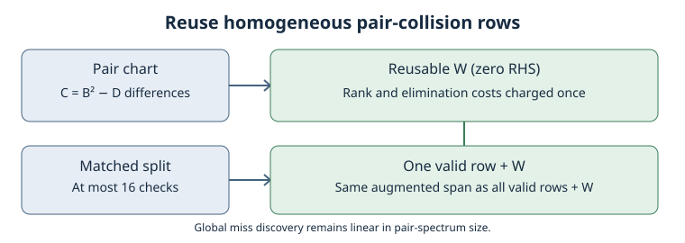

# Reuse homogeneous pair-collision rows across all target fibres

2026-11-24; draft PR #5131, parent 3ea374459c57ae538713290314802481a806eee4. Written producer proof [pcc:unverified]. No new native execution, random experiment, measurement or spending.

## Contract and provenance

Inherited ordinary cofactor-one M31: p=2147483647, a=847514846, b=2087444724, r=2147446831, G=(625037715,2100627251), B=31 (not recertified). Coefficient arithmetic is over F_r. The exact signed group point is the bucket key. Source: pair_collision_rank_followup/GATE.md blob 34371cec6a3ea415183507827827a3382461aca8; rank_output_contraction/GATE.md blob f95d9b81f4c646c6bd1577c781dff804ae2577da; distinct_index_forest/GATE.md blob 71472d5f41513682b71ebbed08e7e5147be654d9 and receipt 155cafcfec2288fe01ce0870667b08d8f93cc9d3. The prior forest retains authentic distinct-index rows without auxiliary relations. This gate instead allows authentic homogeneous relations from pair collisions, even when they do not have four distinct indices. Do not conflate the two contracts.

## 1. Exact reusable homogeneous row space

Let A={±P_i}, with distinct nonzero signed pairs in an odd prime-order subgroup. For the unrestricted normalized pair chart let F_S contain coefficient vectors a mapping to S, with repeated leaves allowed and F_O={0}. Let phi(a)=sum a_i P_i. Choose one representative c_S for each nonempty bucket, with c_{-S}=-c_S. Define W=span{a-c_S : a in F_S}. Every such difference is a valid homogeneous group relation, with at most four leaf contributions and zero RHS. Conversely every unrestricted four-leaf homogeneous coefficient row is a+b with phi(a)=S, phi(b)=-S, so a+b=a-(-b) is a difference within F_S. Thus W is exactly the span of ALL unrestricted homogeneous four-leaf relations, including cancellation and repeated leaves. For D nonidentity pair abscissae the full normalized chart has B² unoriented nonzero labels, and exactly C=B²-D representative differences suffice, by sign symmetry. The chart can be built without enumerating the quartic homogeneous tuple space. No claim that W has rank B-1, or that it equals the distinct-index-only homogeneous span.

## 2. One admissible witness per split after W is included

For target T, write a matched signed split S+U=T. Every valid row is R(a,b)=(a+b,z_T), where z_T is fixed for that target, including when it represents a target variable or known RHS. If any valid pair (a0,b0) exists then

    R(a,b)-R(a0,b0)=(a-a0+b-b0,0) in W x {0}.

Therefore a single authentic admissible row per nonempty matched split, together with W, spans the same augmented system as all valid rows together with W. This holds for any prior augmented row space, across any number of targets and target columns (embed W by zeros). Relative to W it suffices to report one row, not a forest. For h=dim W, coefficient quotient dimension is B-h; the rank increment for a single target in the augmented space is at most the number of nonempty splits and at most B-h+dim span(z_T). The uncompressed coefficient-only bound is B-h. Equal numerical rank alone is not a sufficient test of the equality of row spaces.

Important challenge: if the required output is only the span of distinct-index rows, without W on both sides, this result does not apply. Inserting W on only one arm changes the information available, and is not a matched A/B. A collision with shared indices or a doubled leaf is nevertheless a valid homogeneous equation in the allowed broader IC system; its explicit replay and cost are required. If no such relations are allowed, use the previous forest instead.

## 3. Constant-size exact disjoint-index split test

Build a distinct-index signed chart separately or mark the distinct-index labels of the full chart. In any fixed actual point bucket each unsigned index occurs in at most two such normalized labels (the signed complement is unique). Thus any one label forbids at most four labels in the opposite bucket. Store up to five distinct-index labels per bucket, in canonical deterministic order, including its exact truncated count. If one side has at least five, pick any one label on the other nonempty side and check at most the first five of the larger side. At least one is disjoint. If both sizes are at most four, test all at most 16 combinations. An empty bucket fails directly. This covers the case S=U using two copies with disjointness enforced, including rejecting the identical-label pairing. It proves exact existence or emptiness for a matched split, at most 16 compatibility checks, and yields one authentic admissible row if nonempty. Each compatibility check uses at most four unsigned-index comparisons. No additional affine-chart restrictions are covered.

Let D4 count nonzero pair abscissae with at least one distinct-index label. D4<=B(B-1). Among 2D4 signed keys, the matching involution S -> T-S partitions the matched subset into pairs and at most one fixed point. There are at most D4 unordered matched splits (the total cardinality is at most 2D4, and a fixed point makes it odd). A group-complement scan of these keys followed by the bounded split test gives exact global existence and a rank-complete output RELATIVE TO W, including queries with no admissible decomposition. It still costs O(D4) group operations and lookups per global miss (or O(D4 log D4) deterministic sorted lookup comparisons). No sublinear global selector is claimed. O(D4) output rows in the worst case, O(number of nonempty splits) more precisely.

## 4. Full costs and tradeoff

Initial full chart: O(B²) point operations and labels, O(B² log B) deterministic sorting comparisons; record exact keys and signed differences. W generator list C=B²-D sparse rows, stored in O(C) sparse words or O(B²) in the worst case. Explicit incremental dense echelon for W costs O(C B²) scalar operations and O(B²) storage; do not assume free elimination. If a rank basis is already present, reuse it only with exact inclusion/replay evidence. Alternatively retain all C sparse generators, but charge the expanded linear algebra. The prior support/rank result implies D >= (B-h)², hence C <= 2Bh-h². When h=0 all unrestricted fibres are singleton and the new quotient gives no collision-output benefit. When h is large, a smaller residual dimension is possible but its construction is not free. If h=B-1, W leaves exactly one unknown scaling degree and one nonidentity known-RHS training relation suffices to fix it; this is conditional and not a measured factor-base property. Known-RHS normalization is not obtained from homogeneous relations alone.

Once W is included, prefix storage for distinct-index testing is O(D4) labels; retain the frozen full chart and provenance for independent verification or full-output contracts. Every emitted row still needs exact signed group replay; use the same ordered target stream and full cold setup in both arms. Output work changes from O(sum matched bucket sizes) for the forest to O(number of matched splits), conditional on the charged reusable W. It cannot be sold as an unconditional complete-cost improvement since W construction/LA may dominate, and the global complement scan remains linear in D4.

M31 B31: full pair chart contains 961 unoriented nonidentity labels, so C=961-D; distinct-index chart at most 930 abscissae. Both are symbolic bounds, not a measured census. At a hypothetical split with 31 labels on either side, the earlier forest has up to 185 checks and 61 retained rows; the new contract needs <=5 checks and one retained row when W is already included. This is a conditional count bound, not a timing or actual multiplicity result.

## 5. Validation preparation and coordination

Use exhaustive full and distinct-index chart controls on the original source, verifying signed point keys and all W generators, mutual augmented span inclusion of (W+full distinct-index outputs) versus (W+one-per-split output), exact admissible emptiness and witness replay. Cases: bucket sizes 0 through 5, four forbidden prefix labels, same-bucket splits, isolated vertices, no collisions, repeated leaves in W, x-only sign mismatch, and nontrivial prior target columns. Deliberately compare without W on one side to detect the wrong contract. Include full setup, sparse row/LA costs, retained evidence, independent seed panel, ordered corpus hashes, resources and A/A before claiming speedup. This is validation preparation only; no field arithmetic, seed draws, or native Rust test occurred.

Read live #4977/#4979 (merged), #5131 (draft at exact parent), #4974/#4950 (merged externally) and #5128 (open; owns current-root baseline), branch/main ACTIVE and journal, previous receipts and named problem. No production edits or duplicate jobs. Three-repo bounded search found related earlier pair-collision rank audits (notably research/p192_extension_cover_20261012/line_pair_collision_rank.py); no exhaustive novelty claim. Ordinary linear algebra, index calculus and pair collisions are prior art. Native workers, KB/Conductor and admitted execution not available here; coordinator parallelized repository reads and challenged the row-space proof. Space read required interactive input; no uncertain write replay. Preserve divergent shared histories. No formal proof or signed PCC promotion.

Impact score: 3/10 — exact global reuse of homogeneous pair-collision information and bounded distinct-index split tests, with explicit setup and rank-contract limitations. No global sublinear miss algorithm or measured complete-cost gain. [pcc:unverified]
