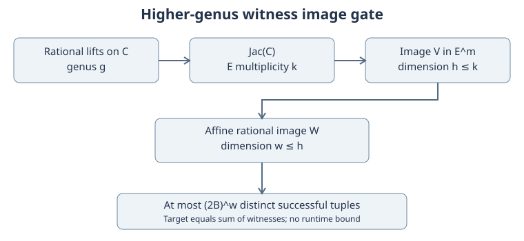

# Prime31 higher-genus rational witness charts: Jacobian image dimension gate

2026-11-24 UTC. Parent dda8de12abfa97b8f160f9bee5b098cff25caaaf, PR #5131. Written producer proof, [pcc:unverified]. Generalizes the frozen rational-section gate to smooth higher-genus rational-lift charts, without proposing a new relation solver.

## Statement

Let E/F_p be the inherited curve (p=2147483647, a=847514846, b=2087444724, r=2147446831 prime, cofactor one, G=E(F_p), generator (625037715,2100627251)). Let C/F_p be a smooth projective geometrically integral curve of genus g; let pi:C→E and f_i:C→E (1<=i<=m) be F_p-defined morphisms. For fixed nonempty A_i subsets of G, a successful rational lift c satisfies f_i(c) in A_i and pi(c)=sum_i f_i(c). Rational maps extend to morphisms here. No condition on cover degree, separability, global sum identity or injectivity of pi is needed.

Write J=Jac(C), F=(f_{1,*},...,f_{m,*}):J→E^m and V=im F, an abelian subvariety over F_p, h=dim V. Let k be the multiplicity of the F_p-isogeny factor E in J. Define W=F(J(F_p)), a subgroup of G^m and hence a vector space over F_r of dimension w. Then

w <= h <= min(k,m) <= g (with h<=g independently);
w <= v_r(#J(F_p)).

The number of distinct successful ordered witness tuples, and therefore the number of distinct covered targets, is at most
min(r, product of |A_i| over a coordinate information set I of size w) for targets, and at most that product without min(r) for tuples. Minimize over information sets if desired. For w=0 the empty product is 1. In particular the target cap is min(r,(2B)^min(k,m)) for the signed base |A_i|=2B. This bound is on distinct tuples/targets, not number of rational lifts.

## Proof

If there is no rational lift the result is trivial. Otherwise choose c0 in C(F_p). The Jacobian universal property for the Abel–Jacobi map j(c)=[c-c0] gives f_i(c)=f_i(c0)+f_{i,*}(j(c)); this also holds for constant maps. Thus every output tuple belongs to one affine translate of W. Choosing a generator of G identifies the *proof* group with F_r, without assuming scalar labels can be computed.

The image V is connected as an image of an abelian variety. By complete reducibility over F_p, any abelian subvariety of E^m is isogenous over F_p to E^h, and any quotient of J isogenous to E^h requires h<=k. Equivalently use multiplicativity of Frobenius polynomials in the exact sequences up to isogeny. Isogenous abelian varieties over finite fields have identical rational point counts, so #V(F_p)=r^h. Since W is a subgroup of V(F_p), |W|=r^w<=r^h. Also |W| divides #J(F_p). Neither equality W=V(F_p) nor prime-to-r degree of an isogeny is assumed.

A matrix whose columns form a basis of W has rank w. Some w rows form an invertible submatrix, giving coordinate indices I such that projection to G^I is injective on W, and on its affine translate. Successful projected tuples are in the Cartesian product of A_i for i in I. This proves the tuple cap, even if multiple lifts give one tuple. The sum identity on successful lifts makes the target a function of the tuple, proving the target cap. The empty product covers the all-constant-on-rational-points case. A chart can be multivalued in T; all rational lifts still fall in the same affine translate.

## Implications and sharp scope

Let Q_E(X)=X^2-36817X+2147483647, the inherited Frobenius polynomial (trace p+1-r). For a proposed normalized cover compute or certify the characteristic polynomial of J, then count Q_E factors over Q[X]. By complete reducibility and Tate's finite-field isogeny criterion this count is k. A genus-two cover with J isogenous to E times an elliptic E' not F_p-isogenous to E has k=1 and cannot improve the previous per-chart 62-target cap, irrespective of root multiplicity or degree. Even a genus-two cover with k=2 (necessarily polynomial Q_E^2) has at most 3844 distinct covered targets for B=31; genus-three with k<=3 has at most 238328. The pair-output chart uses sets of size 2D+1, so the analogous k=1 cap is 2D+1; k>=2 is necessary to exceed it. These are upper bounds, not actual support census or evidence these curves exist with suitable maps. For a full ordered four-leaf tuple-output requirement, including O, a family of k<=2 charts needs at least 62^2=3844 charts at B31; do not apply this count to permutation-quotiented output or to finding just one witness per reachable target. For one witness per target and actual support H, the required number is at least ceil(H/(2B)^k); H is not assumed to be Theta(B^4).

The theorem does not require a coprime degree or a rational section, unlike a push-pull descent argument. A rational-root extractor whose normalization is reducible is subject to separate bounds on F_p-defined components with rational lifts; intersections/singular rational points must be handled separately. Extension-valued lifts with rational outputs need descent or a separate argument. Target-dependent covers, finite-field-only functions, non-geometric sign recovery, and zero predicates without witness maps are outside this theorem. For an x-only selector, adjoining y roots may produce a curve with a larger E-isotypic component or several components; computing its normalization, maps, rational-lift test and root recovery is charged. No per-query lower bound follows from chart counts: adaptive selection, implicit charts and fast root isolation remain open. Repeated E factors are necessary for this particular escape, not sufficient, and do not imply any faster search. No Jacobian realizability or CM-type claim.

## Validation and next action

Adversarial written checks: if E occurs only once, every higher-genus chart has w<=1, even if its degree is divisible by r; if E occurs twice, rational image rank could still be 0 or 1. Degree-zero or inseparable maps, zero target, repeated leaves and repeated outputs are allowed. Distinguish w (dimension of rational witness image), h (geometric image dimension), k (isogeny multiplicity), useful relation rank and factor-base size. The proof does not replace rational image by all V(F_p); only subgroup inclusion is used. If the sum identity holds only at hits, tuple still determines target. For an actual candidate seek an x-only/multivalued selector with a certified normalized correspondence and enough E-isotypic factors, or a nongeometric zero index with priced extraction. No such candidate, no native Rust tests, no timing, no new randomized experiment or paid job. The original-root gate remains unqualified. No independent worker or formal proof. Seed manifest not applicable to this written proof. No ledger standing promotion.

Sources: frozen rational_section_followup/GATE.md blob b9b68b2f7fcd2f9008fbe04c0a4fac1c28ffc028; named problem blob 2c98ef25c8ae6fb815776720571800587889dad5; classical Jacobian universal property and Poincare decomposition; see https://link.springer.com/article/10.1007/s40993-019-0174-x (section 3, finite-field abelian variety decomposition and Frobenius criterion). Bounded three-repo search for Prym witness coverage and open PR query for Prym witness selector found adjacent cover work and no exact matching open PR; not a novelty determination. KB and native workers unavailable in current tool set; coordinator parallelized repository reads and performed self-challenge.

