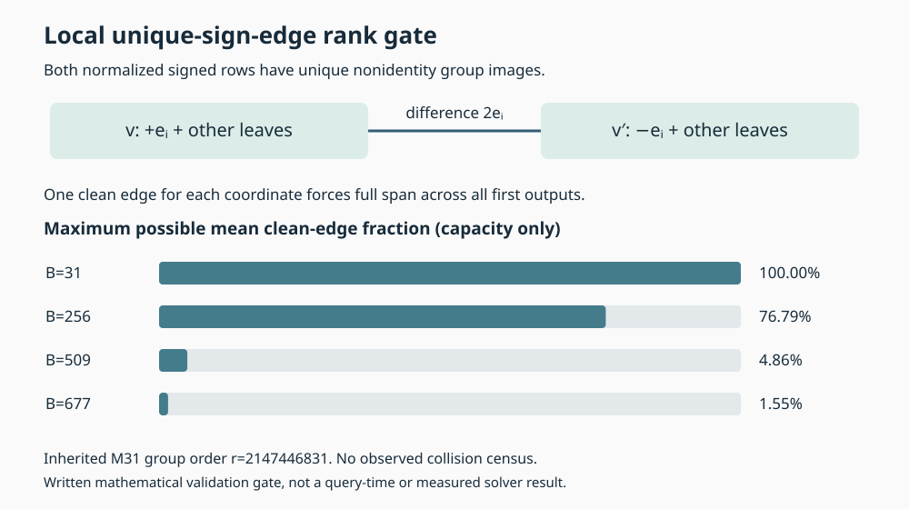

# Local unique-sign-edge rank certificate for first-witness four-sum reporting

2026-11-25 UTC. PR #5131, parent dd7f9019a2ccdfe2e214db8b5fcb7c5da2c267db. Written producer mathematics, [pcc:unverified]. No new curve computation, measurement, experiment, or production source edit.

## Scope and source

Inherited ordinary cofactor-one M31 fixture: p=2147483647, a=847514846, b=2087444724, r=2147446831, G=(625037715,2100627251). These are inherited public parameters, not recertified. Relation coefficients use F_r, coordinate arithmetic F_p. Let A={+P_i,-P_i} have B distinct nonzero abscissae in the odd prime-order group. Let C=N4(B) denote the distinct normalized four-leaf coefficient nets of even integral l1 norm at most 4, including zero and repeated indices; let V be the strict signed four-distinct-index subset. Let phi(c)=sum_i c_i P_i. Assume r>8. The result addresses a complete valid first-witness oracle for C on signed nonidentity targets, including known training RHS, not a witness-finding algorithm. A strict-only oracle can instead take uniqueness within V; that is a different contract.

Previous natural_rank_followup/GATE.md (blob 2d7246876834c203ba01149ebe22403bbdc850f6) uses a global collision-excess subtraction for arbitrary first output. rank_deficit_sharpening/GATE.md (blob 3ce7201945c91d36eca4f0ca675c4d9958f1584d) assumes historical B31 injectivity for the stronger finite budget. This gate gives a local sufficient condition that does not assume injectivity or bounded maximum fibre multiplicity. four_net_rank_capacity/GATE.md (blob fefa847cd1363abf707d4ede93ac3d66222264d4) supplies separate full collision-space capacity. #5157's source (blob 4fcc59b68f116d281131c4842356f09d76b1b199) stores one leaf-pair label per root and returns one x-only witness; it has not established this signed-output contract. #5097 is a separate same-curve B677 mixed-base graph lane with complete generic-source control, not a clean-edge census or an admitted new candidate.

## Exact local condition

Call a strict vector v clean if phi(v) is nonidentity and the entire C-fibre over phi(v) is exactly {v}. A clean vector is necessarily the output of ANY complete valid first-witness oracle at that signed target. Let g_i count unordered sign-flip edges {v,v'} in V that differ only by the sign at index i and have both endpoints clean. There are exactly M_B=8*C(B-1,3) possible edges per index: choose the other three indices and their signs, then pair the two signs of i. Clean endpoints have distinct targets, including within an edge since their difference is +/-2P_i, nonzero in odd order.

**Rank certificate:** if every g_i>=1, the span of all first-witness rows on nonidentity targets is F_r^B. Indeed for each i choose one clean edge. Both endpoints are forced output rows and their difference is +/-2e_i; 2 is invertible, so the span contains every coordinate vector. No independence assumption or choice of collision representative is needed. This does not assert a finite deterministic query budget or that any particular collector has found these edges.

**Adaptive rank-extension bound:** let W be the current coefficient span of codimension k>=1. Select a set I of k coordinate vectors with independent images in F_r^B/W. Each clean edge along i in I has at least one endpoint outside W, since otherwise their difference would give e_i in W. Count one outside endpoint per such edge. A strict vector has four nonzero indices and is incident to at most one edge per index, so it is charged at most min(k,4) times. Clean vectors have distinct nonidentity images under phi, hence the number J(W) of targets that force a rank-extending first output satisfies

    J(W) >= ceil( sum_(i in I) g_i / min(k,4) )
         >= ceil( (sum of k smallest g_i) / min(k,4) ).

The second bound does not require knowing the current span or pivot set. If g_min=min_i g_i>0, it yields J(W)>=ceil(k*g_min/min(k,4)). This is independent of how an oracle chooses ambiguous witnesses. It is a sufficient bound, not necessary; an oracle can gain rank from ambiguous fibres too. If an oracle reports an ordered tuple or abscissae without a verified normalized signed row, the contract is not met.

For independent uniform nonidentity public training targets with legitimately known RHS, conditional rank-increase probability is at least J/(r-1). Summing conditional geometric waiting bounds over deficits gives expected query count <= sum_(k=1)^B (r-1)/ceil(k*g_min/min(k,4)). In particular g_min=Omega(B^3) implies O(r log B/B^3) expected queries even for arbitrary first-witness selection, without a global bound on total collision excess. This is conditional on the actual clean-edge distribution and target model; no new rank samples, independence of rows or faster extraction are claimed. On B31 the previous injectivity-dependent bound is stronger; this gate is for collision-aware validation, not a replacement for it.

## Capacity challenge: why the clean-edge condition cannot automatically scale

Let U be the number of clean strict vectors. Every vector is incident to at most four clean sign edges (one per support index), so 2*sum_i g_i<=4U. Since clean vectors have distinct nonidentity targets, U<=r-1. Thus the mean clean-edge fraction is at most min(1,2*(r-1)/(B*M_B)), and g_min<=min(M_B,floor(2*(r-1)/B)). This is purely a capacity bound, not an actual local census. It also shows that requiring a fixed positive clean-edge fraction cannot work when B^4/r grows without bound. It is compatible with, but does not establish, a positive fraction when B^4=o(r).

| B | Strict vectors | Potential edges per index | Upper bound on minimum clean count | Upper bound on mean clean fraction |
|---:|---:|---:|---:|---:|
| 31 | 503440 | 32480 | 32480 | 100.0000% |
| 224 | 1633830016 | 14587768 | 14587768 | 100.0000% |
| 238 | 2085517840 | 17525360 | 17525360 | 100.0000% |
| 239 | 2121016016 | 17749088 | 17749088 | 100.0000% |
| 256 | 2796682240 | 21849080 | 16776928 | 76.7855% |
| 509 | 44223052016 | 173764448 | 8437905 | 4.8559% |
| 677 | 138805851600 | 410061600 | 6344008 | 1.5471% |

For B677 even the most favorable possible mean fraction is about 1.5471%, while B31 can conditionally have 100% under its archived full injectivity. This does not say B677 has any clean edges; neither does it reject first-witness collection at B677. A different collision-aware certificate or all-output rank control is required if this condition fails. At least one clean edge per coordinate is sufficient for eventual rank, but a single edge per coordinate gives a very weak finite query guarantee.

## Validation and cost boundary

A complete normalized signed census must include repeated/cancelled nets and identity, not only strict positives, and must key by actual signed public group point. The evaluator may mark each strict row clean, then count both endpoints of each coordinate-flip edge exactly once; the identity exclusion is explicit. Check the two identities M_B=8*C(B-1,3) and B*M_B=2*|V|, the distinct-target property, exact signed replay, the edge incidence bound and actual g_i histogram. Any certified result must distinguish a full census from a sample, and must not pass an evaluator's scalar witnesses to the extractor. A direct full census costs Theta(B^4) labels plus group and sorting work. The certificate is not free preprocessing and does not reduce the global miss-scan exponent. A smaller certified method of determining singleton fibres is still open. Do not launch a census under this written preparation.

Literature checked: Coja-Oghlan et al., The full rank condition for sparse random matrices, Combinatorics, Probability and Computing (2024), DOI 10.1017/S096354832400021X (publisher abstract). Its prescribed-degree random matrix model is not a proof for deterministic elliptic fibres. This note uses elementary sign-edge counting and quotient linear algebra, makes no novelty claim. Bounded open PR searches for pair-spectrum and first-witness collision rank found adjacent #5064, #5097, #5157 and #5128; no production edit or duplicate work. Shared KB/Conductor and native worker dispatch unavailable in this interface; coordinator parallelized independent source reads. Original-root dedicated M4 qualification, signed independent validation, and the exact sublinear miss selector remain open. No randomized experiment, native execution, timing, paid work, or signed claim; seed manifest not applicable. Space content not mutated. Preserve existing frozen evidence and branch/main journal histories.

Impact score: 3/10 — a local collision-aware sufficient rank certificate and explicit capacity limitation for first-witness reporting, supported by a written proof and deterministic integer counts; no observed clean-edge census or new faster extraction. [pcc:unverified]
