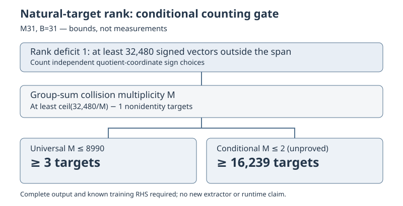

# Natural-target useful-rank gate under bounded witness collisions

2026-11-24 UTC; PR #5131; parent 6b611c44462aafbba30a4af66a0ae35c6ed71785. Written mathematical/validation preparation only. [pcc:unverified]

## Scope and contrast

The inherited cofactor-one M31 fixture is y²=x³+847514846x+2087444724 over p=2147483647, subgroup order r=2147446831, generator (625037715,2100627251), B=31 distinct nonidentity abscissae. These parameters are inherited, not recertified. Work over F_r for relation rank, not F_p. No new arithmetic on the curve or random draws. Iteration8 proves necessary first-moment query counts; iteration12/PLANTED_RANK_OCCUPANCY.md (merged separate PR #5048 lane) gives necessary coverage for planted rows. This gate instead derives a sufficient conditional natural-target rank budget for complete reporting, not an extractor or a claim about actual measured multiplicity.

## Rank-deficit counting lemma

Let G be the odd prime-order group, with distinct signed base ±P_i, and B>=4. Let V be the set of coefficient vectors c in F_r^B having exactly four distinct nonzero indices, each coefficient +1 or -1. Thus |V|=16 binom(B,4). Let phi(c)=sum_i c_i P_i. This map is well-defined over F_r. Let W be any current coefficient-row span with codimension k. Select k standard basis vectors whose images in F_r^B/W form a basis. For a four-index support I, let l be the number of those selected indices in I. Fix the signs on the other 4-l indices. At most one assignment of the selected l signs can make the quotient image zero: two such assignments would give a nontrivial relation among the quotient basis vectors, since 2 is nonzero in F_r. Therefore at most 2^(4-l) of the sixteen sign patterns belong to W, and at least

    L_B(k) = sum_(l=1)^4 (16-2^(4-l)) binom(k,l) binom(B-k,4-l)

vectors in V lie outside W. Binomial coefficients outside their domain are zero. This is a worst-case bound for every W, including adaptive spans arising from prior queries, with no random factor-base or independent-row hypothesis. It is not a bound on the rank of an arbitrary selected witness stream.

## From witness count to actual target count

Let m(T)=|{c in V : phi(c)=T}| and M=max_T m(T), including identity. An exact all-output oracle on a uniform independent nonidentity target will extend W whenever at least one returned row lies outside W, provided training RHS values are legitimately known (public generator multiples generated for training, not the unknown challenge scalar). The number of such nonidentity targets is at least

    J_B(k,M) = max(0, ceil(L_B(k)/M)-1).

Reason: at most M outside vectors share one target and at most one of the occupied targets is O. All-output includes V, and duplicates cannot invalidate the existence of an outside vector. For B31 this bound is positive even for the universal multiplicity ceiling below. Conditioning on the full past leaves the next independent uniform target uniform; the conditional probability of a rank increase is at least J/(r-1). At each deficit the expected wait to leave that deficit is at most (r-1)/J, by summing a geometric tail bound. Some queries may skip deficits. Thus a sufficient expected query budget for rank B is

    E[T_rank] <= sum_(k=1)^B (r-1)/J_B(k,M)

when all J are positive. This is not a deterministic stopping guarantee. Markov gives a failure-probability bound E[T_rank]/budget; tighter tails and complete phase costs are separate. No assumption about independence of successive rows is needed, but independent uniform training targets and complete signed output are required.

An unconditional multiplicity ceiling is M <= floor((2B)(2B-2)(2B-4)/24). Indeed choose the first three ordered signed leaves with distinct indices; for a fixed target the final group point is unique and must be an allowed fourth distinct index. Every row in V has exactly 24 orderings. At B31 the ceiling is 8990. This ceiling is loose; it is NOT the observed maximum. A separate pair-histogram ceiling is M <= floor(4 binom(B,2) mu/6), where mu is the maximum multiplicity of a signed unordered pair of distinct indices under group addition. Each row has six choices of its first unordered pair; dropping the disjointness condition only increases the count. An actual pair histogram can be computed with charged O(B²) group operations/labels; it may not yield a tight bound.

## Numerical screen (deterministic integer combinatorics)

| Deficit k | L_B(k) | J at worst-case M=8990 | J if M<=2 (conditional) |
|---:|---:|---:|---:|
|1|32480|3|16239|
|2|63336|7|31667|
|4|120399|13|60199|
|8|217434|24|108716|
|16|354340|39|177169|
|31|471975|52|235987|

There are 503440 distinct-index signed vectors. The conservative rank-deficit-one bound is 32480 outside vectors, irrespective of the actual span. The M<=2 column is illustrative only: no such bound has been established for this base. Do not interpret these numbers as observed hit rates or measured ranks.

For a growing family, L_B(k) >= 8[binom(B,4)-binom(B-k,4)] >= 8(k/B)binom(B,4). The second inequality follows by sampling a uniformly ordered four-subset and considering whether its first index belongs to the selected k indices. Consequently if M=o(B³), the subtraction of one is absorbed uniformly for large B, and E[T_rank]=O(M r log B / B³). Bounded M is sufficient to justify the conventional natural-target rank exponent up to a logarithm, but neither bounded M nor an efficient all-output query is established. Output processing, RHS, linear algebra, setup, misses, cold recovery, and source-family availability remain fully charged; there is no end-to-end speed claim.

## Single-output challenge

The preceding sufficiency does not transfer to an arbitrary first-witness oracle. For a separate check let C contain every distinct cancellation-reduced coefficient vector of norm 0, 2, or 4, and let n(T) count these vectors (not ordered tuples). Define E_excess=sum_T n(T)(n(T)-1). Each vector in a non-singleton fibre contributes at least one to E_excess, so at least max(0,L_B(k)-E_excess-1) distinct nonidentity targets have a unique complete coefficient vector outside W. This is a sufficient one-witness gate only if the extractor is complete for C, normalizes all signs/cancellations and returns a valid vector. It is vacuous when collisions are large. Do not substitute the ordered-tuple energy, pair energy, or coordinate-field additive energy for E_excess. A full census may cost O(B^4); do not hide it in setup or use it to tune on eventual test instances.

## Validation and next decision

Prepare an independent verifier for coefficient normalization, rank over r, group-sum replay and actual target histogram on the established M31 public training domain. Keep all nonidentity misses, rank-before/after and collisions, record whether output is full or first-only, and keep challenge scalar witnesses separate. A frozen paired comparison must use the exact same ordered upstream target stream, with seed manifests and replay as required. Neither native execution nor a multiplicity census is authorized by this written step. The stronger open selector target remains exact sublinear empty-inclusive query with comparable setup and complete output; original-root build not requalified. No random runs, native tests, paid jobs, new PCC signatures or merge. Native workers/KB/Conductor unavailable; coordinator parallelized independent repository reads and challenged the argument. No independent proof claim.

Related sources: iteration8/EXACT_CONTRACTION_AND_YIELD.md (blob 20f9428434bf228c75de404bdb8c4fde4f7b3675); iteration12/PLANTED_RANK_OCCUPANCY.md on main ea922ca25fa85005c6f45ec5b53a7d91e1b293e2 (blob 8abdce746d66819d742d0f2a1ed6c6bcc90a872d); iteration10/parallel_review/REVIEW.md (blob 0e295d7d5e6ef1d84f59c1889ae81d6cbcaa7fb9). Related random sparse matrix literature: Coja-Oghlan et al., *The rank of sparse random matrices*, DOI 10.1002/rsa.21085; its random matrix model is not invoked as a theorem about natural elliptic targets. Bounded default-branch three-repo search for collision energy/useful rank and iteration8 rank identified these adjacent scopes; not an exhaustive novelty claim.

Impact score: 4/10 — a conditional sufficient natural-target rank budget, separate from planted coverage and necessary yield bounds; no measured multiplicities, independent proof or faster extractor. [pcc:unverified]
