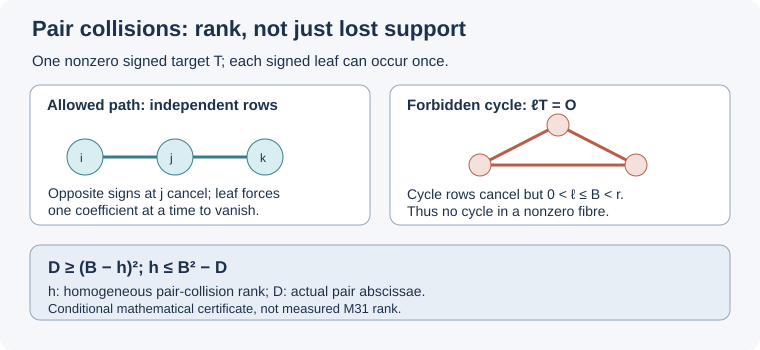

# Signed pair-fibre rank and compression tradeoff

2026-11-24 UTC; continuation of draft #5131, parent 8f4bd9e781df693b354b8346801e759065ff7450. Written producer mathematics, not independently validated. [pcc:unverified]

## Question and source

The previous natural-target rank gate treats concentrated four-summand multiplicity as a possible loss of useful yield. Here isolate a complementary question: what does collision concentration in the *already constructed signed pair spectrum* imply about homogeneous relation rank? This does not solve the empty-query problem. Use the inherited M31 fixture, p=2147483647, a=847514846, b=2087444724, r=2147446831, cofactor one, generator (625037715,2100627251), B=31. These are inherited parameters, not recertified. No curve arithmetic or new target generation took place. All ranks below are over F_r, never F_p. [pcc:unverified]

## Setup

Let G have odd prime order r>B, let P_1,...,P_B be nonzero with distinct signed pairs, and let e_i be standard coordinate vectors in F_r^B. Define phi(c)=sum c_i P_i. The signed nonidentity pair labels are ±2e_i and ±e_i±e_j for i<j. They number 2B²; no such label maps to O. The fibre F_T consists of labels mapping to T≠O. Write mu(T)=|F_T| and let D be the number of nonidentity pair abscissae; in the elliptic model D=|{phi(c)}|/2. Pair signs must be oriented to the SAME group point, not merely to the same x-coordinate.

Let W_2 be the span of c-c' for labels sharing a signed group sum, and h=dim W_2. Because phi(W_2)=O and phi is nonzero, 0≤h≤B-1. Negating a fibre negates its differences; one canonical sign per abscissa is sufficient.

## Lemma 1: exact rank within each nonzero pair fibre

For any T≠O, the vectors of F_T are linearly independent. Consequently the within-fibre differences to any chosen representative have rank mu(T)-1. [pcc:unverified]

Proof: interpret a label as an unordered pair of signed leaves, allowing a doubled leaf. No two different labels in one fibre share a signed leaf: the complement to that leaf is uniquely T minus that leaf. Construct a multigraph on the *unsigned* indices. A two-index label is an edge and a doubled label is a loop with coefficient ±2. Count each loop as consuming only its one signed leaf; at any vertex there are at most two incident labels, and if there are two, their consumed signs are opposite.

The nonloop graph has maximum degree two. A nonloop cycle (including a potential two-edge parallel cycle) would give a sum of its coefficient rows equal to zero, because the opposite signs cancel at every vertex. Applying phi gives length times T=O. The length is at most B<r, impossible. Thus its components are paths or isolated vertices. Loops can occur only at endpoints or isolated vertices. A path with loops at both ends is also impossible: the sum of the nonloop rows plus one half of each endpoint-loop row is zero. Applying phi gives (number of nonloop edges +1)T=O, again a positive integer at most B. Two opposite loops at the same isolated index would require T=-T, impossible. Each component is therefore a path with zero or one loop, or an isolated vertex with at most one loop.

For a path without a loop, a degree-one vertex forces the coefficient of its only edge in any dependence to vanish; inductively remove edges. For a path with one loop, start at its unlooped end, then the final loop coefficient must vanish because 2 is invertible. An isolated loop is independent for the same reason. Different components have disjoint coordinate support. Hence all labels are independent. Subtracting one representative from each of the others preserves independence of the mu(T)-1 differences. This uses no statistical assumptions about the factor base. QED.

In particular mu(T)≤B for the full pair chart, and ≤B-1 if only distinct-index labels are included. A fibre of size mu forces at least mu-1 independent homogeneous rows, not necessarily mu-1 *additional* rows after earlier fibres. These rows have zero RHS and cannot on their own determine the absolute generator normalization. [pcc:unverified]

## Lemma 2: support-size versus total homogeneous rank

Put k=B-h. Project e_i to F_r^B/W_2 and choose k of these images forming a basis. Their signed pair labels (doubles and two distinct indices) give 2k² distinct quotient vectors. Two original pair labels have equal quotient images if and only if they map to the same signed group point: the forward direction uses W_2⊆ker phi and the reverse follows from the definition of W_2. Hence the full signed pair support has size at least 2k², i.e. D≥k². In the opposite direction each of D sign-oriented fibres needs only mu-1 differences to its representative, so W_2 has a generating list of exactly B²-D rows. Combining both arguments gives

    max(B-floor(sqrt(D)), max_T(mu(T)-1)) ≤ h ≤ min(B-1, B²-D).

The lower support bound also follows without retaining individual differences if D is known exactly. It is a rank certificate, not an equality in general or a cost-free way to construct a relation basis. [pcc:unverified]

## M31 conditional arithmetic

At B=31 there are exactly 961 unoriented pair labels; actual D and h have NOT been measured in this step.

|Hypothetical D|Lower h from D alone|Upper h from D alone|
|---:|---:|---:|
|961|0|0|
|960|1|1|
|950|1|11|
|900|1|30|
|400|11|30|
|100|21|30|

These are deterministic conditional values, not observed pair counts or rank measurements. At D=960, the two bounds force h=1. If a nonzero pair fibre has six labels, it alone certifies h≥5. There is no assertion that either event occurs on the inherited base. [pcc:unverified]

## Cost, challenge, and validation boundary

Pair-spectrum construction and sorting of full signed point encodings use O(B²) group operations, O(B² log B) comparisons and O(B²) labels; the rank lower bound given the exact D needs no matrix elimination. Actual field operations, inversions and group equality checks must still be charged. For explicit rank of the complete difference set, an elementary incremental dense echelon computation takes O((B²-D)B²) scalar operations and O(B²) scalar storage in addition to the pair labels; initial sparsity does not establish a better elimination complexity. A preexisting deduplicated spectrum without provenance cannot certify mu or reconstruct the rows. No faster query, full independent rank, known-RHS training bound improvement or cold solve follows from this note.

Challenge cases: reject identity-pair labels, duplicate signed leaves, cofactor/subgroup mismatch, comparisons on x alone without sign correction, and the invalid addition of per-fibre ranks across fibres. For r≤B or composite r the cycle argument requires an appropriate order bound on T; the present theorem assumes r>B prime. Doubling consumes a signed leaf once in the graph but carries coefficient 2 in the row. Verification preparation: compare exact point replay and rank over r against the two inequalities for the frozen original M31 labels when the original-root correctness gate is cleared. No smaller-field substitute, random seeds, experiments, measurements, new Rust, paid work, or claimed native/independent validation. No formal Lean proof or signed PCC verdict. Coordinator performed written derivation and challenge; native agent dispatch, workspace, Conductor, Lean and Rust not available. Seed manifest not applicable.

Adjacent prior work: the previous natural-rank gate (blob 2d7246876834c203ba01149ebe22403bbdc850f6); the actual leaf norm/chart definition (blob 953b48e251bdbd6fce9b7748cd4b05c5d60afb7c); existing pair-collision rank audits in the sibling repos, notably cryptanalysis/experiments/hecke-sparse-target-20261030/PAIR_REUSE_RESULT.md, and crypto/research/p192_extension_cover_20261012/line_pair_collision_rank.py. The classical forest incidence independence argument is background, e.g. https://fabiofurini.github.io/network-optimization/graphs/graphs/the-rank-of-the-incidence-matrix/ ; no novelty claim for graph incidence or pair-collision extraction. The signed-fibre restrictions and support-versus-rank inequalities are the specific written gate here. Bounded three-repository default-branch search is not exhaustive. [pcc:unverified]

Impact score: 3/10 — a written rank certificate clarifies when pair-spectrum collisions may supply homogeneous rank rather than simply reduce multiplicity yield; actual D, mu, h and all cost gains remain unmeasured. [pcc:unverified]
