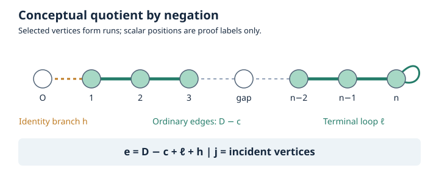

# Prime31: collision-independent pair-spectrum path invariants

2026-11-24 Pacific. Parent 6e8623c4a355e3a82ba4a75cb4a54f29d76f47ce, draft PR #5131. Written producer mathematics, not independently signed. [pcc:unverified]

## Scope

Keep the inherited curve y²=x³+847514846x+2087444724 over p=2147483647, subgroup r=2147446831, G=(625037715,2100627251), cofactor one. No new curve computation. The following proof holds for any cyclic group of odd prime order r and sign-closed nonidentity pair-support set U of size 2D. The source H, Q=H diag off and J_T are precisely iteration9/10 definitions, and T is a nonidentity target. No collision-free leaf-net hypothesis is needed except for the later conditional numerical checks. The D labels are point-negation orbits, not witness buckets with multiplicity.

## Exact induced-path representation

Let n=(r-1)/2. Since T generates the prime-order group, each nonidentity negation orbit is uniquely [kT], 1<=k<=n. This indexing is only a proof device: computing k from coordinates would require a discrete logarithm and is not assumed in the algorithm. In the graph of S3 zero entries for x(T), distinct orbit vertices k,l are adjacent iff |k-l|=1. Indeed the signed sums equal T iff ±k±l=1 mod r. In this range, the difference case gives consecutive integers; the sum case cannot occur for distinct k,l because 2<=k+l<=r-2. The equal-vertex case gives precisely the loop at n, since -2n=1 mod r. The omitted identity vertex 0 is adjacent to 1 and is handled by H, not by S3.

Select the vertices X=x(U) in this conceptual path. Put h=1 if T in U, zero otherwise; ell=1 if T/2 in U, zero otherwise. Then h is occupancy of vertex 1, ell occupancy of vertex n. Let c_X count the connected runs of selected vertices (include isolated vertices; ignore the terminal loop for connectivity). The unordered nonzero signed pair splits of T are the path edges plus ell. Every off-diagonal edge contributes exactly one such split and the terminal loop contributes the equal-point split. Each off-diagonal S3 polynomial has distinct roots under the odd-order guards; the diagonal is linear. Thus the multiplicity e_T of x(T) in Q is exactly

    e_T = D - c_X + ell + h.

The zero polynomial root case e_T=0 is included. For 0<D<n this proves e_T<=D: if both endpoints are occupied, a missing interior vertex forces at least two runs; if at most one endpoint is occupied there is at least one run. For D=n the formula instead gives e_T=D+1. D=0 gives e_T=0. This is a multiplicity cap for arbitrary actual pair-support collisions, not a runtime bound. In particular the derivative multiplicity layer construction never needs characteristic greater than D²+D merely to avoid factorial wraparound: p>D suffices for proper U; the actual M31 p>D is automatic here.

## Local relation among gcd degree, ordered count and two-sided matches

Write j_T=deg J_T. This counts vertices incident to an edge or the terminal loop, not all X. Let c_J count connected components of this incident-vertex graph with loops ignored for connectivity (an isolated terminal-loop vertex is a component). Then

    e_T = j_T - c_J + ell + h.
    k_T = |{P in U : T-P in U}| = 2(e_T-h)-ell.
    s_T = #{[P] in X : T-P and T+P both in U} = k_T-j_T.

The second identity counts two orders for every distinct-point split and one for the equal-point split. The third follows because each negation orbit contributes zero, one or two qualifying signed P; the gcd counts its contribution capped at one. It also shows that j_T<=k_T<=2j_T. Check these locally against original arithmetic on each admitted target, separately from witness-label and rank correctness. The graph can be checked without any scalar coordinates: enumerate existing J roots, use actual rational lifts, and test x(T±P) against the root set, handling O and the terminal loop. Computing J remains charged, and this local check alone cannot certify absence of omitted roots.

## Global exact checks (including collisions)

Let sums with subscript [T] range over all nonidentity negation orbits of targets; s,k,j,e are invariant under target negation. Since U is sign-closed, k_O=2D. Counting all ordered pairs in U² gives

    sum_[T] k_T = 2D²-D.
    sum_[T] e_T = D²+D.
    sum_[T] j_T = 2D²-D - C,
    C = (sum_(P in U) |U intersect (U+2P)| - 2D)/4.

For C, count all signed P and T for which P,T-P,T+P lie in U. For a fixed P, set Q=T-P; the count is |U intersect (U+2P)|. The identity target contributes 2D; each remaining orbit pair ([P],[T]) is counted four times by independent sign choices. Hence C is a nonnegative integer and precisely the sum of two-sided-orbit counts s_T. This proof also works in any odd-order group for the three sum identities, even though the single path and multiplicity cap require prime order. The additive energy of U is E(U)=sum_T k_T², including O. It is an independent checksum of the ordered point-pair representation function, not a witness-label multiplicity or relation-rank measure. Additive energy and convolution counting are standard; no novelty claim for them or the cyclic group path.

## Conditional B31 regression values

Under the previously archived N4 injectivity assumption, D=961 and the ordered pair counts for the seven classes in collision_free_multiplicity/GATE.md are respectively 60,120,1,2,3,4,6. These are mathematical deductions only, checked by deterministic integer arithmetic (no point operations). They give:
- sum k = 1846081 over nonidentity target x-orbits; sum e = 924482; sum j = 1845151.
- C=930; sum_(P in U)|U intersect (U+2P)|=5642.
- E(U)=50582886, including k_O²=1922².
- On this particular base the exact previous strict classifier remains conditional; on arbitrary colliding bases, neither degree six nor multiplicity three is a universal four-distinct-index test.

## Falsification and cost boundary

A missed target must have h=0 and j=0; loop occupancy must be zero too. On positives, verify h, ell, all signed splits, degree and connected-component identities, then authentic leaf labels, distinct indices, duplicate handling and rank over F_r independently. A global checksum alone is necessary, not sufficient; different erroneous histograms could agree. A complete sparse ordered-sum census of U requires O(D²) point additions and up to O(D²) storage and remains a separately charged validation control. A local recovered-root check costs O(j_T) actual group operations and expected dictionary probes after root discovery, not a sublinear empty-query selector. No scalar-residue oracle, FFT character labels, new curve construction or smaller field was used.

The native gate is still separate: #5128 remains open at 9f3aec6264e7a91f81ff8ea81be8bc83ec458f53; dedicated four-summand original-source qualification is not established by earlier external component tests. No duplicate native run or paid compute. Source and seed freeze required before any experiment; this run contains only a written proof and integer combinatorial arithmetic. No seed manifest is applicable; historical frozen evidence not altered.

Prior sources: iteration9/PAIR_SPECTRUM_RESULTANT.md (e2348e91dc08141a663c5adb9798b6ca8f09424e), iteration10/DOUBLE_RESULTANT_AND_SUPPORT.md (db62fd8a58435c9b103d767dc6a86d9da58e5ef7), previous multiplicity gate (b6d60c27190ec90c10d989b4fb559ef36d548880). Bounded PR searches for pair-spectrum moments/path and web background on sumset representation counts; no exhaustive priority claim. Current main ACTIVE and journal read; divergent branch/main histories retained. No native worker dispatch, KB or Conductor access exposed; coordinator performed parallel independent repository reads and a same-coordinator proof challenge. Native Space read required interactive input; no uncertain mutation replayed.

Impact score: 3/10 — collision-independent exact multiplicity/degree identities and a conditional numerical checksum strengthen future M31 qualification; no new native validation, global extraction or asymptotic speedup. [pcc:unverified]
