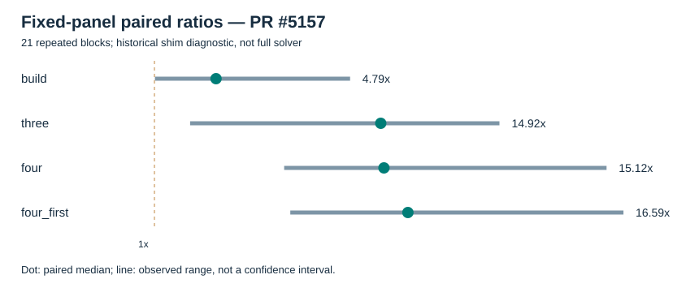

# Paired reanalysis of the 1D-1 projection diagnostic (#5157)

2026-11-25 UTC. Read-only analysis of a different lane's frozen records; [pcc:unverified]. No new cryptographic execution, timing, independent worker validation or source changes. Parent #5131 5e325b06e4b5b52ec4e8fbd6174d396656c2a93d; inspected #5157 27c737ed4e5d4be04813d2454dbbe2d08e1ed003.

## Material result and source identity

The new raw report has 21 repeated timing blocks on one fixed 100-target panel. Recompute old/new within block rather than dividing two marginal medians. The source alternates arm order by repeat parity and appends each arm's timing in that repeat's index. No trials removed. All 21 paired ratios favor the new arm in each diagnostic. This is not 21 independent public instances.

| Component | Median paired ratio | Observed range | Faster pairs | Even / odd median | A/A ratio range |
|---|---:|---:|---:|---:|---:|
| build | 4.79 | 1.03–13.04 | 21/21 | 3.57 / 6.53 | 0.38–1.76 |
| three | 14.92 | 3.19–22.22 | 21/21 | 14.89 / 17.55 | 0.61–1.71 |
| four | 15.12 | 8.98–28.81 | 21/21 | 15.12 / 15.22 | 0.77–1.34 |
| four_first | 16.59 | 9.36–29.85 | 21/21 | 16.84 / 16.40 | 0.77–1.34 |

The synthetic sum of the measured build and 100-query four-sum stages has paired median 14.89x (range 8.95–28.46x). This is a sum of separate timings, not a measured cold interval; it excludes factor-base generation, rank, linear algebra, target recovery and independent verification. Raw per-pair ratios, including A/A, are retained in RECEIPT.json. Timing repeat correlation and host contention prevent treating these ranges as population confidence intervals. The even/odd build medians show order sensitivity. No stochastic resampling was performed.

Sources (same frozen head): [raw JSON](https://github.com/isogeny-labs/crypto/blob/27c737ed4e5d4be04813d2454dbbe2d08e1ed003/research/semaev_1d1_wallclock_20261124/raw_wallclock.json) blob 4b123d984864dbee8670b6e7ee26c5e0e4519961; [harness](https://github.com/isogeny-labs/crypto/blob/27c737ed4e5d4be04813d2454dbbe2d08e1ed003/research/semaev_1d1_wallclock_20261124/shim/src/main.rs) blob 4e0203e0fdc1ef6c951f7ba2ea7bd73d377ca67e; [report](https://github.com/isogeny-labs/crypto/blob/27c737ed4e5d4be04813d2454dbbe2d08e1ed003/research/semaev_1d1_wallclock_20261124/REPORT.md) blob c46fbd3f68a3a1e395f3f2b09677a0c22d52b1dd; [projection source](https://github.com/isogeny-labs/crypto/blob/27c737ed4e5d4be04813d2454dbbe2d08e1ed003/src/cryptanalysis/semaev_projection.rs#L1937-L2079) blob 4fcc59b68f116d281131c4842356f09d76b1b199.

## Why this does not close the present problem

- Same coordinate field but a different curve: the historical diagnostic uses y^2=x^3+2x+3, interval base B64 and 100 deterministic interval-derived x targets (18 three-sum hits, one four-sum hit). Our inherited M31 fixture has a=847514846,b=2087444724,r=2147446831, cofactor one, G=(625037715,2100627251), and Dickson B31. No same-curve/subgroup comparison is established. No new curve was run in this audit.
- The generic four-sum path scans the finite_witnesses map; fast scans fast_finite_list, constructs a full points vector and calls roots_batch before inspecting results. Both require at least linear-in-D materialized work on misses; even the first-witness option constructs that full batch unless the initial cancellation check returns. D is actual pair support, not necessarily the 2080 unordered leaf-pair count. The reduction is in per-component work, not the requested sublinear query exponent.
- Harness checks found/none and aggregate compatible_keys equality, not complete signed witness sets, useful independent rank or scalar recovery. Full-count mode still returns Option<FourSumWitness>, not all witnesses. The first-witness arm has a different output contract.
- Timing was from a contended four-core VM with load about 14, after two full-library OOMs. Shim imports and the stated unused stub are not an original-root run. The raw operation counters are hardcoded zero placeholders and cannot be used as measured work.

## Reproducibility and next gate

The panel constructor and alternating schedule are deterministic; no random panel seed is implied or retroactively invented. Same source uses the same in-memory inputs for both arms. Raw results lack serialized workload/input hashes, signed output hashes, subgroup parameters, independent replicate instances, held-out seeds, independent exact replay, complete resource/measurement accounting and the original-root build. Qualification remains a fixed-workload diagnostic, unqualified for the experiment-seeds/v1 general performance or complete-solver claim. Preserve the two reported OOM attempts and the A/A samples. Do not re-run #5157 or #5128's reserved work. Original M31 curve, authenticated admission and an exact signed complete-output comparison against the strongest maintained control remain required.

The new finding is useful because even a 15x favorable component ratio leaves the mathematical miss-scan exponent unchanged. Prioritize admission of a genuinely different selector, rather than treating a batch-inversion constant-factor improvement as the requested asymptotic result. #4977/#4979 merged; #5131 open draft; #5157 and #5128 open with their own scopes. #5087 uses another M31 curve and a small fixed parameter section; no direct comparison. Native workers, Conductor and KB not available in this execution interface; coordinator parallelized independent reads. No Space write, merge, new benchmark or paid work.

Impact score: 3/10 — independent-of-producer arithmetic reanalysis of retained timing records and source-level miss-cost/output-contract audit; no native replay or new extractor.
