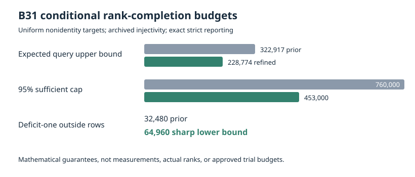

# Prime31: active-column refinement of the rank-deficit bound

2026-11-24 Pacific; PR #5131; parent 83f781114f09fd2d1b31c34e17a91a93a7766c03. Written producer mathematics, [pcc:unverified]. No field-dependent experiment, timing, or new curve.

## Scope

Inherited cofactor-one M31 curve y²=x³+847514846x+2087444724, p=2147483647, r=2147446831, G=(625037715,2100627251), B=31. Relation ranks use F_r, not F_p. The theorem below is valid over any odd-characteristic coefficient field. Conditional numerical training guarantees additionally assume the source-matched historical N4 injectivity, exact complete strict extraction and independent uniform nonidentity public training targets with legitimately known RHS. It is not a statement about recovering an unknown challenge by using its scalar as input.

## Improved finite counting bound

Let V be the 16*C(B,4) signed four-distinct-index coefficient vectors and W any coefficient span of codimension k. Let A:F_r^B→F_r^k be a quotient map with kernel W. Select k independent pivot columns. Let s be the number of nonzero columns of A, so k≤s≤B. Partition the indices into k pivots, s-k active nonpivots, and B-s zero columns. For a four-index support containing l pivots and t active nonpivots, let w(l,t) denote a lower bound on the number of its sixteen sign patterns outside W:

- l+t=0: w=0.
- t=0 and l>0, or l+t=1: w=16. In the first case the selected nonzero columns are independent; in the second case the sum is a single signed nonzero column. No sign assignment vanishes.
- l=0 and t≥2: w=8. Pair sign patterns by flipping a single active coefficient. The two sums differ by a nonzero twice-column, so at most one vanishes.
- l≥1 and t≥1: w=16-2^(4-l). For each fixed assignment of the nonpivot signs at most one pivot sign assignment can produce zero, by independence in odd characteristic.

Consequently define

    F_B(k,s) = sum_(l=0)^4 sum_(t=0)^(4-l)
        w(l,t) C(k,l) C(s-k,t) C(B-s,4-l-t),
    K_B(k) = min_(k≤s≤B) F_B(k,s).

Then |V minus W|≥K_B(k) for every W, including adaptive spans. Invalid binomials are zero. The previous L_B(k) retained only the generic pivot-sign bound and ignored supports having no pivot. This refinement never weakens that bound: every support's count is at least its old pivot-based contribution. It requires no computation of actual quotient columns for its worst-case statement.

For a coordinate subspace with k zeroed coordinates, s=k and exactly 16[C(B,4)-C(B-k,4)] rows are outside W. At B31 the finite minimization gives equality with this attainable value for k=1..5; hence those five universal extremal counts are sharp. For k=6..30 the computed lower bounds need not be sharp. At k=B all 503440 rows are outside. This is not a general all-k extremal characterization.

| Deficit k | Prior L_B(k) | Refined K_B(k) |
|---:|---:|---:|
|1|32480|64960|
|2|63336|123424|
|3|92624|175840|
|4|120399|222640|
|5|146715|264240|
|8|217434|288344|
|16|354340|367080|
|31|471975|503440|

The exact k=1 count doubles the previous universal deficit-one lower bound on this fixture. In the collision-free conditional model, no strict row maps to O and no two distinct strict rows share a target. The same K_B(k) is therefore a lower bound on rank-extending nonidentity targets, even for a correct first-witness extractor on this fixture. This follows from the archived injectivity assumption, not a new census. With arbitrary collisions and all-output extraction one may instead use max(0,ceil(K_B(k)/M)-1) with a valid multiplicity ceiling M; arbitrary single-witness selection is not covered in that case.

## Failure-inclusive training budget

Set q_k=K_B(k)/(r-1) for the collision-free conditional model. Given any past and current deficit k, the next independent uniform target increases rank with probability at least q_k. The waiting time to leave the deficit is conditionally stochastically bounded by a geometric random variable on {1,2,...} with parameter q_k. This holds even though successive rank spans are adaptive. Each rank stage is visited at most once; skipped stages cost zero. Backward conditioning bounds the moment generating function of the total query count N by the product of the geometric generating functions. For z>1 with (1-q_k)z<1 for all k,

    E[N] <= sum_k 1/q_k,
    Pr(N>n) <= z^(-n) product_k [q_k z/(1-(1-q_k)z)].

Using z=1+min(q_k)/2, the accompanying deterministic certificate verifies conservative tail cutoffs with exact rational arithmetic, using log bounds rather than assuming floating rounding is exact.

| Sufficient conditional bound | Previous L | Refined K |
|---|---:|---:|
|Expected blind training queries|322916.34|228773.93|
|Expected positive training draws|75.704|53.633|
|Expected queries to leave deficit one|66115.98|33057.99|
|At least 95% rank-completion query cap|760000|453000|
|At least 99% rank-completion query cap|973000|560000|

Expected positive draws follow from the fixed strict hit probability 503440/(r-1) times the expected stopped query count, by conditioning on whether each trial is attempted. These are upper bounds, not predictions, measured means, actual rank curves or approved budgets. The earlier column is recomputed under the same archived injectivity and nonidentity conditioning, without the identity subtraction. The finite-p tail caps use the same analytic rule in both columns. A smaller sufficient budget is not a measured speedup. The growing-family exponent and query extraction cost have not changed. No assumption of independently generated relation rows is used beyond independent uniform targets; known training RHS, exact valid output, and the historical injectivity hypothesis are essential.

## Adversarial review and validation preparation

- A coordinate hyperplane attains the deficit-one lower bound, so no uniformly stronger count can be obtained without using actual span structure. For k=1..5, the certificate verifies both the lower bound and the coordinate-subspace upper example.
- In odd characteristic flipping a sign cannot preserve a zero sum when its column is nonzero; the proof would not apply in characteristic two. Independent pivot columns cannot sum to zero with coefficients ±1.
- The probability model includes every failed query, not only planted positives. A uniform independent training-target draw with replacement is distinct from replayed seeds, chosen points, or a correlated walk. No new random draws were made.
- An evaluator may prepare strict positive cases conditional on the archived injectivity, but their timing alone cannot validate the blind distribution, and answer witnesses must stay out of solver inputs.
- This budget estimates rank completion only. Factor-base construction, relation generation, source-specific exact miss cost, useful-rank computation, target recovery and memory are separately charged. It does not establish a sublinear selector or authorize spending.

Source alignment: natural_rank_followup/GATE.md blob 2d7246876834c203ba01149ebe22403bbdc850f6; historical_collision_reconciliation/GATE.md blob 5bbbbb76276b11d806194147a698c4719dd5f7c0; pair_path_invariants/GATE.md blob 85afd829c4f96bbbb35abef9be65e0e63c15c81d. Related literature: Coja-Oghlan et al., The rank of sparse random matrices, DOI 10.1002/rsa.21085 (abstract and introduction consulted); The full rank condition for sparse random matrices, arXiv:2112.14090 (abstract consulted). These random sparse-matrix models do not directly prove the adaptive conditional bound above; no novelty assertion. Bounded GitHub issue search for rank deficit/sign, plus adjacent lane notes, found no matching active scope; KB/Conductor unavailable here, not a complete duplication audit. Live #5128 owns current-root qualification and remains open; no duplicate native work. No native dispatch or local Rust/Lean workspace available. Coordinator performed parallel read-only operations, derivation, challenge, and deterministic exact combinatorics; no independent worker or signed validation. Historical evidence unchanged. Seed manifest not applicable: no experiment or PRNG. No paid jobs or merge.

Impact score: 3/10 — sharper conditional finite-sample rank sufficiency and exact extremal counts for five deficits on B31; not an extractor or independently validated speedup. [pcc:unverified]
