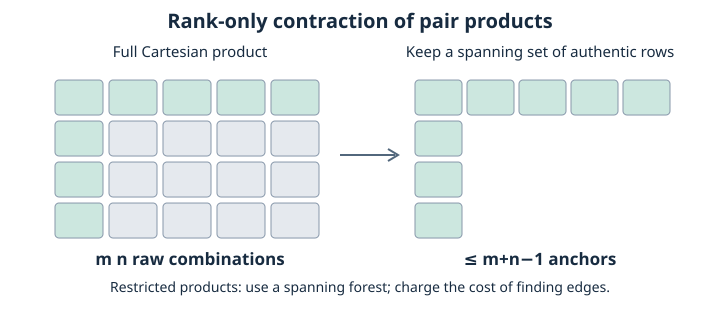

# Rank-only contraction of matched signed pair fibres
2026-11-24 UTC; PR #5131, parent 5c0606bbbc5aa6acc3eb542109c9f4861b27cf97. Written producer mathematics, [pcc:unverified]; no native or random execution.

## Source and scope
Inherited ordinary cofactor-one M31: p=2147483647, a=847514846, b=2087444724, subgroup r=2147446831, G=(625037715,2100627251), B=31; not recertified. Coefficient ranks are over F_r. Read iteration8/EXACT_CONTRACTION_AND_YIELD.md, iteration9/PAIR_SPECTRUM_RESULTANT.md (e2348e91dc08141a663c5adb9798b6ca8f09424e), iteration11/pair_collision_rank_followup/GATE.md (34371cec6a3ea415183507827827a3382461aca8), natural_rank_followup/GATE.md (2d7246876834c203ba01149ebe22403bbdc850f6), and RR5 audit receipt (e0869fd4771edf7aaba097f152711233090a1b64). These distinguish exhaustive tuple reporting, rank, and chart restrictions. This gate changes only rank-output semantics, not discovery. Bounded default-branch searches ("affine hull pair relation rank", "Cartesian product pair collision rank", "rank compressed pair bucket") found no exact matching gate in returned excerpts; not an exhaustive novelty claim. Classical linear/graph algebra is prior art. Auxiliary-system background: Semaev 2015 https://arxiv.org/abs/1504.01175 and Kosters–Yeo 2015 https://arxiv.org/abs/1503.08001; no binary-field complexity assumption used. KB and Conductor unavailable.

## 1. Exact augmented-row span theorem
Let F_S be the set of distinct signed two-leaf coefficient vectors a mapping to actual group point S under phi(a)=sum a_i P_i, allowing repeated leaves. F_O={0}, preserving its B underlying opposite-leaf witnesses separately for the full tuple contract. Nonidentity buckets contain exactly 2B² normalized pair labels altogether. For a target T let z_T be the fixed appended coordinate vector for the chosen row convention (known RHS or target column); it is constant within a target. For a matched unordered split S+U=T, let m=|F_S|, n=|F_U| and choose anchors a0,b0 from the two buckets. The full augmented row set consists of (a+b,z_T). Retain only (a+b0,z_T) for all a and (a0+b,z_T) for all b, with duplicate anchor removed. Every retained row is an authentic four-leaf row and
    (a+b,z_T)=(a+b0,z_T)+(a0+b,z_T)-(a0+b0,z_T).
Hence the two row spans are identical, including relative to arbitrary prior accumulated rows. At most m+n-1 anchor rows suffice instead of mn combinations. When S=U, use one anchor a0 and rows (a+a0,z_T); the analogous identity using (2a0,z_T) proves sufficiency with m rows.

## 2. Global cap and exceptions
S -> T-S is an involution on the matched subset of the group-point buckets. Its orbits are the unordered splits, so each bucket participates once. Total anchor rows <= sum of matched bucket sizes <= 2B²+1, i.e. 1923 at B31, not an observed count. An optional basis has at most B+d rows in the augmented ambient dimension B+d. Rank increments are exactly preserved even if a target supplies many useful rows. For hypothetical distinct buckets of size 31 each, 961 raw combinations contract to <=61 anchors (not a count of distinct full rows or a timing ratio); no gain for singleton buckets. Identity and repeated leaves are retained via the full chart; T=O works for group-row output. Rational affine-tree reconstruction requires separate guards and cost. Exact point signs, not mere x equality, are essential. Full ordered tuple/multiset enumeration is not equivalent to this rank-only output.

## 3. Generalized restricted-chart gate
If distinct-index or other cross-pair compatibility excludes some products, arbitrary anchors need not be admissible. Instead form a bipartite graph on the two labelled buckets (use distinct left/right copies even when S=U), with one edge for each admissible pair (a,b). Each edge carries row (a+b,z_T). Any spanning forest retains the entire augmented row span: for any edge outside the forest, its endpoints are connected by an odd-length forest path. The alternating sum of path rows, starting and ending with +, cancels all internal vertices and preserves exactly one z_T, yielding the omitted edge row. All retained forest edges are authentic admissible witnesses. The number of edges retained is v-c, where v counts incident vertices and c their connected components; at most m+n-1 for a nonempty graph, including the self-bucket bipartite-copy case (where the unrestricted m-row shortcut may fail). This generalizes the star contraction without assuming the admissible graph complete. However finding edges/components can cost mn compatibility checks: a fast implicit forest finder is a separate obligation, not an established discovery improvement. No matrix numerical rank alone can establish span equality.

## 4. Charged costs and validation gate
Original chart storage O(B²) labels, group operations, source construction and exact complement/S3 query including misses are unchanged. With D distinct nonidentity x buckets there are 2D+1 group buckets. Conditional on already finding all matched splits, unrestricted anchor construction and sparse witness replay cost O(sum_matched |F_S|) rather than the sum of Cartesian products. Dense incremental echelon processing costs O((B+d)^2) scalar operations per anchor and O((B+d)^2) storage in addition to chart data; it is not free. Restricted graph construction may take O(mn) checks, plus forest processing. Misses still pay full scan/selector cost; this is output contraction only, not sublinear exact empty-query solving.

For a future source-frozen native validation, compare full versus rank-only outputs on the identical inherited M31 chart and ordered public targets, with the same initial augmented rank state; verify each anchor as four signed public points, test mutual row-space inclusion over r rather than merely equal rank, and separately require exact matched-split/emptiness agreement. Include identity, repeated leaves, same-bucket, sign collisions, and a restricted graph with multiple components/isolated vertices. Do not treat arbitrary stars as complete for the distinct-index RR5 chart. Preserve all-output reference, tuple multiplicities, failures/caps, seed manifests and A/A controls. No seed panel frozen because no new experiment executed.

## Coordination and standing
#4977/#4979 merged; #5131 open draft; #5128 owns root qualification; main journal tracks #4974 and #4950 native admission dependencies. No duplicate source/build/job. Native workers, KB and Conductor not exposed; coordinator parallelized reads and challenged proof. No signed PCC issuance, independent validation, actual rank measurement, paid compute, Space mutation or merge. Preserve divergent branch/main shared journals on integration. First atomic tree request containing full ACTIVE and journal text hit GitHub 422 timeout; retry via content-addressed blobs, retaining the same parent guard.

Impact score: 3/10 — exact output-span contraction and restricted-graph extension; no measured extraction speed or cheaper misses. [pcc:unverified]
