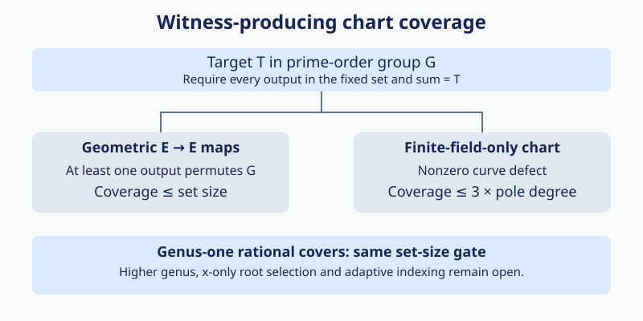

# Prime31 rational section and genus-one cover coverage gate

2026-11-24 UTC. Written producer derivation, [pcc:unverified]. Parent f9b0b066db5b64377e0061726ded67e4e1ccdda6, PR #5131. This is a restriction on witness-producing maps, not on zero predicates, rank, or all extraction algorithms.

## 1. Fixed geometric rational witness charts

Let E be the inherited ordinary curve over p=2147483647, r=2147446831 prime, cofactor one, coefficients a=847514846,b=2087444724, generator (625037715,2100627251). These are inherited parameters, not a newly chosen curve. Let G=E(F_p), and let A_i be nonempty fixed finite subsets of G. For a chart of geometric rational maps F_i:E -> E over F_p, call a target T successful if F_i(T) in A_i for every i and sum_i F_i(T)=T. No assumption of unique decompositions.

Claim: one chart succeeds at at most max_i |A_i| targets. More precisely, if any coordinate acts nonconstantly on G, the bound is min |A_i| over those coordinates; if none does, at most one.

Proof: a rational map from a smooth projective curve to a projective curve extends to a morphism. Subtract F_i(O), so the resulting morphism preserves the origin and is an endomorphism (the rigidity theorem). Thus on the cyclic prime group F_i(T)=[a_i]T+C_i for some a_i mod r, C_i in G. The slopes are used solely in the proof, never assumed computable. If at least two distinct successful targets exist, subtract their sum identities: sum_i a_i=1 mod r, and hence some a_i is nonzero. For each such i, F_i permutes G. Its inverse image of A_i has size |A_i|. Intersecting the success conditions cannot increase this size. This applies to inseparable and high-degree endomorphisms, including ones constant on rational points but nonconstant geometrically. It does not use a degree bound.

For S=(A+A) including O, A={±P_j}, B distinct abscissae and |A|=2B, write D=|x(S minus O)|, so |S|=2D+1. A chart returning P,Q in S with P+Q=T covers at most 2D+1 targets. A direct four-leaf chart with all A_i=A covers at most 2B targets. The pair version remains valid if only P is returned and Q=T-P is recovered by group arithmetic; this is a second morphism. At inherited B=31 the direct bound is 62 targets per chart, independent of degree.

If H is the actual number of reachable targets, including or excluding O consistently, then a fixed family of K such charts providing at least one witness for every reachable target requires K >= ceil(H/max_i |A_i|). Do not infer H=Theta(B^4) or Theta(D^2): no lower support census is supplied. If the specified output instead requires every ordered m-tuple from A^m, including O targets, at least (2B)^(m-1) charts are required since a chart outputs at most one tuple per target. For nonidentity targets only, at most (2B)^(m-1) tuples are lost, giving K >= (2B)^(m-1)-(2B)^(m-2). These are chart-family cardinality bounds, not runtime or distinct useful rows. Permutation/sign-quotiented output is not the ordered-output model.

## 2. Finite-field-only coordinate expressions: explicit pole escape

A solver may instead evaluate rational functions x_i,y_i on E that satisfy the curve equation only at its hits. Assume these functions have common effective pole bound L_i on E, of degree d_i: x_i,y_i in L(L_i). Exclude evaluation points where an expression is undefined; charge any separate exceptional branch independently. The defect e_i=y_i^2-x_i^3-a*x_i-b lies in L(3L_i). If it is nonzero, the zero divisor has degree at most 3d_i, so at most 3d_i distinct regular geometric targets can be successful. If e_i is identically zero, the affine pair defines a geometric rational map to E and section 1 applies after extension. Consequently a finite family of charts with all d_i<=d has per-chart coverage at most max(3d,max_i |A_i|). A chart that is genuinely finite-field-only must have large pole degree to cover more points than this. This is a pole-degree bound, not a bound on circuit size; repeated squaring and finite-field exponentiation can produce large degree succinctly. Identity outputs can be represented by separate constant O branches; arbitrary piecewise choices of identities or poles are not one affine chart.

## 3. Genus-one auxiliary covers do not escape by themselves

Let C/F_p be a smooth projective geometrically integral genus-one curve, with target map pi:C->E and witness maps f_i:C->E defined over F_p. A successful rational lift c in C(F_p) satisfies sum_i f_i(c)=pi(c) and f_i(c) in A_i. If at most one distinct target is reached, the claim is trivial. Otherwise choose any rational point as origin on C. Each map is then a translate of a homomorphism. The target homomorphism is nonzero on rational points, thus its image is all G. Therefore r divides #C(F_p). Hasse gives #C(F_p)<=p+1+2sqrt(p)<2r on the inherited M31 parameters; hence #C(F_p)=r. Every witness homomorphism nonzero on rational points is a bijection onto G. At least one is nonzero if two distinct targets succeed, because otherwise the sum is constant. Hence the number of successful rational lifts, and thus distinct covered targets, is at most max_i |A_i|. No degree of pi enters. This also works on a growing prime-order family whenever the Hasse upper bound is <2r, or by the standard isogeny point-count equality.

For genus >=2 the prime cyclic group argument need not apply to C(F_p). The elementary fibre bound for a nonconstant witness map of degree delta gives at most delta*|A_i| rational lifts with output in A_i (and therefore this many distinct targets). This does not show that a higher-genus cover or algebraic root selector can be constructed or efficiently inverted. Nonrational lifts, reducible covers, singular normalization issues, extension-valued witnesses and branch choices depending on target remain outside the genus-one claim.

## 4. Discriminating next gate and review

A rational map to P^1 that returns only an x coordinate does not automatically give a geometric rational map E->E; rational y recovery at individual targets may be a finite-field root operation. The promising remaining architecture is an algebraic/multivalued selector (or nonseparable index) with charged root isolation and branch selection, not merely a globally curve-valued rational chart. A candidate should identify its actual correspondence, rational-lift condition, cover/projection degrees, and exception handling. For a genus-one source use the bound above before spending native implementation resources. For higher genus or x-only selectors do not extrapolate the bound.

Challenge cases: constant maps cover <=1 target if all outputs constant; P fixed and Q=T-P reaches at most |S|; [r] is not assumed to be the zero geometric morphism; O and repeated leaves are allowed through the group formulation; a decision tree selecting charts adaptively may have many leaves and logarithmic depth, and the bound gives no per-query lower bound; a rank-three S3 zero predicate never supplies a witness chart by itself. Uniform support, independent rank, cost advantage and novelty are not claimed. No new cryptographic computation or experiment, no random draws, no native tests, no spend, no new claim issuance or signed proof. Original-root blocker remains unqualified.

Sources: prior RANK_GATE.md blob c35366ff2613f1d9385d72ba43fbfe7df4db0f96 and problem blob 2c98ef25c8ae6fb815776720571800587889dad5; Andrew Sutherland, MIT 18.783 Lecture 4 (2023), Theorem 4.15 and section 4.2, https://math.mit.edu/classes/18.783/2023/LectureNotes4.pdf (page 5 inspected); classical rigidity theorem as cited there. Bounded default-branch code searches in crypto, cryptanalysis and crypto-autoresearcher for rational witness selector morphism, rational decomposition selector endomorphism and pair spectrum rational chart rigidity returned adjacent topics but did not qualify novelty; research KB and native workers not exposed. Coordinator parallelized independent reads, then performed written challenge, not independent worker validation. Seed manifest not applicable: no experiment or randomized search executed. [pcc:unverified]

