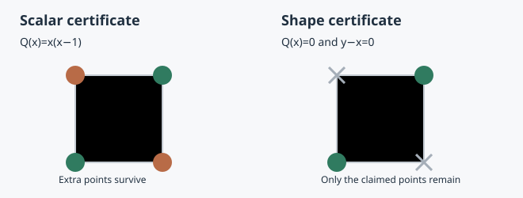

# Projected shape certificate: separation only on the claimed support

2026-11-25; PR #5131, parent aeef2c3bed7ddda1e2d50c154b61907a3e80b753. Written producer derivation [pcc:unverified].

## Result
For an affine polynomial ideal I in k[z_1,...,z_d,w_1,...,w_n], and a claimed finite set S of s distinct rational parameter tuples, choose l=z_1+c_2 z_2+...+c_d z_d injective on S alone. Let Q(t)=prod_(u in S)(t-l(u)); interpolate g_j(l(u))=u_j, deg g_j<s, for j=2,...,d. Define K=(Q(l),z_2-g_2(l),...,z_d-g_d(l)). If S is empty use K=(1).

The coordinate change t=l, z_2,...,z_d is invertible. Quotienting by K leaves k[t]/(Q), a product of s copies of k, and its points are exactly S. Thus K is the vanishing ideal of S and its d generators lie in I only if the geometric projection of I is contained in S. This direction needs no prior split-grid membership checks. Verified witnesses at every claimed point imply equality. For necessity, if I contains squarefree split coordinate constraints, the projected ideal is radical by the finite-grid CRT argument in split_projection_certificate/GATE.md; containment then implies K subset I. Without split or radical projected ideal, membership is sufficient but not necessary. For example (z_1^2,z_2) has singleton support, but z_1 is not in I.

A separator need only distinguish S, not the rest of a large grid. For l=z_1+t z_2+...+t^(d-1)z_d, any pair of distinct points excludes at most d-1 values of t. If (d-1) binom(s,2)<p, a deterministic search of that many plus one distinct field elements suffices. Charge the search, label comparisons, interpolation and polynomial substitution. Naive interpolation can use Q, its linear quotients and Q' evaluated at labels, O(d s^2) field work plus inversions; compact coefficients O(d s). Expanded multivariate powers and normal form costs are not bounded by compact coefficient storage. No free basis or recovery.

## Discriminating example and diagnostic
For S={(0,0),(1,1)}, l=z_1 separates S but Q(z_1)=z_1(z_1-1) also vanishes on (0,1),(1,0). Adding z_2-z_1 eliminates both. Checking only Q with a separator on S is unsound.

For the historical #5087 four-point geometric diagnostic with singleton {(0,0)}, the shape certificate is simply t,u. After verifying a Gröbner basis for the original ideal, two linear normal-form membership calls plus an independently verified witness suffice; three calls including unit nonmembership if only a geometric witness is needed. The archived API performed six calls and returned four indicators; these are different output contracts, not a measured acceleration. The earlier three/four-call certificate used two section-membership calls. This shape form can omit those because it proves containment globally in the affine chart. Projective infinity and rational witness coverage still require the original chart/guard contract. The original fixture's curve y^2=x^3-3x+21 differs from inherited Prime31 a=847514846,b=2087444724,r=2147446831,G=(625037715,2100627251), cofactor one. No elliptic arithmetic performed.

## Deterministic validation model
In the M31 field p=2147483647, use a non-elliptic affine 3-by-3 parameter grid with coordinates 0,1,2. Exhaust all 512 claimed supports, choosing the first c in 0,1,2,3 separating the claim; interpolate the second coordinate. Exhaust all 512 actual-support masks independently. The coordinator executed the exact BigInt arithmetic in the JS tool runtime: 4608 point evaluations, 262144 containment comparisons and 262144 exact-support comparisons; zero shape errors. Scalar-only containment falsely accepts 42598 ordered pairs, and 315 claims have extraneous grid zeros. Counts by c are 64,98,154,196. CHECK.js records the identical deterministic algorithm and expected counters; Node replay not executed. This is a support-logic check, not an elliptic relation, native Gröbner benchmark or independent attestation. No random source, so no seed manifest applies.

## Prior art and remaining gates
Shape-lemma/RUR literature: Cox–D'Andrea arXiv:2112.10306 (sections 1–2) and Demin–Rouillier–Ruiz arXiv:2402.07141 (introduction). Standard shape representation applied to verification of already reported projected support, not a new solver. Previous split certificate and #5087 source scope read from the exact parent; #5128 still owns original-root qualification, #5157 retains its diagnostic lane. No native edits, tests, timing, paid work, signed proof or merge. KB/Conductor/native workers unavailable; coordinator parallel source reads. Prior Space authorization blocker remains unreconciled; no mutation attempted. No lower bound or improvement to empty-inclusive discovery is asserted.

Impact score: 3/10 — compact multivariate support certificate and exhaustive model controls, no measured discovery improvement.
