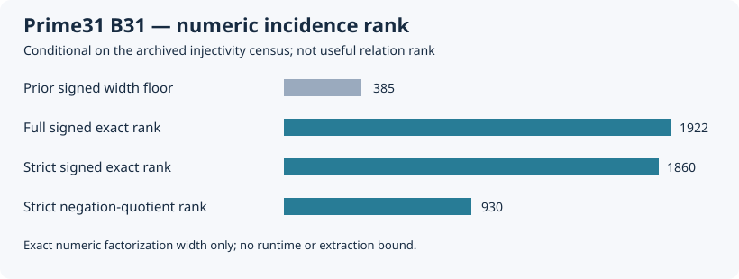

# Prime31: exact signed pair-incidence rank under archived injectivity

2026-11-24 Pacific; PR #5131; pinned parent fff9442b220e825ea85eea154fb5daba3af78eb2. Written producer proof, [pcc:unverified]. No new field experiment, performance run or point enumeration.

## Model

Retain the inherited ordinary cofactor-one curve p=2147483647, a=847514846, b=2087444724, r=2147446831, G=(625037715,2100627251), B=31. Let A={±P_i}, U=(A+A) minus O, X=U/{±1}, and U4 contain just signed pairs with distinct indices. Assume exactly the archived injectivity of the coefficient-net set N4 (even integer l1 norm 0,2,4) into the source group, as reconciled in ../historical_collision_reconciliation/GATE.md. Thus |U|=2B², |U4|=4*C(B,2). This is conditional, not a new census.

Let C(T,P)=1 if T-P belongs to U, zero otherwise, for P in U and T nonidentity. Let Cx([T],[P]) be 1 if at least one sign of P has complement in U, zero otherwise. This is the Boolean support of the pair-spectrum GCD, not the rank-three S3 value matrix. On the strict four-distinct-index target subset, let M be the restriction of C to columns U4; Mx is its negation-orbit version. The injectivity hypothesis makes each strict row precisely the six pair subsets of its four signed leaves, and double columns vanish. Misses in the strict-output predicate have zero rows. No discrete logs are used as coordinates.

## Theorem 1: full rank without the identity target

For every field K, rank_K C=2B² and rank_K Cx=B². In fact there is a unit triangular minor.

Choose the row T=4sP_i for each double column 2sP_i (s=±1). Any nonzero complement match is a decomposition into two two-token nets. Their total belongs to N4. By injectivity its net must be 4s e_i; its weight is four, so no cancellation occurred. Consequently the only split is 2sP_i+2sP_i, giving a row with a single 1 at that column.

For each remaining column P=sP_i+tP_j, i<j, choose T=3sP_i+tP_j. The same argument forces the only unordered split 2sP_i+(sP_i+tP_j), giving exactly two 1s, one at P and one at its double pivot column. All selected rows are nonidentity and distinct by injectivity. With doubles ordered first, the square submatrix is [I 0; L I], with exactly one 1 per row of L. Subtract the corresponding double pivot row to get identity. The proof works even in characteristics two and three.

For Cx, take one representative per simultaneous negation class of columns and chosen rows. No two selected rows coincide except the intended opposite signs. Each projected row has the same one- or two-entry pattern, and the resulting square minor is also unit triangular. No assumption of Fourier character labels or field-specific cyclotomic order is required.

Thus the prior conditional actual-source F_p width floor ceil(2D/5)=385 is sharpened to the exact 1922 for the full signed numeric membership matrix, and the orbit matrix has exact width 961, even without the identity target. This applies to exact separable factorizations with equality of numeric entries; not to zero-pattern encodings with a nonlinear final test.

## Theorem 2: strict positives alone give full distinct-pair rank

For B>=6 over any field of characteristic other than 2 or 3, rank M=4*C(B,2), rank Mx=2*C(B,2). Proof: suppose a vector of signed pair weights w_{ij}(s,t) is annihilated by all strict rows. Since 2 is invertible, write

    w_{ij}(s,t)=a_{ij}+b_{i,j}s+b_{j,i}t+c_{ij}st.

For each four-index support S and all its 16 sign choices, the sum of its six pair weights vanishes. The sign characters are linearly independent (their evaluation matrix has inverse 1/16 times its transpose), so compare coefficients:
* c_ij=0, by choosing any support containing i,j.
* For each i, the sum of b_{i,j} over every triple of distinct j outside i is zero. Comparing triples differing in one element gives equality of every b_{i,j} for this i. Since 3 is invertible, all b vanish.
* The sum of a_ij over the six edges of every four-subset vanishes. Compare supports {i} union S and {j} union S for triples S disjoint from i,j. Every triple sum of a_{iu}-a_{ju} is zero. Since B>=6, at least four choices of u remain, so comparing triples and using 3 invertible gives a_{iu}=a_{ju} for all distinct i,j,u. Symmetry implies every edge weight is the same constant; six times that constant is zero, and 6 is invertible.

Hence w=0. For the orbit matrix, pull back a putative null vector to signed pair columns by assigning equal values to opposite pairs. Each strict signed row selects exactly one signed column from each of its six distinct pair orbits, so the orbit null relation implies a signed null relation, forcing zero. This proves full column rank after quotienting row and column signs. In characteristics two or three, every row has six ones, so the all-ones vector instead witnesses a kernel; do not extend Theorem 2 there.

## Exact finite regression invariants

For B=31 the strict matrix has 503440 rows and 1860 columns, each row six 1s. The strict orbit matrix has 251720 rows and 930 columns, also six 1s per row. Each signed column occurs in 4*C(29,2)=1624 rows, by choosing the other two indices and their signs. Each orbit column also occurs in 1624 orbit rows. Thus totals are 3020640 and 1510320 nonzeros. The signed Gram matrix entry for a pair of columns is zero if their signs disagree on a shared index; otherwise it is 2^(4-u)*C(B-u,4-u), where u is the number of distinct indices in the union (2,3,4). These are exact conditional structural counts (1624,56,1), not newly measured native ranks.

An evaluator can check the unit minor with 1922 signed or 961 orbit public targets and complete matching output on the existing factor base, without supplying witness labels to the extractor. On strict rows check the sign-character identity and Gram counts if a full census is admitted. This is validation preparation, not an efficient method to discover an unknown target's row. Forming the witness-chosen minor costs O(B²) public additions and O(B²) sparse expected dictionary storage plus the charged candidate query work for every row; the complete strict census costs O(B^4) rows and its explicit dense matrix would be much larger. None was executed. A producer can construct the expected rows cheaply from labels; the solver must not receive those labels.

## Research decision and challenge

Fixed exact numeric separable pair-incidence compression is now excluded below linear-in-D width on the fixed archived collision-free fixture, including strict-positive-only reporting. Ordinary rank-three S3 values are not numeric membership; determinant, nonlinear zero tests, one-sided filters, succinct high-degree expressions and nonseparable indices are outside the theorem. This is not a query-time lower bound or a claim about the useful B-column coefficient rank. Do not extrapolate injectivity to growing B or other curves. The next algorithmic gate is an exact empty-inclusive selector avoiding explicit numeric incidence materialization, with charged setup and rational witness recovery. Native candidate qualification remains in #5128, not duplicated here.

Prior art checked: Semaev, arXiv:1504.01175, section 2, summation-polynomial semantics and point decomposition; Ghorbani et al., arXiv:0709.3144, section 1 and inclusion-matrix/diagonal-form discussion (Wilson's ordinary subset rank is prior art; the signed proof above is elementary and does not import the theorem). The actual fixed-source translation rank gate and pair path/census notes are pinned in the receipt. Bounded open-PR search for pair-spectrum rank and Prime31 incidence found the separate graph-IC lane #5122 on B677 LP projections, not this membership matrix. KB, Conductor and native worker dispatch unavailable in this runtime; coordinator used parallel read-only calls and an algebraic challenge. No novelty priority claim, independent attestation, native test, new PCC claim, random trial, paid compute or merge. Historical A/B provenance remains unqualified. Native Space last read required interactive authorization; no uncertain mutation replayed. Main and branch shared journals differ; retain both at integration.

Impact score: 3/10 — Exact conditional numeric membership ranks, including strict positives alone, strengthen the earlier width obstruction and give a sparse unit-minor validation fixture. No native replay or faster miss algorithm. [pcc:unverified]
