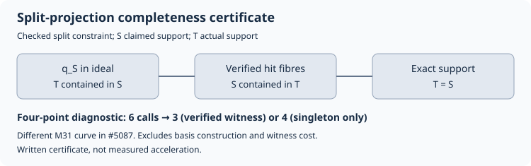

# Output-sized completeness certificate for split projection

2026-11-25; #5131, parent acc047527314152925227be200ad13a43171a4b8. Written producer proof [pcc:unverified].

## Source and scope

Inherited Prime31: p=2147483647, a=847514846, b=2087444724, r=2147446831, G=(625037715,2100627251), cofactor one. No new curve operations. Read-only comparison to #5087, head 4ce957bd43ee29132cb5851c0b764ddbb7433865: its curve y²=x³−3x+21 is a different M31 curve. Its PROOF.md blob eb5652c67c1693f4eec7f1c374830f320de1c393, REPORT.md blob f7d36ec2baab88f7eecfdb423e952caabb04d7d8, PROTOCOL.md blob 1282899b1adcbabfb882f8286b1d6e43e834b1cd. The published diagnostic has one distinct coupled fixture with geometric support {(0,0)}, 29 leading-term iterations in six normal-form calls after basis verification. No native edit in that lane; #5128 retains root qualification.

## Lemma

Let k be a field, R=k[z,w_1,...,w_n], I an ideal containing a squarefree split H(z) whose distinct roots are U in k. Let T be the geometric projection to z. For a claimed S subset U define q_S(z)=product_(s in S)(z-s), with q_empty=1. Then

    q_S in I  iff  T subset S.
    I intersect k[z] = (q_T).

With verified witnesses for all s in S, membership of q_S is thus necessary and sufficient for completeness. In particular empty support is equivalent to 1 in I.

Proof: CRT identifies k[z]/(H) with the product of copies of k indexed by U. Its homomorphism to R/I sends the coordinate identities to orthogonal idempotents. The fibre algebra at a given root is nonzero exactly when that idempotent survives. A nonzero finite-type k-algebra has a maximal ideal with finite residue extension and hence a geometric point. The scalar map from k into each nonzero component is injective. The kernel is therefore exactly the functions vanishing on T, regardless of nilpotents or positive-dimensional auxiliary fibres. Taking its preimage in k[z] gives (q_T), and q_S vanishes on T precisely when T subset S.

For a rectangular grid with squarefree coordinate constraints J contained in I, a separating linear form l injective on the entire grid gives I intersect the parameter ring = J+(q_T(l)); similarly q_S(l) membership proves containment. Do not assume cheap separation on large grids. Existence is guaranteed by counting bad coefficient hyperplanes if binom(|U|,2)<|k| for a finite k, not a construction bound. Without separation use grid idempotents. If S is a singleton, q_S in I and 1 not in I suffice even without a supplied witness. For larger nonempty S, unit nonmembership does not establish every claimed hit.

## Four-point diagnostic calibration

The #5087 section t²-t=u²-u=0 permits l=t+2u, with distinct labels 0,1,2,3. For its singleton S={(0,0)}, q_S(l)=t+2u, degree one. Two section checks plus one q membership call suffice with a separately verified witness; add one unit nonmembership call without a witness. Compare the original six calls. This narrower certificate does NOT return the four ambient indicator normal forms of the existing API. It does not replace any frozen tests or claim an implemented acceleration.

Under degree-compatible division, one degree-d call visits at most binom(n+d,d) leading monomials. For n=8 the existing six degree-two call bound is 270; candidate singleton bounds are 99 with witness, 100 without. For n=12: 546 vs 195/196. Different upper bounds are not measured ratios; the existing observed 29 iterations cannot be compared to a candidate upper bound as speed.

## Challenge, costs and test

Deterministic integer truth table: all 16 claimed and 16 actual support masks; 64 root evaluations, 256 subset checks, 256 exact-support checks, 64 singleton checks passed. Omitting the hit check produces 65 strict-subset false accepts over 256 ordered pairs. See CHECK.js; this is not native or elliptic execution. A nonreduced counterexample without H in I is I=((z-a)^2), T={a}, q=z-a not in I. Check the squarefree constraint. Geometric projection may include extension-field ghosts; rational signed output needs separate guards/equivalence and all requested orientation/label/identity/collision replay. A timeout cannot be called empty.

For one split coordinate, q has s+1 coefficients, degree s=|S|; naive construction O(s²) field operations or quasi-linear via a fast polynomial product tree under the appropriate arithmetic model. This does not include discovery of S, H construction, proof of H in I, basis construction/checking, witness recovery, or division. Multi-coordinate substitution may expand and must be charged. No free setup or sublinear global query is shown.

Standard CRT/idempotent theory: https://stacks.math.columbia.edu/tag/00EM ; standard normal forms: https://macaulay2.com/doc/Macaulay2/share/doc/Macaulay2Doc/html/_normal_spforms.html . This is an application of established algebra, not a novelty claim. No random runs, native tests, paid jobs, production changes, signed proof, merge or independent validation. KB/Conductor and native worker dispatch unavailable; parallel source reads only. Space read required interactive input. Next: original-curve native rational signed completeness and charge all basis/extraction costs when admitted. Do not substitute this certificate for a relation finder.

Impact score: 3/10 — exact output-sized split-projection certificate and explicit false-accept control, not a faster extractor.
