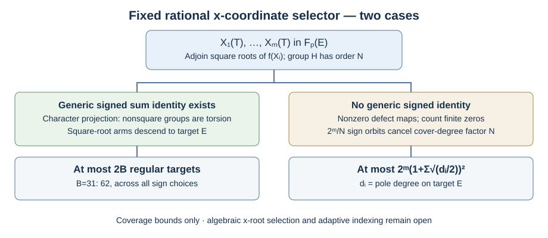

# Fixed rational x selectors: square-class cancellation and finite-exception gate

2026-11-24 UTC. PR #5131, parent 3165332a8ad4215a1d5e378771146c93ae835677. Written producer derivation [pcc:unverified]. No new curve, computation or experiment.

## Setup

Use the inherited M31 ordinary curve E: y²=f(x)=x³+ax+b with p=2147483647, a=847514846, b=2087444724, prime order r=2147446831, cofactor one, G=E(F_p), generator (625037715,2100627251), as recorded in the parent Jacobian gate. Let K=F_p(E), with generic point T. Fix m rational functions X_i in K and nonempty sign-invariant affine witness sets A_i ⊂ G (e.g. signed factor base, |A_i|=2B). A regular hit is a rational target T_0 at which all X_i are finite, f(X_i(T_0)) nonzero squares, all selected signed points belong to A_i, and some sign vector makes their sum T_0. Fixed identity leaves may instead be removed; poles, adaptive identity choices, ramified/zero roots and nonrational targets are outside this regular chart. On this odd-order source no affine rational point has y=0.

If any f(X_i) is identically zero there are no regular hits. Otherwise write u_i=f(X_i), L=K(sqrt(u_1),...,sqrt(u_m)), N=[L:K]=2^s, and let C be the smooth projective normalization with projection pi:C→E. Each P_i=(X_i,sqrt(u_i)) is an E-valued morphism on C. The Galois group H is an elementary abelian 2-group; its sign character chi_i is trivial exactly when u_i is a square in K. A generic signed identity means sum_i eps_i P_i=T in E(L), with a fixed vector eps_i in {+1,-1}^m. A finite-field sign match at individual targets does not assert this identity.

## Gate A: generic sign identities cannot escape the rational-chart coverage bound

Assume one generic sign identity exists. For a character chi of H let Q_chi=sum_{i:chi_i=chi} eps_i P_i. Applying the integral group-ring operator sum_{h in H} chi(h) h to the identity, using character orthogonality, gives [N]Q_chi=O for chi nontrivial and [N](Q_1-T)=O for the trivial character. No division by N in the group of points is needed. Nontrivial character sums are only asserted N-torsion over L, not necessarily zero geometrically. Q_1-T belongs to E(K). A morphism from the geometrically integral target E to the finite etale N-torsion scheme is constant, with F_p-rational value; since G has odd prime order, that value is O. Thus Q_1=T already in E(K).

Each trivial-character point P_i defines an F_p-rational self-map of E. By rigidity it acts on G as [a_i]T_0+C_i for scalar a_i mod r, used only in the proof. Since sum eps_i P_i=T, at least one such a_j is nonzero. That P_j permutes G. The condition X_j(T_0) lies in the abscissa set of A_j is exactly P_j(T_0) in A_j (sign-invariance, regularity). Hence there are at most |A_j| distinct regular hits, even if the evaluator tries ALL sign patterns, including nongeneric ones, because the fixed X_j and its membership requirement are common to all patterns. This is stronger than a union bound over sign branches. At B=31 the four-leaf cap is 62 for one fixed tuple of rational x functions; two signed pair outputs instead give the applicable size of their pair sets. On a rational hit every nontrivial Q_chi for the generic identity specializes to N-torsion in G and hence O. Thus genuine nonsquare-root arms cannot carry any of the generic target contribution on this odd-order group.

A useful x-only diagnostic: when X_i belongs to F_p(x(T)), the square test in K is equivalent to u_i or u_i/f(x(T)) being a square in F_p(x(T)). Indeed writing a square root as a+b y(T), the cross term 2ab vanishes, so a=0 or b=0. This concerns fixed rational functions, not an algorithm for unknown roots. Constant X_i, repeated arms, and inseparable maps are permitted. The proof uses the square class over the whole target function field, not whether values are squares at sampled targets.

## Gate B: when NO generic sign identity exists, charge finite exceptional targets by actual degrees

Let d_i=deg(X_i:E→P¹), zero for constants. Define a defect morphism F_eps:C→E by F_eps=sum eps_i P_i - pi. For a nonconstant defect the number of geometric zeros is bounded by its map degree; a constant nonzero defect has no zeros. For the nonconstant coordinate maps deg(P_i)=N d_i/2, since x:E→P¹ has degree 2 and X_i is pulled back along pi. Constants have degree 0 by convention.

The degree quadratic form q(F)=deg F on maps C→E modulo constants is nonnegative and satisfies the parallelogram law. One proof uses the line-bundle identity on E×E: the sum of the addition and difference pullbacks of (O) is linearly equivalent to twice each projection pullback, from the divisor of x(P)-x(Q). Pull back the line-bundle identity along any pair of maps, including coincident or constant maps. Polarization then gives Cauchy–Schwarz and sqrt(q(F+G))≤sqrt(q(F))+sqrt(q(G)) (apply nonnegativity to integer combinations and then rational approximations). Hence deg F_eps≤N(1+sum_i sqrt(d_i/2))².

If a regular rational hit exists, the corresponding place splits completely in L: all u_i are local units with nonzero square residues, so each defining quadratic equation splits over the completed local field by Hensel, and their compositum does too. In particular the constant field is F_p and C is geometrically integral. If no such hit exists, the claimed bound is trivial. At a split place the N lifts realize precisely one H-orbit of signs, and all possible sign vectors are covered by 2^m/N orbit representatives evaluated over the lifts. If a defect is zero at a hit for one pattern, it is zero for the orbit representative at some lift. Thus at most 2^m/N × N(1+sum sqrt(d_i/2))² distinct regular targets can be hits when there are no generic identities:
 
H_regular ≤ min(r, floor(2^m (1+sum_i sqrt(d_i/2))²)).

One may improve this using the exact degrees of orbit-representative defects and omit constant nonzero ones. The cancellation of the cover degree N is essential: counting all signs on all lifts overcounts by N. For four arms of maximum degree d, the displayed bound is 16(1+4 sqrt(d/2))², i.e. O(d) for fixed m. If a generic identity does exist, Gate A already bounds the entire regular hit set independently of degree, so do not add the finite-exception cap to it.

## Challenge and costs

If there are no trivial characters then a generic identity would imply [N]T=O, impossible for the generic point of E. Two equal nonsquare classes can cancel, including repeated P and -P; they need not be independent. Constant nonsquare radicands produce no regular rational hit. A rational square root function can have a sign different from the evaluator's preferred root, but the signed membership set is unchanged. Degree of a rational function is pole-divisor degree on E, not formal coefficient degree or circuit size. The degree bound charges no computation and is not a query-time lower bound; high degree can have a short circuit. A chart whose X_i themselves are multivalued algebraic roots, depend on another target-dependent variable, are chosen adaptively, or are only finite-field functions without bounded geometric degree is not excluded. An unbounded family of charts or implicit indexed lookup may still be fast; no lower bound on number of successful targets or rank is assumed.

For actual candidate screening, freeze a fixed tuple of X_i, classify f(X_i) in K*/K*², and determine whether any generic signed identity holds; compute the actual pole and defect degrees before making coverage claims. A supplied chart certificate is not a relation finder, and square-class computation, root evaluation, membership, signs, exceptions and miss costs must all be included if tested. Prefer a selector whose x coordinates themselves are algebraic/multivalued rather than just adjoining y signs to fixed rational coordinates. The target-dependent quotient/zero-component index and all admitted M31 performance gates remain open.

## Sources, ownership and validation

Parent jacobian_image_followup/GATE.md blob d369a4f50055f672feb84cba562f3db414afd486; rational_section_followup/GATE.md blob b9b68b2f7fcd2f9008fbe04c0a4fac1c28ffc028; named problem blob 2c98ef25c8ae6fb815776720571800587889dad5. Classical rigidity (Silverman, Arithmetic of Elliptic Curves III.4, Theorem 4.8; MIT 18.783 Lecture 4 notes, https://ocw.mit.edu/courses/18-783-elliptic-curves-fall-2025/); quadratic twist invariant/anti-invariant precedent Morgan–Paterson, https://arxiv.org/abs/2011.04374 (number-field setting, not imported as function-field theorem). Character orthogonality and the degree identity are proved above. Bounded default-branch searches across crypto, cryptanalysis and crypto-autoresearcher for multiquadratic square class witness selector, square class character decomposition summation polynomial, rational x selector sign orbit returned no exact matching title and adjacent work; no novelty claim. KB/Conductor and native worker dispatch unavailable. Coordinator parallelized read-only operations, then performed producer derivation and challenge. No independent validation, Lean, native Rust, random experiments, timing, paid jobs, seed schedule modification, ledger promotion or merge. No Space mutation: bounded read requires interactive input. Current main has advanced; keep branch log/ACTIVE changes scoped and reconcile both sides during later reviewed integration. No original-root requalification.

