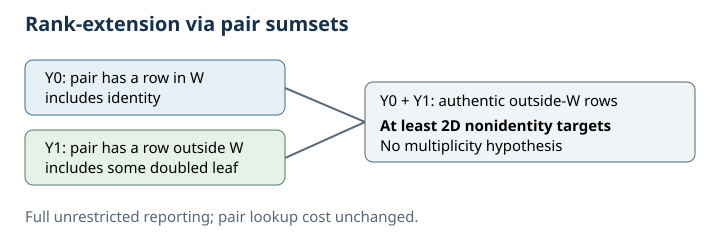

# Multiplicity-free rank-extension floor from pair sumsets

2026-11-25; PR #5131; parent 96c2e73d6e80d5a158f3b144285b46427cdcd5f1. Written producer proof [pcc:unverified]. No field experiment, no timing.

## Theorem (unrestricted four-summand full output)

Let G have odd prime order r, and let A={+P_i,-P_i}, 1<=i<=B, with distinct nonidentity signed points. Let V_2 be the normalized coefficient vectors representable by two leaves (including 0 and repetitions), phi(v)=sum v_i P_i, Y=phi(V_2)=A+A, |Y|=2D+1. Work in coefficient space F_r^B. Let W be any proper coefficient span. Set Y0={phi(v):v in V_2 intersect W}, Y1={phi(v):v in V_2 outside W}. These are sets of group points, not a disjoint partition: collisions may put a point in both. Their union is Y. Both are nonempty: 0 belongs to V_2 and W, while some e_i is outside W, and 2e_i is in V_2 outside W because r is odd.

Every T in Y0+Y1 has an authentic four-leaf coefficient vector outside W: add representatives v0 in W and v1 outside W. No claim that all witnesses at T are outside W. The classical Cauchy–Davenport inequality on the prime cyclic group yields |Y0+Y1| >= min(r,|Y0|+|Y1|-1) = min(r,2D+o), where o=|Y0 intersect Y1|. Both sets are negation-invariant. Remove O and use even cardinality of nonidentity negation orbits. The number J(W) of nonidentity targets with at least one outside-W witness therefore satisfies

    J(W) >= 2 floor(min(r,2D+o)/2) >= 2D.

No four-sum injectivity, maximum multiplicity, randomness of factor base, or independence of rows is used. Cauchy–Davenport is invoked on the abstract cyclic group; computing logs of any points is unnecessary.

For independent uniform nonidentity targets and COMPLETE unrestricted four-summand reporting, conditional on any prior rank state, rank-extension probability >= 2D/(r-1). Expected queries to gain one dimension or more <= (r-1)/(2D); to reach full coefficient rank from deficit k <= k(r-1)/(2D). This is a sufficient expected bound, not a fixed-budget success guarantee. The known-RHS training contract is the same as natural_rank_followup; challenge scalar witnesses remain evaluator-only. If D is unavailable then |A+A|>=min(r,4B-1) by Cauchy–Davenport, giving 2D>=min(r-1,4B-2).

## Alternative deficit-sensitive bound with triple-support parameter

Choose k independent quotient images of e_i in F_r^B/W; the 2k signed images are distinct. For each distinct S in 3A choose any fixed three-leaf coefficient representative u(S). At most one of the 2k signed pivots e can give u(S)+e in W. Thus at least (2k-1)|3A| ordered (S,e) pairs have outside-W rows. Each target has at most 2k such pairs, since a fixed e determines S=T-phi(e). Let L=ceil((2k-1)|3A|/(2k)). Negation symmetry of the entire useful target set (not of chosen representatives) and removal of O give J(W)>=2 floor(L/2). Take the maximum with the pair floor. This requires the actual triple support for its strongest form. Building an explicit triple census costs O(B^3) candidates; it is not free or authorized here. Cauchy–Davenport provides a weaker bound |3A|>=min(r,2D+2B) without that census.

## Inherited M31 numerical calibration

p=2147483647, a=847514846, b=2087444724, r=2147446831, cofactor one, G=(625037715,2100627251), B=31. Parameters inherited, not recertified. D=961 is conditional on the archived source-matched pair census; the four-sum injectivity assumption is NOT needed for the new theorem once D is known. The floor is 1922 nonidentity targets at every nonzero deficit, giving sufficient expected wait 1117298.0385 queries per rank increase and at most 34636239.1936 queries for all 31 dimensions. These are intentionally conservative bounds, not measured rates; the sharper earlier B31 injectivity-dependent strict witness budget remains in force when its hypotheses hold. The older worst-case multiplicity ceiling gave only three targets at deficit one for the different strict four-distinct-index contract; do not call this an apples-to-apples speedup.

Under the stronger archived even-four-net injectivity condition, distinct odd triple nets also have distinct images: a collision of two odd triple nets yields a zero even net of l1 norm <=6, ruled out by the prior even-net argument. Therefore |3A|=4B+4B(B-1)+8 binom(B,3)=39804 at B31. This is a deduction, not a new census. The triple floor at k=1 is 19902 and at k=31 is 39162; neither supersedes the earlier stronger injective strict bound.

For growing families with D=Theta(B^2), pair-floor rank query budget O(r/B) is multiplicity-free under complete reporting but does not give the desired O(r log B/B^3). Pair lookup is still linear in D per miss. No sublinear query or complete solver follows.

## Adversarial scope and validation

- Y0 and Y1 can overlap; subtracting the overlap in the sumset bound would be incorrect. Their common group point may have distinct quotient representatives. The proof never needs to identify an actual Y0 or Y1 table, which would require W and charged pair-bucket processing.
- All-output is essential unless a certified homogeneous span contains differences of all relevant four-leaf witnesses sharing a target. Only then do all witnesses have the same quotient class. Do not construct a full four-sum collision table for free. Pair-collision span alone does not imply this property.
- Repeated indices and cancellation are allowed; the proof uses 0 and 2e_i. It does not transfer to strict four-distinct-index, fixed chart, or geometric-only reporting. Nonidentity excludes O explicitly and the parity rounding uses odd order.
- In a native correctness gate compare actual outside-W target counts on the same frozen M31 signed chart to these floors; separately check authentic signed group replay, all-output completeness, quotient rank over r, and failures. No new native or random run authorized or performed. The existing pair-scan control and seed/paired protocols remain unchanged.

Sources: natural_rank_followup/GATE.md (2d7246876834c203ba01149ebe22403bbdc850f6), historical_collision_reconciliation/GATE.md (5bbbbb76276b11d806194147a698c4719dd5f7c0), homogeneous_quotient_followup/GATE.md (c0ce8350ac0e9affa6f5457e3b83027bcb7fe5a8), exact pair query problem (2c98ef25c8ae6fb815776720571800587889dad5). Classical Cauchy–Davenport: Tao, *An uncertainty principle for cyclic groups of prime order*, https://arxiv.org/abs/math/0308286 (primary abstract); restricted-sum distinction: Alon–Nathanson–Ruzsa, DOI 10.1006/jnth.1996.0029 (publisher-linked abstract). No novelty claim for the sumset theorem. KB/Conductor and native agent dispatch unavailable; parallel repository reads only. #4977/#4979 merged; #5131 remains open; #5128 owns current-root work. No new random draws, native tests, paid jobs, signed PCC verification or merge; Space prior authorization blocker unreconciled. Exact global misses remain the principal algorithmic gap.

Impact score: 3/10 — multiplicity-free sufficient rank-extension floor for full unrestricted reporting; no native independent validation or new extractor. [pcc:unverified]
