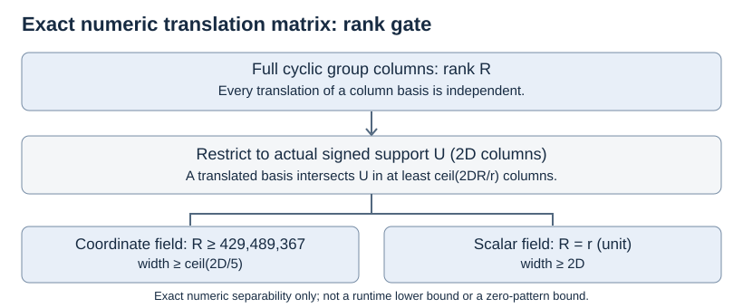

# Prime31: restricted translated-membership rank gate

2026-11-24 UTC. Additive follow-up to PR #5131 at frozen head 58d67f642cea000ffdac5494a55064b992861f57. Written mathematics and deterministic integer certificate only; [pcc:unverified]. No claim of novelty for circulants, Fourier analysis, or cyclic group algebras.

## Exact question

Can a source-specific, arbitrary-feature, bilinear numeric contraction compress all signed pair-membership values into o(D) coordinates, even when its source domain is only the actual Dickson pair spectrum? This is a different scope from the geometric projective-shift lemma, the universal arbitrary-subset interpolation-span argument, and the ordinary rank-three S3 zero predicate.

Use the inherited ordinary cofactor-one curve y^2=x^3+847514846x+2087444724 over p=2147483647, group order r=2147446831, generator (625037715,2100627251), as recorded in research/prime31_ic_20261115/rr9/RR9_EXTERIOR4_PUBLIC_RESULT_20261119.md. No group point, target or leaf was generated or reselected. Put A={±P_i}, U=(A+A) minus O, D=|x(U)| and |U|=2D. Write G for the cyclic prime-order group and let h:G→K be an exact numeric function. For S⊆G the rectangular matrix is

    C_h[G,S](T,P) = h(T-P).

Examples: the 0/1 membership indicator of U or of A+A (including O); ordered signed pair multiplicity h=1_A*1_A; more generally fixed-arity ordered relation counts. The output requirement here is exact numeric equality for every signed source P and every target T, not merely an equivalent zero predicate and not only the final aggregated four-sum count.

## Lemma 1: restricted-column rank transfer

For any field K and any finite group with abelian translation, let R=rank_K C_h[G,G]. Then for every S⊆G,

    rank_K C_h[G,S] >= ceil(|S| R / |G|).                 (1)

Proof. Choose a column basis indexed by I⊆G, |I|=R. Translation of its indices by any g is accompanied by permutation of rows T→T-g, so I+g is also independent. Its intersection with S is an independent set in the restricted matrix. Summing |S∩(I+g)| over g gives |S|R; at least one intersection has size at least the ceiling of the average. This argument uses the actual fixed S, not a worst-case arbitrary S. If the identity target is excluded, removing that one row can decrease rank by at most one.

## Lemma 2: field-specific full-group rank

Over F_p with p≠r, take a primitive rth root ζ in the algebraic closure. The r characters are an invertible Vandermonde basis since r is nonzero in F_p and X^r−1 has distinct roots. The eigenvalues of convolution are the Fourier coefficients H(ζ^j) (up to sign convention), with H(X)=sum h(iG) X^i; these indices are used solely in the proof, never assumed computable from a public point. Rank is invariant under extending the field. For j≠0, the Frobenius orbit j→pj has length e=ord_r(p). Since coefficients are F_p-valued, nonzero eigenvalues occur in complete orbits. If h is nonconstant, at least one nontrivial mode survives by Fourier inversion. If sum h is nonzero, the trivial mode also survives. Hence

    rank_Fp C_h[G,G] = 1+k e,  1<=k<=(r−1)/e.           (2)

For the inherited M31 parameters, deterministic integer modular-power arithmetic gives r−1=2·3·5·71·233·4327 and e=(r−1)/5=429489366. The complete order/primality certificate and replay are in CERTIFICATE.md. In particular R>=429489367. No Fourier matrix or large extension is materialized. This does not assume a Chebotarev all-minors theorem over finite fields.

Over F_r, cyclic convolution is multiplication by H in F_r[X]/(X^r−1)=F_r[X]/((X−1)^r). If H(1)=sum h is nonzero, H is a unit in this local algebra, so R=r and all subsets of columns are independent. This proof does not use nonexistent distinct rth roots in characteristic r.

## Consequence for the actual signed pair spectrum

Take h=1_U, with U nonempty and proper (O is excluded). Since 0<|U|<r<p, sum h is nonzero in both fields. For h=1_(A+A) use the same assertion if A+A is proper, as it is at the B31 fixture by the pair count cap. For h=1_A^{*m}, total mass is (2B)^m, nonzero in either field for 0<2B<r. Nonconstancy in F_p follows from Fourier inversion: if every nontrivial Fourier coefficient of h vanishes, the corresponding coefficients of 1_A vanish because a field has no nonzero nilpotents; 1_A would be constant, a contradiction for a nonempty proper A. No count overflow is needed: the proof applies to the exact count reduced in the selected field.

If C_h[G,U](T,P)=sum_(i=1)^w a_i(T)b_i(P) for all T,P, even with unrestricted features chosen after inspecting this exact Dickson base, rank ≤w. Equations (1) and (2) give

    F_p:  w >= ceil(2D*429489367/2147446831) >= ceil(2D/5).
    F_r:  w >= 2D.

If only nonidentity targets are required, subtract at most one from each bound. This rules out sublinear-width exact separable numeric encodings of the stated matrix for this fixed M31 modulus and actual source subset. The growing-family counterpart is conditional on ord_r(p)=Omega(r) along that family; the F_r unit argument applies to every prime r with nonzero total mass. The lower bound does not assume D=Theta(B²), and no D census is claimed. It is not the rank of useful signed relation rows.

## Challenge / limitations

1. Shift sign: a column indexed by P+g equals the old column evaluated at T−g. Thus the basis-intersection count is independent of the sign convention and field.
2. Frobenius rank: only actual F_p-valued exact numeric h has the stated orbit constraint. Extending the feature field cannot reduce the rank of the same F_p-valued matrix, but evaluating a different encoded function can evade it. For F_r do not use a diagonal Fourier argument.
3. Counts and membership: distinguish support, multiplicity and zero subtotals. The all-group matrix can include O explicitly. If a support fills the entire group, its indicator is constant and rank one; the nonconstancy premise is essential. Ordered convolution counts and 0/1 indicators are different functions. Removing a row or restricting the target set further can weaken the bound.
4. The S3 rank-three matrix computes an algebraic expression whose zero set encodes a different relation predicate. A zero/nonzero test of a low-rank matrix need not have low-rank 0/1 indicator. A nonlinear final zero test, hashing canonical group complements, adaptive lookup, high-degree succinct circuits and target-dependent sparse evaluation remain outside the theorem. Indeed the direct exact dictionary lookup of h(T-P) has full or high rank but can be cheap: dimension is NOT a query-time, memory, or generic group lower bound.
5. The bound constrains the selected source-wise numeric contraction, not the scalar function sum_P h(T-P) times pair weights computed by another algorithm. Do not reject FFT/other convolutions simply because a numeric matrix has high rank. An efficient FFT on group-character labels would still need a charged public point-to-label reduction; no such reduction is supplied.

Decision: do not spend implementation resources seeking a fixed sublinear-width bilinear exact 0/1 or count matrix for this domain. Continue with target-dependent zero predicates, actual leaf quotient structure or nonseparable indexes, and price empty targets, witnesses, rational roots, signs and duplicates. Exact pair scan remains the control. No speedup, complete-solver cost, useful-rank result or formal proof is claimed. [pcc:unverified]

## Source and coordination receipt

Pinned parent: PROJECTIVE_SHIFT_GATE.md blob 2bcc944ed7e43ffc16926e8cf0ed03c69b7d2684; iteration8/EXACT_CONTRACTION_AND_YIELD.md blob 20f9428434bf228c75de404bdb8c4fde4f7b3675; iteration10/S3_PENCIL_CONTRACTION.md blob da12c7a459405f4fdea44118cc03ade721d5eb90; problems/prime31-exact-pair-spectrum-query.md blob 2c98ef25c8ae6fb815776720571800587889dad5. Literature checked: Tao, [An uncertainty principle for cyclic groups of prime order](https://arxiv.org/abs/math/0308286), complex-field result; the finite-field rank argument above is proved directly, not imported from complex Chebotarev. Prior sign Fourier and RR9 work is on supplied-index sign computations and does not imply this particular numeric translation representation. Bounded code searches across crypto, cryptanalysis and crypto-autoresearcher for "429489366", "translation indicator rank", "circulant rank pair spectrum Frobenius", and "Prime31 exact Fourier rank" did not identify the same restricted-column gate. KB/Conductor/native workers unavailable in this connector environment; not an exhaustive novelty audit. Coordinator used parallel independent source reads and same-session adversarial proof review, not independent worker attestation. No new cryptographic experiments, random seeds, original Rust tests, timed runs, PCC issuance, or paid compute. The modular integer certificate is deterministic proof arithmetic, not an M31 curve computation. The historical source/build evidence is unchanged. [pcc:unverified]
