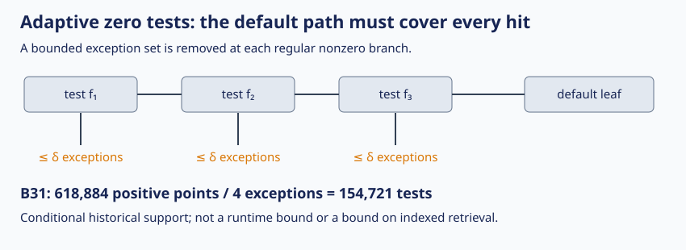

# Adaptive exact zero-test degree budget on the actual B31 spectrum

2026-11-24; PR #5131; parent 81aa59b6db0bcd97294be99a2dadd64de990fb7b. Written algebra/validation preparation, [pcc:unverified]. No new field computation or experiments.

## Model and theorem

Let U be a finite set of N rational points of a smooth projective geometrically integral curve, and let H denote the number of positives for a fixed exact membership predicate, with 0 < H <= N/2. A deterministic query tree has preprocessed constants and at each node chooses a fixed nonzero rational function f on the curve (it may depend on previous branch outcomes). The default outcome is a regular nonzero value. A zero, a pole, or any additional explicitly identified exceptional point may cause other branches. A node's budget e is an upper bound on the number of U points not taking its default outcome. No value-dependent table address, order/character predicate, or branching on the actual nonzero value is allowed in this model. Identically zero functions or constants provide no input discrimination unless another charged exceptional predicate is present; remove such constant-outcome nodes. Representational removable singularities must be counted separately if they can branch; using the reduced rational function alone does not bound implementation exceptions. For a polynomial in affine elliptic x,y, the weighted degree max(2i+3j) bounds the number of zeros away from O unless it is identically zero on E. For a rational function of pole-divisor degree d, its zero and pole sets together have size <=2d by the principal-divisor degree theorem. Thus one can use e=d for everywhere-regular-on-U predicates and e=2d for reduced rational predicates with zero/pole branches, plus any additional exceptions.

Follow the formal path that always chooses the default outcome; let e_i be the exception budgets and t its length. Any target not following its first j tests belongs to the union of the first j exception sets, which has size <= S_j=sum_{i<=j}e_i. This union bound is valid even with adaptivity, since all default path functions are fixed by that path. If the formal path has no remaining feasible inputs, its prefix has already covered all N inputs; regard its first empty prefix as terminal. Otherwise the terminal leaf returns a fixed boolean. If it returns miss, all H positives are in the exception union; if hit, all N-H misses are in the union. Either way S_t>=H. This is not a claim about a tree that can evaluate a final target-dependent membership predicate without charging it.

For a uniform target conditional on being a miss, at least max(0,1-S_j/(N-H)) of the inputs still follow the first j default outcomes. For uniform all targets use N instead. If e_i<=delta (positive integer) for all nodes, t>=L=ceil(H/delta). For every 0<=j<L, a target on the default prefix must execute test j+1, so by the tail-sum identity,

    E[tests | miss] >= sum_(j=0)^(L-1) (1-j delta/(N-H))
                    = L - delta L(L-1)/(2(N-H)).

The analogous bound with denominator N holds unconditionally. These are predicate counts, not elapsed times, field operations or general computation-tree lower bounds. For randomized zero-error trees exact for every input almost surely, the finite domain permits fixing any seed outside a null set, applying the same argument, and averaging; no randomized trial is performed. Monte Carlo average-error algorithms do not satisfy this proof.

## Inherited Prime31 calibration

p=2147483647, a=847514846, b=2087444724, r=2147446831, G=(625037715,2100627251), cofactor one, B=31. Reuse the source-matched historical collision census from historical_collision_reconciliation/GATE.md (blob 5bbbbb76276b11d806194147a698c4719dd5f7c0) and receipt 66b4f9bf0fe7d3eb645cf022a1b41d3a1b9bff75. Conditional on its exact archived injectivity, U is the r-1 nonidentity group points, H=618884 unrestricted signed four-sum positives (including cancellation-reduced two-leaf sums), D=961 pair abscissae. Distinct-index-only support H=503440 is a different contract; do not mix counts. No fresh point operations or scalar witnesses used.

| Exception cap delta | Minimum default path tests L | Mean miss tests lower bound |
|---:|---:|---:|
| 4 | 154721 | 154698.70 |
| 8 | 77361 | 77349.85 |
| 32 | 19341 | 19338.21 |
| 128 | 4836 | 4835.30 |
| 1024 | 605 | 604.91 |

For individual fixed-pair S3(u,v,x(T)) tests the target polynomial degree is at most two in x and pole degree at most four, so the regular affine exception cap is four (nonzero polynomial, with all exceptional branches charged). The conditional expected miss bound is 154698.70 tests, versus 961 distinct pair abscissae in the existing dictionary/complement control; these are different work units. This explains why an adaptive cascade of bounded-degree pairwise zero tests cannot itself compete with the scan in predicate count. The same argument covers compressed low-degree *fixed* predicates, not S3 plus target-dependent indexed retrieval. The bound is conditional on the archived census, not a new measured result.

For an injective growing family with H=Theta(D^2)=o(N), the lower bound is Omega(H/delta) when H/delta grows. Consequently O(D^theta) expected tests in this restricted model requires delta=Omega(D^(2-theta)). Constant-degree rejection predicates alone cannot achieve the desired sublinear query count. For theta<1/2, the required exception capacity grows faster than D^(3/2). This is a degree budget, not an arithmetic lower bound: high-degree structured polynomials may be cheap to evaluate, multiple predicates can be evaluated together, and hashing, nonzero numeric outputs, character tests, adaptive indexed retrieval, and multivalued root extraction are outside the model. Do not charge polynomial degree as multiplication count or assume the injective family exists at every asymptotic parameter.

## Adversarial checks and next gate

- On the rare-positive domain, changing the default leaf to hit cannot help: the same union must cover all misses, a larger obligation. A default path with no feasible input also cannot evade the bound.
- Adaptive selection of the next rational function cannot increase its exception budget on the fixed all-default path; identically-zero tests are constant, not a free multi-point exception oracle.
- A single precomputed full-support polynomial can make one high-degree zero test; the theorem allows this, and does not hide its construction cost. Likewise a hash lookup is not a bounded-degree rational zero-test tree.
- For validation, record actual rational pole degree or proven exception-set cap per candidate predicate, separately from arithmetic cost, any exceptional denominator branch, and any value-dependent operation. Freeze exact query/output contract and use original Rust and the prescribed paired seed manifest before trials. No new experiment budget authorized.

Prior art checked: Andrew Snowden, Lecture 2: Elliptic curves, principal-divisor degree theorem (https://websites.umich.edu/asnowden/teaching/2013/679/L02.html); Ben-Or, Lower Bounds for Algebraic Computation Trees, STOC 1983 (https://doi.org/10.1145/800061.808735), bibliographic abstract only, not invoked as a finite-field theorem. Existing repository character_partition_followup treats quadratic characters, not this default-zero-test model. Bounded PR searches for "zero test" / "decision tree", "zero predicate", "pole degree" on crypto checked; KB/Conductor and native worker dispatch unavailable. No novelty claim or independent proof. Exact integer calculations use only census counts.

Impact score: 3/10 — written, scoped expected-miss predicate-count obstruction for adaptive bounded-degree zero tests, with conditional actual B31 numerical calibration; no extraction speedup, independent validation or native execution. [pcc:unverified]
