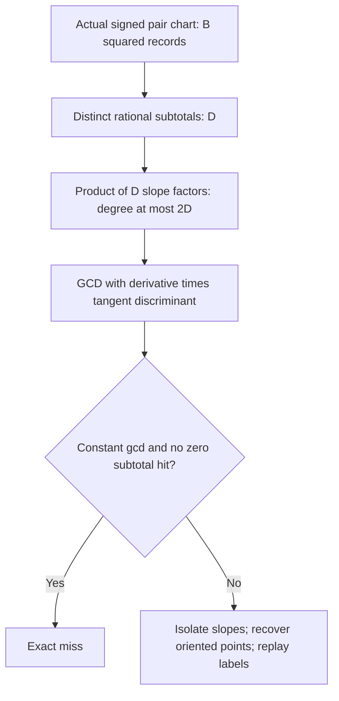

# Oriented chord-slope collision selector for exact four-leaf support

2026-11-24 UTC. PR #5064, frozen predecessor ddfe87db0bbbd450a0ee9dbce6eeb8de2eeb72a8. [pcc:unverified] Written algebra/validation preparation; no cryptographic execution, native tests, benchmark, signed validation or new asymptotic bound.

## Domain and exact one-variable elimination

Use the actual distinct rational pair-spectrum abscissae X, D=|X|, with both signs of each subtotal in the original odd-order subgroup. Store complete signed-pair backpointers and the identity bucket as in iteration9/PAIR_SPECTRUM_RESULTANT.md (blob e2348e91dc08141a663c5adb9798b6ca8f09424e). H(V)=product_(v in X)(V-v). For the oriented finite nonidentity target R=(r,y), y!=0, use the nonvertical line through -R with slope t:

    f(V)-(t(V-r)-y)^2=(V-r) q_t(V),
    q_t(V)=V^2+(r-t^2)V+a+r^2+r*t^2+2*y*t.
    q_t(v)=(r-v)t^2+2*y*t+v^2+rv+r^2+a.

The roots of the monic quadratic q_t are the two residual intersections, with multiplicity. A repeated root means a tangent subtotal pair, not two different labels. For a fixed v!=r in X the quadratic in t has discriminant 4f(v), nonzero square; hence its two slopes are distinct and rational. For v=r the factor is the nonconstant linear 2*y*t+3r^2+a, encoding the tangent through -R rather than every line through -R. This is the correct residual factor after removing the fixed intersection. A vertical line can contribute only an identity subtotal for R!=O; those cases use H(r)=0 and the preserved identity bucket.

Define

    P_R(t)=product_(v in X) q_t(v),
    L_R(t)=disc_V(q_t)=t^4-6*r*t^2-8*y*t-3*r^2-4*a,
    J_R(t)=monic gcd(P_R, P_R' * L_R).

D=0 is the empty-product case, J_R=1. Every root of P_R lies in Fp. Multiplicity is at most two: every factor is squarefree, and a fixed q_t is quadratic in V. At a double root of P_R, q_t has two distinct roots in X, so L_R!=0 and P_R' has multiplicity one (p>3). At a simple root, P_R'!=0; the gcd retains it exactly when L_R=0, i.e. the two residual points coincide and their doubled sum is R. Thus J_R is squarefree, and its roots are exactly the slopes encoding nonzero-subtotal unordered oriented pairs summing to R. For each such root recover the two roots v,w of q_t and the oriented points (v,t(v-r)-y), (w,t(w-r)-y); their abscissae are in X, so both are in the actual subgroup. No closure-root or sign ambiguity remains. Both backpointer buckets must be expanded or rank-compressed under an explicitly declared output contract. Identity subtotals are handled by H(r)=0 and the zero bucket separately. R=O uses the original complement control, not this affine construction.

Consequently, for R!=O the exact empty predicate is H(r)!=0 AND J_R=1. The degree of P_R is 2D or 2D-1 according as r is absent or present in X. The gcd degree is at most D: a distinct-pair slope consumes two factor roots, while a tangent consumes one; there can be at most one tangent hit because doubling is a bijection on the odd-order subgroup. For D=0 the assertion is direct. All roots are rational without an additional Frobenius test. This does not produce actual pair spectrum X without source work.

## A direct bridge to the previous S3 obstruction

For v!=w, v,w!=r the ordinary quadratic resultant in t satisfies

    Res_t(q_t(v), q_t(w))=(v-w)^2 S3(v,w,r).

To see the mechanism, subtract the factors: q_t(v)-q_t(w)=(v-w)(v+w+r-t^2). On this quadratic constraint the remaining linear equation is 2*y*t=(v-r)(w-r)-(3*r^2+a); eliminating t gives precisely the oriented S3 identity from iteration6/MATHEMATICAL_NOTE.md (blob 9120eb9d367fbc54e04fc7b2f53497f770e35d4c). The resultant residual was also reduced symbolically modulo y^2=f(r). Do not apply the fixed quadratic-degree resultant formula unchanged to the degree-drop factor v=r.

For r not in X, the discriminant product rule therefore gives the exact identity

    disc(P_R) = 4^D * product_(v in X) f(v) * disc(H)^2
                * product_(v<w in X) S3(v,w,r)^2.

This explains why a scalar discriminant test cannot magically eliminate the off-diagonal S3 product: it is that same obstruction in a different coordinate. The extra tangent factor L_R is indispensable because the discriminant alone does not detect a doubled subtotal. The identity is restricted to this explicit polynomial, not a general indexing lower bound.

## Dimensions, output and cost

The contraction replaces independent offset tensors by an oriented one-dimensional slope selector after the actual pair-spectrum setup. That setup still costs O(B^2) group operations and records; D<=B^2, no assumption of equality on the fixed fixture. Build P_R by balanced product of D degree<=2 factors in O(Mpoly(D) log D) field operations. The derivative and quartic L_R cost O(D), and fast gcd/extended gcd cost O(Mpoly(D) log D), including exact miss proof (Bezout for J_R=1 and nonzero H(r)). O(D) coefficient storage is possible with discarded tree levels, subject to backend workspace; storing a factor tree uses O(D log D). To recover all h<=D slopes, use split-root isolation or a factor-tree gcd descent with charged O(Mpoly(D) log^2 D) overhead; alternatively derive the known slopes of q_t(v) from stored ordinates with batch inversion and sort/hash, which costs at least the explicit D factor accesses. Charge quadratic root recovery, exact signed replay, all pair collisions, duplicate removal and output. Any incomplete isolation is INDETERMINATE. For B=31 the chart has 961 records, so deg P_R<=1922 and deg J_R<=961; these are bounds, not observed support sizes. No arithmetic of the original curve was executed.

This is a different exact univariate contraction, not a sublinear empty-query algorithm. It remains quasi-linear in D and cannot beat the O(D) group-complement control by exponent. It does not change the stronger conditional pipeline requirement tau<1. The next gate is an implicit evaluation/collision index for the actual structured pair chart, without constructing this product per target. A mere discriminant, companion matrix or low-degree line equation is not that index.

## Review, validation and dated handoff

2026-11-24 UTC. What was done: live #4977 and #4979 are merged; #5064 is open/draft at the frozen predecessor; read its prior geometry source/receipt, repository AGENTS, docs/ACTIVE, main Nov24 journal and named problem. Prior search: repo queries 'slope collision pair spectrum', 'chord slope resultant', 'slope polynomial squarefree' returned the existing iteration9 baseline, APS cubic divisibility proof map, and prior chord-resultant examples. Semaev arXiv:1504.01175 and Karabina arXiv:1504.02347 establish prior summation-chain work; standard chord/divisibility machinery is not claimed novel. KB/Conductor and native agents unavailable; no workspace checkout or Rust compiler executable. Coordinator performed exploratory symbolic identities and wrote this proof; not a separate independent validator.

Decisions: preserve all shared STATE, journals, reserved reports, source and workflows; use this disjoint dated handoff as the report annex. No source implementation selected, no compute allocation, no signed ledger mutation or promotion. Open threads: post-freeze symbolic replay; original Rust exhaustive small-field checks, including r in X, triple intersection, double roots, tangent-only hit, identity, negative targets, collisions, ordered tuples, zero/one/multiple useful rank and the existing ghost/cancellation controls. Preserve prior build blockers. Space uncertain mutation not replayed; no native Page update asserted. Errors: ACTIVE initially looked up at root (404), then read docs/ACTIVE; old lane Nov24 journal absent, main journal read; no source execution. [pcc:unverified]
