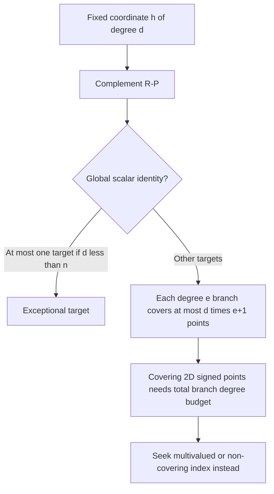

# Fixed rational-coordinate complement agreement gate

2026-11-24 UTC; PR #5064; predecessor ab950a41af89ca4f12213d7f87cd8cee681c6fd6. [pcc:unverified] Written algebra, not native execution or a query speedup.

## Question and setup

Can a fixed low-degree scalar coordinate on the original elliptic curve turn the complement operation P -> R-P into a small number of target-dependent rational functions of that coordinate, so that existing scalar indexing techniques become applicable without constructing a two-offset tensor? The earlier NEXT_IMPLICIT_INDEX.md Section F rejects global small homomorphic buckets and x-only single-valued signed addition. The following is a more local, quantitative restriction: even exact agreement only on a finite, actual pair spectrum is constrained.

Let E be the original smooth projective elliptic curve over F_p, G its prime-order subgroup of order n, U=(A+A) minus O the actual signed nonidentity pair spectrum, and D=|x(U)|. Thus |U|=2D in the odd-order subgroup. Fix a nonconstant rational coordinate h:E -> P^1 of geometric degree d, independent of the target R. All maps and equalities below are projective, so poles and O are not excluded. Let j_R(P)=R-P. Allow arbitrary target-dependent rational maps g:P^1 -> P^1 of degree e (including constants, e=0); coefficients can depend on the source and R. The maps must reproduce the actual coordinate h(j_R(P)), not just a lossy bucket containing it.

## Lemma 1: bounded agreement on finite subsets

For any R and g, either h∘j_R=g∘h as maps of curves, or the number of distinct geometric points P satisfying h(j_R(P))=g(h(P)) is at most (1+e)d.

Proof: Write F=h∘j_R and K=g∘h. Their degrees are d and ed respectively (K has degree zero if constant). The diagonal of P^1 x P^1 is the zero locus of the bihomogeneous determinant of the two homogeneous coordinate pairs. Pull it back along (F,K). It is a section of F^*O(1) tensor K^*O(1), a line bundle of degree (1+e)d. Unless the section is identically zero, its zero divisor is effective of precisely that degree. Distinct agreement points consume at least one unit each. This argument covers inseparability, poles, common poles and tangencies with no affine denominator omissions. Alternatively use the difference of the two rational functions: bound its poles by the sum of their pole divisors and count simultaneous poles separately using the multiplicity canceled from that upper bound. The projective determinant makes the latter accounting automatic.

If the equality is global, multiplicativity of degree forces e=1 (h is nonconstant and j_R is an automorphism). In that case g is a Möbius transformation.

## Lemma 2: at most one exceptional target at small coordinate degree

Assume 0<d<n. Suppose two different R,S in G admit global identities with Möbius maps M_R and M_S. Composing the two identities gives h(P+R-S)=(M_R∘M_S)(h(P)) for all geometric P. The translation T=P -> P+R-S has exact order n. Surjectivity of nonconstant h implies M^n=id where M=M_R∘M_S.

Every Möbius transformation over the algebraic closure has a fixed projective point z (the identity has every point fixed). The nonempty fibre h^{-1}(z), with its multiplicities, is invariant under T: pullback of the point divisor is unchanged since M fixes z. Translation by a point of order n acts freely, every geometric orbit has n points, and multiplicities on each orbit coincide. Therefore n divides deg(h^{-1}(z))=d, contradiction. This proof does not require M to be defined over the prime field or separability. It in fact excludes any two exceptional targets whenever n does not divide d.

For maps defined over F_p there is an extra restriction on this fixture: |PGL2(F_p)|=p(p-1)(p+1), coprime to n. The order follows by choosing two independent columns in GL2 and quotienting by the p-1 nonzero scalar matrices. Hence M^n=id implies M=id. Global translation-equivariance then makes h constant on the whole G orbit of O. Consequently any h nonconstant on G also admits at most one exceptional target even without d<n. This extra statement assumes both Möbius maps are over F_p.

## Corollary: piecewise scalar relabeling budget

For each nonexceptional target R, suppose K rational branches g_i of degrees e_i cover U exactly, in the sense that for each P in U at least one g_i(h(P)) equals h(R-P). A branch selection may be arbitrary and even sign-aware; the union bound still gives

    2D <= d * sum_i (1+e_i).

In particular K Möbius branches satisfy K*d >= D. For the fixed abscissa h=x, d=2 and R=O is a global exception (negation fixes x), so every nonidentity R is nonexceptional. It follows that K>=ceil(D/2) for every such R if all branches are degree one. A single scalar rational function has to have degree at least D-1 to reproduce the complement coordinate on all 2D actual signed pair points. These are geometric degree and branch-count constraints, not arithmetic circuit or query-time lower bounds. If the full pair spectrum has D=Theta(B^2), constant-degree branches require Omega(D) branches in this specified covering architecture. A higher-degree function may still be compactly evaluable, and a collision-checked or multivalued correspondence is not subject to this single-valued relabeling bound.

The union argument covers negative targets, poles, repeated leaf labels (count distinct points only), and both signs of each actual subtotal. Identity subtotal backpointers are not part of U and must remain separately handled. Empty queries still have the same agreement bound; no natural target hit or witness was assumed. This is not a new restriction on arbitrary finite-set mappings, low-degree implicit bivariate correspondences such as S3, or direct group-complement lookup. In particular the known quadratic S3 relation is multivalued, so it is not a counterexample to the lemma and not ruled out. Nor does this bound imply a cost for a data structure that never attempts to reproduce h(R-P) on every P.

## M31 binding and scope

Read the unchanged original fixture in research/prime31_ic_20261115/native/lib.rs blob 42e1e7c1912be43190959c5be8f84cf59c867786 at predecessor. p=2147483647, a=847514846, b=2087444724, n=2147446831, G=(625037715,2100627251). Original check_curve requires prime n, valid nonzero n-annihilated generator, nonsingular equation and 2n above Hasse upper bound; conditional on that inherited certificate the cofactor is one. No new point count or curve execution. Coordinate field p and scalar n are distinct.

Integer arithmetic cross-check only: p-1, p, p+1 modulo n are 36815, 36816, 36817 respectively; Euclidean gcd(n,p(p^2-1))=1. The inherited B=31, N=64 chart gives D<=961, not an observed D. The lower bound ceil(D/2) would equal 481 only if D=961; no support census is claimed. No benchmark inputs or targets instantiated, no smaller field experiment, no field-dependent cryptographic computation.

## Decision, validation preparation and handoff

- What was done: read live PR metadata (#4977/#4979 merged, #5064 open draft), current AGENTS/ACTIVE/main Nov24 session-log tail, source STATE and continuation, named problem, iteration9 baseline, prior slope note and receipt and earlier homomorphic bucket obstruction. Checked finite-set agreement and exceptional target argument, including constant maps, both projective poles and d>=n caveat. Checked fixture integer gcd by JavaScript BigInt Euclidean arithmetic only. Literature: Stacks Project Lemma 33.44.11 https://stacks.math.columbia.edu/tag/0AYZ for pullback degree, Snowden lecture https://websites.umich.edu/asnowden/teaching/2013/679/L02.html for divisors; Fan preprint https://arxiv.org/abs/2608.24744 for adjacent equivariant isogeny quotient literature (not this finite-set complement claim). Repository code searches for rational coordinate Mobius translation equivariant, complement rational map degree projective, prime31 Dickson homomorphic bucket; read NEXT_IMPLICIT_INDEX.md. KB/Conductor and native agent slots unavailable; not an exhaustive novelty audit.
- Decisions made: reject a universal bounded-degree single-valued scalar relabeling as the next exact index unless its finite-set agreement budget is met. Preserve the multivalued S3 and oriented slope controls. Only coordinator written work, no shared mutable STATE, root journal, reserved reports, Rust, CI, ledger or frozen proof edits; use this dated disjoint report annex. No new automation, no merge, no compute expenditure.
- Open threads: seek genuinely multivalued implicit correspondence or collision index not forced to cover every complement coordinate. Native validation preparation: after admitted frozen M31 source, compare h=x and any proposed fixed h against complete group replay for nonidentity, tangent, identity and negative targets, with distinct subtotal counts and witness/rank equivalence; record maximum exact branch agreement and count missing cases. A candidate outside the covering model needs its own complete cost proof. No Rust candidate selected. Original-root blockers and independent signed verification unresolved.
- Errors/limits: no native workers, local original-Rust/Lean or signed PCC validation; prior failed builds remain historical, no new test. Native Space uncertain write not replayed; no Page update asserted. Initial research/ACTIVE.md path returned 404; corrected to docs/ACTIVE.md. This written proof is producer-unverified. [pcc:unverified]

