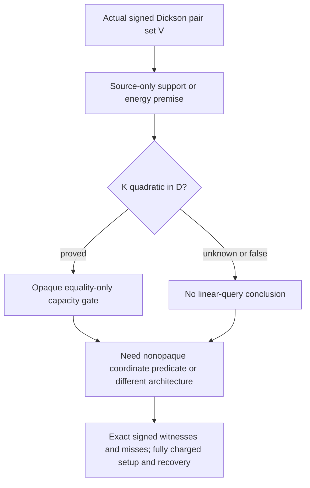

# Exact signed pair-spectrum reporting: collision-capacity gate

Date: 2026-11-23 local / 2026-11-24 UTC. Tracking PR #5125. Base ceba74bb64854027c4dd16f00428bf676383bfdb. **Written candidate lemma, [pcc:unverified]; not registered or independently signed, not a new solver.** No field-dependent experiment or randomized run.

## Scope and why this gate matters

Merged #4977 and #4979 establish the exact S3 pencil and pair-spectrum elimination; merged #5048 separately audits planted-row coverage. This note does not duplicate those results or the Semaev-only polynomial sector lane (#5044). It tests whether an exact *public-target* index can improve the pair-scan exponent using only group arithmetic and equality, regardless of its choice of adaptive translations, scalar multiples, or preprocessed group handles.

The method is the classical generic-group symbolic linear-form argument, not a claim of novelty. See Shoup, *Lower Bounds for Discrete Logarithms and Related Problems*, revised EUROCRYPT 1997 paper, §2, https://www.shoup.net/papers/dlbounds1.pdf ; the equality-only (Nechaev) model is distinguished in its related-work section. Shoup's encoding model is broader than the deterministic equality-only model below. This note does not claim a lower bound for concrete elliptic coordinate algorithms, all random-encoding algorithms, or 3SUM-Indexing generally. The literature check also found Chung–Larsen, SODA 2023, https://doi.org/10.1137/1.9781611977554.ch19 ; this note does not import their cell-probe bounds into elliptic groups. Shared research KB and Conductor not exposed; no exhaustive novelty determination.

## 1. Exact model

Let G=<g> have prime subgroup order n, written additively. Use n for the scalar modulus and p=2147483647 for the coordinate field, never interchange them. Fix a signed base A={±P_i}, B distinct abscissae, P_i != O. Let V=A+A include O, U=V minus {O}, X=x(U), D=|X|, so |V|=2D+1. Put S=(V+V) minus {O}, K=|S|. The query domain is G minus {O}, of size N=n-1; there are L=N-K misses. The output is either EMPTY or a signed four-leaf index tuple (or every such tuple for the stronger reporting contract). Every emitted tuple must sum exactly to the supplied R. Repeated leaves and zero pair subtotals are allowed; no false negatives.

The inherited Prime31 fixture has n=2147446831, B=31. This is a source-pinned input, not a new curve certification. The theorem below requires a prime-order group and no extra target-dependent scalar side information. It does not assume the actual K or D has been measured. The earlier support cap gives K<=618884 for B31, not a lower bound or an executed support census.

After arbitrary target-independent preparation, allow M accessible constant group handles, including g and O and any source points; all count toward M. Even arbitrary scalar advice about the base is permitted, provided it is independent of R and cannot reveal an opaque target's encoding. Online, the algorithm receives one handle R=z*g, with z not supplied. Handles can only be copied, compared for equality, and combined by known scalar linear combinations. Grant each newly made handle as one unit even if computing its scalar combination would normally cost many group operations. Equality comparisons of any already available handles are free; no direct label bits, ordering, affine coordinates, scalar labels of R, pairing, or coordinate arithmetic are available. The algorithm's choices depend on equality results and the target-independent advice. Cap the number of new handles at t; set q=t+1 to count the original R. If a constant not among the M preprocessed handles is generated online it counts toward q. This is a collision-capacity statement about handle creation, not measured field operations or a space bound for arbitrary advice.

## 2. Proposed lemma and proof

On the symbolic no-accidental-collision path every accessible handle is (a z+b)g, with a,b in F_n. The M initial constants have slope a=0. The induction is exact: every known scalar linear combination of affine forms is affine. Along this path, comparisons of identical forms return equal, and distinct forms return unequal. For distinct forms, equal slopes cannot produce an equality; unequal slopes yield at most one z, by inversion in the prime scalar field. Thus, among all comparisons between M constants and q online handles and among the q online handles themselves, at most

    C_M(t) = M(t+1) + t(t+1)/2

distinct scalar values can cause an accidental equality along the symbolic prefix. This counts all potential comparisons, including those never requested, so adaptivity and free all-pairs equality cannot increase this upper bound. Comparisons among the initial constants convey no target information. If negation-class equality is also free, conservatively use 2 C_M(t): each pair yields at most one root from each nonidentical signed comparison; identical forms up to sign give the predeclared answer. Testing O is covered by including O among the constants. No field modulus p is used in the scalar inversion.

For each target outside the exceptional set, induction on the transcript gives exactly the symbolic path. In particular, if C_M(t)<min(K,L), there is at least one hit and one miss that are indistinguishable up through t handle creations. An exact deterministic decision algorithm cannot halt there. Any bounded exact decision algorithm must therefore satisfy

    C_M(t) >= min(K,L).

For reporting, a fixed nonempty signed tuple on the no-collision path can be correct for at most one z: its sum is fixed by the source. The same conclusion holds if a nonempty complete list is required, since at least one fixed tuple must be correct. Thus an exact witness reporter has the separate necessary condition C_M(t)>=K-1, even when K>L. When C_M(t)<L, at least one miss remains on the default transcript, so the default must be EMPTY and every positive must be exceptional: C_M(t)>=K. These implications are necessary, not sufficient. For a capped possibly incorrect reporter the number of positive inputs for which a correct nonempty tuple is returned is at most C_M(t)+1. For uniform positive input, success is at most min(1,(C_M(t)+1)/K); for uniform nonidentity input the unconditional probability of an authentic tuple is at most min(K,C_M(t)+1)/N. These bounds extend to a random choice of a target-independent deterministic tape by averaging. They are not rank bounds: all-output queries can emit many rows, and independence is a separate check.

For variable-time exact queries, choose an integer t such that C_M(t)<min(K,L). The first t steps of the symbolic path must exist (otherwise it halts on an indistinguishable hit and miss). At least L-C_M(t) of the miss inputs follow that path through the cap and require more than t creations. Hence

    E[T | miss] >= (t+1)(1-C_M(t)/L).

If either K or L is zero, the decision bound is vacuous, as it should be. Reporting and decision have distinct bounds. Under signed x-only handle comparison the same derivation uses the doubled capacity, but does not authorize evaluation of arbitrary x-coordinate predicates.

## 3. Consequence for the growing-family gate

If K=Theta(D^2), D^2=o(n), and M=O(D polylog D), choose t a sufficiently small constant times D/polylog D. Then C_M(t)<K/2 and C_M(t)/L=o(1). The proposed bound yields Omega(D/polylog D) worst-case exact decision work and the same order for expected miss work, even granting free equality, arbitrary scalar advice about the base, and unit-price linear-combination handles. Fixed theta<1 in the desired near-linear-preparation index would then need a genuinely nonopaque operation or a different hypothesis/architecture.

Crucially, K=Theta(D^2) is not established for the actual Dickson-derived spectrum. A small K changes the conclusion. In the prime-order abstract group, V could be an arithmetic interval (in scalar labels), where its sum support is only linear in |V|. This is a conceptual boundary example, not a claim about the original M31 base or a smaller-field experiment. No universal Omega(D) query bound for actual Dickson fibres follows. Do not infer K from B^4 possible tuples, from D<=B^2, or from a miss *upper* bound on K.

An exact sufficient condition for the dense-support premise is additive energy: define m(s)=#{(a,b) in V^2:a+b=s} and E(V)=sum_s m(s)^2. Cauchy-Schwarz gives K+1 >= |V|^4/E(V). Thus E(V)=O(D^2) implies K=Omega(D^2), while K+1<=|V|^2 gives the upper bound. This is a new *checkable premise* for the restricted obstruction, not a proof that E(V) has that size on actual fibres. Direct energy census costs O(D^2) group-pair processing and its storage/output costs must be charged; do not execute a dense census merely to turn this into an online candidate. The mathematical challenge is to bound energy for the actual Dickson pair spectrum or to exploit its large energy if the premise fails.

## 4. Candidate admission diagram

This gate is not an algorithm. It applies to any equality-only implementation of the declared public-target query, including a proposed adaptive translation index, a table of generic scalar multiples or a group-complement shortcut. It does not exclude algebraic predicates using the actual Dickson selector, finite-field polynomial arithmetic, nonuniform target generation with scalar metadata, correlated multiple-target processing, or a solver that directly constructs relations without a public-target oracle. A dense hash table with M comparable to K also escapes the near-linear-handle premise, but must charge that setup.

## 5. Independent-review checklist (not yet executed)

Challenge the quantifiers on the fixed symbolic path and initial handle access; verify that all target dependence enters via the opaque input and each new expression is affine. Mutants: wrongly count all constant/constant pairs as target tests; allow a label-bit branch; use a composite order with noninvertible slopes; replace K by B^4; infer rank from successful target count; omit O; ignore negative witnesses; silently pass evaluator scalar metadata to solver. Each invalidates the corresponding proposed inference. A coordinate-based candidate must explicitly state the operation escaping the model, derive its exact empty-inclusive cost, and preserve signed pair buckets, rational-root checks and zero subtotals.

No cryptographic computation or randomized experiment, no seed panel is applicable. No original Rust test, performance sample, formal Lean proof or independent signature exists for this note. Native worker dispatch, Rust/Cargo, PCC, KB and Conductor unavailable in this runtime. One coordinator performed independent parallel source reads and a written adversarial challenge; no independent worker attestation. The third historical original-root failure receipt remains frozen; the binary hyperelliptic source blob has since changed on the pinned main base (715f26d223ddf3b09c1ddd0b934ff15b5fd06389 versus failed f001a1b641abd48bb0130c1a9a246e37c28bcc3a), but no current full-root build has been verified. Do not repeat the historical blocker as a current source fact.

## Source bindings

All repository paths at base ceba74bb64854027c4dd16f00428bf676383bfdb:
- iteration8/EXACT_CONTRACTION_AND_YIELD.md blob 20f9428434bf228c75de404bdb8c4fde4f7b3675
- iteration9/PAIR_SPECTRUM_RESULTANT.md blob e2348e91dc08141a663c5adb9798b6ca8f09424e
- iteration10/S3_PENCIL_CONTRACTION.md blob da12c7a459405f4fdea44118cc03ade721d5eb90
- iteration10/quotient_followup/DICKSON_PAIR_NORM_REVIEW.md blob 953b48e251bdbd6fce9b7748cd4b05c5d60afb7c
- iteration10/translated_discriminant_followup/DISCRIMINANT_OFF_FACTORIZATION.md blob 571d55e8799ab2b2683217a5935e1594a8a53137
- iteration6/evidence/ci-framework-restored-failure/receipt.json blob 9b3e4cba98a22471fe7f68ccb9645014bd7536dd
- problems/prime31-exact-pair-spectrum-query.md (repository root)

Next: independent proof challenge; seek a concrete coordinate-level target predicate escaping the opaque model, with charged actual Dickson setup and signed recovery. Do not launch a new M31 measurement until source and seed-manifest/admission gates are met. Preserve existing frozen states and ledger. [pcc:unverified]
