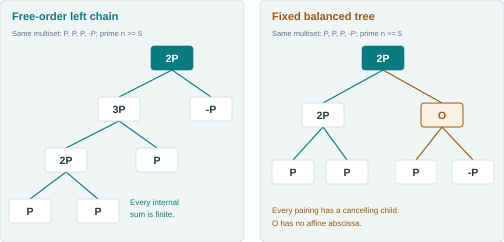

# Prime31 iteration 6: an exact quadratic relation system

**Research checkpoint | 22 November 2026, America/Los_Angeles | Existing PR #4928**

The candidate now has a precise higher-arity representation: an oriented S3
chain joined to compact Dickson membership ladders. Every equation is at most
quadratic. On the stated rational affine domain, the full Dickson fibre gives
exactly the same signed witnesses as its liftable subset. A freely ordered
left chain is complete for unordered signed multisets of up to n points in a
prime-order group. [M1, M2]

The next task is to solve this compact system, including empty targets, at a
lower complete cost. Equation degree and input size alone do not establish
that bound. **The first Rust CI build is blocked by inherited root syntax;
the new tests did not execute.** The
mathematical derivations and their independent written review remain
**[pcc:unverified]**. [E1, M1, M2]

## 1. Inputs and the exact domain

| Item | Specified input or condition |
| --- | --- |
| Field | p = 2147483647 = 2^31 - 1 |
| Curve | y^2 = x^3 + 847514846 x + 2087444724 |
| Recorded group order | n = 2147446831, prime and odd |
| Root | A specified rational point R = (r,s), different from O |
| Membership | F(X) = D_N(X) - c, N = 2^k; F split and squarefree over Fp |
| Tree | Every auxiliary abscissa is finite and belongs to Fp |

The curve/order inputs are inherited from the lane. This iteration supplies
no new point-count certificate. Write W for the liftable fibre coordinates,
B = |W|, and H(X) = product over w in W of (X-w). The signed point base A
contains both points above each w, so |A| = L = 2B. The point at infinity O is
excluded. Odd group order makes every finite rational ordinate nonzero. [M1]

The result distinguishes three objects: a connected S3 tree whose auxiliaries
are actually in Fp; a polynomial ideal with coefficients in Fp but unrestricted
roots; and a projected higher summation polynomial. Only the first object
inherits rational-tree purity without further field restrictions. [M1, R1]

## 2. All-node orientation keeps the equations quadratic

For each internal vertex v, let its children have abscissae x_l and x_r.
Introduce a slope lambda_v; introduce y_v only for nonroot internal vertices.
The root coordinates are the constants (r,s). Impose

\[
\lambda_v^2=x_l+x_r+x_v,\tag{Q1}
\]

\[
2y_v\lambda_v=(x_l-x_v)(x_r-x_v)-(3x_v^2+a).\tag{Q2}
\]

For each nonroot internal child w of v, propagate the ordinate through

\[
y_w=\lambda_v(x_w-x_v)-y_v.\tag{Q3}
\]

The same expression recovers a leaf's ordinate after solving. Separate cubic
curve equations for every vertex are unnecessary: the factorization on the
next page proves curve membership inductively from the actual root. [M1, M2] [pcc:unverified]

At each leaf set z_(i,0) = x_i and apply k steps of z -> z^2 - 2, ending at c.
For k >= 1 this uses k equations and k-1 new variables per leaf. It enforces
D_(2^k)(x_i) = c without expanding a degree-N polynomial. [M1]

| Component | Variables | Equations |
| --- | ---: | ---: |
| Nonroot abscissae | 2m-2 | 0 |
| Nonroot internal ordinates | m-2 | m-2 |
| Slopes and their two constraints | m-1 | 2m-2 |
| Dickson intermediates | m(k-1) | mk |
| **Total** | **mk+3m-5** | **mk+3m-4** |

These counts hold for m >= 2 and k >= 1, with solutions sought over Fp. The
input construction uses O(mk) field-sized data given the valid curve and
fibre. Selecting or validating those inputs remains setup. The m=1 case is
direct target membership; N=1 is a separate linear membership case. [M1, M2]

## 3. Why full-fibre witnesses become rational

Let R=(r,s), put u=x-r and v=z-r, and suppose S3(x,z,r)=0 over Fp. Define

\[
\lambda=\frac{uv-(3r^2+a)}{2s},\qquad
P=(x,\lambda u-s),\quad Q=(z,\lambda v-s).
\]

The centered S3 identity yields lambda^2 = x+z+r. With f(r)=s^2,

\[
f(r+T)-(\lambda T-s)^2=T(T-u)(T-v).
\]

Thus the line meets the curve at -R, P and Q, with multiplicities, and P+Q=R.
The formula divides only by 2s. It covers x=z and coordinates equal to r,
including tangent cases. The parent point and two child abscissae determine
the oriented children uniquely. [M1, M2, E2]

Start at the specified rational root. The local formula gives rational
children. Odd rational group order keeps their ordinates nonzero, allowing
the same step at every internal child. All leaves are rational, and all
signs agree across edges. Therefore, as sets of Fp-valued tree assignments,

\[
V_{\mathbb F_p}(S_3\text{ tree},F(x_i))
=V_{\mathbb F_p}(S_3\text{ tree},H(x_i)).
\]

Q1-Q3 produce a bijective augmentation of these assignments. This is the
reason full Dickson membership can replace the expanded liftable polynomial
throughout the tree. [M1, M2]

### A projected S4 can still have a ghost

Take a nonliftable fibre coordinate w and a rational fibre point R with
abscissa r. Geometric points P,-P,R have total R, so S4(w,r,w,r)=0. But
q(U)=S3(w,r,U) has nonsquare discriminant 16 f(w) f(r): its two auxiliary
roots lie in Fp^2, and neither lies in Fp. Eliminating q against itself gives
zero; the finite-Fp chain rejects this tuple. Coefficients in Fp do not
replace a rational-root condition. [M1, E1]

## 4. Completeness belongs to the freely ordered left chain

For m >= 3 use auxiliaries q_j for prefix sums, with

\[
S_3(x_1,x_2,q_2)=0,\quad
S_3(q_{j-1},x_j,q_j)=0,\quad
S_3(q_{m-1},x_m,r)=0.
\]

The middle equation has 3 <= j <= m-1. For m=2 there is only
S3(x_1,x_2,r)=0. A particular ordered signed tuple appears in this affine
chart when its internal prefix sums are nonzero. [M1]

**Ordering lemma.** In a prime-order group of order n, any multiset of
1 <= m <= n nonzero points with nonzero total admits an order with every
prefix nonzero. Work backward: with t >= 2 remaining points and total S,
remove a point different from S. If no such choice exists, all t points
equal S, forcing (t-1)S=O. This contradicts 1 <= t-1 < n. The remaining
total stays nonzero; reverse the removals to obtain the order. [M1, M2]

Repeated points and cancelling pairs are covered. The result is complete for
unordered signed multisets of exactly m points, with free leaf slots. A
fixed sorted order can lose them. Enumerating every ordered tuple needs
permutation expansion or explicit identity-intermediate branches, with
their output cost charged. [M1, M2]

For prime n >= 5, P,P,P,-P totals 2P. The left-chain prefix sums P,2P,3P,2P
are nonzero. Every balanced two-pair partition puts -P with a P and therefore
contains an identity child. The theorem does not extend to an arbitrary fixed
balanced topology. The m <= n uniform guarantee is sharp: n+1 copies of P
have a zero prefix of length n in every ordering. [M1, M2]

## 5. Field guards and the complete-cost gate

For closure-based elimination, constrain the m-2 internal abscissae to Fp.
Leaf abscissae already lie there because F splits; the oriented equations
then force slopes and internal ordinates into Fp. [M1, M2]

At p=2^31-1, introduce h_1,...,h_30 for each internal x and impose

\[
h_1=x^2,\quad h_j=h_{j-1}^2\ (2\le j\le30),\quad h_{30}^2=h_1.
\]

The eliminated equation is x^(2^31)-x^2 = x(x^p-x), whose zero set is exactly
Fp. This adds 30 variables and 31 quadratic equations per internal x:

\[
\text{variables}=mk+33m-65,\qquad
\text{equations}=mk+34m-66.
\]

Zero has multiplicity two. Use zero-set and witness semantics, not scheme
length or raw multiplicities. A squarefree eliminated x^p-x guard uses a
split square/product circuit with 59 variables and 60 equations per internal
x. A native Fp solver needs neither added guard. [M1, M2]

### Assigned-point extraction is explicit; root solving remains charged

Per internal node, direct oriented extraction costs at most

\[
I_p+4M_p+S_p+6A_p+2C_p,
\]

where I, M, S, A and C denote inversion, general multiplication, squaring,
addition/subtraction, and constant scaling. A whole tree has m-1 internal nodes.
Membership evaluation adds mk squarings and mk subtractions. Independent
signed curve replay, row normalization, deduplication and output remain
additional. Writing z rows requires at least Omega(mz) point labels. [M1, M2]

The complete cold cost retains parameter/fibre setup, system construction,
solving, rational root isolation, extraction and output. The unresolved term
is the solver, especially an exact empty-target certificate. [M1]

An exact shared-state alternative counts valid prefixes by
f_j(S)=1_(S!=O) sum_(P in A) f_(j-1)(S-P). A sparse explicit build extends
each supported state by L choices, costing Theta(L M_(j-1)) group/hash
operations per level. Storing every prefix witness still takes Theta(L^j)
entries for fixed j; aggregate states can be smaller, and their memory and
query-edge regeneration must be priced. The quadratic representation avoids
constructing that graph as input. A faster exact contraction remains to be shown. [M1, M2] [pcc:unverified]

### A quantitative target for the next solver

In the conventional uniform-target/full-independent-row model, write setup as
B^sigma, an empty-inclusive target query as B^tau, and sparse linear algebra
as B^2. Set alpha=max(sigma,2). The conditional complete exponent is
alpha/(alpha+m-1-tau), when m-1>tau and the balancing range is admissible.
Beating one half within this model requires alpha+tau<m-1. Thus for m=4 and
sigma<=2, the concrete missing query bound is **tau<1**. This is a
model-specific necessary budget, not an established algorithm or an ECDLP
lower bound. [R2]

## 6. Evidence, prior art, and the next discriminating action

| Evidence | Current standing |
| --- | --- |
| Mathematical note | Written derivation, independently reviewed; [pcc:unverified] |
| Frozen correctness source | Four new test functions and imported original tests prepared; new tests did not execute |
| Original-root-lock CI | **Blocked by inherited root syntax** at source bf56de345c02ef6f1c55bfa047087b0e880cb09e |
| Centered S3/discriminant records | Existing native evaluated-tier certificates, proof:null |
| New cubic-residual identity | Native issuer prepared but not executed; issuance and replay remain pending |
| Performance | No new timing panel or asymptotic solving bound |

[CI run 45096187034](https://github.com/isogeny-labs/crypto/actions/runs/45096187034),
job 137436389923, failed while compiling the original root crate. The
inherited `ecbench/spec.rs` test-fixture section around lines 894-1042 has
malformed calls and unclosed delimiters. This stopped execution before the
new example tests and before native cubic-residual identity issuance. The
failure is a build dependency, not a mathematical counterexample. A minimal
history-based repair and original-lock rerun are in progress. [E1]

The frozen correctness panel uses the existing depth-six N=64/B=31 fibre,
the explicit Fp^2 ghost, repeated and corrupted certificates, the fixed-order
identity-prefix failure and its repair, the balanced-tree counterexample,
and all 64 ordered triples plus 256 ordered quadruples on a fixed four-point
signed base. These are specified controls, not yet reported observations.
The source and commands are retained in SOURCE_FREEZE.json. [E1]

Semaev 2015 already gives ground-field S3 chains and a related minimality
lemma. Existing native code already has Dickson ladders and chord/tangent
orientation of a final pair. This continuation adds the scoped all-node
representation, exact field restrictions and free-permutation completeness
accounting; literature-wide originality is unestablished. [L1, R1]

**Next action:** repair the inherited root parse failure, retain the failed
receipt and rerun source-bound correctness checks with the original lock;
then specify an
actual solver for the guarded quadratic system with exact empty-query and
output semantics. Its recurrence must charge preparation, state dimension,
misses, rational extraction, memory and all signed rows against the maintained
group-complement and meet-in-the-middle controls. A fixed prime is a benchmark;
an exponent claim requires a stated growing family, without assuming
infinitely many Mersenne primes. [M1]

### Sources and provenance

- **M1:** [MATHEMATICAL_NOTE.md](MATHEMATICAL_NOTE.md), unchanged proof note;
  SHA-256 `948d36ca3d72661aa4cf16786ebed30fcb2ba146afb0df4420767a91e8f35ddc`.
- **M2:** [INDEPENDENT_REVIEW.md](INDEPENDENT_REVIEW.md), independent written
  mathematical audit. This is not a formal proof or signed PCC certificate.
- **E1:** [SCOPE.md](SCOPE.md), [SOURCE_FREEZE.json](SOURCE_FREEZE.json), and
  [report-validation.json](report-validation.json). Source checkpoint:
  [bf56de345c02ef6f1c55bfa047087b0e880cb09e](https://github.com/isogeny-labs/crypto/commit/bf56de345c02ef6f1c55bfa047087b0e880cb09e).
- **E2:** Existing [centered S3](../identity-certificates/centered-s3.json)
  record `IDC1hf62e2402e4871a82` and
  [discriminant](../identity-certificates/s3-discriminant.json) record
  `IDC1h869923a46a34c70c`. These certify evaluated identities at their
  stated scope; they do not certify the tree/completeness theorems.
- **R1:** The prior native example
  `research/prime31_ic_20261115/native/examples/prime31_m8_oriented_f4.rs`,
  blob `e65aff0b1ee1166aefdfd79775f1c4bc2f695a16`; bounded sibling source
  audit and original lane notes, as identified in M1.
- **L1:** Igor Semaev, *New algorithm for the discrete logarithm problem on
  elliptic curves* (2015), [arXiv:1504.01175](https://arxiv.org/pdf/1504.01175),
  Section 3 equation (4), Section 4.1 Lemma 2, Section 4.2.
- **R2:** [ROOT_REVIEW.md](ROOT_REVIEW.md), the scope/provenance integration
  review and conventional full-rank exponent budget.

The existing [PR #4928](https://github.com/isogeny-labs/crypto/pull/4928) and
[research Space](https://chatgpt.com/space/page_729b0b80bdb4819193f457c80ecabe84)
are the continuation records. The new PDF is a six-page account of this
iteration; all previous pinned reports and evidence remain unchanged.

**PCC records:** representation and completeness `PCC-20261123-ed96d7`;
scoped bucket/rank and conditional exponent budget `PCC-20261123-36ec87`;
literature/source audit `PCC-20261123-184d4e`. All remain unverified. These
records are claim tracking, not signed mathematical or execution verdicts.
