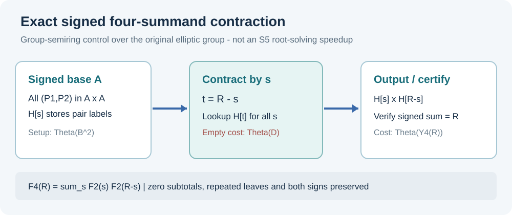

# Prime31 continuation: exact negative-query and target-yield report

**2026-11-22 Pacific; [pcc:unverified].** This is an illustrated note for independent follow-up draft PR #4941. Parent #4928 and companion #4924 are merged. No new original-Rust execution, reported performance win, or signed proof has been produced by this follow-up.

## Mathematical result

For a verified signed point base A of size L=2B in the ordinary curve's prime-order group, prepare all ordered signed pair sums and their labels. The exact four-summand query for R is the contraction

\[
F_4(R)=\sum_{s\in G}F_2(s)F_2(R-s).
\]

One scan of every distinct pair-sum key finds **every** ordered signed quadruple, or certifies emptiness relative to A. No auxiliary closure ghosts are admitted. Identity subtotals and repeated leaves remain valid; a freely permuted affine comb can reconstruct all multiset witnesses for nonzero R and m<=n. A fixed balanced affine tree still misses P,P,P,-P.

| Phase | Exact charge |
|---|---|
| Factor-base construction | Previously proved *conditional* selectable full-fibre expected O(q log p) field work plus inversions, source-group checks |
| Pair-table setup | Theta(L²) point additions, hash insertions and labelled pair records |
| Query, including a miss | Theta(D) point additions/lookups; D=number of **distinct** signed pair sums |
| Signed full output | Additional Theta(Y4(R)) tuple emissions/replays |
| Rank and cold recovery | **Not supplied** by the contraction |

If D is quadratic in B, the specified query exponent is tau=2, setup exponent sigma=2. This baseline fails the conventional m4 conditional budget alpha+tau<3 with alpha=max(sigma,2). It is not a general lower bound for alternative indexes or true algebraic elimination.

## Exact blind-target limit, not a sampled measurement

For each fixed A and a uniform R in a group of order n, E[Y4(R)]=L⁴/n, hence P(hit)<=L⁴/n. For a uniform nonzero R on an odd-order group, three universal cancellation patterns give a sharper bound P(hit)<=(L⁴-3L²+3L)/(n-1).

| Inherited Prime31 fixture | Value |
|---|---:|
| p | 2,147,483,647 |
| recorded prime group order n | 2,147,446,831 |
| B / signed L | 31 / 62 |
| Expected ordered signed quadruples per uniform R | 0.006880885611 |
| Proven uniform-target empty probability, at least | 99.3119114% |
| Proven uniform-nonzero empty probability, at least | 99.3124398% |
| Necessary ideal 90%-rank probability query count for B rows | 4,055 |

The 4,055 lower bound uses only E[rank]<=T L⁴/n and Markov for uniform target marginals; it is not a forecast for an adaptive relation strategy or an observed experiment. It reveals why a planted positive certificate cannot substitute for a natural-target/miss-inclusive test.

## Conditional growing-family cost window

For B~p^beta, an otherwise proved full-rank m4 solver with setup exponent sigma, matrix exponent 2 and empty-inclusive query exponent tau would have a sub-square-root exponent if

\[
\frac{1}{2(3-\tau)}<\beta<\frac{1}{2\max(\sigma,2)}.
\]

With sigma<=2, a possible interval requires tau<1. Iteration7's field/fibre theorem under a **guaranteed** Linnik exponent Lambda constructs selectable B~p^beta for every beta<min(1/Lambda,1/2) on a supplied eligible odd-order source curve. The conservative established Lambda=5 only guarantees enough base size for some candidate beta in the interval when tau<1/2. The newer reported Lambda=3.99 is not independently established here and must not be treated as proven. Neither statement certifies a growing prime-order elliptic source family or an actual fast solver.

## Current source-bound status

| Evidence | Observed outcome | Scope |
|---|---|---|
| PR #4928 | Merged | Historical lane, do not maintain |
| PR #4924 | Merged | Historical companion, do not maintain |
| Run 45096187034 | Failed | Inherited ecbench/spec.rs parse defect |
| Run 45097885135 | Failed | Unclosed src/cryptanalysis/ic_framework/mod.rs delimiter |
| Run 45100829948 | Failed | Duplicate root Cargo.toml key at line 132 |
| PR #4941 | New draft | Independent proofs, negative-query protocol, unsigned claims, no Rust/CI |

The last three native gates stopped **before** the new candidate tests. A historical CI success is valid only for its own exact source revision. Do not claim a later native chain or monic issuer passed merely because old commits did.

## Next discriminating experiment

Freeze and implement an actual quadratic Q1-Q3 elimination/root-isolation algorithm using the maintained Rust code, including **complete certified misses**. Compare all F101 targets against the signed group contraction, then natural Prime31 targets generated under the exact deterministic sampling specification. After independent signed replay, source/lock CI repair and EKS admission, report complete cold costs, rank and target recovery versus the strongest maintained index calculus and optimized negation-map rho.

The complete written arguments, mathematical limitations and source references are in [EXACT_CONTRACTION_AND_YIELD.md](EXACT_CONTRACTION_AND_YIELD.md), the proposed deterministic generator in [NATURAL_TARGET_PROTOCOL.md](NATURAL_TARGET_PROTOCOL.md), and all unsigned claim scopes in [CLAIMS.json](CLAIMS.json). No signed formal proof, Rust measurement or asymptotic breakthrough is claimed.