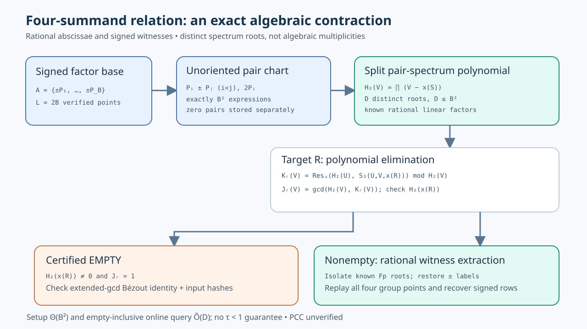

# Iteration 9 research report — pair-spectrum resultant gate

**2026-11-22 PT / 2026-11-23 UTC.** Written mathematical continuation after merged #4928, #4924 and #4941. **[pcc:unverified]**. This report presents an explicit finite-field S3 elimination *with a verifiable miss certificate*. It does not prove a faster asymptotic solver, offer native Rust timing, or replace the existing group-semiring MITM baseline.

## Result and what changed

For B distinct rational, liftable source abscissae, the signed point base has L=2B elements but the nonidentity two-sum **x-spectrum** has **at most B²** roots, not 4B². The chart consists of P_i+P_j and P_i-P_j for i<j plus 2P_i for every i, exactly B² expressions. The B cancelling {P_i,-P_i} pairs are retained separately. Simultaneous negation is free on nonzero unordered pairs in an odd-order group, giving the bound with a short exact proof. Point collisions only reduce the distinct root count. This is a fourfold reduction in the *number of pair additions relative to direct ordered signed-pair enumeration*; no wall-time or asymptotic advantage follows. [pcc:unverified]

Let H_2(X) be the monic squarefree product of those distinct pair-sum abscissae, degree D≤B². For a nonidentity public target R, form K_r(V)=Res_U(H_2(U),S3(U,V,x(R))) modulo H_2(V) and J_r=gcd(H_2,K_r). For the supplied verified rational point base, the complete four-sum relation set is empty **exactly if** H_2(x(R))≠0 and J_r=1. The zero-pair branch is necessary: gcd=1 alone is not a valid miss certificate.

The extended-gcd equality A(V)H_2(V)+B(V)K_r(V)=1, together with H_2(x(R))≠0 and frozen source hashes, is independently checkable. A nontrivial gcd isolates known **Fp** linear factors from a precomputed product tree. Each surviving v needs at most two candidate u abscissae from the degree≤2 S3 relation; all signed pair buckets are then replayed using original group arithmetic. This restores actual rational witnesses rather than relying on an algebraic-closure solution or polynomial multiplicity. [pcc:unverified]

## A concrete size and cost gate

| Stage | Actual size | Charged work |
| --- | ---: | --- |
| Rational signed lifts | 2B points | B quadratic-residue/sqrt validations plus source-subgroup checks |
| Unoriented nonzero pair expressions | B² | exactly B² additions/doublings, collision hashing |
| Distinct split pair roots | D≤B² | H_2 degree D, retained pair buckets |
| Source polynomial/product tree | D leaves | O(M(D) log D) field work, O(D log D) Fp-element tree memory |
| Each target resultant remainder | D quadratic factors | O(M(D) log D) field work, even on an empty target |
| Each target gcd and Bezout miss proof | degree≤D | O(M(D) log D) field work with fast Euclid |
| Nonempty rational isolation | h=deg J_r | at most O(M(D) log² D) field work; ≤2h partner roots, plus all output |
| All signed rows | Z_R complete ordered tuples | Ω(Z_R) output labels plus independent group replay |

At **B=31** on the inherited p=2^31−1 curve, the chart has 961 expressions rather than 3844 ordered signed pair expressions; the degree D may be smaller through actual point collisions but **has not been measured** here. The uniform-target exact count from iteration8 is E[Y_4]=14,776,336/2,147,446,831, so uniform blind misses dominate at this size. The present elimination does not avoid their query cost.

When D=Θ(B²), source setup exponent σ=2 and empty-inclusive query exponent τ=2 (up to multiplication logarithms). In the conventional m=4 independent-full-rank cost model, the necessary gate max(σ,2)+τ<3 fails (2+2=4). This is a *scoped obstruction for this explicit resultant*, not a general lower bound on algebraic contraction or other reporting indexes. Finite-field root completeness and output multiplicity are separate from matrix-rank completeness.

## Exact source and literature audit

- [Long-form proof, degeneracy guards and exact algorithm](PAIR_SPECTRUM_RESULTANT.md). The appendix derives the missing H_2(r) zero-pair branch, exact multiplicity handling, squarefree resultant support and stage dimensions.
- [Previous signed-group contraction](../iteration8/EXACT_CONTRACTION_AND_YIELD.md) (merged PR #4941). This algebraic realization has the same group semantics; meet-in-the-middle and S3 symmetrization are **not novel mechanisms**.
- [Rational affine Q1-Q3 theorem, free-order proof and Fp² ghost](../iteration6/MATHEMATICAL_NOTE.md) (merged PR #4928). We do not extend completeness to fixed balanced trees: the P,P,P,-P counterexample is retained.
- [Constructible full Dickson fibres](../iteration7/FIXED_CURVE_FIBRE_DENSITY.md) and [Linnik growing field](../iteration7/SMOOTH_TORUS_FAMILY.md). These supply source factor-base candidates under stated hypotheses, but neither gives a sublinear query, prime-order source family, rank or completed ECDLP.
- Semaev 2015 https://eprint.iacr.org/2015/310 ; Faugere et al. EUROCRYPT 2014 https://doi.org/10.1007/978-3-642-55220-5_3 ; Chan et al. arXiv:2610.42012 (2026-11-14 revision) https://arxiv.org/abs/2610.42012. Current generic reporting arXiv:2611.09656 and arXiv:2611.13294 remain in the iteration6 literature audit. Do not call those results impossible/irrelevant or presume integer residues are free group-character labels.

**Evidence:** Inspected retained original-lock job logs. Run45096187034 job137436389923 stopped in ecbench/spec.rs; rerun45097885135 job137441679059 stopped at ic_framework/mod.rs:4528; subsequent run45100829948 job137451053331 stopped at duplicate root manifest key, all before this new candidate. None of the historical successes certify the present source. This iteration performed no Rust operation, no GPU/CPU experiment, and no submitted PCC verifier; every theorem and cost claim is currently **[pcc:unverified]**. No retained failures were reclassified as passes.

**Known environmental constraints:** This execution has no installed rustc/cargo, no EKS admission or research KB connector, and the confirmed research Space Page read requires interactive authorization. The page and existing automation were neither recreated nor changed. Source/workflow/main STATE changes are deliberately left to their existing owners; this isolated PR preserves other live lanes.

## Next experiment / falsifiability

Implement an **original-arithmetic Rust** decision/output/certificate oracle (not a borrowed Rust reimplementation) and freeze source, curve, signs and seed. Enumerate all targets on a small odd-order F101 subgroup, including target O, all misses, zero pairs, repeated leaves, pair collisions and P,P,P,-P. Compare exact output *multisets*, not only positivity, against the already published iteration8 group-semiring contraction. Independently verify every nonempty target through signed group replay and every miss through the Bezout identity.

Only then use unselected natural Prime31 targets with B=31 and larger supported fibres, retain every attempt, and implement a different contraction whose **proved** empty-inclusive query exponent might be below 1. Admission to complete-cost claims requires independent rank and target recovery, checkpoint/EKS rules, matched best IC and optimized negation rho, setup and storage, and a justified growing family. The research objective remains open.