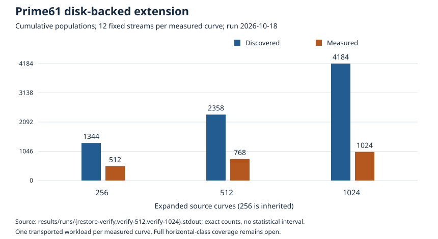
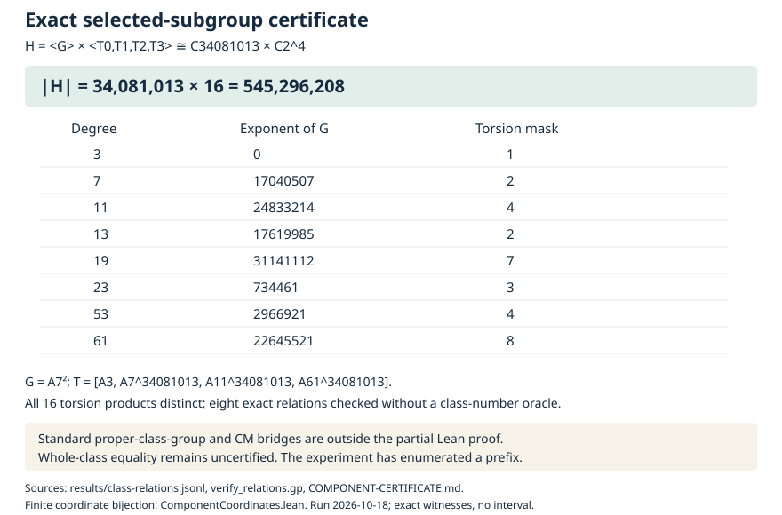
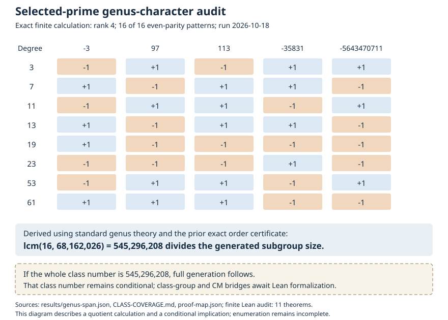

# Prime61 extension and selected-component certificate, 2026-10-18

The public synthetic experiment over **p=2^61-1** now has **4,184 discovered
curves, 15,360 verified maps and 1,024 measured curves**. Its 12,288 committed
streams complete **1,228,800,000 target trials, zero relations and zero
solves**. This remains a bounded prefix of the user's requested all-horizontal
experiment. The earlier studies and checkpoints remain frozen.

Separately, explicit reduced-form relations certify that the eight selected
prime classes generate exactly **545,296,208 ideal classes**, with structure
C68162026 × C2^3. Standard ordinary maximal-order CM theory transfers this
size to the selected curve component. The entire class number and equality
with the whole horizontal class remain uncertified. Neither result completes
the requested enumeration or establishes a factor-base ranking.

[Four-page inspected PDF](reports/report.pdf), [editable source](reports/report.typ),
[count data](reports/summary.json), [coverage derivation](CLASS-COVERAGE.md),
[additive component certificate](COMPONENT-CERTIFICATE.md),
[PR 2144](https://github.com/aburan28/crypto/pull/2144).



## Recorded execution

| Expanded sources | Discovered curves | Verified maps | Measured curves | Committed streams |
| ---: | ---: | ---: | ---: | ---: |
| 256, inherited | 1,344 | 3,840 | 512 | 6,144 |
| 512 | 2,358 | 7,680 | 768 | 9,216 |
| 1,024 | 4,184 | 15,360 | 1,024 | 12,288 |

New since the input checkpoint: 2,840 discovered curves, 768 expanded sources,
11,520 maps, 512 measured curves, 6,144 streams and 614,400,000 trials.
All 41 native phase commands exit zero, with no caps or kernel failures.
The separate 192-stream input collector replay is a control, excluded from
measurement totals. At the final checkpoint **3,160 sources remain pending**
and 3,160 discovered curves remain unmeasured; these sets need not coincide.
The full selected component is not exhausted.

The [final verifier](results/verification-1024.jsonl) checks all 15,360 maps,
1,024 expanded-source rosters and 122,880 scalar transports. The
[prefix audit](results/immutable-prefix-1024.json) matches all **11,330 inherited
immutable rows**; the final logical dump contains 31,834 rows. Only curve
expanded/measured flags may advance. Before extension, inherited maps,
rosters and records pass verification, 192 collector streams replay, and
the restored logical dump is byte identical to the predecessor's dump.

Maximum reported native-worker peak RSS across the phase receipts is
**20,044 KiB**. Final live database size is **11,173,888 bytes**; the compact
closed snapshot is 11,137,024 bytes, gzip 3,948,851 bytes. Compiler, test,
audit, Lean and renderer memory are excluded. These observations do not
bound full-class storage or establish speed, S or full IC cost. Disk usage
still grows with SQLite BFS; no full-class quota/runtime extrapolation is
admitted. Host isolation is unqualified: five visible Intel Xeon Platinum
8573C CPUs, four-CPU cgroup quota, 16 GiB RAM.

## Frozen source and workload

[PROTOCOL.json](PROTOCOL.json), committed as `90d82f8` before extension,
freezes cumulative batches 512/768 and 1024/1024 expanded/measured. The input
is the verified 256-source snapshot from
[the preceding continuation](../prime61_disk_continue_20261018/README.md).
The unchanged [spec.json](spec.json) and worker source
`b68341cd72b51acf9c5ce6c4f755351cc83053db` retain Rust 1.99.1 and system
SQLite. Current-main ecbench compile failures are preserved in the preceding
study; no unrelated source was repaired. Pinned-source test success is not
a claim that current main passes.

The spec fixes a=p-3, b=111, prime subgroup order 2305843010818082053,
G=(1,1796364306280342617), Q=(992726311114892094,558260110083040833),
and degrees [3,7,11,13,19,23,53,61]. Scalar 539365399 is public synthetic
checking data; collection receives G and Q, not the checking scalar. Each
measured curve gets a fresh low-x base of three inverse pairs, twenty
requested relations and twelve streams with seeds 2026101600..2026101611,
each capped at 100000 target trials. One first-parent transported workload
is measured per discovered class. Raw records retain exact EC1/UIDs and
transported coordinates; no candidate promotion or screenshot-search
reproduction is claimed.

[continue.sh](continue.sh), committed before execution, advances at most
32 cumulative sources and measures at most 64 cumulative curve IDs per
command, with a 300-second outer cap. Full verification has a 900-second
cap, without weakening any check or stream budget. Transactional retry
logic preserves timed-out attempts; no retry was needed. One frontier writer,
8 MiB SQLite cache, disabled mmap, disk-backed temporary storage, 2 GiB
study cap and 2 GiB minimum free disk are frozen. The script stops after
the two batches. No remote compute or unattended extension is provisioned.

## Exact selected-component certificate



[RELATIONS_PROTOCOL.json](RELATIONS_PROTOCOL.json), committed as `81d504f`
before the diagnostic, freezes a separate exact-form witness search.
[class_relations.gp](class_relations.gp), committed as `b36b0dc` before
execution, checks an odd order-34081013 generator, four independent
involutions, all sixteen distinct products and eight explicit relations.
There is no whole-class-number oracle. [verify_relations.gp](verify_relations.gp)
checks the fixed witnesses without search and rejects both a corrupted
exponent and a corrupted torsion mask. Both paths use the same PARI 2.15.2
library and host. The old exact-order certificate also replays byte identically.
Package hashes and commands: [PARI environment](results/pari-environment.json).

The [full certificate](COMPONENT-CERTIFICATE.md) gives the group argument,
all witnesses and the ordinary CM bridge. The preceding
[genus diagnostic](CLASS-COVERAGE.md) independently shows rank four and
all sixteen even-parity genus masks; its original proof and 512 archive
remain unchanged.



Lean 4.34.1 checks eleven preceding finite genus/arithmetic facts and three
new finite-coordinate theorems. The [gate](results/component-proof-gate.log)
audits sixteen declarations, including two generated equation lemmas, with
**zero extra trusted axioms**. The coordinate encoding and inverse are
kernel checked. **Formalization is partial:** native primality/form
arithmetic, proper ideal classes, the group product argument and CM action
remain outside Lean. See [genus proof map](proof-map.json) and
[component proof map](component-proof-map.json). Standard foundations are
recorded; no sorry, native_decide or custom axioms are used. lean4checker
is unavailable. The initial 4.24 audit compatibility failure and initial
zero-job build remain in the evidence and are not counted as proof passes.

The discriminant coefficient certificate
[IDC1h5d70c781a75cea1c](results/discriminants.identity.json) has a universal
integer Lean proof and 32+32 native evaluation checks. It concerns only
discriminant coefficients and does not certify class coverage.

## Durable storage and validation

Both closed snapshots were uploaded to Drive, metadata-read back, downloaded,
manifest-checked and compared byte for byte. The final restored raw database
also produces the original native logical dump exactly. Public receipts
omit private Drive identifiers:
[512](results/drive-512-receipt.json), [1024](results/drive-1024-receipt.json).

| Expanded | Archive bytes | SHA-256 |
| ---: | ---: | --- |
| 512 | 3,783,039 | `8e95378c437a65c78edf97c4d6bcecf7b262c9ce9ee79bf3719f3d20ab167941` |
| 1024 | 7,330,526 | `f43d2033fd414677af1f94ef0b6c830543d85aa3e7730dd872e5d40b4e562f0d` |

The final archive contains 27 internally hashed files: database, logical
records, spec, protocols, exact source revisions and compact proof evidence.
[pack_checkpoint.sh](pack_checkpoint.sh) creates the final archive. The
512 archive predates the additive component certificate and remains unchanged.
Small archive round trips do not establish full-class storage quota.

Pinned-source validation passes **4,168 release library tests, zero failures,
117 ignored**, plus four disk-worker tests and the existing degree-3 evaluator
test. Native genus tests compare independent span algorithms, including
deficient cases, and square-set controls. A fresh native helper replay
reproduces the genus record, IDC certificate, inherited-prefix audit and
all three SVGs and summary byte identically. The Lean gate also passes
in that replay. Raw archive extraction/repacking is byte identical; its
extracted logical dump passes the inherited-prefix audit.

Evidence: [library log](results/prime61-extend-library-tests.log),
[example log](results/prime61-extend-example-tests.log),
[native tests](results/genus-tests.log), [replay exit](results/reproduction.exit),
[replayed proof gate](results/reproduced-proof-gate.log),
[archive recovery](results/raw-archive-recovery.log),
[all-page PDF inspection](results/report-inspection.json).

## Recover and reproduce

From this study directory, check `sha256sum -c evidence.sha256` and
`sha256sum -c results/runs.tar.xz.sha256`. Extract the raw tree into a new
scratch directory with `tar -xJf results/runs.tar.xz -C /new/raw`.
All 41 exact native commands, stdout/stderr/exits, inherited restore
controls and both closed snapshots/dumps are retained. Repacking recipe:

```sh
tar --sort=name --mtime='2026-10-18 00:00:00Z' --owner=0 --group=0 \
  --numeric-owner --mode='u+rwX,go+rX,go-w' --format=gnu \
  -C /new/raw -cf - runs | xz -6 -T1 > /new/repacked.tar.xz
```

Build the exact pinned worker in an isolated checkout:

```sh
cargo build --release --no-default-features --example isogeny_disk_walk
```

Use `verify spec.json checkpoint.db 16`, `status spec.json checkpoint.db`
and `dump spec.json checkpoint.db` as subcommands of the resulting example.
Restore the closed database to a new writable path before advancing it.
Do not rerun `continue.sh` over recorded evidence: it intentionally expects
new paths and the exact inherited checkpoint. Freeze a new resource envelope
before increasing cumulative limits.

From the repository root, with Rust 1.99.1, the pinned target directory
and Lean 4.34.1 on PATH, replay helpers into a new scratch directory:

```sh
bash research/prime61_disk_extend_20261018/replay_helpers.sh \
  /path/to/pinned-target /new/raw/runs /new/helper-replay
```

The predecessor's extracted `results/runs/dump-256.stdout` is also required
by the immutable-prefix helper. Its archive is linked in that study.
Render the copied `reports/report.typ` with Typst 0.15.0; inspect every page.
Reproduce the native class witnesses with the commands in
[COMPONENT-CERTIFICATE.md](COMPONENT-CERTIFICATE.md). These reproductions
are controls and are excluded from committed measurement totals.

## Requested scope and next step

| Requested deliverable | Current status |
| --- | --- |
| Larger-field experiment using aburan28/crypto | Verified prime61 bounded batches; binary83 not attempted in this study |
| Every horizontal class | Partial: 4,184 discovered, 1,024 expanded/measured; selected component size known, whole-class equality and exhaustive workloads open |
| Several vertical maps if they exist | None over this base field for this fixed class, by the earlier fundamental-discriminant certificate |
| Recoverable storage and PR publication | Two verified Drive archives, native evidence and inspected PDF in PR 2144 |
| Class-wide factor-base ranking or cost advantage | Unresolved: these capped streams found no relations or solves; full IC cost and speedup remain null |

A rigorous whole-class upper bound of 545296208 would settle selected-prime
coverage. Independently, the exact component coordinates suggest an index-free
streaming walker. That backend is **not implemented or tested**. Validate
coordinate/orientation transitions and transported targets on complete small
classes, add degree-97/113 involution-map controls, then freeze storage and
compute for the full run. The current SQLite index still grows; a full-run
envelope has not been provisioned. The problem and backlog card remain open.

Canonical scoreboards, leaderboard, boundary/frontier plots and their
rendered copies were checked for relevance and remain unchanged: this study
adds prefix capacity, null relation-stage and mathematical certificate
evidence without an admitted performance improvement. Performance-only
`benchmarks/` publication does not apply. Coordination was attempted via
conductor and unavailable (exit 127); scope remains this study and the
existing horizontal-class problem/card.
