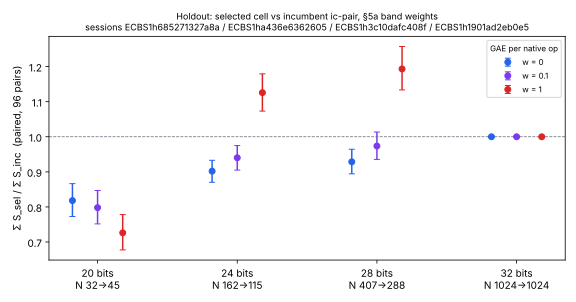
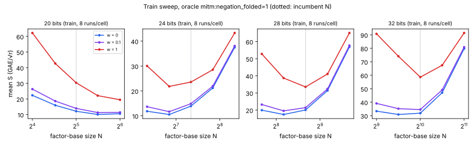

# Prime-field factor-base size and oracle tuning: results (2026-10-29)

This study is the run of backlog card
[`XP-20261016-prime-base-oracle-tuning`](../../backlog/XP-20261016-prime-base-oracle-tuning/).
Its protocol is [`PROTOCOL.md`](../../backlog/XP-20261016-prime-base-oracle-tuning/PROTOCOL.md),
frozen 2026-10-29 as git blob `0ee2e287…`, with no amendments. The card was frozen in PR #2810.
The decision rule is the protocol's §7.3. Each size decides alone, on the holdout only.

## Decision

| size | selected `R*(b)` | §7.3 outcome | reading |
|--:|:--|:--|:--|
| 20 bits | `prime-abscissa:size=45` + `mitm:negation_folded=1` (incumbent N 32) | 1–4 hold | **improvement**: new prime-field IC baseline at 20 bits |
| 24 bits | N 115 (incumbent 162), same oracle | total falls at w = 0, rises at w = 1 | relabelling (work moved into native operations); incumbent retained |
| 28 bits | N 288 (incumbent 407), same oracle | total falls at w = 0, rises at w = 1 | relabelling; incumbent retained |
| 32 bits | N 1024 = incumbent | `R*(b)` = incumbent | null by construction; incumbent retained |

At 20 bits the change is the factor-base size only. The oracle is the incumbent's, so `sel` and `size` are the same arm. Train picked no other oracle at any size. The three-summand, root-finding and subset oracles (`mitm3`, `rfmitm3`, `rfsub3`, `rfsub2`, `sub2`, `rfpairs3`) have a mean S from about 2× to several hundred times that of the best `mitm2` cell on every train curve (`select/band-train-P*.md`).

## Result

All values below are *recorded*. They come from `ecbench compare --weight W` (`analysis/compare-P<b>-<a>__<b>-w<W>.json`, the `ops` block) and `ecbench band` (`analysis/band-holdout.md`). Each holdout row has 48 fresh targets × 2 rounds = 96 matched pairs, every arm in the same session on the same targets and algorithm seeds. The intervals are the cluster bootstrap's 95% intervals (4,000 resamples, seed 20261002).

Paired ratio of totals `Σ S_sel / Σ S_inc`:

| size | w = 0 | w = 0.1 | w = 1 |
|--:|:--|:--|:--|
| 20 | 0.818 [0.773, 0.866] | 0.798 [0.752, 0.847] | 0.726 [0.677, 0.778] |
| 24 | 0.902 [0.870, 0.933] | 0.940 [0.905, 0.975] | 1.126 [1.073, 1.179] |
| 28 | 0.929 [0.894, 0.964] | 0.974 [0.935, 1.014] | 1.193 [1.134, 1.257] |
| 32 | 1.000 [1.000, 1.000] | 1.000 [1.000, 1.000] | 1.000 [1.000, 1.000] |

Mean S (GAE/√r) on the holdout curves:

| size | curve | inc w=0 / 0.1 / 1 | sel w=0 / 0.1 / 1 | rho-neg w=0 / 0.1 / 1 |
|--:|:--|:--|:--|:--|
| 20 | icv1-fp20-tm565-6d7d1d32 | 12.853 / 14.826 / 32.577 | 10.515 / 11.829 / 23.655 | 1.357 / 1.474 / 2.529 |
| 24 | icv1-fp24-tm4739-bb3c4b72 | 13.976 / 15.168 / 25.892 | 12.605 / 14.260 / 29.149 | 1.013 / 1.104 / 1.919 |
| 28 | icv1-fp28-tm1499-56171ddc | 20.478 / 22.204 / 37.737 | 19.017 / 21.618 / 45.036 | 0.939 / 1.031 / 1.851 |
| 32 | icv1-fp32-tm36751-2eaac89e | 32.240 / 35.309 / 62.931 | = inc | 0.968 / 1.064 / 1.930 |

### §7.3 checks at 20 bits

1. **Instrument: holds.**
   - `identity` replayed the four frontier sessions: 240/240 records verified at each size, and every replay reproduced.
   - Every holdout, train and Kummer audit is `ok`.
   - `inc-aa/inc` and `rho-neg-aa/rho-neg` are exactly 1.000 at every weight and size.
   - `run.sh verify` re-checked `select/FROZEN.sha256` and replayed every session (`verify/`).
2. **Completeness: holds.** 96/96 measured runs are verified for `sel` and for `inc`, with 0 censored pairs and 0 unpaired runs.
3. **Ratio: holds.** The upper bound is below 1 at all three weights: 0.866, 0.847 and 0.778.
4. **Band: holds.** `ecbench band --ranks` gives `sel < inc` at every weight.

### Gap to matched rho (distance remaining, §7.4)

`Σ S / Σ S_rho-neg` on the same targets (*recorded*, `compare-P<b>-rho-neg__*.json`):

| size | inc w=0 / 0.1 / 1 | sel w=0 / 0.1 / 1 |
|--:|:--|:--|
| 20 | 9.47 / 10.06 / 12.88 | 7.75 [6.92, 8.70] / 8.02 / 9.35 [8.27, 10.60] |
| 24 | 13.79 / 13.74 / 13.49 | 12.44 / 12.92 / 15.19 |
| 28 | 21.80 / 21.55 / 20.38 | 20.25 / 20.98 / 24.33 |
| 32 | 33.30 / 33.18 / 32.61 | = inc |

At 20 bits the gap to rho narrows from 9.5× to 7.7× at w = 0, and from 12.9× to 9.4× at w = 1. IC remains above rho at every size and weight.

### Attribution and controls

- **`size/inc`:** identical to `sel/inc` at every size, because `R*(b)` uses the incumbent oracle.
- **`stride/inc`:** `prime-abscissa:size=N*,stride=7919` with the same oracle is the small-abscissa control.
  - At 20 bits: 0.809 [0.758, 0.868] (w = 0) and 0.715 [0.661, 0.778] (w = 1).
  - At 32 bits: 0.989 [0.960, 1.018] (w = 0) and 0.983 [0.938, 1.029] (w = 1).
  - `ecbench band` ranks `stride < sel` at every size. This is read as a control only (§7.3): choosing the smallest abscissae buys nothing measurable here. The 20-bit gain comes from N, not from which abscissae fill the base.
- **Random-base control:** absent. This is recorded as a gap (PROTOCOL.md §12.2).
- **Panel K** (`analysis/band-kummer.md`) is descriptive only.
  - 22-bit curve: `lowx-c68` < `kummer-t7` across the band. Kummer is not ahead at matched columns.
  - 24-bit curve: `kummer-t8` 12.36 vs `lowx-c119` 12.11 at w = 0, unresolved.

### Why 24 and 28 bits are not improvements

There, the w = 0.1 selection rule (§4.4) picked a smaller base. On the holdout, the total falls at w = 0 and rises by 13–19% at w = 1. At w = 0 only charged group operations count, and w = 1 adds the native operations at full price. So the smaller base trades charged work for native work. The protocol reads this as work moved into uncharged native operations, not as an improvement. On the train curves the w = 1 minimum sits at the incumbent N at 28 and 32 bits. At 24 bits it sits at N 115 (21.8 vs 23.6 at N 162, 8 runs per cell), which the holdout did not reproduce (1.126 [1.073, 1.179]).

## Scope and limits

- **Leaderboard promotion is pending.** PROTOCOL.md §13 requires a second-host replay (`ecbench-independent-runner`) before a leaderboard promotion. The validation here is a same-host, same-binary replay. So this PR lands the result, its validation and the benchmarks entry. The prime-field section of the IC leaderboard follows once a replay on a distinct host class (isolab-eks) reproduces the 20-bit holdout session.
- **Larger than predicted.** The 20-bit gain (18–27%) exceeds the pre-registered §10 prediction 4 ("any holdout gain is under about 10%"). The prediction was wrong; the decision rule does not depend on it.
- **Shallow train minimum.** On the 20-bit train curve, N 45 beat N 64 by little: 11.243 against 11.413 at w = 0.1, 8 runs each. At w = 1, N 64 was lower (19.46 against 22.10). A larger N might do better at 20 bits, and this card did not test that on the holdout.

- **Engineering class:** one parameter (N) at one size. One holdout curve per size, so no exponent claim and no pooled claim across sizes.
- **Counted unit only:** ecbench GAE with the §5a pricing of native operations. No wall-clock claim. The harness's median wall time per run is recorded in `analysis/table-holdout.md` (20 bits: inc 2.49 ms, sel 1.73 ms), but it is not admitted as a claim.
- **Same host for every session:** one core (`taskset -c 3`) of a 4-vCPU cloud container (`host/host.json`, env class `ECBENV3hc4d998f5ae3f`). The replays are same-host and same-binary.
- **Route:** local, as the card's `run` block specifies. The isolab-eks request takes one spec per job, and its admission (L2, A/A, at least 5 rounds) does not fit the staged train → select → holdout protocol. `PBO_CPU` was 3 instead of the card's 31, because the host has 4 vCPUs.

## Provenance

- **Worktree:** commit `7df34ba67dc6d9f03c4aa2daee24a7e31e784257` (`host/commit.txt`). The source of the binary is `code.commit` `0e124fb1b207a76ae9ef88c2bffb1f5b8d92b1b6`.
- **ecbench SHA-256:** `bf5eec6d61fbe83a7e6911bf73d05d847cc0ab23fd6db3342290a26b9f3807d9` (`host/ecbench.sha256`).
- **Launch:** frozen command card `CARD-XP-20261016-prime-base-oracle-tuning-01`, compiled by the experiment director and run by the mechanical executor. Started 2026-10-29T01:29:21Z, analysis written 01:56:09Z.
- **Holdout sessions:**
  - 20 bits: `ECBS1h685271327a8a`
  - 24 bits: `ECBS1ha436e6362605`
  - 28 bits: `ECBS1h3c10dafc408f`
  - 32 bits: `ECBS1h1901ad2eb0e5`
- **Train sessions:**
  - 20 bits: `ECBS1h9fcb65b4770e`
  - 24 bits: `ECBS1hc463af97cc77`
  - 28 bits: `ECBS1had86361014ec`
  - 32 bits: `ECBS1h5cd4a4b40770`
  - plus six 20-bit edge-extension sessions
- **Kummer sessions:** `ECBS1hb054a99e3b4e` and `ECBS1h2cef62166615`.
- **Selection:** `select/selection-P*.json`; frozen hash `3d4461e9455d6cd2` (`select/FROZEN.sha256`).
- **Raw sessions:** stored in the artifact store under `sessions/` (`.artifacts.json` pointers).
- **Run report:** [`reports/run-20261029T0129Z/`](reports/run-20261029T0129Z/).
- **Validation:** [`VALIDATION.json`](VALIDATION.json): verdict passed for row `icv1-fp20-tm565-6d7d1d32`, with caveats. It names [`replay-certificate.json`](replay-certificate.json) and [`validator-report.json`](validator-report.json); the validator's receipts are in [`validation/`](validation/). The validator replayed holdout-P20 (672/672 identical), train-P20 and its extensions on a different core of the same host, re-ran all 84 comparisons byte-identically, and recomputed the ratios independently.
