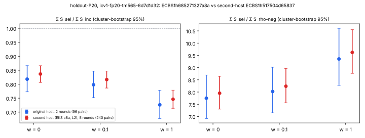

# Second-host re-execution of holdout-P20 (PROTOCOL.md §13), 2026-10-29

This is the second-host replay that [PROTOCOL.md](../../../backlog/XP-20261016-prime-base-oracle-tuning/PROTOCOL.md)
§13 requires before the 20-bit result of this study ([README](../README.md)) is promoted to the leaderboard.
It re-executes the frozen holdout-P20 spec on a different host class with a different ecbench build, and
checks every original record against its counterpart on the second host.

## Outcome

- **Reproduced exactly.** Each of the 1,008 records of the original session `ECBS1h685271327a8a` has a partner on the second host with the same arm, workload, round and algorithm seed. All 1,008 partners are identical in every deterministic field: outcome and recovered scalar, `cost`, `counters`, `boundaries`, `field_ops` and `solver`, plus each phase's adds, doubles, scalar multiplications, GAE and `native` map. The band reads `counters` and the phase `native` maps (`src/cryptanalysis/ecbench/band.rs`, `unpriced_counts`). So S at w = 0, 0.1 and 1 is reproduced exactly. Source: [`analysis/match-original.json`](analysis/match-original.json), written by [`tools/match_records.py`](tools/match_records.py).
- **Second-host session audit passes.** `ecbench verify` on the EKS worker (`eks-results/audit.json`) reports 2,016 of 2,016 records verified and regraded, with the session complete. The L2 gate (`eks-results/l2-gate.json`) admitted all 2,016 executions at L2.
- **Same decision on more data.** The second-host session has 5 measured rounds, so 240 pairs instead of 96. On it, `ecbench compare --weight` gives *recorded* paired ratios for sel/inc and sel/rho-neg:

| w | Σ S_sel / Σ S_inc, second host (240 pairs) | original (96 pairs) | Σ S_sel / Σ S_rho-neg, second host | original |
|:--|:--|:--|:--|:--|
| 0 | 0.836 [0.806, 0.866] | 0.818 [0.773, 0.866] | 7.95 [7.31, 8.64] | 7.75 [6.92, 8.70] |
| 0.1 | 0.817 [0.786, 0.847] | 0.798 [0.752, 0.847] | 8.24 [7.56, 8.97] | 8.02 |
| 1 | 0.746 [0.714, 0.779] | 0.726 [0.677, 0.778] | 9.62 [8.77, 10.55] | 9.35 [8.27, 10.60] |

`inc-aa/inc` is exactly 1.000 at every weight. `ecbench band --ranks` (`analysis/band.md`) ranks `sel < inc` and `rho-neg < sel` at every weight. Rounds 3–5 use seeds the original session never ran, but the same curve and targets. They add target-round pairs, not curves.

Figure. Paired ratios with cluster-bootstrap 95% intervals. Blue is the original host (`ECBS1h685271327a8a`, 96 pairs); red is the second host (`ECBS1h517504d65837`, 240 pairs). Values come from the saved `ecbench compare --weight` JSON; [`figures/plot.py`](figures/plot.py) does layout only.

## What ran

- **Spec:** the frozen `specs/holdout-P20.json` of this study, with three fields changed: `label` (descriptive; it feeds only the spec id), and for EKS admission `measurement.rounds` 2 → 5 (the lab requires at least 5) and `measurement.isolation_required` L0 → L2. Curve, targets, arms, warm-up, order and seed are unchanged. `src/cryptanalysis/ecbench/spec.rs` derives the algorithm seed of a round from (seed, workload, round) only, so measured rounds 1–2 equal the original executions.
- **Request:** [`launch/request.json`](launch/request.json), sha256 `4cf9306c…c7cd6e`. The launcher stored it as [`launch/validated-request.json`](launch/validated-request.json), request sha256 `cc72e6be…8944ff`.
- **Route:** isolab-eks, using the AWS launcher (`taskq/deploy/eks-karpenter/remote/launch-remote`).
  - Frozen task card [`launch/card.md`](launch/card.md) (CARD-…-xhost-02), written by the experiment director and run by the mechanical executor.
  - Card -01 failed on the client before any request was sent: the venv's awscli v1 reads only `AWS_DEFAULT_REGION`. The launcher's CodeBuild build list held no build carrying its request key, so -02 is not a resubmission.
- **Identity:**
  - Launcher build `isolab-experiment-launcher:7569b7f7-fc24-4096-a62a-7a76bf46947e`.
  - Job `pbo-p20-xhost-20261029`, Job UID `b3207fe0-32b1-47b5-a9fb-da09e7ea8282`, Pod UID `e2064a35-dae6-4576-b8b8-883baa19858b`.
  - Launcher result: [`launch/result.json`](launch/result.json), state `succeeded`.
  - S3 results: `s3://isolab-results-104186811093-us-east-2/runs/pbo-p20-xhost-20261029/e2064a35-dae6-4576-b8b8-883baa19858b/`. The 19 files in `eks-results/SHA256SUMS` all verify after download.
- **Host and binary:**

| | original | second host |
|:--|:--|:--|
| env class | `ECBENV3hc4d998f5ae3f` | `ECBENV2h3a51beea0bc2` |
| host | 4-vCPU Intel Xeon @ 2.10 GHz container, one pinned core, L0 | EKS Spot c8a.2xlarge, AMD EPYC 9R45, 4 exclusive CPUs (cpuset 1-4), L2 |
| ecbench sha256 | `bf5eec6d…3807d9` | `583e62f0…c6a5a9` |
| ecbench source commit | `0e124fb1b207` | `cb2ec6873f30` (image built 2026-10-19) |

The second host's binary is an older build, and it does not emit the newer bitop/v1 `work` or phase `work_native` fields. The match therefore excludes them, and they are named in `match-original.json`. No counted or band-priced field is excluded.

## Independent validation

An independent validator re-checked this directory and passed it (`../validation/second-host/`, certificate `replay-certificate.json`; recorded in `../VALIDATION.json` under `second_host_replay`). Its own record comparison, seed-law reimplementation, `[d]G = Q` checks on 3,024 records, and a local `ecbench verify --replay-all` of both sessions (1,680/1,680 and 672/672 replays identical) agree with the outcome above.

## Limits

- **Form of the replay:** a new session from the frozen spec, matched record by record, not an `ecbench verify --replay-all` of the original session's bytes run on the second host; a `vs_rho` claim through `ecbench claim build --independent-receipt` would need that form.
- **Rounds 3–5 are post-freeze data** on the same curve: consistent with the frozen result, they do not replace it; the decision rests on the frozen 96-pair holdout.

- **One curve:** this is one 20-bit holdout curve. The replay establishes that the recorded counts reproduce on another host class and build. It adds no curve and makes no claim at other sizes.
- **Counted unit only:** wall times in `eks-results/` are L2 records but are not analysed here.
- **Not an independent implementation:** both hosts run ecbench. The original validator's own `[d]G = Q` check remains the only implementation-independent check.

## Files

- `launch/`: request, validated request, card, launcher log and CodeBuild receipts.
- `eks-results/`: every file the worker uploaded, with `session/records.jsonl` (2,016 records, sha256 `a9bce342…5924`) stored in the artifact store.
- `analysis/`: second-host `compare` JSON at w = 0, 0.1 and 1, `band.md`, and `match-original.json`.
- `tools/match_records.py` and `figures/`.
