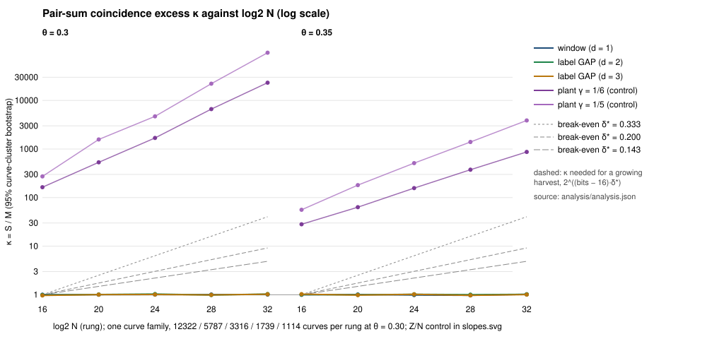
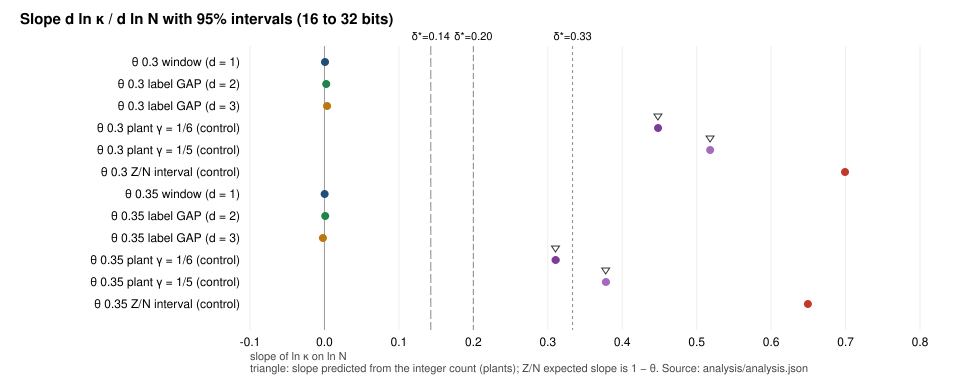

# Break-even growth ladder for structured-base pair-sum coincidences

**Track: generic decomposition (bounded by √r; cannot beat rho).** This measures a relation-yield statistic, not a cost: no ranking against k-sum, no priced IC cost, no dashboard point (PROTOCOL.md §1).

**Result.** `SUB_BREAK_EVEN_AT_SCALE`. On prime-order curves of 16 to 32 bits, the pair-sum coincidence excess κ of x-coordinate-structured bases does not grow with N.
- **Slopes.** d ln κ / d ln N has a 95% interval inside [−0.006, +0.008] for all six geometry-θ combinations (window, rank-2 and rank-3 label GAP, at θ = 0.30 and 0.35). The largest upper bound of a 95% interval is **0.008**, against the break-even exponents δ*(h) = 1/3, 1/5, 1/7: 41×, 25× and 18× below them.
- **Level.** Every rung's κ has its 95% interval inside [0.92, 1.08] (point estimates 0.967 to 1.034).
- **Controls.** All gates pass. The Z/N interval recovers slopes 0.699 and 0.649 (exact 0.70 and 0.65), and the weighted plants recover their integer-count slopes to within 0.001.
- **Reading.** Registered as `exhausted_at_scale` at 32 bits (`p < 2^32`). It is not a proof, and it says nothing about growth beyond the rungs measured.

**Distance remaining.** A growing harvest wins only if κ > 1.27·c·N^(1/(2h−1)). At 32 bits that is 1,874·c (h = 2), 101·c (h = 3) and 29·c (h = 4), against a measured κ of at most 1.07 (T3 below): 27× to 1,745× short for c = 1. The measured κ is flat, so the gap widens with N.

Public synthetic curves; no security claim. Registered in [`PROTOCOL.md`](PROTOCOL.md) before any pilot or main run (hashes in [`REGISTRATION.sha256`](REGISTRATION.sha256)).

**Labels.** `[measured]`: native `coincidence_ladder` outputs in this directory. `[derived]`: arithmetic on those outputs. `[recorded]`: values read from the EXP-PFDR-ca5e01 record.

## 1. What was measured

- **Statistic.** For a symmetric base F of exactly b points, C(F) is the number of pairs of unordered pairs {P, Q} ≠ {R, S} with P + Q = R + S (P ≠ Q, P ≠ −Q), counted exactly: a 4-term relation among base points. κ = S/M is the structured count over the mean of 20 matched random symmetric bases.
- **Bases.** Window (consecutive x), rank-2 and rank-3 label GAP, as in EXP-PFDR-ca5e01. All three were run; none was selected afterwards. b = 2·round(2^(bits·θ)/2) with θ ∈ {0.30, 0.35}.
- **Ladder.** 16, 20, 24, 28, 32 bits on prime-order curves with random (a, b); the order is proved by a unique prime multiple in the Hasse interval. The pilot sized each cell for a 2% relative standard error (T4); no cap bound, and the achieved precision matches the prediction.
- **Slope.** OLS of ln κ on the rung's mean ln N, with a joint curve-cluster bootstrap (2000 resamples).

## 2. Result `[measured]`

### Real geometries (T1)

θ = 0.3

| geometry | κ at 16 bits | κ at 20 bits | κ at 24 bits | κ at 28 bits | κ at 32 bits | slope [95%] | class |
|:--|:--|:--|:--|:--|:--|:--|:--|
| window (d = 1) | 1.001 [0.965, 1.040] | 1.003 [0.965, 1.044] | 1.007 [0.968, 1.046] | 1.010 [0.969, 1.051] | 1.008 [0.970, 1.047] | 0.001 [-0.004, 0.005] | null |
| label GAP (d = 2) | 0.986 [0.949, 1.024] | 1.012 [0.971, 1.050] | 1.034 [0.993, 1.076] | 0.987 [0.945, 1.028] | 1.033 [0.991, 1.074] | 0.002 [-0.002, 0.007] | null |
| label GAP (d = 3) | 0.967 [0.930, 1.002] | 1.006 [0.966, 1.047] | 1.011 [0.973, 1.048] | 0.992 [0.950, 1.034] | 1.023 [0.986, 1.063] | 0.004 [-0.001, 0.008] | null |

θ = 0.35

| geometry | κ at 16 bits | κ at 20 bits | κ at 24 bits | κ at 28 bits | κ at 32 bits | slope [95%] | class |
|:--|:--|:--|:--|:--|:--|:--|:--|
| window (d = 1) | 0.997 [0.956, 1.037] | 1.011 [0.973, 1.050] | 0.986 [0.944, 1.026] | 0.973 [0.938, 1.008] | 1.020 [1.002, 1.038] | 0.000 [-0.004, 0.004] | null |
| label GAP (d = 2) | 1.010 [0.968, 1.050] | 0.996 [0.956, 1.037] | 1.022 [0.983, 1.062] | 1.004 [0.962, 1.044] | 1.020 [1.003, 1.038] | 0.001 [-0.003, 0.005] | null |
| label GAP (d = 3) | 1.029 [0.990, 1.069] | 0.982 [0.946, 1.018] | 1.020 [0.981, 1.057] | 0.971 [0.929, 1.014] | 1.006 [0.986, 1.026] | -0.002 [-0.006, 0.002] | null |

All six slope intervals contain 0, and the largest upper bound is 0.008. The registered predictions P1 and P2 hold (PROTOCOL.md §9): P1 is |slope| ≤ 0.05, upper < 0.07, at least five of six intervals containing 0, and every κ point estimate in [0.95, 1.05]. They were written after a dry run on other curves, so they are not independent predictions (PROTOCOL.md §11).

### Controls (T2)

| θ | control | slope [95%] | expected | κ at 16 bits | κ at 32 bits |
|--:|:--|:--|:--|:--|:--|
| 0.3 | Z/N interval | 0.699 [0.698, 0.700] | 1 − θ = 0.70 | 1141.3 | 2666639.7 |
| 0.3 | plant γ = 0 (random) | -0.001 [-0.005, 0.004] | 0.000 (integer count) | 1.02 | 1.00 |
| 0.3 | plant γ = 1/6 | 0.448 [0.447, 0.450] | 0.448 (integer count) | 163.54 | 23175.80 |
| 0.3 | plant γ = 1/5 | 0.518 [0.517, 0.519] | 0.518 (integer count) | 272.84 | 96085.28 |
| 0.3 | null vs null | 0.000 [-0.004, 0.004] | 0 | 0.997 | 0.997 |
| 0.35 | Z/N interval | 0.649 [0.647, 0.651] | 1 − θ = 0.65 | 660.2 | 893378.8 |
| 0.35 | plant γ = 0 (random) | 0.001 [-0.002, 0.005] | 0.000 (integer count) | 1.00 | 1.01 |
| 0.35 | plant γ = 1/6 | 0.311 [0.306, 0.316] | 0.310 (integer count) | 28.23 | 870.68 |
| 0.35 | plant γ = 1/5 | 0.378 [0.373, 0.383] | 0.378 (integer count) | 56.13 | 3872.38 |
| 0.35 | null vs null | -0.003 [-0.006, 0.001] | 0 | 1.003 | 0.981 |

Z/N is the known positive, with slope 1 − θ. The plants' reference slope comes from an integer count of the rows' coincidences with no group arithmetic, so the match also checks the group-sum kernel. A random γ = 0 plant and null-vs-null both read slope 0 (gate G1: 0 of 4 intervals exclude 0).

### Distance remaining (T3) `[derived]`

| bits | mean N | 1.27·N^(1/3) (h = 2) | 1.27·N^(1/5) (h = 3) | 1.27·N^(1/7) (h = 4) | largest real κ upper bound |
|--:|--:|--:|--:|--:|--:|
| 16 | 4.89e+4 | 46 | 11 | 6 | 1.069 |
| 20 | 7.82e+5 | 117 | 19 | 9 | 1.050 |
| 24 | 1.26e+7 | 295 | 33 | 13 | 1.076 |
| 28 | 2.01e+8 | 744 | 58 | 20 | 1.051 |
| 32 | 3.21e+9 | 1874 | 101 | 29 | 1.074 |

### Cells and precision (T4)

| bits | θ | b | curves | pilot M1 | pilot V1 | predicted rel. sd | achieved rel. sd of S (window) |
|--:|--:|--:|--:|--:|--:|--:|--:|
| 16 | 0.3 | 28 | 12322 | 1.18 | 6.56 | 0.020 | 0.019 |
| 16 | 0.35 | 48 | 1176 | 12.06 | 65.16 | 0.020 | 0.020 |
| 20 | 0.3 | 64 | 5787 | 2.68 | 15.83 | 0.020 | 0.021 |
| 20 | 0.35 | 128 | 362 | 43.01 | 254.77 | 0.020 | 0.020 |
| 24 | 0.3 | 148 | 3316 | 4.82 | 29.35 | 0.020 | 0.020 |
| 24 | 0.35 | 338 | 119 | 134.63 | 820.74 | 0.020 | 0.020 |
| 28 | 0.3 | 338 | 1739 | 8.42 | 46.99 | 0.020 | 0.021 |
| 28 | 0.35 | 892 | 42 | 404.93 | 2587.59 | 0.020 | 0.020 |
| 32 | 0.3 | 776 | 1114 | 14.14 | 84.87 | 0.020 | 0.020 |
| 32 | 0.35 | 2352 | 40 | 1211.37 | 6792.57 | 0.011 | 0.011 |

### Stage 1: what was already recorded (T6) `[recorded]`

The recorded ca5e01 cells (16 to 22 bits; 3 or 4 cells per group; relative sd about 4.5%) give slopes consistent with 0, but only to about ±0.05. Only θ = 0.30 has three powered rungs in any group.

| θ | d | cells | slope [95%] |
|--:|--:|--:|:--|
| 0.3 | 1 | 4 | 0.016 [-0.013, 0.046] |
| 0.3 | 2 | 3 | 0.018 [-0.025, 0.063] |
| 0.3 | 3 | 3 | -0.040 [-0.088, 0.007] |

The new ladder reaches 32 bits with 2% cells and tightens the bound from upper bounds of 0.046 and 0.063 (θ = 0.30, d = 1 and 2) to 0.008.

### Overlap with ca5e01 (T7) `[measured]`

| bits | d | ca5e01 κ [95%] | this study κ [95%] | intervals overlap |
|--:|--:|:--|:--|:--|
| 16 | 1 | 0.966 [0.879, 1.056] | 1.001 [0.965, 1.040] | yes |
| 16 | 2 | 1.002 [0.915, 1.086] | 0.986 [0.949, 1.024] | yes |
| 20 | 1 | 1.023 [0.935, 1.121] | 1.003 [0.965, 1.044] | yes |
| 20 | 2 | 1.053 [0.962, 1.146] | 1.012 [0.971, 1.050] | yes |
| 20 | 3 | 1.005 [0.919, 1.096] | 1.006 [0.966, 1.047] | yes |

The curve generators differ, so this is statistical agreement, not a replication. All five overlapping cells agree.

## 3. Integrity `[measured]`

- **Selftest (10 checks)**, [`audits/selftest.txt`](audits/selftest.txt):
  - the proved order equals a brute-force point count on 16 curves;
  - the batched sorted count equals an unbatched hash-map count on 30 bases of every kind, and across a chunk boundary;
  - the Z/N counter equals a naive pair-of-pairs count;
  - the integer row counts match hand values (0, 0, 2);
  - the base sizes equal ca5e01's cells;
  - a whole job is a pure function of its labels.
- **Recount.** The unbatched recount of null, window, GAP and plant bases ran on every 97th curve of every rung, with no mismatch.
- **Determinism.** The 24-bit rung rerun with 2 workers instead of 6 is byte-identical ([`audits/determinism.txt`](audits/determinism.txt)).
- **Source.** The binary was built from the file hashed in the registration (`16d048d1…`), see [`BINARY.sha256`](BINARY.sha256). The raw per-curve outputs are 3.6 MB; their hashes are in [`main/SHA256SUMS`](main/SHA256SUMS), and `run.sh` regenerates them byte for byte.
- **Code.** Standard library only; rustfmt and clippy clean on the local toolchain.

## 4. What this closes and what it does not

- **Closed at scale.** For x-coordinate-structured bases (window, rank-2 and rank-3 GAP) at θ = 0.30 and 0.35, κ is constant in N over 16 to 32 bits, so the harvest law cannot reach break-even there: a constant κ at U = N^(1/(2h−1)) is N^(−1/(2h−1)) short (IDEA-20261018-a0830c).
- **Not closed.**
  - Growth beyond 32 bits (`p < 2^32`; larger rungs need 128-bit keys and, at θ = 0.35, memory for about 10^8 pair sums per base at 40 bits).
  - Non-geometric structure, and bb0d26's log-GAP label sets (a different statistic, on other curves).
  - Any family chosen from algebraic structure rather than coordinate geometry.
  - A reading from these rungs is a bound over 16 bits of N, not a law.
- **What reopens it.** A κ that is not flat across rungs for some structured family, or this ladder extended to 36–48 bits with wider keys.
- **Atlas note (not edited here).** `LEAD-ICP-coincidence-harvest-structured-base` names the bb0d26 independent review as its pending step; bb0d26's `analysis.md` (EV-PFDR-07d608, DEC-20261029-01405d) shows that review done. This study supplies the ladder step, so the lead's disposition can move to `exhausted_at_scale` on the evidence above.

## 5. Deviations and disclosures

- **R1: plant γ = 1/3 cannot be built** at θ = 0.30 or 0.35, because c₀ = N^(1/3) exceeds b/2 at every rung. The plants are γ = 0, 1/6 and 1/5 (PROTOCOL.md §6).
- **Dry run before registration** on a throwaway block (9,999,000) at 16–28 bits: the controls recovered and all real slopes were within ±0.016. The predictions were written after it (PROTOCOL.md §11).
- **No cost claim, no ranking.** κ is a yield statistic. The replication block was not run, because the reading is not ALIVE.
- **Formalization.** No theorem is stated, so no Lean file is owed.

## 6. Files

- `PROTOCOL.md`, `REGISTRATION.sha256`, `registered-at.txt`: the registration.
- `../../examples/coincidence_ladder.rs`: the native code (selftest, census, design, analyze, stage1).
- `run.sh`: pilot, design, main census, determinism rerun, analysis (a pure function of the labels).
- `pilot/`, `design.json`, `main/SHA256SUMS`, `analysis/analysis.json`, `analysis/stage1.json`, `audits/`, `stage1/ca5e01-cells.tsv`: inputs and outputs.
- `plot.mjs`, `tables.mjs`, `kappa_ladder.svg/png`, `slopes.svg/png`, `analysis/tables.md`: figures and tables (tooling).
- `report.pdf`: this README.

## 7. Addendum 1 (review fixes; [`AMENDMENT-1.md`](AMENDMENT-1.md))

- **Raw rows are committed.** `main/main-16.tsv` … `main-32.tsv` are the original per-curve rows, byte for byte (`shasum -a 256 -c main/SHA256SUMS` passes). They are data files over 64 KiB, so the repository's artifact bot moves them to the store and leaves the `.artifacts.json` manifest. This supersedes the sentence in §3 that says they are not committed.
- **`analyze` refuses an incomplete ladder.** It now fails, with no reading and nonzero exit, unless all five registered rungs, both θ values (at least 40 curves each) and every required series are present. [`check-refusal.sh`](check-refusal.sh) confirms three refusals (the pilot TSVs filtered to θ index 0, the pilot without 32 bits, and the 32-bit rung alone), [`audits/refusal.txt`](audits/refusal.txt). The selftest has an 11th check ([`audits/selftest-amendment-1.txt`](audits/selftest-amendment-1.txt)).
- **No evidence changed.** On the complete ladder the amended binary reproduces `analysis/analysis.json` byte for byte, and the reading is still `SUB_BREAK_EVEN_AT_SCALE`. The registered source hash in `REGISTRATION.sha256` is the pre-amendment one; the amended hashes are in `REGISTRATION-AMENDMENT-1.sha256`.
