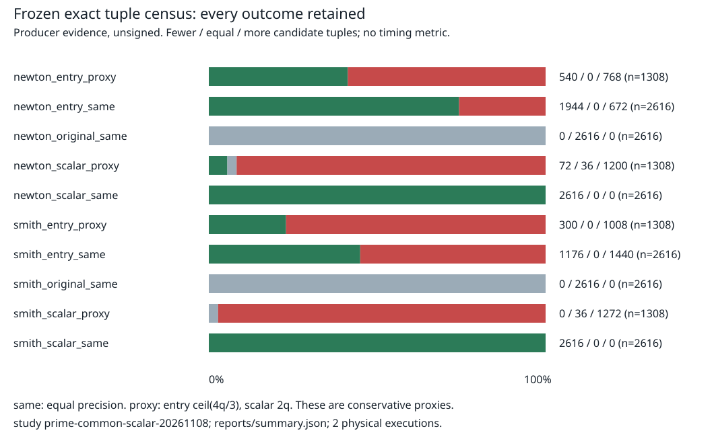

# Common scalar square and a rational successor

The common scalar removes the finite mode proliferation that the entry-dependent
normalizer caused in the previous panel. At equal precision it has fewer tuple
counts in all2616 registered cells for both Newton and Smith representations.
This is unsigned producer evidence, recorded as PCC-20261108-4f9871.
[pcc:unverified]

The next construction is a common **rational** denominator, not an entry-dependent
one: `U_d(T)=B_d(T)^2/D(T)`, `D(T)=sum_s B_s(T)=C'(T)/C'(0)`. Its node identity
and homogeneous denominator clearing now have Lean proofs. This is a concrete
successor to the completed polynomial-scalar experiment; it has not been run
as an experimental arm. No priority/novelty certificate is asserted.
[pcc:unverified]

Read [REPORT.md](REPORT.md), [PLAN.md](PLAN.md) and the exact
[proof map](lean/PROOF_MAP.md). Frozen design: [PROTOCOL.md](PROTOCOL.md),
[protocol.json](protocol.json), hash
`dedbb0086d84e5ecffba17a424a1fcfe6b89bb3d5db0ea40a5421afc36e8d548`.
Source555cd9430, published freeze12e310bda. All instrument/analyzer input cells
were fixed and published before both actual processes. Data are losslessly
stored under runs/0 and runs/1; their receipt timestamps are authoritative.



Recount saved data without another panel:

```sh
research/prime_common_scalar_20261108/verify_saved.sh /tmp/common-scalar-recount
```

This rebuilds native check/analyze tools, runs fixed development controls,
unpacks both saved outputs, checks every registered row, independently recounts
the histograms by grouped generating functions, and compares both reports.
No third panel or timing run occurs. Native Rust metadata checker additionally
validates both canonical schemas and the study-specific bindings. Its scope is
explicitly smaller than the general canonical checker; no signed independent
execution or measurement verdict is supplied by this producer.

Metadata errors are retained: the unfrozen one-arm schema draft; premature
analyzer invocation before replay completion; initial export without byte
lengths. The adapter then added file byte lengths and lossless XZ artifact
paths. The protocol, native algorithm, analyzer, hypotheses and experimental
inputs did not change. These formatting fixes are post-data and not presented
as preregistered implementation details. The original source remains in Git.

The PDF and full census table are in reports/. No time or speedup was measured. [pcc:unverified]
so performance/leaderboard graphs and benchmarks remain unchanged. Required
independent review and PCC signatures are still external, not manufactured here.
