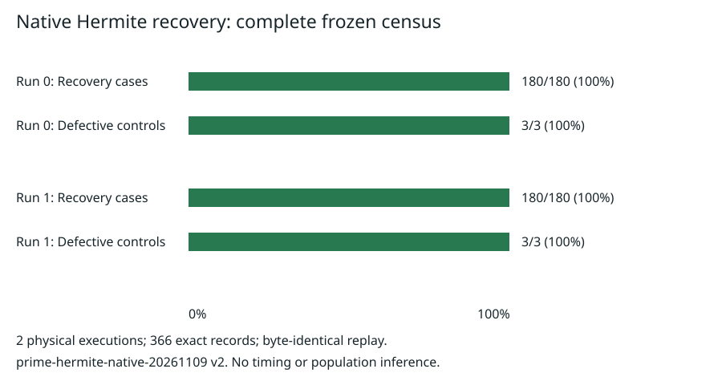

# Native rational Hermite recovery: exact census and replay

Study `prime-hermite-native-20261109`, protocolv2. Producer statement
PCC-20261109-4d31b7; unsigned evidence [pcc:unverified].

Both physical invocations completed all180 positive cases and detected all3
registered defects. The separately frozen C++ analyzer accepted366 records,
required all unique registered keys, recomputed integrality/congruence by exact
divisibility and required byte-identical replay [pcc:unverified].

| Physical execution | Positive cases correct | Defects detected | Exit | Recount |
|---|---:|---:|---:|---|
| native-census/0 | 180/180 | 3/3 | 0 | accepted |
| replay/0 | 180/180 | 3/3 | 0 | accepted |

Flow:2 planned,2 attempted,2 completed,0 interrupted,0 resumed,0 excluded.
These are exact finite counts with no statistical uncertainty or population
inference. There were no failed/incomplete census cases or extra invocations.
Both full TSV files have SHA256
`46a73583d9709c64acbcf02fbadb82734ed48b16cb5c33d85341ca74db512c09`
[pcc:unverified].

## What was executed

Frozen checker/analyzer source77aed44a5a68e7ba4e794bed742b04b30994da23;
GMP6.3.0, g++14.2.0, C++20,-O2,-Wall,-Wextra,-Werror. Binary hashes remain
in ../../instrument.json and match the original freeze. The checker constructs
the actual affine-cleared polynomial densely for small sparse immutable weights,
then actual integral local charts, finite modular inverse/convolution, allowed
integer lifts and the rational Hermite sum. It checks the target at zero and
each output residue. The analyzer recomputes congruence through divisibility
of numerator-target*denominator, using a different arithmetic test from the
checker's odd-denominator inversion [pcc:unverified].

The census crosses5 triples(a,u,M),3 weight fixtures,2 supplied injective
placements,3 output precisions(1,4,9) and2 lift rules:180 positive cases.
The a4 cells were held out relative to the a3 development domain. All actual
active source nodes are used, at original source child precision. Parameters
and formulas are exhaustively specified in ../../PROTOCOL.md; this is not a
sample of prime-field curves or an arbitrary-tensor performance evaluation.

Controls: the zero quotient misses delta target1; a +1 change to the node1
quotient constant produces a nonintegral result; the scalar affine check
separates D-N=1 from1-N=-1 at D3,N2. The last control tests that arithmetic
identity, not a full substituted faulty contraction implementation. Both
canonical and congruent offset lifts are covered. The second complete
invocation is the A/A control; observed exact byte spread is zero
[pcc:unverified].

## Admission and resources

Protocolv1 is retained exactly as ../../protocol-v1.json. Before any data,
version2 changed only checkpoint transport under explicit owner authorization.
Canonical protocol hash:
`7d5b77252d2930a0e8da185f08e0454809af934270dfa94c1a1a44bd50d57635`.
Freeze20:07:22UTC precedes both run-start markers. Run0 lifecycle markers:
20:07:42--20:07:49UTC; run1:20:07:53--20:08:00UTC, November9,2026.
Markers are execution provenance, not performance measurements.

Local Linux x86-64, AMD EPYC9V74 model,5 exposed logical CPUs; each checker
was pinned to logicalCPU0, single-threaded, with2GiB address-space limit,
600s timeout and32MiB output limit. The analyzer had1CPU/2GiB/60s. Host
co-tenants/frequency were not isolated; earned isolationL0. No clock, measured
RSS or speed result is reported. Full host metadata: ../../runs/host.txt.
Every run-start marker and raw outcome was committed and pushed to git origin.
The previous failed S3 admission remains; no S3 success is asserted.

## Evidence and interpretation

Raw panels, stderr, lifecycle/status files and per-run receipts: ../../runs/.
Frozen analyzer output: ../../summary.json. Canonical two-row export:
../../export.json. Schema validation and native protocol/artifact binding checks
passed. Native metadata/plot formatter is under ../../metadata/; it was written
after collection, does not invoke or change the frozen checker/analyzer, and
formats the observed results. Counts/source for the graphic are in
../native-20261109/counts.json, plot.tex and the formatter source. Both primary
TSV files remain unmodified [pcc:unverified].

The result supports native correctness of the constructed rational recovery on
this complete finite domain. It gives no timing, native memory-saving, uniform
recursive cost or ECDLP solve conclusion. Same-producer separate recount and
A/A replay are not independent signed verification. The scaled modular
accumulator is a distinct next arm requiring prospective amendment and native
refinement; it was not silently substituted in these runs.

Sources checked: original frozen protocol and C++ sources; preceding actual
Hermite recovery and stream-precision Lean reports; pinned OpenAI Oct25,2026
manuscript D.4.1--D.4.4/D.9--D.10 cited in those reports. KB unavailable (MCP
absent, wrapper no executable). No novelty or exhaustive-search claim.
No measured leaderboard/ecdb row changed; historical graphs remain unchanged.
