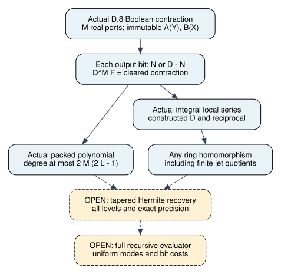

# Actual affine Boolean contraction: denominator clearing

2026-11-09. Component proof development; unsigned producer evidence throughout
[pcc:unverified]. Mathematical source commit: fa4e2bbab. No timing, speedup,
curve-solving, exhaustive literature or novelty claim is made.

The actual Boolean contraction admits denominator clearing with exponent exactly
M, the number of real row ports. Its zero-output factor is affine, so treating
it as homogeneous in W would be incorrect. Correct affine homogenization retains
the desired doubled degree budget [pcc:unverified].

## Source and scope

Reviewed the pinned primary manuscript, OpenAI, October 25, 2026, Appendix D.4.2--D.4.4,
D.7--D.10, retained at /workspace/audit/tensor-primary/openai-oct25.txt;
the study's prior source receipts identify the download. The imported Cauchy
polynomials are the existing source-connected definitions, not free variables.
Also checked research/prime_common_kernel_20261030/reviews/boolean-gauges.md,
its GaugeCounterexample.lean, and
research/prime_tensor_variants_20261030/reviews/matched-level.md.
KB unavailable: no loaded MCP; repository wrapper status/search exit127.
This bounded source review does not establish novelty or survey exhaustion.

D.8 has independent bit assignments X,Y and fixed tensor products A(Y),B(X):

    F(W) = sum_X sum_Y A(Y) B(X) product_j ell_Yj((W X)_j)
    ell_0(z) = 1-z; ell_1(z) = z.

The sums run over M real ports. Unused packet slots are absent. The actual
packed matrix restricts within-packet Cauchy entries to those ports and sets
between-packet entries to zero. An injective supplied placement identifies row
and column ends; the construction and cost of the source packing are not proved
by this component. A and B are immutable in the deformation parameter.
No particular elliptic curve or subgroup is an input to these algebraic lemmas.
[pcc:unverified]

## Derivation

Write U=N/D, with a common unit D. Each row sum scales by D inverse. A one-output
factor clears to the numerator row sum; a zero-output factor clears to D minus
that row sum. Multiplying the M factors gives D^M F(U), then distributivity
passes the identity through both finite sums. This works over every commutative
ring, including rings with nilpotents [pcc:unverified].

For the actual repair, L=2^a, N_ij=B_ij^2, D=sum_s B_s, and deg B_s<=2L-1.
Both possible cleared row factors have degree at most 2(2L-1); therefore the
actual cleared polynomial has degree at most 2M(2L-1). Fixed A,B contribute no
T degree. This uses an upper bound valid even with zero divisors
[pcc:unverified].

At rational points the equality requires D(T) nonzero. No cancellation at a
pole is asserted. At zero, injective placement gives U(0)=I and F(U(0))=sum A(X)B(X).
The local series theorem instead uses the actual integral denominator and its
previously constructed reciprocal, packaged as a unit. Applying any ring
homomorphism transports the whole identity, including to reduction by the jet
ideal. It does not assert that an arbitrary coefficient truncation is a ring
homomorphism [pcc:unverified].

## Controls and evidence

The Lean negative control is 3*ell_0(2/3)=1 while ell_0(2)=-1. Both bit branches
are proved; no M>0 premise excludes the empty product. The identity certificate
[IDC1had86c2d70ea770ef](../../identity/affine-clearing.json) covers only the
polynomial rearrangement d(1-zi)=d-z(di). Its unit equation is separate in Lean.
The unchanged native checker accepts extra points and rejects the naive
substitution as a false identity. This finite-field certificate is supporting
evidence, not the quantified ring proof or independent attestation
[pcc:unverified].

The default Lean build passed (packed-build-004.log). The actual repository gate
reports 140 declarations and zero extra trusted axioms; see
[gate](../../lean/contraction-gate/). Official import-inclusive fresh replay is
recorded separately in contraction-fresh-status.json and contraction-fresh-001.log.
Axioms are restricted to propext, Classical.choice and Quot.sound. No gate,
checker, trust policy or dependency revision was changed [pcc:unverified].

Failed Boolean and packed elaborations, and the first native compilation, are
retained. These were API/coercion errors; the failed propagated sorryAx diagnostic
was not accepted. Native tests are in identity/tests-001.log. No performance
inference depends on host load, compiler elapsed times, or these checks.

## Proof map and claim records

All records below are unsigned; their declaration hashes are pinned in
[contraction-claim-pins.json](../../lean/contraction-claim-pins.json).

| Obligation | Lean declaration | PCC record |
|---|---|---|
| Actual affine weighted sum | BooleanContraction.sourceContractionClearing | PCC-20261109-87aebd |
| Actual rational point equality, D(T) nonzero | PackedContraction.packedPointClearing | PCC-20261109-205f61 |
| Actual polynomial degree over Q-algebra | PackedContraction.actualPackedContractionDegree | PCC-20261109-21b592 |
| Origin, supplied injective placement | PackedContraction.actualPackedOriginContraction | PCC-20261109-7987a6 |
| Actual integral local series | PackedContraction.actualLocalContractionClearing | PCC-20261109-9e5d39 |
| Any ring-map transport | PackedContraction.mappedLocalContractionClearing | PCC-20261109-055aa0 |

Source: [BooleanContraction.lean](../../lean/BooleanContraction.lean),
[PackedContraction.lean](../../lean/PackedContraction.lean). RationalScalar exposes
its existing kernel definition and adds a reflexive formula API; its math is
unchanged. Default Lake targets include both new modules.

## Next discriminating obligation

Source D.5 uses h=ceil(3M/u), q_t=h*max(0,u-v2(t)). The L odd nodes alone provide
Lhu>=3ML. That lower bound alone does not imply a total greater than
2M(2L-1), so that particular shortcut no longer suffices at doubled
degree. The total over all active levels must be proved and matched to the
precision loss. The existing first-three-level margin suggests enough total
multiplicity; it is not the all-level recovery theorem. Next formalize the
actual node counts and full taper, then construct exact Hermite recovery for the
cleared polynomial. D(0)=1 preserves the recovered target. Account for forming
local D^M F, then prove the full recursive mode/child-entry/bit-cost bound.
[pcc:unverified]

The explicit sum defining F still has exponentially many assignments; it is a
correctness specification, not a faster contraction evaluator. Rank reduction
at the origin also remains separate: this scalar repair preserves I.
[pcc:unverified]

Checked study-local prior normalizer/smith visuals, docs/ic-leaderboard.html,
docs/index-calculus-scoreboard.html and docs/ic/progress-timeline.json for scope.
No measured value or admitted ledger row changes, so historical comparison
plots and scoreboards are left unchanged. This new diagram records the proof
bridge, rather than depicting a measured algorithmic gain.
