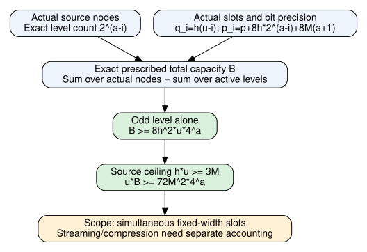

# Actual prescribed quotient-buffer capacity

November9,2026. Source `8e62d4dfc182ee3bd41765dda4847100ddf516f6`.
Unsigned producer mathematical evidence [pcc:unverified].

The actual node set gives an exact accounting identity for the total prescribed
coefficient capacity B. For0<u<=a and h=ceil(3M/u),

    B = sum_(i=0)^(u-1) 2^(a-i) h(u-i)
          [p+8h*2^(a-i)+8M(a+1)],
    B >= 8h^2*u*4^a,
    u*B >= 72M^2*4^a.

The identities and inequalities are Lean statements connected to the actual
sourceOrder, childPrecision and actual valuation cardinalities. No assumed
random or uniform node distribution is used [pcc:unverified].

B counts the bit widths of all prescribed quotient coefficient slots, one
vector per node. Simultaneously materializing those slots in fixed-width packed
form charges at least B bits before metadata. This is not an information-theoretic
lower bound or a bound against streaming, compression, sparse values, shared
storage, different precision algorithms or other ECDLP algorithms. A zero
coefficient still has a prescribed slot width in this accounting convention.
Actual allocation or peak RSS has not been measured [pcc:unverified].

## Derivation and parameter implication

At level i<u<=a, actualValuationCard gives2^(a-i) nonzero nodes. Each receives
q_i=h(u-i) coefficients and p_i=p+8h*2^(a-i)+8M(a+1) bits per coefficient.
The zero node and all inactive levels contribute zero. Finite-sum exchange,
exact level counts and the source definitions identify B with that sum.
The i0 contribution alone is at least2^a*(h*u)*(8h*2^a). Finally h*u>=3M
from sourceCeilingBudget yields the port-count inequality [pcc:unverified].

For an input length n and this simultaneous explicit representation, a linear
grid exponent a would charge exponential capacity through4^a (u<=a). A
sub-exponential version therefore needs a=o(n) or a representation that avoids
this simultaneous capacity. This is a necessary condition on the stated
strategy; it supplies no sufficient recursive runtime bound [pcc:unverified].

Additional weighted-sum identities are available for future closed forms:
W_r(u)=sum_(j=0)^(u-1)(j+1)r^j satisfies
(r-1)^2 W_r(u)=[u(r-1)-1]r^u+1, with explicit r2/r4 specializations.
These auxiliary identities are formal; no closed-form replacement for B is
claimed to have been connected in this phase [pcc:unverified].

## Evidence, sources and next action

BufferBudget.lean imports the actual constructed recovery. Logs001,003,004
pass the respective completed scopes;002 is a failed finite-sum membership
attempt and is preserved. Final actual source audit and fresh replay receipts
are recorded separately below when completed. All standing remains unsigned.

Sources: NodeMultiplicity.actualValuationCard, HermiteUniqueness.sourceOrder,
HermiteError.childPrecision, previous constructed recovery report, and the
pinned manuscript D.9/D.10 cited there. KB MCP absent; wrapper status again
reports no executable. This is a source-connected accounting result, with no
novelty or exhaustive literature assertion.

The native protocol in ../../replay/ is frozen and committed before data.
Its actual S3 gate failed for absent transport; no census has run. The narrow
checkpoint-substitution question remains pending. This does not prevent this
formal accounting work. Next use these charges in parameter selection and
all-level cost recurrences; retain streaming as a distinct representation
whose recomputation and retained-state costs need their own bounds.

## Completed producer receipts

Actual source audit:279 declarations,0 extra trusted axioms. Import-inclusive
fresh BufferBudget replay: exit0, source8e62d4dfc. Unique compressed raw log and
status JSON are retained under ../../lean/. Canonical unsigned bindings:
weightedIdentity PCC-20261109-0bd800; actualBufferBitsEq d7e294;
actualBufferBitsLower b444d5; actualBufferBitsPortLower37dc47 (same PCC date
prefix). Full canonical hashes: ../../lean/buffer-budget-claim-pins.json.
Only standard axioms occur [pcc:unverified].

## Source schedule context

The pinned manuscript D.4.1 defines lambda=ceil(log2 s); D.4.2 bounds
a<=4epsilon*lambda and L<=s^(1/1000). Consequently its intended schedule has
4^a=L^2<=s^(1/500), a polynomial factor in s. The generic linear-in-input-length
warning above does not reject this source schedule. The actual weighted buffer
charge must be carried into the recurrence, including how s relates to the
ECDLP input size; the storage inequality alone settles no runtime exponent
[pcc:unverified].
