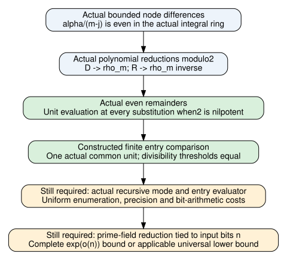

# Actual chart units and the remaining algorithm theorem

November9,2026. Mathematical source `7bb27662363b94031f91f579837101d88fa6737f`.
All new records are unsigned producer evidence [pcc:unverified].

The actual rational denominator and earlier scalar normalizer are now units
after every interpolation substitution in any commutative target coefficient
ring where the image of2 is nilpotent. The statement includes every ZMod(2^p)
value and permits zero divisors and further nilpotents. The constructed finite
normalized entry and old scalar-square entry differ by one actual common unit,
independent of the entry index; every scalar divisibility threshold is preserved
[pcc:unverified].

## Actual construction

Let O be the concrete rational two-adic integral subring, alpha=2^(a+1),
and actual centered source node t_m=m-2^a. For distinct indices, the nonzero
integer difference m-j has absolute value below alpha, so v2(m-j)<=a.
Consequently alpha/(m-j) is divisible by2 in O. The equal-index chart ratio
is0 and also satisfies the statement [pcc:unverified].

The already constructed localBase polynomial is rho_m times a product of
1+ratio*z, with a ratio*z factor when s!=m. Under every map pi:O->R killing2,
its coefficient image is constant pi(rho_m) at s=m and zero otherwise. Thus
actual localDenominator D=sum_s localBase_s reduces to C(pi(rho_m)). The
constructed old scalar polynomial R=sum_s C(rho_s^-1)^2*localBase_s evaluates
to the actual CommonScalar.normalizer chart, and reduces to C(pi(rho_m^-1)).
The old definition is exposed through its module API and a public formula;
its value and all existing theorem bodies are unchanged [pcc:unverified].

Using the actual residue-map kernel, both polynomial remainders are divisible
by C(2): D-C(rho_m), R-C(rho_m^-1). For arbitrary pi:O->A with pi(2)
nilpotent and arbitrary z in A, each evaluated polynomial is a mapped unit
plus pi(2) times another value. A commuting nilpotent perturbation of a unit
is a unit. No assumed-unit premise for an unspecified normalizer remains
[pcc:unverified].

## Finite entry comparison and scope

Define n_s as the evaluated actual localBase, choose the unit d supplied by
the denominator theorem, and set U_s=d^-1*n_s^2. With r the evaluated actual
old normalizer, the actual common factor c=r*d is a unit and

    c*U_s = r*n_s^2,
    e divides r*n_s^2 iff e divides U_s

for every e in the target ring. These statements concern the constructed
finite coefficient model. They do not themselves prove uniqueness/minimality
of a Smith/Newton decomposition, transport every full matrix certificate, or
price mode enumeration. Nor is the full coordinate Hermite precision argument
replaced by the generic normalizer-unit theorem [pcc:unverified].

The completed old panel remains unchanged. This is a derived algebraic bridge,
not a new rational-kernel measurement or a relabelling of its proxy-budget rows.
No new native experiment was run; the two-run correctness census stays closed.

## Canonical bindings and checks

Full declaration hashes: ../../lean/chart-units-claim-pins.json.

| Declaration | Unsigned PCC suffix (prefix PCC-20261109-) |
|---|---|
| chartRatioEven | 777347 |
| localDenominatorMap | 9c4c4f |
| localNormalizerEval | 65b9f5 |
| localNormalizerMap | 53504f |
| actualDenominatorUnit | 485e5c |
| actualNormalizerUnit | 7cea35 |
| actualModularComparisonUnit | c9a342 |
| actualEntryComparison | 51ff85 |
| actualEntryDivisibility | ff3e71 |

Build002 checked actual even chart ratios/reduction;005 checked the unit
construction;006 checked the full finite comparison. Failed API/coercion/import
attempts are retained. Actual source audit and fresh import-inclusive replay
have unique raw logs/status; read their final receipts appended below rather
than inferring success from a source-only statement. Only standard axioms are
accepted by the gate [pcc:unverified].

Sources: actual LocalCharts/LocalIntegral/ResidueEncoding/StreamPrecision,
the preceding recovery reports, the prior written chart-unit obligation in
../../REPORT.md, and pinned OpenAI Oct25,2026 manuscript D.4.3--D.4.7/D.9/D.10.
Primary Mathlib sources: PadicNorm and RingTheory.Nilpotent.Basic. KB unavailable
(MCP absent; wrapper no executable). No priority or exhaustive literature claim.

## Goal assessment: exact mathematical dependency

The standing target is a faithful Lean proof establishing or ruling out a
novel classical sub-exponential algorithm for general prime-field ECDLP.
This continuation establishes neither alternative. The obstruction to finishing
that target is mathematical, not checkpoint admission or CPU isolation.

| Route reviewed | What is established | What still prevents the requested theorem |
|---|---|---|
| Common scalar/rational repair | Actual clearing, precision, finite recovery, bounded native correctness and now finite chart units | No complete actual recursive evaluator with uniform enumeration and child-entry bit costs tied to ECDLP input length |
| Scaled modular accumulator | Actual scaled target congruence and cross-precision cancellation | Canonical native extraction, coefficient/input delivery and retained-state/recomputation bounds |
| Nonscalar origin channel | Prior Boolean-gauge review identifies invalid generic physical-coordinate substitution | No proved target-preserving replacement and charged evaluation/recovery route |
| Rank-directed C(T)H completion | Prior origin-preservation lemma; higher jets remain adjustable | No uniform rank/mode reduction; preserving C(0)=0 cannot change the identity at the origin |
| Unrestricted non-generic nonexistence | No applicable lower-bound theorem supplied by these component results | A failure or obstruction for one family is not a universal algorithm lower bound |

For existence, a program and correctness theorem must cover the stated prime
fields/curves/subgroups and public targets, with complete success and bit-cost
accounting and T(n)=exp(o(n)), n the ECDLP input bit length. The manuscript's
mode-count/recurrence uses network/circuit size s; its relation to n and all
actual tensor-entry costs must be proved rather than identified by notation.
An upper-bound envelope alone cannot prove an algorithm lower bound
[pcc:unverified].

No theorem of the form “assume recovery” or “assume sub-exponential total
cost” closes these gaps. No impossibility statement about all non-generic
algorithms follows. The next decisive input is an actual uniform evaluator
and reduction/cost bound, or an applicable unrestricted lower-bound argument;
small additional component checks do not supply either [pcc:unverified].

## Actual source audit receipt

The actual default-project source audit passed310 declarations with0 additional
trusted axioms, including ChartUnits and the exposed scalar formula. Receipts:
../../lean/chart-units-gate/. Only propext, Classical.choice and Quot.sound occur.
The fresh import-inclusive ChartUnits replay exited0 for source7bb276623.
Its unique raw compressed log and status JSON are retained under ../../lean/
[pcc:unverified].
