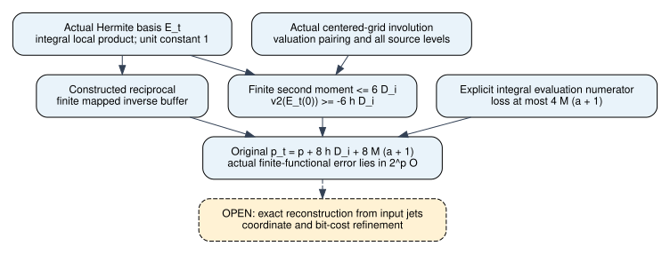

# Actual Hermite multiplier loss and source-precision stability

2026-11-09. Mathematical sourcea375671ad8d9c2fb2b3fd3ac74d698b4b52b5eba.
Unsigned producer evidence throughout [pcc:unverified]. This continues the
[actual affine contraction](../boolean-contraction-20261109/REPORT.md) and
[actual source counts/exact uniqueness](../source-recovery-20261109/REPORT.md).
PR3750 merged at6cbe03b2b0ef0344cd052a3eb8806cbeb69cdeb8; this phase is a
versioned addition. No new benchmark, frozen-panel rerun or novelty claim.

The actual normalized Hermite multiplier now has a quantified valuation bound
in Lean. Actual local inversion and truncated evaluation are source-connected,
and an explicit finite recovery functional preserves target precision under
the original source child precision. Exact reconstruction from its input jets
remains a separate obligation [pcc:unverified].

## Exact domain and source

The precision/error theorems here use rational coefficients and the concrete
integral ring O={q in Q: |q|_2<=1}. The mapped inverse theorem permits any
coefficient ring map. The full precision theorem has not been generalized to
the source's extension-field and nilpotent coordinate lattice. Prior exact
uniqueness over Q-algebras does not discharge that precision refinement.
No particular curve or subgroup is solved in this component. [pcc:unverified]

Read the pinned OpenAI October25 manuscript D.9--D.10, the repository's prior
matched-recovery review, and actual Mathlib APIs for finite remainders,
valuations, ultrametric sums, monic degrees and coefficient buffers. Primary
PDF SHA2565b1612dc2eebb2cad5b4cbe62d1fed2982f01ab1908c26f70010a651487e8123;
[provenance](../../../prime_common_kernel_20261030/sources.md).
KB unavailable: MCP absent, repository wrapper unavailable127. This is a
bounded source review/formalization, not an exhaustive novelty audit.

## Actual basis and local inverse

Use L=2^a, alpha=2L, actual source nodes t=m-L, h=ceil(3M/u), q(0)=0 and
q(t)=h*max(0,u-v2(t)) otherwise. Define the actual basis polynomial

    E_t(T)=product_(s != t) ((T-s)/(t-s))^q(s).

The factor at the zero source node has exponent0. Its actual local chart is

    E_t(t+alpha*z)=product_(s != t) (1+alpha*z/(t-s))^q(s).

Each actual integer difference is nonzero and has absolute value below2L;
the existing ratio theorem places alpha/(t-s) in O. The local product has
constant1, so its constructed integral reciprocal exists. Its finite mapped
inverse buffer is proved from the finite input vector alone. No unspecified
Hermite unit is assumed [pcc:unverified].

## Actual multiplier loss through a grid pairing

On S excluding0 and t, let m(s) be the actual centered representative of t-s.
The code defines and proves an involution, its exclusions, actual integer
congruence modulo2L, and preservation of the actual difference valuation.
Write v_s=v2(s), w_s=v2(t-s)=v2(m(s)) and i=v2(t). The actual basis value obeys
[pcc:unverified]

    V = v2(E_t(0)) = sum_s q(s)*(v_s-w_s),
    2V = sum_s (q(s)-q(m(s)))*(v_s-w_s).

The natural taper is h-Lipschitz and decreasing. Therefore

    2V >= -h*sum_s (v_s-w_s)^2.

The ultrametric identity at actual nonzero t gives

    (v_s-w_s)^2=(max(0,v_s-i))^2+(max(0,w_s-i))^2.

Pairing makes these two sums equal. Both exclusions have zero excess, so the
moment reduces to the full nonzero-node moment. Actual node counts are extended
through the top level j=a, whose sole node is the left endpoint. Consequently

    sum_s (max(0,v_s-i))^2
      = sum_(j=0)^a 2^(a-j)*max(0,j-i)^2
      <= 6*2^(a-i).

The final inequality uses a finite rational identity, not an assumed infinite
series:

    sum_(k=0)^n k^2/2^k = 6-(n^2+4n+6)/2^n.

Thus the actual multiplier satisfies V>=-6hD_i, D_i=2^(a-i). This proves the
source loss constant using the actual grid and taper. It does not assume a
random distribution of valuation levels [pcc:unverified].

## Evaluation loss and finite coefficient errors

The actual ceiling satisfies hu<=4M when u<=M. For an integral polynomial below
q(t), an explicit integral numerator clears evaluation at -t/alpha:

    b^q P(t/b)=sum_(j<q) P_j*t^j*b^(q-j),  b in O, b !=0.

Taking b=2L and q=4M gives loss K=4M(a+1). Together with multiplier loss
B=6hD_i, the source child precision is

    p_t=p+8hD_i+8M(a+1)=p+B+K+slack,
    slack=2hD_i+4M(a+1)>=0.

An actual coefficient error 2^p_t*c in O contributes, after dividing by2^p,

    2^slack * (2^B E_t(0)) * (2^K c*(-t/alpha)^j),

which is integral. Summing the finite coefficients proves each actual
contribution stable modulo2^p. Summing actual sampled nodes proves the same
for the explicitly defined recoveryFunctional on supplied bounded quotient
polynomials. Multiplication by the actual integral local inverse preserves
input finite buffers. These are actual precision statements, without
cancelling a power of two inside a finite ring [pcc:unverified].

**Remaining reconstruction bridge:** prove that the exact quotient polynomials
constructed from an input polynomial's jets have the required interpolation
jets and degree, so recoveryFunctional equals its value at zero. The stability
theorem does not assume or prove that equality. Native refinement, coordinate
lattices and complete operation/bit costs remain open. [pcc:unverified]

## Proof map and evidence

| Obligation | Lean declaration | Unsigned PCC |
|---|---|---|
| Actual normalized local product | HermiteBasis.actualBasisLocalEval | PCC-20261109-09b188 |
| Constructed finite reciprocal | HermiteBasis.actualBasisMappedInverseBuffer | PCC-20261109-348f1c |
| Actual translated-grid valuations | HermiteGrid.actualMirrorValuation | PCC-20261109-f0b5d3 |
| Actual multiplier loss6hD_i | HermiteMoment.actualHermiteMultiplierLoss | PCC-20261109-827aa4 |
| Actual evaluation loss4M(a+1) | HermiteBasis.actualEvaluationLoss | PCC-20261109-ad5a31 |
| Original-precision finite-functional stability | HermiteError.actualRecoveryFunctionalStable | PCC-20261109-00cb3f |
| Actual input-buffer precision preservation | HermiteError.actualLocalQuotientBufferStable | PCC-20261109-fd958d |

[Canonical statement pins](../../lean/hermite-precision-claim-pins.json).
Default build precision-default-build-001.log passed. Actual source-discovering
repository gate reports216 declarations,0 extra trusted. Foundations remain
propext, Classical.choice and Quot.sound. Official import-inclusive fresh replay exited0 and
is recorded separately in hermite-precision-fresh-status.json and its raw log.
All checks are unsigned producer evidence [pcc:unverified].

Pinned Lean4.35.0, CryptoLean148f5dc389b341401e06d76abe7783c4ccf42f2e and
Mathlibcfc55fc58714a59dc06e6e79edc6d1d95140d3c2. No checker, gate, trust
manifest or dependency revision changed. Failed build and API diagnostics are
retained; final sources have no hole or added axiom. The quantified valuation,
finite-sum and buffer statements do not fit polynomial-expression certificate
v1; their evidence is the actual Lean proof and source audit.

## Next discriminating action and comparison scope

Construct the actual exact quotient truncations and the D.9 interpolation
polynomial, prove its jets and degree, then use existing uniqueness. Only
after that bridge and cost refinements should a separately prospective native
campaign compare the actual original precision against the old doubled-budget
proxy. The preceding exact controls provide mathematical reasons to revisit
that proxy, without changing any historical panel number. [pcc:unverified]

Checked historical study graphs and scoreboard/timeline scope. No measured
value, admitted row or graph input changes. This versioned diagram records
proof dependencies, with the remaining reconstruction bridge visibly open.
No loss or proof outcome is attributed to CPU load.
