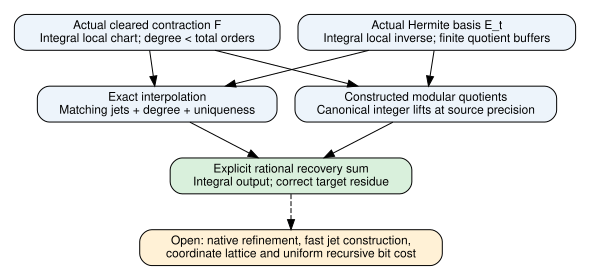

# Constructed finite rational Hermite recovery

November9,2026. Mathematical source: `bd8cbfe231702221685d3f99cfa91f6168cbb797`.
All results below have unsigned producer standing [pcc:unverified].

The finite modular quotient construction and explicit rational Hermite sum now
return the original integral contraction modulo2^p. The construction derives
its quotient congruence from two finite coefficient buffers; no supplied
reconstruction identity or quotient-congruence premise remains. The returned
value is the computed sum, with integrality established by its proof. The
known contraction is not substituted for the computed value [pcc:unverified].

## Domain and construction

Let O be the subring of rational numbers with odd reduced denominator. Use
L=2^a, alpha=2L, centered grid t=m-L, h=ceil(3M/u), q(0)=0 and
q(t)=h max(0,u-v2(t)). Assume3<=u<=a, u<=M and injective supplied placement.
Weights A,B lie in O; p is output bit precision. The cleared polynomial uses
actual affine factors N and D-N and has degree below the sum of actual orders
[pcc:unverified].

For each positive-order node, define E_t(T)=product_(s!=t)((T-s)/(t-s))^q(s).
Multiply the source chart F(t+alpha*z) by the integral reciprocal of
E_t(t+alpha*z), truncating below q(t). Exact quotient jets yield an interpolation
polynomial with the same jets and degree bound as F; the earlier uniqueness
theorem therefore identifies it with F. Evaluation at zero gives the explicit
D.9 sum, without assuming that identity [pcc:unverified].

The integral chart is constructed from the actual local numerator and
denominator and immutable integral weights. Its map to Q equals the global
polynomial's source chart. The finite quotient operator takes only length-q
input and denominator vectors, constructs a length-q inverse, and convolves
below q. Coefficients modulo2^p_t are canonically lifted to integers, where
p_t=p+8h*2^(a-v2(t))+8M(a+1). The preceding precision bound applies to these
constructed lifts. The resulting sum is integral and has the target residue
[pcc:unverified].

## Declaration bindings

Canonical hashes are in ../../lean/hermite-recovery-claim-pins.json.

| Declaration | PCC record (unsigned) |
|---|---|
| HermiteReconstruction.exactReconstruction | PCC-20261109-67badf |
| HermiteReconstruction.actualPackedReconstruction | PCC-20261109-281660 |
| HermiteReconstruction.exactHermiteEvaluation | PCC-20261109-55e9c7 |
| IntegralRecovery.actualIntegralChart | PCC-20261109-a4f1bb |
| IntegralRecovery.integralQuotientMap | PCC-20261109-11770a |
| FiniteRecovery.computedQuotientResidue | PCC-20261109-33208a |
| FiniteRecovery.computedPackedRecoveryPrecision | PCC-20261109-e2bf84 |
| FiniteRecovery.computedPackedRecoveryResidue | PCC-20261109-e57c3b |

## Checks and evidence

Default build completed3198 jobs. Actual source audit passed269 declarations
with0 additional trusted axioms. The import-inclusive fresh replay of
FiniteRecovery exited0; status and raw compressed logs are under ../../lean/.
Only propext, Classical.choice and Quot.sound occur in the audited dependency
axioms. All build failures and API probes are retained. These are producer
checks, awaiting signed PCC standing [pcc:unverified].

No experimental records or timing observations are added in this phase. The
old frozen panel and all three earlier report versions remain historical
artifacts. No leaderboard or benchmark graph changes: no measured row changed.
This report's dependency diagram is new; earlier diagrams remain unchanged.

## Sources and next test

Primary source: OpenAI, *The Exponential Time Hypothesis is False*, October25,
2026, sections D.4.2--D.4.4 and D.7--D.10, pinned at
[7ef5c0cc](https://github.com/openai/math/blob/7ef5c0cc5ca4b0e072b7a050fca09ab24bc6fa3a/preprints/The-Exponential-Time-Hypothesis-is-False-October-25-2026/paper.pdf),
PDF SHA256 `5b1612dc2eebb2cad5b4cbe62d1fed2982f01ab1908c26f70010a651487e8123`.
Repository context: ../hermite-precision-20261109/REPORT.md and the actual Lean
sources. KB MCP unavailable; earlier wrapper attempts failed127. No novelty
or exhaustive literature assertion follows from that gap.

Next, implement the finite arithmetic in native code and prospectively freeze
a bounded exact correctness replay, including defective controls and identical
second execution. Coordinate refinement to extension/nilpotent lattices, fast
input-jet construction and uniform recursive bit costs remain explicit
obligations. Dense enumeration in a test harness would establish no fast
arbitrary-tensor evaluator [pcc:unverified].
