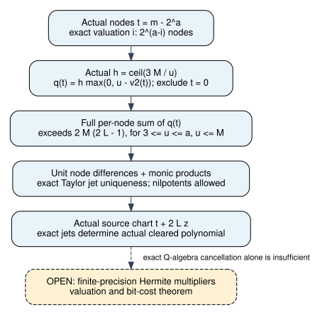

# Actual source taper and exact jet determination

2026-11-09. Mathematical source31c212f5a51d56478facc264dc8c0e15c487bb56.
Unsigned producer evidence [pcc:unverified]. This continues the
[affine-contraction component](../boolean-contraction-20261109/REPORT.md),
without replacing its frozen report. No timing, performance or novelty claim.

The actual source's nonzero nodes at each active two-adic level are now counted
in Lean. Their actual ceiling taper has enough total multiplicity for the
repaired polynomial's doubled degree. Exact scaled source jets determine the
actual cleared packed polynomial over any Q-algebra, including nilpotent
coefficient rings [pcc:unverified].

## Source scope and the mechanism checked

Read OpenAI's pinned October25 manuscript, D.4.3--D.4.4, D.8--D.10, the prior
matched-recovery-independent.md and the actual Mathlib APIs for remainder blocks,
ceil division, Taylor maps, coprime products and monic degree bounds. Primary
PDF SHA256 is5b1612dc2eebb2cad5b4cbe62d1fed2982f01ab1908c26f70010a651487e8123;
[prior provenance](../../../prime_common_kernel_20261030/sources.md) and
[primary release](https://github.com/openai/math/blob/7ef5c0cc5ca4b0e072b7a050fca09ab24bc6fa3a/preprints/The-Exponential-Time-Hypothesis-is-False-October-25-2026/paper.pdf).
KB unavailable: MCP absent and repository wrapper unavailable127. This is a
bounded review and formalization of an established interpolation mechanism.

The earlier odd-node lower bound covers the original degree. It alone does not
establish enough multiplicity at doubled degree. The source-node counts and
full per-node sum were therefore actual obligations, not assumptions to copy
from the numeric margin [pcc:unverified].

## Actual grid and taper

Use L=2^a and the actual source grid represented without aliases:

    m : Fin(2^(a+1)),    t_m = (m:Z) - 2^a.

For each active i<a, an explicit quotient/remainder equivalence counts the
residue class m mod2^(i+1)=2^i. Shifting by L preserves that class because
2^(i+1) divides L. A separate integer lemma establishes

    t mod2^(i+1)=2^i  iff  t !=0 and padicValInt 2 t=i.

Consequently the actual nonzero level has exactly2^(a-i) nodes. Zero is excluded
explicitly; padicValInt at zero is not treated as a level. This holds for all
active levels, not only the first three [pcc:unverified].

The source ceiling is h=ceil(3M/u), with its budget3M<=hu derived from Mathlib's
ceil division. Define the actual per-node order as zero at t=0 and
h*max(0,u-v2(t)) otherwise. The proof identifies its complete grid sum with

    sum_(i=0)^(u-1) #(actual level i) * h * (u-i).

For3<=u<=a and u<=M this exceeds2M(2L-1). The first three actual levels certify
a lower bound on the complete sum; no other level is discarded. The source
ceiling and counts are derived, not supplied as caller assertions
[pcc:unverified].

## Exact interpolation uniqueness and actual scaled charts

For any commutative coefficient ring, node differences that are units make
the polynomials (X-t_i) pairwise coprime. If two polynomials have equal exact
Taylor coefficients below q_i, then (X-t_i)^q_i divides their difference.
The product of those monic factors divides the difference. Its degree is the
sum of q_i, which exceeds the degrees of both polynomials, so the difference
is zero. This proof permits zero divisors and nilpotents [pcc:unverified].

Actual distinct source grid nodes have nonzero rational differences, which map
to units in any Q-algebra. Source charts use t+2Lz, not an unscaled Taylor
variable. An explicit coefficient identity multiplies Taylor coefficient j by
(2L)^j. That scalar is a unit over the Q-algebra, so exact scaled jets imply
equal exact Taylor jets. Applying the actual packed polynomial degree theorem
connects uniqueness to the actual contraction polynomial [pcc:unverified].

**Precision boundary:** cancelling2L here uses characteristic-zero Q-algebra
structure. It cannot be repeated modulo2^p, where2L is not a unit. No theorem
in this component claims finite-precision reconstruction, a reconstruction
program, inexpensive evaluation of the double sum, or a recursive runtime bound.

## Evidence and proof map

Pinned Lean4.35.0, CryptoLean148f5dc389b341401e06d76abe7783c4ccf42f2e and
Mathlibcfc55fc58714a59dc06e6e79edc6d1d95140d3c2. Both new modules are default
targets. recovery-default-build-001.log passed. The actual source-discovering
gate reports162 declarations,0 extra trusted; foundations remain propext,
Classical.choice and Quot.sound. Import-inclusive fresh replay of
HermiteUniqueness exited0; see recovery-fresh-status.json and its raw log.
All are unsigned producer checks [pcc:unverified].

| Obligation | Lean declaration | Unsigned PCC record |
|---|---|---|
| Actual binary valuation node counts | NodeMultiplicity.actualValuationCard | PCC-20261109-ed63ef |
| Actual ceiling and per-node budget | NodeMultiplicity.sourceJetDegreeMargin | PCC-20261109-966d63 |
| Exact uniqueness over commutative rings | HermiteUniqueness.exactHermiteUnique | PCC-20261109-7e8217 |
| Actual packed scaled source jets | HermiteUniqueness.actualPackedScaledJetsDetermine | PCC-20261109-05e9da |

[Statement pins](../../lean/recovery-claim-pins.json),
[NodeMultiplicity.lean](../../lean/NodeMultiplicity.lean),
[HermiteUniqueness.lean](../../lean/HermiteUniqueness.lean),
[source gate](../../lean/recovery-gate/).
The identities here involve counted finite sets, valuations or variable-length
jet vectors and do not fit polynomial-expression identity.certificate/v1.
Their evidence is the quantified Lean source and source audit. The preceding
affine polynomial certificate remains unchanged.

Node build attempts001--009 and both Hermite builds are retained, including
incorrect guessed APIs and failed elaborations. Default build contains the
final accepted source, without an axiom or proof-hole workaround. Logs are
raw diagnostic evidence, not performance measurements; deterministic gzip is
used where needed. No Rust library source or dependency changed in this phase.

## Next discriminating proof

Formalize the actual normalized Hermite basis E_t from D.9 and derive its
multiplier loss. D.10 needs the weighted level difference, including its factor
j/2^j; omitting that j would yield the wrong series bound. Its argument bounds
v2(E_t(0)) below by-6hD_i using sum j^2/2^j=6. Also derive the actual ceiling
upper bound hu<=4M, bound evaluation at-t/(2L), and propagate errors with
p_i=p+8hD_i+8M(a+1). None of those finite-precision bounds follows merely
from the exact uniqueness theorem.

A useful successor test distinguishes the source's actual p_i from the earlier
doubled-budget proxy. It requires a separately prospective protocol and proof
of the actual precision before changing any campaign result. No old run was
rerun, relabelled, or blamed on host contention in this continuation.

Checked the earlier affine diagram and historical study plots, as well as
scoreboard/timeline scope. They remain historical and unchanged. This component
adds a versioned proof diagram; no measured row or admitted performance result
changes.
