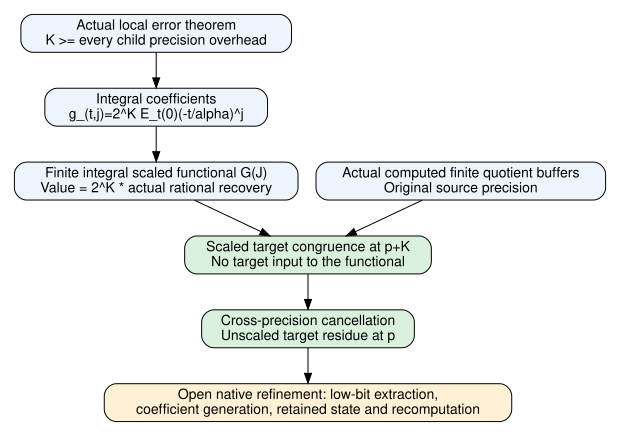

# Integral modular accumulator for actual Hermite recovery

November9,2026. Mathematical source `15ab03e54a929ce076fd6b58edc6bb646a110cb8`.
Unsigned producer evidence throughout [pcc:unverified].

An integral finite scaled functional now represents the actual rational Hermite
sum with one common power-of-two denominator cleared. On actual computed
quotient buffers it has the scaled target residue in the larger precision
ring. Cross-precision cancellation identifies the unscaled target residue.
This establishes the algebraic bridge for streaming contributions rather than
retaining every node's quotient vector [pcc:unverified].

## Actual coefficient scaling

Use h=ceil(3M/u) and the actual source nodes, orders and child precision.
Let K=8h*2^a+8M(a+1), a conservative uniform overhead. The actual child
precision at output precision0 is at most K because2^(a-v2(t))<=2^a.
For every nonzero actual node and j<q_t, the existing coefficient-error theorem
applied to c=2^(childPrecision0) makes
2^(childPrecision0)*E_t(0)*(-t/alpha)^j integral. Multiplying by the remaining
nonnegative power of2 establishes integrality at the common K [pcc:unverified].

Thus define actual integral coefficients g_(t,j)=2^K E_t(0)(-t/alpha)^j
inside the concrete rational integral ring O, and the finite O-valued sum
G(J)=sum_t sum_(j<q_t) g_(t,j)*J_(t,j). The proof identifies its rational
value with2^K times the actual recoveryFunctional, for the prescribed degree
bounds. The construction's inputs contain quotient coefficients, parameters
and supplied placement/weights where used, never the target contraction
[pcc:unverified].

## Precision transition

The actual residue map has kernel(2^p). Consequently, for integral x,y,

    toResidue_(p+K)(2^K*x)=toResidue_(p+K)(2^K*y)
        iff toResidue_p(x)=toResidue_p(y).

This uses divisibility cancellation in the integral domain O, across two
precisions. It assumes no inverse for2 in a fixed ring Z/(2^p).
Combining this statement, the constructed scaled-functional identity and the
actual computed finite-buffer recovery theorem gives

    G(computedQuotient) = 2^K * sum_x A(x)B(x)  (mod2^(p+K)).

Domain: rational integral weights,3<=u<=a,u<=M, injective supplied placement.
Here p is output bit precision, not the prime of an elliptic curve
[pcc:unverified].

## Scope, checks and continuation

The finite ring sum can be evaluated as a fold, so the algebra does not require
simultaneously retaining every quotient vector. This phase does not provide a
native canonical unscaling routine, efficient generation of the scaled
coefficients or input jets, a proved retained-state bound, a recomputation
bound, measured memory savings or a complete recursive runtime theorem.
The noncomputable mathematical definitions remain specifications until native
refinement. A future native accumulator arm requires a new prospective protocol
amendment; it is not silently inserted in the frozen exact-rational census
[pcc:unverified].

Canonical unsigned claims: residueEqIff PCC-20261109-9fdb17;
crossPrecisionCancellation445413; actualScaledCoefficientIntegral d2a76b;
scaledFunctionalMap f27d83; computedScaledFunctionalResidue eb2e7e (same date
prefix). Canonical hashes: ../../lean/stream-precision-claim-pins.json.
Builds001,003,005,006 pass their completed scopes;002/004 failed elaboration and
are retained. Final source audit and fresh receipts are appended when completed.

Sources: actual ResidueEncoding.residue_kernel and HermiteError's actual
coefficient precision theorem, FiniteRecovery's constructed target-residue
theorem, and the pinned source manuscript D.9/D.10 cited in the preceding
Hermite recovery report. KB unavailable, wrapper no executable. Standard
localization/residue arithmetic is reused; no priority or exhaustive-literature
claim is made.

Next: native low-bit extraction from a canonical scaled modular accumulator;
charged coefficient/input construction and per-node retained state; then the
uniform recursive mode and bit-cost theorem. Existing frozen census is still
unexecuted because S3 admission failed and the narrow substitute is pending.
Earlier reports and all measured graphs remain unchanged; no measured row or
ecdb source changed. This new diagram contains dependencies, not measurements.

## Actual source audit

The final project audit passed289 declarations with0 extra trusted axioms.
Receipts: ../../lean/stream-precision-gate/. Only propext, Classical.choice and
Quot.sound occur. Separate fresh StreamPrecision replay is still in flight at
this checkpoint; its eventual status must be read from the unique status JSON,
not inferred from the source audit [pcc:unverified].
