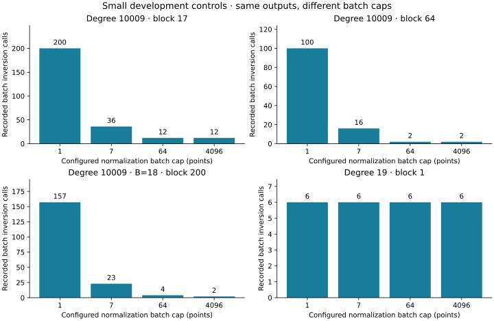

# Bounded projective walks for the complete evaluator

18 November 2026 · PR #4703 · native development controls.

The supplied-case evaluator now accepts `--projective-batch CAP` together with
its existing explicit-window option. Baby and giant walks can use Jacobian
mixed additions and convert their x-coordinates in bounded batches. The
default remains affine; the coverage gate, quotient and point-map formulas,
subgroup inputs and direct-PARI cap are unchanged. This implements an optional
coordinate backend; elapsed-time advantage is unmeasured.

The completed qualifier reports 24 projective pipeline replays and **504
point-input evaluations across three supplied prime fields**, agreeing with
direct PARI and the baseline outputs. An additional bounded primitive check
over the actual 202-bit target field reports **32768 x-coordinate comparisons**
across two kernel-walk prefixes and four batch caps. These are unsigned producer
observations in `PCC-20261118-3560cd`; its standing is `not_covered`, not
independent verification. [pcc:unverified]

## Coordinate and resource contract

For a finite Jacobian point `(X,Y,Z)`, the affine coordinates are
`(X/Z^2,Y/Z^3)`. Mixed addition uses the established EFD `madd-2004-hmv`
formulas; doubling uses the general-a `dbl-2007-bl` formulas. Infinity, doubling,
inverse pairs and doubling of a point with y=0 have explicit branches before
the generic mixed-addition formulas. The field characteristic must exceed 3.
The [source reference](sources.json) records the general EFD page and its hash.
No new formula or algebraic identity is asserted.

The walker holds at most `min(CAP, block length)` points' X coordinates,
Z coordinates and prefix products in three GMP-integer vectors. It inverts
the accumulated nonzero Z product and traverses the prefixes backwards to
normalize the batch, then emits x-coordinates in their original order. It
refuses a walk containing infinity. The evaluator still emits no final
quotient or images before complete coverage and destination checks.

`CAP` must be between 1 and 65536. This bounds those three temporary vectors;
it is not a byte-memory cap for the evaluator. GMP limbs, scalar starts,
root vectors, polynomial products, jets, log norms and serialization remain
separate storage/work. The direct leftover loop stays affine. No peak RSS or
time has been measured. A small batch or a one-point block can add normalization
work without eliminating an affine recurrence inversion.

The earlier [window audit](../window-audit-20261118/README.md) remains pinned to
its pre-batch source, retained in [baseline/complete_pipeline.cpp](baseline/complete_pipeline.cpp).
Its old manifests are not rewritten or presented as hashes of this new source.
The complete 80-bit window remains an independent construction bottleneck.

## Development checks and counter boundary

| Control | Recorded outcome |
|---|---|
| Old default fixture and six new affine-default cases | Byte-equal to their recorded baselines |
| Six small pipeline schedules, four batch caps each | 504 point-input evaluations; quotient/images and original counters agree |
| Enumerated small group law, p=7,11,71 | 3717 mixed-add comparisons, including 84 doubling and 84 inverse-pair cases; four y=0 inputs |
| Small normalization walks | 261 samples: 120 finite walks (600 x checks) and 141 expected infinity rejections |
| Actual target-field coordinate prefixes | 4096 baby and 4096 giant positions, each checked at four batch caps: 32768 comparisons |
| Zero, excessive, duplicate, missing and invalid batch cap | Exit 2, empty stdout |

All completed positive commands returned exit 0 with empty stderr. Counts
include repeated records, infinity and kernel inputs; they are not counts of
distinct non-kernel images, new conductor crossings or ECDLP trials.
[pcc:unverified]

The frozen qualifier compares baseline, new affine-default and optional
projective outputs for six schedules in the supplied fields 6666679, 71 and
11, with projective batch caps 1, 7, 64 and 4096. It includes explicit windows,
partial batches, kernel inputs, infinity inputs and repeated point records.
Direct PARI checks both quotient coefficients and every image. Arithmetic
controls separately enumerate three small groups and compare mixed additions
and short walks with PARI, including exceptional inputs.

The recorded `walk_backend` counters cover projective walk additions,
normalized finite walk points, batch inverse calls and largest batch length.
They exclude setup/kernel-validation inversions, the leftover loop, point-map
arithmetic, polynomial/log-norm work and PARI. They are not total field-operation
counts. The graph compares batch caps within this backend, not elapsed times
or a baseline-versus-candidate speedup. Each cell is one development replay;
deterministic operation counts have no timing uncertainty interval.
[pcc:unverified]

Raw checks and their completion status are recorded under [results](results/).
The separate pre-call manifest was created before invoking the independently
copied frozen qualifier; it is not replaced by later source or reporting work.
The frozen qualifier is a producer's check, not an independent certificate.
No benchmark, gap record or execution verification is promoted from these
controls. [pcc:unverified]



For example, the degree-10009/block-64 schedule records 100 normalization
inverse calls at cap 1 and two at cap 64 or 4096. The block-1 control records six
at every cap, despite having no recurrence additions to replace. These are
operation-counter observations; the extra projective multiplications/squarings
and all excluded stages must be measured before any speed conclusion.
[pcc:unverified]

The target-field primitive control is separately pinned in
[wide-field-pre-call-manifest.sha256](wide-field-pre-call-manifest.sha256).
It reuses the exact walker, checks its starts and reference x-coordinates with
PARI, and has a 120-second process deadline (exit 0). That deadline is a ceiling,
not a timing result. It never enters the complete isogeny constructor. Its
output leaves full quotient, isogeny images and runtime fields null.
[pcc:unverified]

The [summary](summary.json), raw outputs and [PDF](reports/report.pdf) accompany
the producer evidence. No signed execution verifier was used. The local
repository-wide Rust suite and `conductor check` remain unavailable in this
executor; native checks and eventual remote merge checks have separate scope.

The complete raw tree is preserved in `runs.tar.xz`, with
`runs.tar.xz.sha256`. The two individual JSON records named by the PCC claim
also stay loose so their proof paths resolve. All other results are restored
from the archive; the plotter reads the copied recorded counters in summary.json.
From this study directory:

```sh
sha256sum -c runs.tar.xz.sha256
tar -xJf runs.tar.xz
```

Deterministic packing uses `--sort=name --mtime='2026-11-18 00:00:00Z'`, numeric
owner/group 0, `--mode='u+rwX,go+rX,go-w' --format=gnu`, and `xz -6 -T1` on
the `results` directory. Repacking the extracted tree must reproduce the
archive's bytes. This newly archived tree was not previously committed loose.

## Build and replay

Use the native build command in the earlier
[evaluator report](../evaluator-20261118/README.md#build-and-replay). Keep
`projective_walk.hpp` beside `complete_pipeline.cpp`; it is a build input.
The worker Docker context must copy and hash this header as well before a
new image can bind this source. The older qualified image covers its historical
source only, not this version.

```text
complete_pipeline --evaluate MAX_WINDOW BLOCK [--pari-reference]
                  [--baby-window B] [--projective-batch CAP]
complete_pipeline --projective-controls
```

The `--projective-controls` command is a finite development check over small
public curves. It is not a parameter search or an ECDLP timing driver. Replaying
the historical frozen qualifier in place would overwrite early output files
before its late rejection-record sentinel stops it. Do not do that. For a new
replay, copy the current template into a new frozen qualifier, hash it before
calls, and pass a fresh output directory as its third argument. The updated
template refuses an existing output directory before writing anything. The
original frozen script and its recorded hash remain unchanged.

## Original requirements remain separate

| Requested outcome | Status of this change |
|---|---|
| Minimum 80-bit prime endomorphism-conductor gap crossed by an ordinary-curve isogeny | Still needs the full target quotient and images |
| Several fields and dozens of point inputs | Small development controls only; repeated records and exceptional inputs included |
| Repeated matched scalar and ECDLP timings on both endpoints | No new measurements |
| Index-calculus comparison | Not implemented by this coordinate change |
| Source-bound cloud worker and durable results | New image publication/qualification and cloud admission remain separate |

Primary formula source:
https://www.hyperelliptic.org/EFD/g1p/auto-shortw-jacobian.html.
KB wrapper unavailable (exit 127); source scope is the pinned implementation,
EFD formulas and direct PARI controls, with no record or novelty claim.
The existing frozen conductor/measurement graphs are unchanged; this study's
new graph is confined to its own normalization counters.
