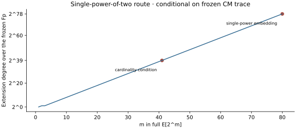

# Frozen ordinary-kernel construction prerequisites

This audit retains the minimum 80-bit prime conductor crossing, complete
quotient/non-kernel images and paired endpoint measurements. It checks the
actual frozen source and kernel rather than treating a larger Frobenius
conductor or an efficient representation theorem as a constructed crossing.

## Question and fixed development controls

For the supplied ordinary source y²=x³−140x+784, write s²=−7,
r=7+s, u=(1−s)/2 and t=3r²−140. The degree-2 normalized quotient is

    x'=x+t/(x−r), y'=y(1−t/(x−r)²),
    A'=−140−5t, B'=784−7(5r³−420r+1568).

The identities A'=u⁴A and B'=u⁶B make the composition
α(x,y)=(x'/u²,y'/u³) an endomorphism of the original source.
Both choices of s will be checked against direct PARI quotient/maps.
Its degree is 2; its differential u has polynomial u²−u+2=0.
The endomorphism trace bound |tr(α)|≤2√2 and the differential action,
in characteristic greater than 5, imply tr(α)=1. Thus
α²−α+[2]=0; conjugation sends α to 1−α. These are standard
trace/norm facts, not a new endomorphism formula or speed claim.

Prediction: α(K) and K are independent in the target prime torsion,
because that prime is inert in the source CM field. Require exact source
membership/order, direct PARI images, characteristic identities on the
kernel and ECDLP-generator scalar panels, and a primitive Weil pairing.
The negative control replaces α(K) by [2]K; its pairing must be 1 and the
basis gate must reject with empty stdout. No target isogeny is evaluated.

Also calculate Frobenius in O=Z[α] from the frozen trace and field:
π=A+Bα, B²=(4p−T²)/7, A=(T−B)/2. Verify its exact norm p and trace T.
The sign of B is conjugation and does not change its order modulo 2^m.
For m=1..80, repeated squaring finds the least power-of-two k with
π^k=1 modulo 2^m. An independent PARI modular matrix checks this and,
when k>1, rejects k/2. These are exact order certificates. Given the
frozen CM trace/order and maximal source ring, they give the extension
degree for full E[2^m]. They do not recount E(Fp).

Report separately the exponent needed for the interpolation cardinality
condition 2^(2m)≥4ell+1 and the stronger single-power embedding condition
2^m>ell. Neither calculation rules out other smooth torsion, other fields,
or other representations. Bounds are not map runtimes.

Development cap: fixed input only, 120 seconds per native checker call,
256 MB PARI stack, no paid computation and no search/benchmark. Freeze
source/input/binary hashes before calls, retain all raw stderr/exits and
require empty stderr for the positive call. No timing will be reported.

## Sources and applicability

- Existing source/kernel certificates, complete evaluator, and general
  degree-2 control in ../wide-harness-20261118/two_map_control.cpp.
- [Robert, Evaluating isogenies in polylogarithmic time](https://www.math.u-bordeaux.fr/~damienrobert/pro/publications/articles/polylog_isogenies.pdf),
  Theorems 1.2/1.3 and §5: the representation construction needs initial
  images; its rational-kernel setup retains a square-root degree term.
- [The Isogeny Problems](https://isogeni.es/problems/full.pdf), Problem 5,
  ordinary-case discussion and Problem 5.2. The latter requires a norm-d
  ideal as input. An inert prime has no norm-ell ideal in the maximal
  source order, so this is not literally that ideal-input instance.
- [Rueger's ordinary CLAPOTI thesis](https://rueg.re/2024-rrueger-msc-ordinary-icga-hd.pdf),
  §4.4: small-prime descents produce prime-power conductors. They do not
  replace a large-prime conductor ratio.
- [PARI pairing reference](https://pari.math.u-bordeaux.fr/dochtml/html/Elliptic_curves.html#ellweilpairing)
  and Sutherland 18.783 Lectures 13/16 for endomorphism trace/norm/order.

KB unavailable: no tools exposed; wrapper exit 127. The ePrint PDF request
returned 403; the author's primary-source PDF was accessible. No general
impossibility, novelty or world-record claim is made. The audit does not
change the original source/kernel, proof subjects or measurement criteria.

## Completed outcomes

Both conjugate degree-2 endomorphisms match PARI on 128 point images:
32 distinct scalars on K and 32 on the q-generator for each branch.
The conjugate sum/product and characteristic identities pass, including
kernel and infinity exceptions. K and α(K) form a basis of the full
prime torsion over the base field: their Weil pairing has exact order ell.
Replacing α(K) with [2]K rejects the independence gate with exit 2 and
empty stdout. The original kernel line is not CM-stable. [pcc:unverified]

Given the frozen CM trace, all 80 native ring-order certificates agree
with the independent PARI matrix calculations and preceding-power controls.
The interpolation-cardinality exponent is m=41: full E[2^41] requires
extension degree 549755813888 = 2^39. The single-power embedding exponent
is m=80: full E[2^80] requires degree 302231454903657293676544 = 2^78.
These are field degrees, not operation counts or runtimes. [pcc:unverified]

This diagnoses the large-single-power route on this exact field. Robert's
powersmooth alternative and other fields are not excluded. Neither variant
supplies initial images under the unknown degree-ell map. Problem 5.2's
norm-ell ideal input is also absent from this maximal inert source; applying
that formulation from a lower nonmaximal order first needs the lower curve.
The earlier open-problem reference was contextual, not an exact input match.

PCC-20261118-ef3abf binds summary.json, attempt-b/positive.json, the dependent
rejection and pre-call-v2.sha256. These are unsigned producer attestations;
the maintained verifier returns not_covered, with standing unverified.
The CM trace is inherited, not independently recounted here. No target
quotient, target non-kernel image, endpoint timing or impossibility result
is asserted. [pcc:unverified]



[Two-page illustrated report](reports/report.pdf).

## Failures, exact versions and reproduction

Build A used an unavailable PARI API gmodulcp; build-a retains its failed
source and stderr. Build B uses gmodulo and passes, but attempt-a fails:
the reused unsigned strtoi helper turns the negative source coefficient
into zero. The native parser diagnostic retains that exact behavior.
That attempt is invalid for the intended curve. No arithmetic conclusion
is drawn from it. [pcc:unverified]

The current source's local signed_gen wrapper fixes both the source
coefficient and negative Frobenius matrix entry. Build C passes with
warnings denied; attempt-b completes and the dependent control rejects.
The original source bytes are preserved in source-v1/cm_prerequisites.cpp,
with the original binary and qualifier unchanged. To audit pre-call.sha256,
map only its cm_prerequisites.cpp path to that preserved version. All other
historical subjects match their original hashes. The v2 manifest passes
directly from the repository root before and after execution.
[pcc:unverified]

The pre-existing oracle, two/five-map controls and exporter all canonicalize
negative coefficients before calling the unsigned parser; this new checker's
error does not apply to those existing paths. Their bytes are unchanged.

Build with the parent evaluator's FLINT/PARI/GMP prefix and optimized.o,
using the exact compiler command recorded in build-command.txt. Replay the
current fixed qualifier with a fresh output directory:

```sh
bash qualify-v2-frozen.sh /absolute/repository /absolute/cm-prerequisites-v2 /absolute/fresh-output
```

The manifest pins absolute executable/object paths used in this development
environment. For another host, freeze its actual rebuilt paths in a new
manifest/qualifier; preserve these historical subjects. No old attempt
directory may be overwritten. No benchmark session or cloud job is active.
