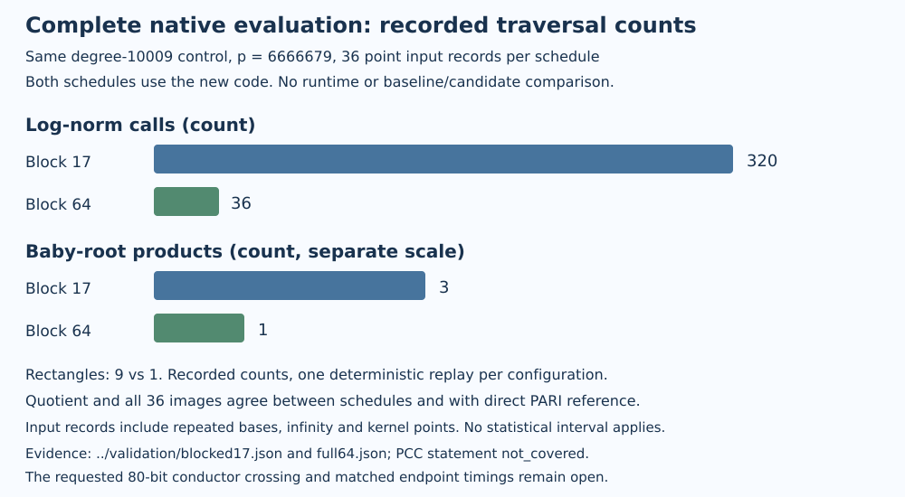

# Balanced complete isogeny evaluator

18 November 2026 · PR #4680 · native development checks.

The existing complete evaluator now uses FLINT's balanced baby-root product,
retains each baby polynomial across giant blocks, and walks baby, giant and
leftover kernel points by addition after one scalar start per block. A supplied
case interface makes the full normalized quotient and point evaluator usable
outside the two hard-coded controls. Canonical coverage and collision checks
still precede output. This is implementation progress toward the requested
ordinary prime-conductor crossing.

The producer's checks reproduce the archived fixture bytes and compare **84
supplied-case image evaluations across three prime fields** against PARI.
Eight additional rejection controls pass. These observations have PCC statement
record `PCC-20261118-8b4a2c`; its standing is `not_covered`, not independent
verification. [pcc:unverified]

## Original request and evidence

| Requirement | Current status | Evidence |
|---|---|---|
| Minimum 80-bit prime endomorphism-conductor crossing on ordinary curves | Open | Unchanged [parameters](../parameters.json); no target quotient or full images |
| Complete native quotient and point evaluation | Implemented; development controls replayed | Existing fixtures and new CLI outputs below |
| Matched scalar-multiplication and ECDLP measurements on both endpoints | Open | No new runtime measurements; old fixture known answers remain controls |
| Several fields and dozens of point/scalar inputs | Development coverage only | Three small prime fields; 36 point inputs in each of two degree-10009 schedules; unchanged 68 fixture recoveries |
| Index-calculus comparison | Open | This change adds no IC arm |
| Bounded cloud execution and durable results | Not submitted | [Cloud routing/readiness receipt](cloud-readiness.json) |

An isogeny's prime degree is not automatically its endomorphism-conductor gap.
The generic output therefore leaves `ordinary_status`, `conductor_gap` and
`runtime_measurements` null. An eligible record needs separate endomorphism-order,
subgroup-transport and measurement evidence. The 263-bit K-571 factor remains a
separate published comparison; this change does not construct its other endpoint.

## Implementation changes

- `baby_product` calls `fmpz_mod_poly_product_roots_fmpz_vec` instead of growing
  the polynomial through one linear-factor multiplication per root.
- The baby product is built once per baby block and reused for each giant block.
- Baby roots advance by `[2]K`; giant points by `[4B]K`; leftovers by `[2]K`.
  Starts remain exact scalar multiplications; GMP integer counters record these
  stage-local calls and recurrence additions.
- `--evaluate MAX_WINDOW BLOCK [--pari-reference]` accepts a supplied short
  Weierstrass case, with exact prime field/degree checks, nonsingularity,
  canonical coordinates, source membership, exact prime-kernel witness and
  complete coverage. `MAX_WINDOW` bounds both complete baby and giant sides,
  before root allocation. It is an element-count limit, not a peak-RAM estimate.
- Optional direct PARI expansion is capped at degree 10009. At most 64 point
  inputs are accepted. No quotient/images are printed after a rejection.

The paired biquadratic, log-norm backend, normalized image formulas and coverage
contract are unchanged. No new general algebraic identity is asserted here.

## Development checks

| Case | Field p | Degree | Block | Point input records | Check |
|---|---:|---:|---:|---:|---|
| Larger supplied control | 6666679 | 10009 | 17 | 36 | PARI quotient/images |
| Same supplied control | 6666679 | 10009 | 64 | 36 | PARI and identical semantic output |
| Small supplied control | 71 | 19 | 1 | 6 | PARI, smallest block |
| Empty-leftover branch | 11 | 5 | 2 | 6 | PARI, zero leftover starts |

The records include repeated bases, infinity and kernel points; **84 evaluations
are not 84 distinct non-kernel points**. Source and destination coordinates are
retained. The original `--fixtures` output is byte-identical to both the before
binary and the archived receipt: 42 existing map inputs, 34 paired known scalars,
68 endpoint recoveries, and six existing coverage rejection controls.
These are small known-answer controls, not ECDLP performance data. [pcc:unverified]

Additional rejection cases: off-curve input, wrong-order kernel, composite degree,
trailing input, noncanonical kernel coordinates, more than 64 points, a declared
window limit below the control, and the unchanged target80 input under a 1024-side
limit. Each returned exit 2, empty stdout and the expected stderr reason.
[pcc:unverified]



The graph compares **two schedules of the new code**, not baseline versus
candidate. The larger block's 36 log-norm calls versus 320 for block 17 are
recorded traversal diagnostics. No elapsed times, memory peaks, uncertainty
intervals or end-to-end runtime comparisons were measured. Stage counters exclude the two
fixed step-point setup multiplications, kernel validation, PARI reference work,
and arithmetic inside each norm call. Do not treat them as total field-operation
counts. No benchmark/leaderboard row is added.

## Build and replay

Dependencies used: GCC 14.2.0, FLINT 3.1.3, PARI 2.17.2, MPFR headers 4.2.2,
and the system GMP development package. Official Debian package hashes and the
actual binary/source hashes are in
[post-call-manifest.sha256](validation/post-call-manifest.sha256). This is a
post-call reconstruction, not a pre-call or pre-experiment checkpoint.

For dependencies installed in a Debian-layout prefix:

```sh
deps=/path/to/native-prefix/usr
src=research/prime_conductor_gap80_20261031/native
build_dir=$(mktemp -d)
cc -O3 -Wall -Wextra -std=c11 -isystem "$deps/include" \
  -Dprime_log_norm_jet=optimized -Dprime_log_norm_free=optimized_free \
  -c "$src/optimized.c" -o "$build_dir/optimized.o"
c++ -O2 -Wall -Wextra -std=c++17 -isystem "$deps/include" \
  -isystem "$deps/include/x86_64-linux-gnu" \
  "$src/complete_pipeline.cpp" "$build_dir/optimized.o" \
  -L"$deps/lib/x86_64-linux-gnu" -Wl,-rpath,"$deps/lib/x86_64-linux-gnu" \
  -lpari -lflint -lgmpxx -lgmp -o "$build_dir/complete_pipeline"
study=research/prime_conductor_gap80_20261031/evaluator-20261118
"$build_dir/complete_pipeline" --fixtures
"$build_dir/complete_pipeline" --evaluate 64 17 --pari-reference < "$study/inputs/control10009.txt"
"$build_dir/complete_pipeline" --evaluate 64 64 --pari-reference < "$study/inputs/control10009.txt"
"$build_dir/complete_pipeline" --evaluate 4 1 --pari-reference < "$study/inputs/control19.txt"
"$build_dir/complete_pipeline" --evaluate 2 2 --pari-reference < "$study/inputs/control5.txt"
sh "$study/check-rejections.sh" "$build_dir/complete_pipeline" "$build_dir/rejections"
```

Input format is whitespace-delimited:

```text
p a b ell Kx Ky point_count
O
x y
... exactly point_count entries
```

`O` denotes infinity. The source model is `y^2=x^3+a*x+b`. The caller supplies
every curve and point; no parameter search, unknown-target campaign or timing
arm is launched by this interface. Baseline source was copied before editing
and is recoverable from commit `1f7e1c6c7a` at the same native source path.
The raw fixtures, positive CLI output, negative inputs/stderr and empty build
stderr are under [validation](validation/).

## Next construction step and execution boundary

The 80-bit target still requires 427154957034 baby roots. Balanced products and
block reuse do not establish feasibility for that window. Complete external-memory
scheduling, total work/I/O costs and durable resume integration remain open.
The original frozen [measurement protocol](../MEASUREMENT_PROTOCOL.md) still
governs future paired timings.

The current GitHub experiment workflow bundles Rust ecbench/fresh-owner and a
separate norm-branch command mode, not this FLINT/PARI worker. This runtime has
no EKS MCP, AWS CLI, kubectl or configured AWS identity. No live budget remainder,
reserved spend or capacity readback is established. Per
[COST_CONTROLS.md](../../../taskq/deploy/eks-karpenter/COST_CONTROLS.md), those
checks and a pinned compatible worker must precede a paid build/job. No cloud
trial or surrogate integration fixture was dispatched.

## Sources checked

- [Existing constructor derivation](../../conductor_gap_cm_orbits_20261015/native/CONSTRUCTOR.md)
  and [complete pipeline contract](../complete-pipeline/README.md).
- [FLINT polynomial documentation](https://flintlib.org/doc/fmpz_mod_poly/index.html)
  and the installed 3.1.3 header's public `product_roots_fmpz_vec` declaration.
- [Sage square-root Velu reference](https://doc.sagemath.org/html/en/reference/arithmetic_curves/sage/schemes/elliptic_curves/hom_velusqrt.html):
  established fast-product/resultant approach and the distinction between
  normalized codomain models. Native arithmetic remains C/C++, not Sage/Python.

KB unavailable: no exposed knowledge-base MCP service; wrapper exit 127. The
primary project Velu-sqrt site timed out; the official Sage reference and pinned
existing arithmetic were accessible. No novelty or world-record claim is made.

The prior readiness, complete-pipeline and CM-orbit figures were checked for
applicability. Their frozen measurements and target coverage are unchanged.
This component gets its own [PDF](reports/report.pdf) and editable SVG.
