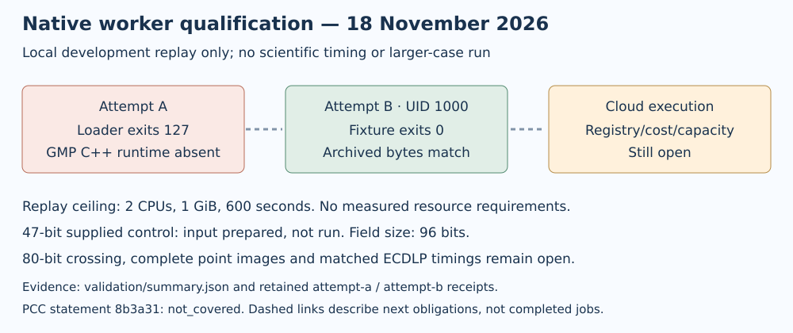

# Native worker packaging and supplied-case preparation

18 November 2026 · follow-up PR #4690 after #4680 merged.

The corrected standalone amd64 worker runs as UID/GID 1000 and emits exactly
the archived fixed-fixture bytes: 42 map inputs, 68 known-answer endpoint
recoveries and six coverage rejection controls. The first image's loader failure
is retained. These are local development observations, recorded by unsigned
statement `PCC-20261118-8b3a31`, not an independent mathematical verdict.
[pcc:unverified]

## Actual execution

| Attempt | Build source | Result | Receipt |
|---|---|---|---|
| A | `3cedf8af6c` | Image created; fixture process exits 127 at the loader, missing `libgmpxx.so.4` | [raw stderr](validation/attempt-a/fixtures.stderr) |
| B | `1df0b39628` | Explicit GMP C++ runtime added; fixture exits 0, stderr empty, archived bytes match | [raw fixture](validation/attempt-b/fixtures.jsonl) |

The first build-exit JSON records 0 while the orchestration tool reported 1.
Both observations are retained in the [summary](validation/summary.json).
The exported image existed; its explicit loader failure determines its unusable
runtime status. Attempt B used a new receipt directory; no failed artifact was
replaced.

Both builds used a pinned public Debian manifest and exact FLINT/PARI package
versions. Source-publication receipts and **pre-call** manifests were captured
before each build. The corrected image was replayed with a 600-second limit,
2 CPUs, 1 GiB RAM, 64 PIDs, no network, a read-only root and a 64-MiB temporary
mount. Those are execution ceilings, not measured memory/time requirements.
No scientific runtime or hardware-isolation claim is made.

```text
Local image ID:
sha256:3dcd2c0e240753cd315aadb61dd30375d31c4cabdecf0688156f46c286f56b49
Native executable SHA-256:
3c16dd628912f1f37c16903447f03f513cd63574e197f246245b383833cebfd7
```

The source manifests inside the image match the repository's unchanged
`complete_pipeline.cpp` and `optimized.c`. The image ID is a local Docker
identity, **not a published registry manifest digest**. The image archive is not
in Git or S3. A future trusted publisher still needs to build/publish the worker
and bind its actual source, binary and registry OCI digest. [pcc:unverified]



## Prepared 47-bit supplied control — not executed

[input.txt](qualification47/input.txt) contains the archived case 1007 over
`p=78125000378223625457769953627`, a **96-bit field**, with candidate prime
conductor ratio `ell=125000000302579`, **47 bits**. Its source is the archived
root **quadratic twist**, with short coefficients
`18274853889642953323454959912, 32133284755955526260408304513`.

The three supplied inputs are the archived second ell-torsion basis point,
the kernel generator and infinity. The source snapshots and hashes are in
[sources](qualification47/sources/) and [source-hashes](qualification47/source-hashes.sha256).
The input, protocol and snapshots agree as exact strings; no floating-point
conversion was used to copy these large integers.

The proposed transport point has order **ell**, not the original curve's
96-bit prime order. Its independence from the kernel is supported by the
recorded nontrivial Weil pairing; the original point-order/pairing checks must be
replayed before a scientific run. Here the subgroup order equals the isogeny
degree. A coprime-degree argument does not apply, and the dual map is not an
inverse on this subgroup. Forward injectivity needs the independent-line
argument, and any recovered scalar must be checked on the source.

The [proposal](qualification47/protocol.json) specifies how to compare the
raw-twist output to the archived floor: multiply output `a` by 4 and output `b`
by 8 modulo p. It proposes a single bounded attempt, 4 CPUs, 96 GiB,
3600 seconds and a USD 5 total ceiling. These are **proposed ceilings**,
not a runtime estimate, an admitted launch request, or permission to skip the
actual account/lane budget and capacity checks. No large-case invocation,
unknown-target recovery or endpoint timing was run. [pcc:unverified]

## Original objective and next step

| Obligation | Status |
|---|---|
| Standalone native package and fixed development replay | Locally exercised; unsigned statement evidence |
| Supplied 47-bit control | Input/proposal prepared; not run |
| Compatible registry-published worker and trusted launcher integration | Open |
| Current remaining budget, reservations and live capacity | Not established |
| Minimum 80-bit ordinary prime-conductor quotient and complete point images | Open |
| Full-window work/memory and durable checkpoint feasibility | Open |
| Matched scalar/ECDLP timings and index-calculus comparison | Open |

The 47-bit preparation does not replace the minimum 80-bit goal. The existing
80-bit input and frozen measurement protocol are unchanged. The next execution
step is trusted worker publication and read-only budget/capacity qualification,
followed by the proposed supplied-case run only if those obligations pass.

## Reproduction and reporting scope

Build/run commands are in [README.md](README.md). Raw build output, initial
failure, image metadata, package manifests, source/binary hashes, publication
receipts and fixture outputs are under [validation](validation/).
The test used the exact native sources already published before each build.
The corrected Dockerfile here is byte-identical to the tested input.

Sources: existing complete-evaluator contract, frozen upper-96 kernel/floor
and torsion-module records, the runtime Docker instructions, and the existing
IsoLab cost/access contracts. The shared research KB remains unavailable;
this work reuses the scoped frozen sources and makes no novelty claim.

Existing target-coverage, traversal-count and benchmark figures remain
unchanged: this packaging step adds no scientific measurements. The linked
worker-state diagram and [PDF report](reports/worker-qualification.pdf)
describe this component only. No eligible conductor-gap record is promoted.
