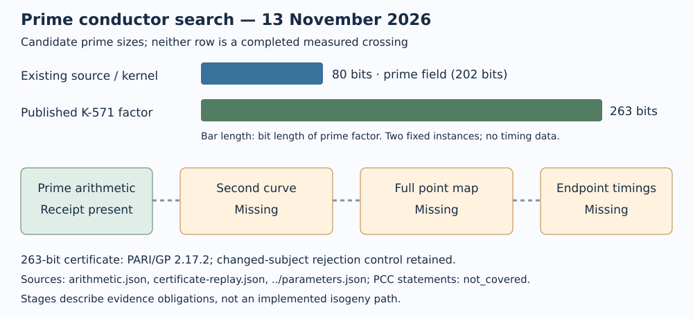

# A concrete 263-bit prime conductor factor

2026-11-13. The scoped literature search recovered the exact **263-bit prime**
from the published K-571 example. PARI/GP reconstructed the Frobenius conductor,
accepted a saved ECPP certificate, and rejected a changed certificate subject.
These are arithmetic observations recorded as PCC statements, whose verdict is
`not_covered`; independent review remains required: [pcc:unverified]. Claims: `PCC-20261113-add2c4` (data) and
`PCC-20261113-80903b` (literature).

```text
ell = 9021184135396238924389891945192676814518993645089807769277009849103733654828039
```

The curve is **K-571**, `y^2 + xy = x^3 + 1` over `GF(2^571)`. Its maximal
endomorphism order has fundamental discriminant `-7` and conductor 1, according
to Koblitz–Koblitz–Menezes, Section 11.2, Example 4. The Frobenius conductor is

```text
c = 35655896511340624687810845487372082980344185179452596885179918179218090432562595510057
  = 3952463 * ell
```

The replay calculates the extension trace from the fixed Frobenius polynomial
`X^2 + X + 2`, checks the numerical discriminant relation, and certifies both
factors as prime. It checks this fixed published example; it is not a new
isogeny search or a benchmark. Full output: [arithmetic.json](arithmetic.json).
Prime proof: [prime263.cert](prime263.cert). Replay and changed-subject control:
[certificate-replay.json](certificate-replay.json). [pcc:unverified]

## What qualifies, and what remains open

The user's criterion remains **a minimum 80-bit prime endomorphism-conductor
gap between ordinary curves, crossed by a completely evaluated isogeny, followed
by matched endpoint ECDLP measurements**. The 263-bit number is an isogeny-class
conductor factor. It is not an equation for the second curve, a computed map,
or an eligible measured crossing. The full floor conductor would be the composite
`c`; a ratio exactly `ell` requires an appropriate intermediate endpoint, which
is also absent here. No world-record claim is made.

| Instance | Field | Prime gap candidate | Quotient and full map | New endpoint times |
|---|---|---:|---|---|
| Existing native source/kernel | 202-bit prime field | 80 bits | Missing | Missing |
| Published K-571 | Binary field of degree 571 | 263 bits | Missing | Missing |

The original 80-bit candidate is unchanged:
`ell=729845429276318409687041`, source `[0,0,0,-140,784]`,
`p=4794168233664648458988367110514316682522236917173341621535751`.
Its exact kernel, generator and subgroup are in [parameters.json](../parameters.json).
The K-571 review introduces no ECDLP subgroup, target scalar, or timing arm.



## Construction routes checked

- **Ascending recovery with self-pairings:** Galbraith–Gilchrist–Robert,
  Algorithm 3, takes both ordinary curves as input. It does not manufacture the
  missing endpoint. Its additional divisor mechanism uses the upper-order
  discriminant: at our maximal `D=-7` endpoint, the available odd positive
  divisors are only 1 and 7. That mechanism supplies no conductor-sized divisor.
- **Higher-dimensional representation:** it can make a supplied representation
  efficient to evaluate; the needed initial torsion images are still an input
  obligation. It is not a completed construction for our kernel.
- **CLAPOTI/class-group actions:** horizontal actions of invertible ideals do
  not provide a general vertical construction. The ordinary non-invertible
  ideal problem is explicitly listed as Problem 5.2 in *The Isogeny Problems*.
- **SCALLOP and prime-power descents:** an orientation order on a supersingular
  curve, or a conductor such as `3^27`, does not meet this ordinary prime-gap
  criterion.

These are bounded assessments of the cited methods, not impossibility claims.
The next technical step remains a complete quotient and non-kernel images for
the existing 80-bit source, with recorded total construction and transport costs,
before endpoint scalar-multiplication and ECDLP measurements. [pcc:unverified]

## Replay

Use PARI/GP 2.17.2 and an **empty output directory** (GP `write` appends):

```sh
study=/absolute/path/to/record-search-20261113
run_dir=$(mktemp -d)
cd "$run_dir"
gp -s 128M -fq < "$study/check-published.gp" > arithmetic.json 2> arithmetic.stderr
test ! -s arithmetic.stderr
test -s arithmetic.json
test -s prime263.cert
gp -s 128M -fq < "$study/check-certificate.gp" > certificate-replay.json 2> certificate-replay.stderr
test ! -s certificate-replay.stderr
```

This session used the official Debian `pari-gp_2.17.2-1_amd64.deb`, extracted
into `/workspace/tools/pari` without system changes. Its SHA-256 and downloaded
paper hashes are in [source-hashes.txt](source-hashes.txt). The first certificate
attempt exhausted GP's default 8 MB stack; the retained
[error](primecert-stack8M.stderr) is not a nonprime result. The 128 MB replay
completed. GP can exit zero after an interpreter error, hence the stderr and
output checks above. No performance measurements were taken.

## Sources and search boundary

1. [Koblitz–Koblitz–Menezes, Section 11.2, Example 4](https://www.math.uwaterloo.ca/~ajmeneze/publications/ecc.pdf).
2. [Galbraith, ANTS submission, introduction, Section 5 and Appendix A](https://antsmath.org/ANTSXVI/papers/Galbraith.pdf).
   This copy predates later IACR revisions; it is not presented as the latest text.
3. [Galbraith–Gilchrist–Robert, Algorithm 3 and Proposition 5.1](https://www.math.u-bordeaux.fr/~damienrobert/pro/publications/articles/climbing_volcanoes.pdf),
   PDF dated 2025-08-15.
4. [The Isogeny Problems, Problem 5.2](https://isogeni.es/problems/full.pdf).

The source audit and hashes are in [source-review.json](source-review.json).
KB unavailable: no knowledge-base MCP tools were exposed; the repository wrapper
exited 127. Fallback was scoped existing evidence plus primary sources. ecdb was
not available in this fresh environment; the fixed published trace/factor replay
is explicitly recorded instead. This is not an exhaustive world-record survey.

The existing measurement-readiness, complete-pipeline and CM-orbit graphs were
checked for applicability. Their inputs and measured coverage did not change;
no existing graph, scoreboard or benchmark row is promoted. This round adds
the linked evidence-stage diagram and [PDF report](reports/report.pdf).
