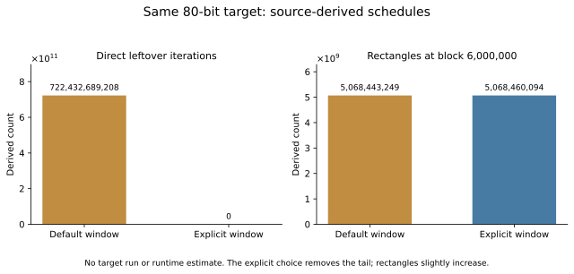

# Explicit baby windows and the unchanged 80-bit target

18 November 2026 · current evaluator audit and small development controls.

The native evaluator now accepts `--baby-window B` while keeping its existing
default unchanged. For the same frozen 80-bit degree, an explicit window
`B=414464344064`, `G=440234147840` has **zero direct leftovers** in the exact
schedule model. The default has 722432689208 leftover pairs. Small explicit-window
controls agree with direct PARI and the existing normalized outputs.
Statement `PCC-20261118-7f57d5` records unsigned producer evidence; independent
mathematical standing is not established. [pcc:unverified]

This does not construct the 80-bit quotient or evaluate its points. The new
choice still has multi-terabyte full-window array requirements and billions of
rectangles at the proposed bounded block size. The field, degree, kernel,
subgroup and frozen measurement protocol are unchanged.

## Exact metadata, not measured memory or runtime

The new native `complete_schedule_preflight` computes integer window/traversal
metadata without allocating any roots, performing curve arithmetic, multiplying
polynomials or timing a construction. It does not check primality or admit a
launch. Its results are conditional on a complete successful execution of the
pinned source. The [post-call manifest](post-call-manifest.sha256) binds the
actual evaluator/planner sources and development binaries; it is not a pre-call
experiment checkpoint.

| Same 80-bit target | Default window | Explicit zero-leftover window |
|---|---:|---:|
| Baby count | 427154957034 | 414464344064 |
| Giant count | 427154957034 | 440234147840 |
| Direct leftover pairs | 722432689208 | 0 |
| Rectangles at block 6000000 | 5068443249 | 5068460094 |
| Full baby-vector/result slot bound, bytes | 6834479312552 | 6631429505032 |

The explicit choice **slightly increases rectangles** at block 6000000. Removing
the direct tail does not establish a faster complete construction; no timing
advantage or total-work estimate is asserted. Source-loop counts omit the
arithmetic within every log-norm call and point update. [pcc:unverified]



The full-block storage calculation counts the root vector and the monic
product's coefficient slots while both are live in `baby_product`. It excludes
all GMP limbs, other jet/polynomial/norm objects, serialization, stack and
allocator overhead. **Live logical storage is not measured RSS.** No swap or
external-memory implementation is modeled.

The old [legacy audit](../measurement-readiness.json) counted only the root
slots, yielding 3417239656272 bytes. The new 6834479312552-byte default bound
includes a second live array. It is a tighter accounting scope, not an observed
memory regression. Both comparisons use an example 128-GiB in-memory policy
budget (137438953472 bytes), not a live quota/capacity readback.

## What bounded blocks do to this implementation

| Default window, block size | Rectangles | Giant contexts regenerated |
|---|---:|---:|
| 4096 | 10875544558802641 | 44546230163497922886 |
| 6000000 | 5068443249 | 30410442856121562 |
| 8589934591 | 2500 | 21357747851700 |
| Full window (block 427154957035) | 1 | 427154957034 |

The 8589934591 value is the most generous block allowed by this **baby-array-only
slot bound** at 128 GiB. It leaves no allowance for the excluded objects and is
not a usable memory recommendation. The 2500 count is conditional on the fixed
default window and this weak necessary bound; it is not a lower bound for every
window choice or isogeny algorithm. The full-window case fails even this bound.
All values are derived exact integers retained as decimal strings. No throughput
conversion, wall-time projection or universal infeasibility claim is made.

The current evaluator regenerates giant contexts for each baby block. A bounded
root vector alone therefore does not establish an acceptable complete schedule.
External-memory processing and total work/I/O accounting remain open obligations.

## Development checks and retained rejected choice

- Four planner schedules match all corresponding stage counters in the retained
  degree-10009, degree-19 and degree-5 development receipts. The modeled minimum
  norm-call count is checked only as a lower bound on the actual recorded calls.
- The modified evaluator's default `--fixtures` bytes still equal the frozen
  receipt, including the original 68 known-answer endpoint recoveries.
- Explicit windows `B=18` at degree 10009 and `B=1` at degree 19 compare 42 point
  inputs against direct PARI and existing default quotient/image outputs. The
  degree-10009 explicit window covers the zero-leftover branch.
- Zero, out-of-range and duplicate window options return exit 2 with no result.
  Slot-budget boundary and invalid-degree metadata controls are retained.

These are development observations, not new large-gap ECDLP data. [pcc:unverified]

The first manually proposed window 412316860416 was rejected **as a zero-tail
choice**: the exact model reports 549755813888 leftovers. Its valid model is
retained in [rejected-divisor-candidate.json](results/rejected-divisor-candidate.json).
It was not a failed construction or a timing sample. Exact native arithmetic
confirms zero leftovers for both 274877906944 and the selected 414464344064.
The latter keeps the two window dimensions closer. [pcc:unverified]

## Build and replay

The planner needs GMP C++ and the FLINT header for the actual slot size:

```sh
c++ -O2 -Wall -Wextra -std=c++17 \
  native/complete_schedule_preflight.cpp -lgmpxx -lgmp -o complete_schedule_preflight
./complete_schedule_preflight 729845429276318409687041 6000000 137438953472
./complete_schedule_preflight 729845429276318409687041 6000000 137438953472 414464344064
```

Run those commands from the study root with system dependencies, or supply
the dependency include prefix used by the preceding evaluator build. The
optional final planner argument selects the explicit baby window.

The supplied-case evaluator's CLI is now:

```text
complete_pipeline --evaluate MAX_WINDOW BLOCK [--pari-reference] [--baby-window B]
```

`MAX_WINDOW` bounds both complete window sides; it is not the block size or a
byte-memory cap. A proposed explicit window must satisfy the same complete
coverage conditions, and the existing independent-reference degree cap remains
10009. Duplicate, missing or invalid options are rejected. No large target
invocation is prescribed or launched here.

Raw planner results, control outputs, rejected options and default fixture
replay are under [results](results/). The editable plotting source reads only
those recorded values and lays out the [PDF](reports/report.pdf).

Local source/manifest and prose checks passed. The repository-wide
`cargo test --release --lib` and session coordination `conductor check` could
not run: both executables are absent (exit 127). No Rust source is changed.
The native development checks above do not replace the required remote merge
checks or constitute a large-gap experiment.

## Original goal and remaining obligations

The minimum 80-bit prime endomorphism-conductor crossing still needs a complete
explicit quotient, full images, independently supported endpoint/subgroup
certificates and the frozen matched scalar/ECDLP measurement protocol. An
index-calculus comparison remains unimplemented. Current small control degrees
are not certified conductor gaps.

Worker publication, budget/reservations/capacity and complete schedule feasibility
are independent requirements; fixing the cloud route does not resolve the
window/work counts above. No target curve, point image, runtime or conductor-gap
record is promoted by this audit.

Sources checked: pinned `complete_pipeline.cpp`, existing
[constructor derivation](../../conductor_gap_cm_orbits_20261015/native/CONSTRUCTOR.md)
(arbitrary positive baby window and exact remainder coverage), the archived
80-bit parameters, and the installed FLINT 3.1.3 public root-product declaration
([official reference](https://flintlib.org/doc/fmpz_mod_poly/index.html)).
This exposes established index-set tuning; no new general algebraic identity
or isogeny formula is asserted. KB unavailable: wrapper exit 127, no exposed
knowledge service; the review used these scoped primary/implementation sources.
Existing frozen measurement/coverage graphs remain unchanged. The new graph
shows derived schedule counts, not an admitted benchmark or timing comparison.
