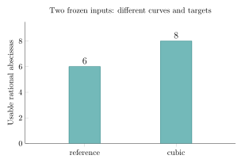

# Saved cover inputs: base occupancy and representation

2026-11-13. Exploratory exact two-record native audit; no new solver or timing run.
Unsigned data statement PCC-20261113-79248f [pcc:unverified].

The completed reference and cubic records each describe16 distinct image
abscissas, but only6 reference and8 cubic abscissas pass the producer's
nonzero-square filter. The cubic count matches its saved field; the reference
count was absent from the original row. Both target abscissas are rational on
their respective curves. These are two different curves and planted targets,
not a general density advantage for cubic maps [pcc:unverified].



## Exact audit and its limits

Frozen source record snapshot: crypto@cc986a93b49b4ae91be5c9fe89a9ef8d55c9bd28.
The Rust validator atbf27909df checks the two original file digests, prime and
nonsingularity guards, exact16th-root order, coset distinctness and all32
point/residue calculations. It applies the saved polynomial cover or identity,
deduplicates images and matches the saved cubic cardinalities. The Euler
character filter excludes y=0 exactly as the original generator does.

| Native recomputation | Reference | Cubic |
|---|---:|---:|
| Distinct image abscissas | 16 | 16 |
| Usable nonzero-square abscissas | 6 | 8 |
| Excluded y=0 abscissas | 0 | 0 |
| Target character | 1 | 1 |

Full point/residue rows are in [field-audit.json](evidence/field-audit.json).
This does not replay F4, verify its basis or planted solution, establish a
subgroup order, recover a scalar or measure useful-relation yield. The saved
planted_ok fields are retained as producer fields, not independently checked
by this audit. All standing remains unsigned [pcc:unverified].

## What the original experiment supports

The original protocol's W-only gate for the completed cubic cell remains C:
its reported max_cols is245930 versus167726. That frozen stage rule is not
changed. Cubic was rerun alone after a shared-pod kill; progress records its
completed exit0. Quart and generic3 remain censored. The erroneous late
hard-stop text was corrected by the producer and retained verbatim.

Only one planted target per arm was run; the map draw shifts the RNG stream
before curve selection. The source and rows confirm different curves/targets.
The reference shared its pod, while the successful cubic retry ran alone;
there is no matched timing result here. The unreported reference occupancy
also differs from the cubic occupancy. These observations limit a total
relation-finding or all-encoding conclusion; they do not overturn the original
finite W gate [pcc:unverified].

## A concrete representation to test

The frozen source at3466f3be9e substitutes N(u) directly into S3. The saved
cubic raw input degrees are12,8,8, versus4,4,4 for the reference; its recorded
last productive degree is7. The source does not introduce separate image
coordinates in this cover branch [pcc:unverified].

A standard alternative is to introduce x_i=N(u_i) and use ordinary S3 in x_i.
For this polynomial cubic cover there are no denominator guards. The proposed
m4 layout adds four variables/equations to the original18/19; its expected
maximum input degree is4. These are design predictions for an unimplemented
builder, not measured solver results. Extra variables may outweigh any benefit;
a smaller input degree does not imply less work or a sub-exponential bound
[pcc:unverified].

[CoverGraph.lean](lean/CoverGraph.lean) defines the actual pointwise lift and
projection for arbitrary map phi and residual predicate. projectLift and
liftProject prove both inverse identities. This checks generic solution
correspondence, not a concrete polynomial builder, degree accounting, F4
correctness or complexity. It is standard graph substitution, with no novelty
claim. The next proposed comparison is [NEXT_ENCODING_TEST.md](NEXT_ENCODING_TEST.md)
[pcc:unverified].

A retry has specific reasons: the direct cubic representation incurs an input
degree blowup, its successful retry already resolves the shared-pod OOM for
that input, and relation-phase comparisons must account for the different
usable base sizes. No gain is predicted from CPU contention alone. No new
algorithm has been obtained from this audit [pcc:unverified].

## Reproduce

The original records already live in research/cover_image_fb_r5_m4t4_20261112/runs/.
Run the native validator against the unchanged pins:

```sh
cargo test --locked --release --manifest-path research/prime_cover_encoding_audit_20261113/Cargo.toml
cargo run --locked --release --manifest-path research/prime_cover_encoding_audit_20261113/Cargo.toml -- research/cover_image_fb_r5_m4t4_20261112/runs/m4t4-none.jsonl research/cover_image_fb_r5_m4t4_20261112/runs/m4t4-cubic.jsonl /tmp/cover-field-audit.json
lake -d research/prime_cover_encoding_audit_20261113/lean build
```

The protocol was committed locally before native execution and first published
with the results; this is an exploratory saved-record audit. Test001
failed because the maintained SHA-256 tests needed the omitted hex development
dependency; test002 passes16 tests after that pinned dependency fix. All
native output and failed/successful logs are retained. There is no timing
inference from compiler or test-harness elapsed fields [pcc:unverified].

Graph build001/002 fail on module/type exposure and core-only Type* syntax.
Build003 uses explicit universes and exposed subtype aliases, completes3 jobs
and reports no axioms for both inverse identities. The actual source audit
and fresh import-inclusive replay have their own completion receipts. A
premature failed-source commit is retained, never cited as a passing proof
[pcc:unverified].

## Sources and standing

Read original round5 README, full protocol/amendments, both launch scripts,
both completed rows, progress and full binary digest. Read frozen cover-map,
summation, curve-selection and output code at3466f3be9e. The earlier
auxiliary-cover review supplies geometry/setup context and explicitly leaves
the positive-relation oracle unresolved. Exact source receipts are retained.

KB MCP/wrapper unavailable. Three bounded GitHub queries covered auxiliary
covers, cover-map auxiliary variables and cover-map lift references; best hits
were read. No priority or repository-wide absence claim. Conductor unavailable.
No Python mathematical research was executed. Native correctness checking only;
no paid job, new target, solver, timing or scaling run. Earlier admission
reported monthly exhaustion; current live admission has not been read back
here. The prior user override remains context for the next concrete request.
No benchmark, leaderboard or ecdb result is added.

The data artifact attestation is unsigned; maintained PCC reports not_covered,
not an independent signed verdict. The graph lemmas have separate source
bindings. A sub-exponential public-input relation finder and its uniform bit
cost remain open [pcc:unverified].

[Report PDF](report/report.pdf), [plot source](report/base-counts.tex),
[plot data](report/base-counts.csv), [DOT](report/encoding.dot),
[SVG](report/encoding.svg) and [LaTeX](report/report.tex).

Primary arithmetic definition/criterion was checked in Galbraith2.4.1-2.4.3;
the S3 definition was checked in15.8.1-15.8.2. The author-hosted source PDF
hash and exact source snapshots are in evidence/source-review.json.
