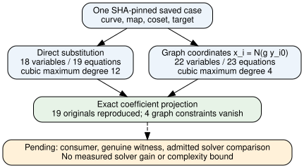

# Paired graph builder: construction checked, solver comparison pending

2026-11-13 continuation of the saved-record audit. Source freeze
00ffe72fbeadaca1eb519459b77e00717f18fda3; prospective local development
contract bf82ba3d4. Statement PCC-20261113-b52e23 [pcc:unverified].

The native builder now emits direct and graph polynomial systems from the
same parsed saved case. Each graph export passes exact symbolic substitution
for every equation before any file is written. Replacing the four new image
coordinates by their prescribed cover polynomials reproduces the original19
equations coefficient-for-coefficient; the four added graph equations become
zero. These are finite native construction checks, separate from the generic
Lean inverse-map theorems already recorded in the original audit.

| Same saved input | Direct variables/equations/max degree | Graph variables/equations/max degree |
|---|---|---|
| Reference | 18 / 19 / 4 | 22 / 23 / 4 |
| Cubic | 18 / 19 / 12 | 22 / 23 / 4 |

The direct degrees match the original producer rows, including cubic12,8,8.
Within each row all curve, map, target and coset parameters are identical
across representations. The reference and cubic rows still describe different
curves/targets. No comparison of useful relation yield follows from this table.



## Evidence and limits

The exporter accepts only the two frozen input SHA-256 digests. Each directory
contains canonical JSON polynomial coefficients/exponents, msolve-style text
and a manifest pinning all four artifacts. Coefficients are reduced modulo the
saved prime. JSON storage is ascending lex exponent order; a consuming solver
must normalize its own selected monomial order. No external solver has yet
consumed the text files, and their format compatibility remains unvalidated.
Exclusive output-directory creation prevents overwriting prior exports.

Seventeen targeted tests pass: four builder controls and13 maintained SHA-256
tests. Controls include independently arranged scalar S3 on F17/F97, both saved
coefficient projections,12 deterministic lift vectors per input, modified image
and modified coefficient negative controls, and m2/m3 chain boundaries. These
vectors are development checks, not known elliptic-relation witnesses. The
release build exits0 with five dead-code warnings for evaluation controls.
Test001's tool caller returned1 despite an explicit process receipt0 and17
passing tests; both statuses are retained. Test002 follows the exclusive-directory
source change and has an attributable tool/process exit0. No failed stage is
silently relabelled successful.

Artifacts: [reference manifest](../evidence/builder/none/manifest.json),
[cubic manifest](../evidence/builder/cubic/manifest.json),
[checks](../evidence/builder/checks.json), and
[protocol](../BUILDER_PROTOCOL.md). Original field-audit output, source manifest
at audit, failed logs and generic graph proof remain unchanged. The new data
attestation is unsigned; its expected PCC status is not_covered.

## Why this retry is justified, and what would decide it

The frozen producer substituted the cubic directly into S3. It did not test
this explicit graph representation. Its degree expansion is therefore a
specific implementation reason to compare the two representations. The old
completed W-only gate remains unchanged. The original alone rerun already
addresses that cubic input's shared-pod kill; CPU contention alone supplies no
new predicted gain.

A lower input degree supplies no bound on solving degree, critical pairs,
nonzeros, memory or elapsed work. Added variables can erase the benefit. In
particular, eliminating the graph variables recovers the same direct system.
Before a performance claim: validate consumer ingestion, independently replay
a genuine witness including rational lifts/signs, freeze ordering/resource
policy, obtain live compute admission, and compare complete sparse work on
identical cases. Keep timeouts/OOMs censored and naturally negative targets
separate from planted positives. Follow [the experiment plan](../NEXT_ENCODING_TEST.md).
No solver or timing job has run in this continuation.

Sources checked: the frozen native pilot at3466f3be9e, original round5
protocol/amendments and records, Galbraith15.8.1-15.8.2 S3, and the earlier
auxiliary-cover review. See the original source-review receipt for exact
snapshots. KB unavailable here; no novelty or exhaustive prior-art claim.
Graph encoding is standard. The missing algorithmic result is a public-input
relation finder with a uniform sub-exponential bit-cost bound; this export
does not establish one [pcc:unverified].

## Reproduce the construction checks

From the repository root, with the pinned Cargo dependencies available:

```sh
cargo test --locked --release --manifest-path research/prime_cover_encoding_audit_20261113/Cargo.toml --bin cover-graph-build
cargo run --locked --release --manifest-path research/prime_cover_encoding_audit_20261113/Cargo.toml --bin cover-graph-build -- research/cover_image_fb_r5_m4t4_20261112/runs/m4t4-cubic.jsonl /tmp/cover-cubic-export
```

The output directory must not already exist. Substitute m4t4-none.jsonl and
a distinct fresh directory for the reference. No command above invokes a
solver. Check the source/input manifest with sha256sum -c from the repository
root; the historical manifest is retained separately as source-inputs-at-audit.

For an asymptotic result, the remaining solver theorem must allow parameters
to grow with the subgroup bit length n. It must bound total expected work,
including failed attempts, useful relation yield, sparse linear algebra and
final recovery, by exp(o(n)). A fixed polynomial saving in p, a lower input
degree, or one favorable finite cell would not meet that obligation.
