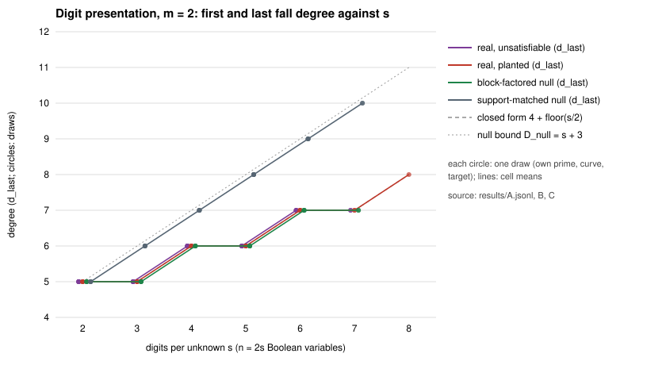
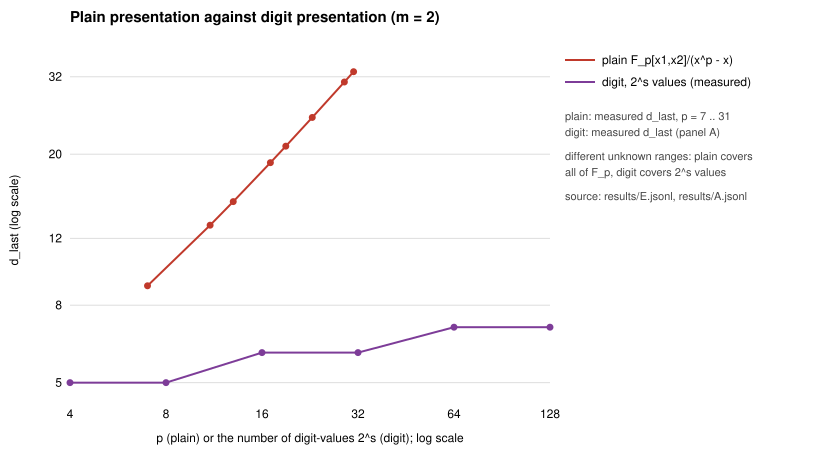

# Digit presentation of the prime-field Semaev system: a native finite degree ladder with independent primes

**Track: algebraic (a degree study; not a cost).** Nothing here is an ECDLP cost, so there is no dashboard point and no `benchmarks/` entry. Lead: `LEAD-ICP-digit-presentation-solving-degree`.

**Result.** The last fall degree `d_last` of the base-2 digit-presented Semaev system grows with the digit count `s`, at the closed-form rate, on every independent draw. The lane is **exhausted at the measured scale** (`m = 2`, `s ≤ 7` unsatisfiable and `s ≤ 8` planted; `m = 3`, `s = 4`). It does not reopen.

- **`d_last = 4 + ⌊s/2⌋` on 106 of 106 real draws at `m = 2`** (60 unsatisfiable at `s = 2..7`, 46 planted at `s = 2..8`): 5, 5, 6, 6, 7, 7, 8. In every one, `d_last` equals the first fall degree `ffd`. Each draw has its own prime, curve and target.
- **`m = 3`:** 8 independent instances (4 at `s = 4`, 4 at `s = 5`). `ffd = 13` on all 8, and `d_last = 13` on the 4 at `s = 4` (closure run). A first-fall-only rerun of the 4 `s = 4` instances is a replay check, not 4 more instances; it gave the same `ffd`.
- **Support-matched null:** `ffd = d_last = s + 3` on 44 of 44 draws. The real system falls strictly earlier from `s = 3` (the gap is 0, 1, 1, 2, 2, 3 at `s = 2..7`).
- **Block-factored null** (`∏ q_k`, random forms on the support of `ℓ_k^e`): it reproduces the real `ffd` and `d_last` on **44 of 44 draws**. So the early fall below the support-matched null is explained by the block structure alone. It carries nothing curve-specific.
- **Plain presentation** (`F_p[x_1, x_2]/(x_i^p − x_i)`, the same engine): `d_last = ffd = p + 2` on 32 of 32 draws, `p = 7..31`. The plain degree is linear in `p`; the digit degree is linear in `log p`.
- **But the matrix is nearly the whole ring.** At `d_last` the degree-filtered Macaulay space spans 100%, 98%, 96%, 83%, 81% and 60% of the `2^n` monomials at `s = 2..7` (§3, last column), and 60% at `s = 8`. A low degree does not make a small system at this scale.

Public synthetic curves; no security claim. Registered in [`PROTOCOL.md`](PROTOCOL.md) before the counted runs, with one amendment ([`AMENDMENT-1.md`](AMENDMENT-1.md)).

**Labels.** `[measured]`: native `digit_fall` records in `results/`. `[derived]`: arithmetic on those records. `[predicted]`: the registered table. `[cited]`: the ledger's closed form, not proved here.

## 1. What was run `[measured]`

The object is `S̃ = S_{m+1}(ℓ_1, …, ℓ_m, x_R)` reduced in `B = F_p[a]/(a² − a)`, with `ℓ_k = Σ_{i<s} 2^i a_{k,i}`, `n = m s`, over `y² = x³ + ax + b`.

- **Engine.** `digit_fall.rs` is standard-library Rust. It ports the Huang–Kosters–Yeo engine `examples/hky_last_fall_degree.rs` from `F_2` to `F_p`. The conventions (Macaulay rows with the degree rule, mutant closure, `e0`, `d_last`, `ffd`) are listed in `PROTOCOL.md` §2.
- **Exactness.** `B` is a function algebra on `{0,1}^n`, so `(f) = I(S)` for the zero set `S`. `dim(I ∩ R_{≤c})` and `DG` come from the evaluation rank on `S`, with no Gröbner basis. A value is exact whenever its run is not marked censored. No run was censored.
- **Validation.** On seed 7 it first reproduced the ledger's integers: `ffd = d_last = 5, 5, 6` at `s = 2, 3, 4` and 13 at `m = 3, s = 4`. Those draws are not in the panel.
- **Independence.** Each draw is a new prime in `(2^b, 2^{b+1})`, `b = min(2s + 1, 11)`, a new curve and a new target. This fixes the pseudoreplication of EV-PFDR-99c699, where a handful of integers were repeated 120 times. The `primes` column shows how many distinct primes each cell used. At `s = 2` the interval holds only 7 primes, so 5 distinct ones appear in 12 draws; every draw still has its own curve and target.
- **Replication.** 234 independent instances: A (60), B (46), C (88), D (8), E (32), plus 4 replay checks (panel D, same seeds, primes, curves and targets as 4 of its instances), 238 records in all. 0 censored, 0 errors. The 46 planted draws are panel B at `s = 2..8`.

## 2. Predictions `[predicted]` and what happened `[measured]`

| registered prediction | draws holding | draws failing |
|:--|--:|--:|
| P1 `ffd = 4 + ⌊s/2⌋`, m = 2, real draws | 106 / 106 | 0 |
| P1 `ffd = 13`, m = 3, s = 4, 5 (independent instances) | 8 / 8 | 0 |
| replay: the first-fall-only rerun of the `m = 3`, `s = 4` instances gives the closure run `ffd` | 4 / 4 | 0 |
| P2 `d_last = ffd`, real unsatisfiable draws | 60 / 60 | 0 |
| P5 `d_last = ffd`, planted draws | 46 / 46 | 0 |
| P3 support-matched null: `ffd = d_last = s + 3` | 44 / 44 | 0 |
| P4 block-factored null reproduces the real values | 44 / 44 | 0 |
| P6 plain: `d_last = ffd` linear in `p` | 32 / 32 (`= p + 2`) | 0 |

**Decision rule (PROTOCOL §5).** Reopen if `d_last` at `s = 7` is at most `d_last` at `s = 3`, or if any real draw has `d_last` below the block-factored null or below `ffd`. None happens: `d_last(7) = 7 > d_last(3) = 5`, and the real system equals the block null on every draw. The lane is exhausted at the measured scale.

## 3. The ladder, cell by cell `[measured]`

`nsol` is the number of digit solutions on the grid. In every cell the rows are independent instances (each has its own seed, curve and target) and none is censored. The 4 first-fall-only records at `m = 3`, `s = 4` repeat the instances of the closure row above them, so they are not listed as a row; they are the replay check in §2; `cols` is `Σ_{j ≤ d_last} C(n, j)` (`[derived]` from the measured `d_last`).

| m | arm | s | draws | primes | nsol | closed form | ffd | d_last | D_null | cols at d_last | cols / 2^n |
|--:|:--|--:|--:|--:|:--|--:|:--|:--|--:|--:|--:|
| 2 | U | 2 | 12 | 5 | 0 | 5 | 5 | 5 | 5 | 16 | 1.00 |
| 2 | U | 3 | 12 | 10 | 0 | 5 | 5 | 5 | 6 | 63 | 0.98 |
| 2 | U | 4 | 12 | 11 | 0 | 6 | 6 | 6 | 7 | 247 | 0.96 |
| 2 | U | 5 | 12 | 11 | 0 | 6 | 6 | 6 | 8 | 848 | 0.83 |
| 2 | U | 6 | 8 | 8 | 0 | 7 | 7 | 7 | 9 | 3302 | 0.81 |
| 2 | U | 7 | 4 | 4 | 0 | 7 | 7 | 7 | 10 | 9908 | 0.60 |
| 2 | P | 2 | 8 | 4 | {1,2,3} | 5 | 5 | 5 | 5 | 16 | 1.00 |
| 2 | P | 3 | 8 | 8 | {1,2,3} | 5 | 5 | 5 | 6 | 63 | 0.98 |
| 2 | P | 4 | 8 | 7 | {2,4} | 6 | 6 | 6 | 7 | 247 | 0.96 |
| 2 | P | 5 | 8 | 8 | 2 | 6 | 6 | 6 | 8 | 848 | 0.83 |
| 2 | P | 6 | 8 | 8 | {2,4,6} | 7 | 7 | 7 | 9 | 3302 | 0.81 |
| 2 | P | 7 | 4 | 4 | {2,6,8,14} | 7 | 7 | 7 | 10 | 9908 | 0.60 |
| 2 | P | 8 | 2 | 2 | {12,20} | 8 | 8 | 8 | 11 | 39203 | 0.60 |
| 2 | Usupp | 2 | 8 | 5 | 0 | 5 | 5 | 5 | 5 | 16 | 1.00 |
| 2 | Usupp | 3 | 8 | 6 | 0 | 5 | 6 | 6 | 6 | 64 | 1.00 |
| 2 | Usupp | 4 | 8 | 8 | 0 | 6 | 7 | 7 | 7 | 255 | 1.00 |
| 2 | Usupp | 5 | 8 | 8 | 0 | 6 | 8 | 8 | 8 | 1013 | 0.99 |
| 2 | Usupp | 6 | 8 | 8 | 0 | 7 | 9 | 9 | 9 | 4017 | 0.98 |
| 2 | Usupp | 7 | 4 | 4 | 0 | 7 | 10 | 10 | 10 | 15914 | 0.97 |
| 2 | Ublock | 2 | 8 | 5 | 0 | 5 | 5 | 5 | 5 | 16 | 1.00 |
| 2 | Ublock | 3 | 8 | 7 | 0 | 5 | 5 | 5 | 6 | 63 | 0.98 |
| 2 | Ublock | 4 | 8 | 8 | 0 | 6 | 6 | 6 | 7 | 247 | 0.96 |
| 2 | Ublock | 5 | 8 | 8 | 0 | 6 | 6 | 6 | 8 | 848 | 0.83 |
| 2 | Ublock | 6 | 8 | 8 | 0 | 7 | 7 | 7 | 9 | 3302 | 0.81 |
| 2 | Ublock | 7 | 4 | 4 | 0 | 7 | 7 | 7 | 10 | 9908 | 0.60 |
| 3 | U | 4 | 4 | 4 | 0 | 13 | 13 | 13 | 13 | 4096 | 1.00 |
| 3 | U (first fall) | 5 | 4 | 4 | 0 | 13 | 13 | n/a | 14 | n/a | n/a |

Plain control (`F_p[x_1, x_2]/(x_i^p − x_i)`, 4 draws per `p`, each a new curve and target):

| p | nsol | ffd | d_last | d_last − p | grid points p² |
|--:|:--|:--|:--|:--|--:|
| 7 | {4,6,8} | 9 | 9 | 2 | 49 |
| 11 | {9,10,14,15} | 13 | 13 | 2 | 121 |
| 13 | {10,11,17,19} | 15 | 15 | 2 | 169 |
| 17 | {13,16,18,22} | 19 | 19 | 2 | 289 |
| 19 | {12,17,21,23} | 21 | 21 | 2 | 361 |
| 23 | {16,24,25,26} | 25 | 25 | 2 | 529 |
| 29 | {22,28,29,38} | 31 | 31 | 2 | 841 |
| 31 | {26,28,30,36} | 33 | 33 | 2 | 961 |

The plain control and the digit presentation cover different unknown ranges: plain covers all of `F_p`, digit covers `2^s ≤ p` values. Compare the growth, not the level.

## 4. Reading

1. **The digit presentation does not have a bounded last fall degree.** `d_last` rises by 1 every 2 digits, on 106 independent draws, in agreement with the ledger's closed form `d_ff = m 2^{m−1} + ⌊(s − 2^{m−1})/2⌋ + 1` `[cited]`. That form is reproduced exactly for `d_last` here as well as for `ffd`.
2. **No elliptic early fall.** Block-factored random forms have the same first and last fall degree as the Semaev system on every draw. The real system differs from the support-matched null only through the block structure that `ℓ_k^e` already gives.
3. **Low degree, big matrix, at this scale.** `d_last` is far below the plain presentation's `p + 2` (exponentially, in `s`). But the Macaulay space at `d_last` spans 60–100% of the ring. The fraction falls slowly (0.81 at `s = 6`, 0.60 at `s = 7` and `s = 8`). `[derived]` Asymptotically `d_last / n → 1/(2m)`, so the column count is about `2^{n·H(1/4)}` at `m = 2`, which is not small; this is the ledger's σ > 1 point (D7 of H-PFDR-4148b8), not re-derived here.
4. **What this adds to the ledger.**
   - A native `F_p` engine that reproduces the Python integers.
   - Independent primes, curves and targets per draw.
   - The last fall degree to `s = 7` (the ledger stopped at `s = 5`).
   - A planted (satisfiable) arm and `m = 3` at `s = 4`.
   - The plain-presentation comparator.

**Scale reached, and what would reopen it.** Exact values for `m = 2`, `s ≤ 7` (unsatisfiable) and `s ≤ 8` (planted), `m = 3`, `s = 4`; first fall only at `m = 3`, `s = 5`. The lane reopens only if a larger `s` breaks the closed form (the next cell is `s = 9`, predicted `d_last = 8`; `n = 18`, up to about 2^18 columns), or if a different presentation (the adaptive staircase arm, H-PFDR-f3fe89, not run here) has a degree or matrix below the block null.

## 5. Limits

- **Toy scale.** `p < 4096`, `s ≤ 7`, `m ≤ 3`. The unsatisfiable arm stops at `s = 7`: for `s ≥ 8`, `p < 4096` leaves no unsatisfiable target on the `2^16`-point grid. The limit comes from the `u32` accumulators (`p < 2^12`), not from mathematics.
- **`s = 8`.** Only the planted arm, 2 draws, `n = 16`: `d_last = ffd = 8`, as predicted, with 39,203 columns at `c = 8` (about 11 minutes a draw). Two draws: a prediction check, not a distribution.
- **A degree is not a cost.** A fall degree is not a solving degree, a cost or an exponent. The column count is a size measure of the Macaulay space, not a priced operation count.
- **One convention.** The function-algebra quotient `B` (field equations free). The ordinary-ring convention of `research/guarded_fall_degree_20261028/` is a different object, with proven bounds `d_F^{ord} ≤ 3·ℓ + 2` for the bit-restricted presentation.
- **Not run.** The adaptive staircase arm (H-PFDR-f3fe89) and `m = 3`, `s ≥ 5` last fall. These are the part of the lead's next action that remains open.
- **Pre-registration disclosure.** Validation draws (seed 7) preceded registration. Amendment 1 fixed a hang in the planted-target search; panel A (60 draws) was produced by the registered binary (hash in `BINARY.sha256`), built from the registered source. That source and launcher are recovered and committed in [`registered/`](registered/README.md), with sha256 equal to `REGISTRATION.sha256` (see [`ADDENDUM-2.md`](ADDENDUM-2.md)). A rebuild of the recovered source reproduces panel A's `s = 3` and `s = 5` cells line for line, and the amended binary reproduces its `s = 3` cell. The registered binary's hash is not reproduced by a rebuild (rustc embeds build paths), so that binary is identified by its hash and by those cells only; panel A's other cells were not rerun. A first version of the block null had no constant term (so `q(0) = 0` made it always satisfiable and it never gave an unsatisfiable instance); it was fixed before any panel run.
- **Formalization.** No new theorem is claimed. [`lean/NullTable.lean`](lean/NullTable.lean) (core Lean 4.34.1, `by decide`, no axioms for all six theorems) checks the registered table's arithmetic only. The closed form is `[cited]`; its proof needs Wilson's rank theorem on inclusion matrices (H-WIL), the graded annihilator of `(Σ a_i)^e` in the squarefree algebra and the tensor-kernel formula. None is in core Lean, so a faithful theorem is blocked on those three dependencies.

**Suggested atlas change (not made here).** Keep `LEAD-ICP-digit-presentation-solving-degree` as `open_next_step`, but record the finite ladder as `exhausted_at_scale` at `m = 2`, `s ≤ 8` and `m = 3`, `s = 4`; the open item is the adaptive staircase arm. Evidence: `research/prime_digit_presentation_20261029/`.

## 6. Files

- `PROTOCOL.md`, `REGISTRATION.sha256`, `BINARY.sha256`, `registered-at.txt`: the registration.
- `AMENDMENT-1.md`, `AMENDMENT-1-NOTE.md`, `REGISTRATION-AMENDMENT-1.sha256`, `BINARY-2.sha256`: the amendment and a post-run note (`run.sh` also changed; `REGISTRATION.sha256` reports `FAILED` for the two amended files in the study directory, as expected). `ADDENDUM-2.md` supersedes the note's sentence that the original source is not kept.
- `registered/`: the recovered registered `digit_fall.rs.v0` and `run.sh.v0`, and `run.sh.v1` (panels B-E), immutable, with `SHA256SUMS` matching the registration.
- `digit_fall.rs`: the amended engine (`rustc -O digit_fall.rs`). `run.sh OUT_DIR`: the panel, written to a new directory and never to `results/`; `test_run_sh.sh` and `analysis/run_sh_test.txt`: its safety test. `derive.mjs`: the tables and figures (tooling).
- `results/{A..E}.jsonl`: one record per draw. `analysis/tables.md`, `analysis/summary.json`.
- `degree_vs_s.svg/png`, `plain_vs_digit.svg/png`, `report.pdf`.
- `lean/NullTable.lean`, `lean/lean-toolchain`.
