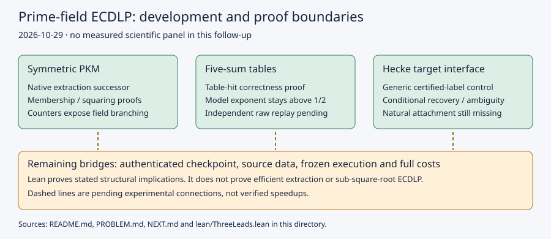

# Prime-field ECDLP: three leads and checked structural proofs

2026-10-29. Development and formalization follow-up. This directory contains no
new admitted performance result and makes no ECDLP speedup or security claim.

The requested work is (1) complete and measure symmetric PKM decomposition,
(2) independently replay the five-sum experiment, and (3) test a Hecke-derived
known-log base on arbitrary targets, with Lean proofs of feasible mathematics.
Implementation tests and formal proofs are distinct from those scientific panels.

The research ranking remains: **symmetric PKM for a possible algebraic exponent
improvement; five-sum for demonstrated generic implementation progress; Hecke
for exploratory relation structure.** None currently establishes a sub-rho
algorithm for general prime-field curves. The decisive missing PKM evidence is
complete extraction and total cost as tower depth grows, rather than a small
first fall degree alone. The decisive missing Hecke ingredient is an efficient
attachment for a prescribed public target, rather than rank on the source set.

## Sources reviewed before implementation

* Petit--Kosters--Messeng, PKC 2016, sections 3--5:
  https://people.maths.ox.ac.uk/petit/files/16PKC_primeECDLP.pdf . The composition
  of low-degree maps supplies the membership system; its solving complexity is
  unresolved. Auxiliary curves and their construction cost are part of the model.
* `research/notes/index-calculus/RESEARCH_PKM_TOWER_ORACLE.md`, especially
  sections 3.3--3.7: degree growth and the conventional relation/LA balance.
* PR2632 and PR2650 (`adde64fdc22d51dc180fe0b9f30a2d28adf992fe`): symmetric
  membership, elementary-symmetric summation equations, and the m=4 diagnostics.
  The construction helpers in the new example derive from that pinned source.
* `src/cryptanalysis/f4_fp.rs`: the existing rational-root streaming visitor
  and its explicit unrestricted branching counters. Use this existing native
  extraction API rather than the older original-grid recovery fallback.
* PR2852 (`42e460293269d149f4ead6929476fcc993babfea`): five-sum law, recorded
  sessions, controls, provenance and independent-host admission still outstanding.
* cryptanalysis PR1274 (`c4b3a67064b66ce3c53d8977882b5b422eca3adc`), PR1278
  and PR1281: class-point rank closure and component optimization. Neither
  supplies a public arbitrary-target attachment algorithm.
* Mathlib at `d13f23b723b8a846827a245b89c10fc7d3f11612`, polynomial
  coprimality/divisibility and finite sums; Lean 4.34.1. The proofs here are
  formalizations of standard structural implications, with no novelty claim.

No new literature theorem or low-solving-degree conjecture is asserted.
The earlier review could retrieve the PKM primary text; the full Yokoyama
paper was unavailable. No universal lower bound is inferred from that gap.

## Native development

`examples/pkm_symmetric_complete.rs` is an additive successor, leaving the
historical instruments unchanged. It accepts an actual finite point on the supplied
curve, builds the symmetric system, visits solutions with native F4 and rational
univariate factoring, decodes the root polynomial, checks tower membership,
lifts points, searches signs and verifies the sum on the original curve.
It records construction separately from solve/decode/verification and preserves
the visitor's timeout, completion and full-field-branch counters. A full-field
branch is enumeration and is never called a purely algebraic speedup.
`SOLVER_SECONDS` bounds the visitor, not the constructor or the whole process;
future measured panels also need an external process/memory cap.

The domain is deliberately bounded: m=2..4, tower depth 1..8, small prime fields.
Distinct abscissae only; repeated-abscissa relations remain outside this system.
The PKM driver's affine target representation does not include the identity.
It is a decomposition oracle, not a complete factor-base-log/target-descent
pipeline. Native arithmetic counters remain partial. Diagnostic clocks do not
earn L2 and do not provide a full GAE comparison.

`examples/hecke_target_router.rs` consumes public short-Weierstrass points and
externally certified scalar labels. It checks prime n, a nonidentity generator
annihilated by n, target n-torsion, all labels,
bounded target shifts and the final scalar equation, with separate setup/online
group and field ledgers. It is a generic shift-control adapter: no new Hecke
source generator, CM transport, or natural non-generic router is supplied.
The X0(11) generalized-Weierstrass data still need a certified normalization
and an importer; the tiny development fixture is not a D79 class experiment.
Target n-torsion alone need not prove membership in the generated subgroup
when rational n-torsion has rank two. The router claims only final-equation-
verified recoveries or a bounded miss; it makes no stronger membership inference.

Both command-line drivers enforce `scripts/checkpoint.sh gate` before a run.
Their direct unit tests are development correctness checks, not experiment data.

`five-sum-inputs.json` pins all eight original test-session IDs, manifest and
session hashes, original binary hashes, and raw-record hashes/sizes/object URIs.
It contains metadata only. The original sessions leave Git commit/dirty fields
null: a build at the pinned PR revision is a replay candidate, not a claim of
byte identity with the original recorded executable. Actual replay equivalence
must be checked, and new receipts must be written outside the frozen sessions.

## Lean proof map

| Declaration in `lean/ThreeLeads.lean` | Exact statement and scope |
| --- | --- |
| `tower_membership` | For a finite set of distinct roots over a field, the product of their linear factors divides X^d-1 iff every root has d-th power one. Does not prove solving degree. |
| `squaring_tower` | Any repeated-squaring sequence in a commutative monoid equals x^(2^t). It can be instantiated in a quotient ring; the code-to-quotient bridge is not formalized. |
| `table_recovery` | A sum-table hit with certified scalar labels gives the target scalar under an explicitly injective linear scalar encoding. No construction or cost of that encoding is assumed free. |
| `row_combination` | Certified combinations of valid scalar equations give the combined right-hand side. |
| `target_recovery` | A nonzero target coefficient and a supplied natural target-row certificate determine the scalar. The geometric target-attachment premise is explicit and unproved. |
| `kernel_ambiguity` | A kernel perturbation preserves all supplied equations while changing a coordinate with nonzero perturbation. |
| `shift_coverage_bound` | A finite shift router covers at most (number of shifts)*(size of its known-log set). Include the identity in that set when the router recognizes it implicitly. No independence or heuristic success distribution is assumed. |
| `table_model_exponent` | k/(2k-1)>1/2 for integer k>=1. An arithmetic fact about the stated table-family model, not a generic-group lower-bound proof. |

The scope is an abstract field/module/additive group. There is no formalized
bridge to the Rust ECC arithmetic, particular curve orders, or empirical costs.
No theorem states bounded PKM first/last/solving degree or sub-square-root ECDLP.
No new polynomial equality is proposed; construction identities are inherited
from the pinned instrument. The quantified divisibility, inequality and
conditional recovery statements are checked by Lean. The fixed-degree
polynomial-equality schema `identity.certificate/v1` does not express those
statements; a sampled polynomial identity is not substituted for them.

Reproduce with Lean 4.34.1 and the committed Lake dependency manifest:

```sh
cd research/prime_ecdlp_three_leads_20261029/lean
lake update
lake exe cache get
lake build
cd ../../..
tools/lean/proof-gate.sh research/prime_ecdlp_three_leads_20261029/lean
cargo test --release --locked --example pkm_symmetric_complete --example hecke_target_router
```

Proof receipts and the final development test outcomes live in `validation/`.
See `PROBLEM.md` for the experiments that remain blocked, and `NEXT.md` for
their controls and acceptance conditions. No scoreboard, performance timeline,
benchmark ranking or canonical curve graph is changed: there is no new measured
cost, curve, isogeny or admitted comparison to enter there.


