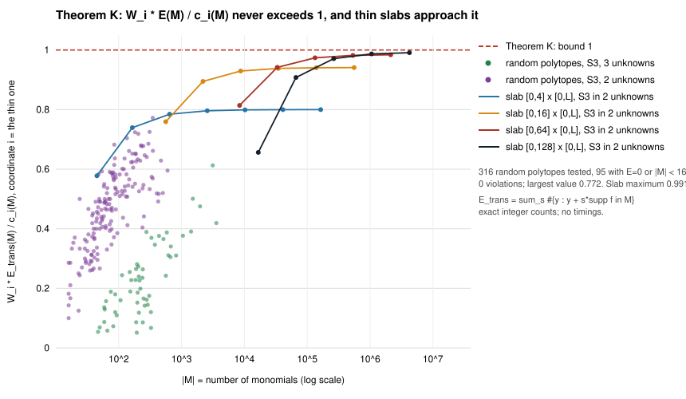
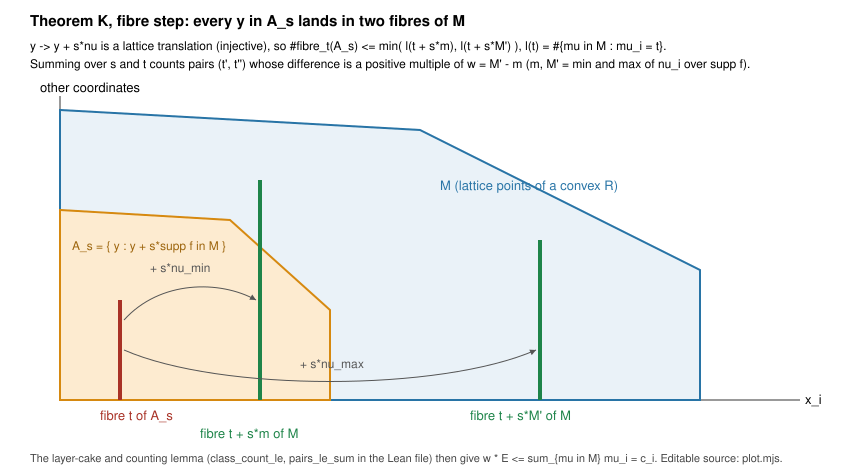
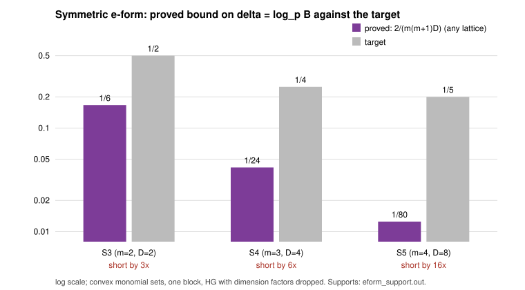

# Small-root reach with unequal bounds

2026-10-29 · lead `LEAD-ICP-coppersmith-smallroot-semaev` · follows
[`research/smallroot_optimal_reach_20261026`](../smallroot_optimal_reach_20261026/README.md) (equal bounds,
numerical search for unequal bounds) and §7c of
[`research/prime_s5_small_root_leads_20261028`](../prime_s5_small_root_leads_20261028/README.md)
(item 5 of the 2026-10-29 lead list: the unequal-bound e-form case left open there).

**Class: analysis (a derived proof, exact integer counts and exact finite-field supports; the e-form closure is conditional on full extents, §3a). Not an
index-calculus measurement, not an improvement, no leaderboard row, no dashboard point.**
**Track: algebraic (small-root decomposition); it ratchets nothing.**

## Result

The cited study proved a reach bound for **equal** per-variable bounds and could only search
numerically when the bounds are unequal (best region 0.4357, rising towards 1/2, for `S₃`). This note
closes that gap for the setting both studies work in.

- **[derived] Theorem K.** Let `f` have exponent set `F`, let `M` be the lattice points of a convex region
  in the orthant, and let `W_i = max_F ν_i − min_F ν_i` be the extent of `f` in coordinate `i`.
  Then the translate count that bounds every lattice gain satisfies `W_i · E(M) ≤ c_i(M) = Σ_{μ∈M} μ_i`.
  The proof is short and elementary (§2): a lattice translation into two fibres of `M`, a layer-cake sum,
  and a counting lemma.
- **[derived] Every bound direction at once.** With bounds `p^{δ_i}` the Howgrave–Graham condition
  `Σ_μ ⟨δ,μ⟩ < E(M)` then gives **`Σ_i δ_i W_i ≤ 1`**, so **`ε = Σ δ_i ≤ 1 / min_i W_i`**, for every
  direction of the bounds, every convex `M`, every level `t`. **This holds for the polynomial actually used:
  `W_i` is the extent of *that* `f` (a specialization), not of the generic one.** For `S₃` with `W_i = 2`
  the supremum is 1/2, the value the numerical search only approached.
- **[derived + measured supports] The symmetric e-form is closed at the Jochemsz–May asymptote, for
  specializations with the full extents.** In the e-variables `e₁..e_m` with weights `δ_{e_j} = j·δ_B`, the
  **generic** specialization of `S₃`, `S₄`, `S₅` has the **full simplex** as support, with `W_j = D = 2^{m−1}`
  for every `j` (GP, §3). **If and only if** every extent is full, **`δ_B ≤ 2 / (m(m+1)·2^{m−1})`: 1/6, 1/24
  and 1/80 for `m = 2, 3, 4`**, exactly the asymptotes that §3.2 of the lead-4 study derived for one lattice
  family, and then no other lattice built from `(p, f)^t` on a convex monomial set does better.
  **The closure is not unconditional for the class.** The extent hypothesis fails for the exceptional
  specializations (§3a): `z = 0` for every `m`, and a few curve-dependent values of `z`. There the proved
  ceiling is weaker (`Σ_j j·W_j·δ_B ≤ 1`: 1/5, 1/22, 1/72 at `z = 0`), and a **review counterexample (§3a, addendum)
  shows a lattice beating 1/6 for `S₃` at `z = 0`** (determinant reach 7/41 = 0.1707 > 1/6). Theorem K itself is
  unaffected.
- **Distance to the targets.** For the generic specialization `S₄` is **6×** short of δ = 1/4 and `S₅` **16×**
  short of δ = 1/5 in the e-form, as in the table of §3.2 of the lead-4 study. At the exceptional specializations
  computed in §3a the ceilings are 1/22 and 1/72 (5.5× and 14.4× short), so the targets stay out of reach there too.
- **Not covered, and not claimed (§5):** multi-target (non-principal) ideals, and non-convex monomial
  sets. For each the exact step of the proof that fails is named.
- **Sharpness.** The constant 1 in Theorem K is sharp for the translate count: thin slabs reach 0.991
  (Figure 1). Whether real lattices attain the translate count in that regime is **not checked** here
  (it is, exactly, in the 11 cases of the cited study; §4).
- **Lean:** the counting lemma, the direction-free reach inequality and the e-form instances are
  checked in core Lean (no `sorry`, standard axioms). Theorem K's fibre step, layer-cake step and the
  Newton-polytope step are **not formalized** (proof map, §6).

## 0. Setting, and what is inherited

A block is `f ∈ F_p[x₁..x_n]` with bounds `|x_i| < p^{δ_i}`. The reach is `ε = Σ δ_i`, as in the cited study.
For a monomial set `M`, `E(M) = log_p[L(M) : p^t Z^M]`, and Howgrave–Graham with dimension factors dropped
(which favours the attacker) reads `Σ_{μ∈M} ⟨δ,μ⟩ < E(M)`.

**Inherited from the cited study, not re-derived here** `[derived there]`:

1. the layer bound `E(M) ≤ Σ_{s=1}^{t} dim(f̄^s F_p[x] ∩ span M)` (regular sequence `p, f`);
2. Ostrowski: `Newt(h·f^s) = Newt(h) + s·N`, `N = Newt(f)`. For `M = R ∩ Z^n` with `R` convex it follows that
   `supp h ⊆ {y : y + sN ⊆ R}`, so `dim(f̄^s F_p[x] ∩ span M) ≤ #{y ∈ Z^n_{≥0} : y + s·F ⊆ M}`.

Write `E_tr(M) = Σ_{s≥1} #{y ∈ Z^n_{≥0} : y + s·ν ∈ M for every ν ∈ F}` (the translate count). Then
`E(M) ≤ E_tr(M)`. Independent check of this layer of the argument: my own implementation of `E_tr`
reproduces **all 11** exact lattice gains of the cited study (§4).

## 1. The direction reduces to one coordinate

`[derived]` Fix `M`, write `c = (c₁..c_n)`, `c_i = Σ_{μ∈M} μ_i`. The Howgrave–Graham condition is the
*linear* constraint `⟨δ,c⟩ < E` on `δ ≥ 0`, and `ε = Σ δ_i` is linear. So the maximum of `ε` over all
bound directions sits at a vertex: all the bound on one coordinate. That is what the cited study's
optimiser kept finding (the whole bound on one variable, §3 there), now derived rather than observed.
It also means the unequal-bound problem is exactly the family of single-coordinate ratios `E(M)/c_i(M)`.

## 2. Theorem K and its proof

**Theorem K.** `[derived]` Let `F ⊂ Z^n_{≥0}` be the exponent set of `f` and `M = R ∩ Z^n_{≥0}` for a convex `R`.
For a coordinate `i` let `m = min_F ν_i`, `M' = max_F ν_i`, `w = M' − m ≥ 1`. Then

`w · E_tr(M) ≤ Σ_{μ∈M} μ_i`.

*Proof.* Let `ℓ(u) = #{μ ∈ M : μ_i = u}` and `A_s = {y ∈ Z^n_{≥0} : y + s·ν ∈ M for all ν ∈ F}`.

1. *Fibre step.* Pick `ν_min, ν_max ∈ F` attaining `m` and `M'`. The maps `y ↦ y + s·ν_min` and
   `y ↦ y + s·ν_max` are injective, send `A_s` into `M`, and shift the `i`-th coordinate by `s·m` and
   `s·M'`. Hence for every `t`: `#{y ∈ A_s : y_i = t} ≤ min(ℓ(t+sm), ℓ(t+sM'))`.
2. *Pairs.* Sum over `t` and put `u = t + sm`: `#A_s ≤ Σ_u min(ℓ(u), ℓ(u + sw))`. Summing over `s ≥ 1`
   counts each pair `u < v` with `v − u` a positive multiple of `w` once:
   `E_tr ≤ Σ_{u<v, w | v−u} min(ℓ(u), ℓ(v))`.
3. *Layer-cake.* `min(ℓ(u), ℓ(v)) = Σ_{λ≥0} 1[ℓ(u)>λ]·1[ℓ(v)>λ]`. With `S_λ = {u : ℓ(u) > λ}` the right side is
   `Σ_λ P_w(S_λ)`, `P_w(S) = #{(u,v) ∈ S², u < v, w | v−u}`.
4. *Counting lemma.* For a finite `S ⊂ Z_{≥0}`: `w·P_w(S) ≤ Σ_{u∈S} u`. Split `S` into residue classes mod `w`;
   the `j`-th smallest element of a class is at least `j·w`, so a class of size `k` has sum at least
   `w·C(k,2)`, which is `w` times its pairs.
5. `Σ_λ Σ_{u∈S_λ} u = Σ_u u·ℓ(u) = c_i`. ∎

**What the proof uses.** Only that `M` contains `y + s·ν` for the two extreme exponents, which is where convexity
enters (via Newton polytopes, §0). It does not use the dimension of `M`, the level `t`, or the shape of
`F` beyond `m` and `M'`.

**Corollary (every direction).** `[derived]` If `E(M) > 0`, `δ ≥ 0` and `⟨δ,c⟩ ≤ E(M)`, then
`Σ_i δ_i W_i · E ≤ ⟨δ,c⟩ ≤ E`, so **`Σ_i δ_i W_i ≤ 1`** and **`ε ≤ 1/min_i W_i`**.

**Calibrations.** It reproduces both known tight cases: a univariate polynomial of degree `d` has `W = d` and
`δ ≤ 1/d` (Coppersmith); a linear form in two unknowns has `W₁ = W₂ = 1` and `δ₁ + δ₂ ≤ 1`.
It is consistent with the bound of the cited study for equal bounds (which is smaller, because it uses the
volume as well) and with the numerical optimiser (every value below 1/2).
I did not search the literature for earlier statements of Theorem K; treat it as derived here, not as new.

## 3. The e-form and the targets

`[measured, exact]` Supports computed in PARI/GP 2.17.3 over `F_P`, `P = 2^31 − 1`, `a = −3`, `b` and `z` fixed
random values: `S₃` by Semaev's formula, `S₄` and `S₅` by the resultant recursion, the e-form polynomial
`T(e₁..e_m; z)` fitted at random points by solving a linear system with 8 spare equations as a check
([`eform_support.gp`](eform_support.gp), output [`eform_support.out`](eform_support.out)):

| m | polynomial | D | monomials in e | nonzero | max exponent of `e_j` | min | `e_j^D` present |
|--:|:--|--:|--:|--:|:--|:--|:--|
| 2 | `S₃(e₁,e₂; z)` | 2 | 6 | 6 | 2, 2 | 0, 0 | yes, yes |
| 3 | `S₄(e₁,e₂,e₃; z)` | 4 | 35 | 35 | 4, 4, 4 | 0, 0, 0 | yes ×3 |
| 4 | `S₅(e₁..e₄; z)` | 8 | 495 | 495 | 8, 8, 8, 8 | 0 ×4 | yes ×4 |

A nonzero coefficient at a random point is a certificate that the monomial is present for generic `(a, b, z)`, so
`W_j = D` exactly (the upper bound `W_j ≤ D` is the total-degree bound: each `e_j` contains each `x_i` to power at most 1).
This also confirms premise P2 of the lead-4 study for `m = 2, 3, 4`.

With `δ_{e_j} = j·δ_B` (the e-form bounds `C(m,j)·B^j`; the constants `C(m,j)` do not change the exponent),
`Σ_j δ_{e_j} W_j = D · δ_B · m(m+1)/2 ≤ 1`:

| m | polynomial | proved bound on δ_B | target | shortfall | the lead-4 study's §3.2 asymptote |
|--:|:--|--:|--:|--:|--:|
| 2 | `S₃` | 1/6 | 1/2 | 3× | 1/6 |
| 3 | `S₄` | **1/24** | 1/4 | **6×** | 1/24 |
| 4 | `S₅` | **1/80** | 1/5 | **16×** | 1/80 |

So, **for the generic specialization (every extent full)**, the asymptote that §3.2 derived for the symmetric
Jochemsz–May family is the **optimum of every lattice in `(p, f)^t` on a convex monomial set**, in the same
determinant convention. The finite-level values of that table (1/55.0, 1/40.7, 1/35.5 for `S₄`) all lie below
1/24, as they must. This statement **needs the extent hypothesis `W_j = D` for every `j`**; see §3a for when it fails.

## 3a. Exceptional specializations (added after review)

`[measured, exact]` The extent hypothesis was checked at one random `(a, b, z)`. It is a statement about a
specialization, and it fails on a thin set. Since the total e-degree is at most `D`, `W_j = D` holds exactly when the
pure-power coefficient `c_j(z)` of `e_j^D` is nonzero. I computed `c_j(z)` for `m = 2, 3, 4` in PARI/GP over
`F_P`, `P = 3·2^30 + 1`, `a = −3`, `b = 1234567`, by evaluating `T` at points with `e_i = 0` for `i ≠ j` and
interpolating in `e_j` and in `z`, with explicit Sylvester determinants (formal degrees: PARI's `polresultant`
uses actual degrees and returns a different value where leading coefficients vanish; a first run that used it
gave wrong zeros for `m = 4`, `j = 1, 2`, and was discarded and redone; the formal-degree code agrees with
`polresultant` at a random point). Output: [`exceptional.out`](exceptional.out), code
[`exceptional.gp`](exceptional.gp).

| polynomial | `c_j(z)`, `j = 1..m` (degree; roots in `F_P`) | exceptional `z` for this `(a, b)` |
|:--|:--|:--|
| `S₃` | `z²` (2; 0), `1` | `z = 0` only (exact for every `a, b`: `c₁ = z²`) |
| `S₄` | (2; one double root `z_a = 2395354738`), `z⁴` (4; 0), `1` | `z = 0` and `z_a` |
| `S₅` | (8; 0 ×6 and 711242957 ×2), (4; `z_a` ×4), `z⁸` (8; 0), `1` | `z = 0`, `z_a`, 711242957 |

`z = 0` is exceptional for every `m` and every curve. The other values depend on `(a, b)` and are roots of a
polynomial of degree at most `D` in `z`, so at most `D` values per `j`.

The extents at the exceptional values I fitted (same method as §3, [`exc_extents.out`](exc_extents.out)), and the
ceiling Theorem K gives for them (`δ_B ≤ 1 / Σ_j j·W_j`):

| specialization | nonzero monomials | extents `W_j` (full: `D`) | proved ceiling on `δ_B` | against the target |
|:--|--:|:--|--:|:--|
| `S₃`, `z = 0` | 4 of 6 | (1, 2) | 1/5 | 1/2: 2.5× short |
| `S₄`, `z = 0` | 25 of 35 | (4, 3, 4) | 1/22 | 1/4: 5.5× short |
| `S₄`, `z = z_a` | 32 of 35 | (3, 4, 4) | 1/23 | 1/4: 5.8× short |
| `S₅`, `z = 0` | 433 of 495 | (6, 8, 6, 8) | 1/72 | 1/5: 14.4× short |
| `S₅`, `z = z_a` | 474 of 495 | (8, 7, 8, 8) | 1/78 | 1/5: 15.6× short |

Not computed: `S₅` at `z = 711242957` (there `c₁ = 0`, so `W₁ ≤ 7`). A ceiling is an upper bound on what any
lattice achieves; I did **not** show these ceilings are attained, so for exceptional `z` the closure is "no
better than `1/Σ j W_j`", not "equal to it".

**What the lead-4 measurement does and does not say.** L4-B found the *x-form* Newton polytope of `S₄` and `S₅`
to be the full box on 20 of 20 seeded `z` on `icv1-fp40-tm924137-0ecaaeb9`. That supports full extents for
random `z` on that curve. It does **not** certify any particular `z`: the exceptional values are at most `D`
per coefficient among about `2^40` values, so 20 random samples cannot detect them (a random target is
exceptional with probability of order `D·m/p`). It says nothing about the e-form directly (full x-box and full
e-simplex are different statements; the e-form support was computed separately, §3), and it is silent on
structural values such as `z = 0`. A target `R` with `x(R) = 0` is not excluded: it exists whenever `b` is a square.

## Addendum (2026-10-29): the review counterexample, checked

A reviewer reported two numbers for `S₃` in the e-form. Both hold, with my own tooling
([`reviewer_check.mjs`](reviewer_check.mjs), [`reviewer_check.out`](reviewer_check.out); exact integers; Lean:
`etr_z0`, `etr_gen`, `c1_val`, `c2_val`):

1. **At `z = 0` (nonzero `a, b`)** `S₃(e₁, e₂; 0) = (e₂ − a)² − 4b·e₁`, whose extents are `(1, 2)`, not `(2, 2)`.
   Holds (also fitted, §3a table).
2. **Level 3, `R = {(i, j) ≥ 0 : 2i + j ≤ 6}`** (16 monomials): `c = (14, 34)` and, for this `f`, the layers of the
   translate count are `9, 4, 1`, so `E = 14`. The determinant bound is `δ_B < 14/(14 + 2·34) = 7/41 = 0.1707`,
   which is **larger than 1/6 = 0.1667**. Holds.

**What it means, plainly.**

- **It is a real counterexample to the claim "1/6 bounds every lattice" for `S₃` at `z = 0`.** For a convex `M`
  the translate count is the exact gain, `E(M) = E_tr(M)` (derived: every `h` supported on `{y : y + sF ⊆ M}` gives
  `p^{t−s}·h·f^s ∈ (p, f)^t` supported in `M`, by convexity, and its layer-`(t−s)` image is `h̄·f̄^s`; so the layer
  dimensions equal `|A_s|`, the upper bound of §0 is attained, and `L(M)` itself has gain `E_tr`). The example is
  therefore an actual lattice, not just a bound.
- **For generic `z` the same region gives `E = 4`** (reach 0.049), and a scan over simplices `{i/α + j/β ≤ 1}`
  (translate count) reaches at most 0.144 < 1/6. The 1/6 closure stands for the generic specialization.
- **It does not contradict Theorem K.** The `z = 0` polynomial has `W = (1, 2)`, so `K` holds
  (`1·14 ≤ 14`, `2·14 ≤ 34`), and its own ceiling is `1/(1 + 2·2) = 1/5`. A scan over simplices for this polynomial
  reaches 0.1831 at `|M| = 49` (translate count), still below 1/5.
- **It is not a statement about the targets.** For `S₃` (target 1/2), `S₄` and `S₅` the exceptional ceilings are
  far below the targets (table above).
- **Corrections made in this commit:** the headline, the §3 closure paragraph, the §5 table, the §6 proof map
  and the PR description now state the full-extent hypothesis. The earlier text claimed the closure for the whole
  class. The data and scripts of the first commit are unchanged.

**The x-form, for completeness.** `[measured for S₃, S₄; derived from the known degree for S₅]` In the original
variables `S₃` and `S₄` have `W_i = 2` and `4` for every `x_i` ([`xform_extents.out`](xform_extents.out)); `S₅`
has per-variable degree 8 (Semaev). So any direction obeys `ε = Σδ_i ≤ 1/4` for `S₄` and `1/8` for `S₅`. For equal bounds this gives
`δ ≤ 1/12` and `1/32`, weaker than the volume bound of §7c (1/21.8, 1/70.8), which stays the right figure there.
Theorem K's value is that it covers every direction, which the volume argument did not.

## 4. Checks `[measured]`

All counts are exact integers; there are no timings and no `ecbench` costs.
Reproduce with `node translate_test.mjs` and `node slabs_more.mjs` (outputs
[`translate_test.json`](translate_test.json), [`slabs_more.json`](slabs_more.json)), then `node plot.mjs`.

1. **The implementation reproduces the cited study's exact lattice gains.** `E_tr` on its 11 box cases
   (linear, univariate degree 2, `S₃` in two and three unknowns) equals its exact `E` in **11 of 11**.
   Theorem K holds in each (largest `W·E/c` is 0.857, the univariate case).
2. **Property test of Theorem K.** 316 random down-closed polytopes for `S₃` (120 in three unknowns,
   196 in two; 2–6 facets plus axis facets, random skew): **0 violations**, largest `max_i W_i·E_tr/c_i` = 0.772.
   Figure 1 draws the 221 with `E > 0` and `|M| ≥ 16`.
3. **Sharpness.** Thin slabs `[0,a]×[0,L]` for `S₃` in two unknowns (`Newt` is the box `[0,2]²`, so
   `E_tr = Σ_s (a−2s+1)(L−2s+1)` in closed form, checked against the brute-force count): `W·E/c₁` rises to
   **0.991** at `a = 128, L = 32768`, i.e. to the bound 1 in the limit `L ≫ a ≫ 1`.
4. **Supports** (§3), and **Lean** (§6).

## 5. The three open cases of §7c

| case | status | why |
|:--|:--|:--|
| Unequal bounds (the symmetric e-form) | **closed for specializations whose Newton polytope has the full extents** (`W_j = D`: generic `z`), convex `M`, one block, determinant (HG) convention. **Not closed as a class:** for exceptional specializations (`z = 0` always, §3a) the proved ceiling is weaker and a lattice beats 1/6 for `S₃` at `z = 0` (addendum) | Theorem K and its corollary (valid for every `f`, with that `f`'s extents); the e-form supports and the exceptional `z` are computed (§3, §3a) |
| Lattices using several targets' polynomials at once | **nothing can be said here** | The proof needs the dimension of `f̄^s·F_p[x] ∩ span M` to be at most a translate count, which comes from Ostrowski for a **principal** ideal. For `(f₁, f₂)^s` an element is a sum `Σ h_J f^J` in which supports can cancel, and `Newt` of a sum is only contained in the hull of the union. The count has no such bound, and the layer step (regular sequence) also changes. I make no claim either way. |
| Non-convex monomial sets | **nothing can be said here** | The fibre step needs `y + s·ν_min ∈ M`. Ostrowski only gives `y + s·ν_min ∈ conv(M) ∩ Z^n`. Running the proof with `M̄ = conv(M) ∩ Z^n` bounds `E(M) ≤ c_i(M̄)/W_i`, but the Howgrave–Graham weight is `c_i(M) ≤ c_i(M̄)`, so the ratio `E(M)/c_i(M)` is not controlled when `M` is much sparser than its hull. |

## 6. Lean proof map

[`lean/EFormReach.lean`](lean/EFormReach.lean), core Lean 4.34.1 (`lean/lean-toolchain`), no Mathlib.
Build and axiom audit: [`lean/lean-build.txt`](lean/lean-build.txt) (command: `lean EFormReach.lean` with
`#print axioms` appended). All declarations are in the namespace `EFormReach`. No `sorry`, no custom axiom, no `native_decide`; the declarations depend on
`propext`, `Classical.choice`, `Quot.sound` at most.

| step | statement | Lean declaration | status |
|:--|:--|:--|:--|
| layer bound and Ostrowski (§0) | `E(M) ≤ E_tr(M)` | none | **not formalized** (inherited; needs polynomial rings over `F_p`, Newton polytopes, regular sequences) |
| 1. fibre step | `#{y ∈ A_s : y_i=t} ≤ min(ℓ(t+sm), ℓ(t+sM'))` | none | **not formalized** (needs `Finset` of lattice points; core Lean has none) |
| 2–3. pairs and layer-cake | `E_tr ≤ Σ_λ P_w(S_λ)` | none | **not formalized** |
| 4. counting lemma | `w · #{pairs a positive multiple of w apart} ≤ Σ S` | `class_count_le`, `pairs_le_sum` | **checked** (strictly decreasing lists of naturals, any `w > 0`) |
| corollary | from `W_i·E ≤ c_i` and `Σ n_i c_i ≤ D·E`, `Σ n_i W_i ≤ D` | `reach_aux`, `reach_le` | **checked** (naturals, scaled `δ_i = n_i/D`) |
| e-form instances (full extents) | `6u ≤ Dn`, `24u ≤ Dn`, `80u ≤ Dn` for `δ_B = u/Dn` | `eform_S3`, `eform_S4`, `eform_S5` | **checked**, with Theorem K at the **full extent** `W_j = D` as explicit hypotheses `k_j`: they say nothing about exceptional specializations |
| `S₃` with arbitrary extents | `(W₁ + 2W₂)·u ≤ Dn` | `eform_S3_ext` | **checked**, given `W_j·E ≤ c_j` |
| review example, exact facts | `etr` of the generic and the `z = 0` exponent sets on `2i + j ≤ 6`: 4 and 14; `c = (14, 34)`; `6·14 > 14 + 2·34` (so 7/41 > 1/6) and the `z = 0` polynomial respects its own ceiling | `etr_gen`, `etr_z0`, `c1_val`, `c2_val`, `z0_exceeds_generic_ceiling`, `z0_respects_own_ceiling` | **checked** (`decide`, no axioms) |
| targets out of reach | `¬ (Dn ≤ 4u)`, `¬ (Dn ≤ 5u)` | `s4_`, `s5_target_unreachable` | **checked** |
| e-form supports, exceptional `z` | `W_j = D` iff `c_j(z) ≠ 0` | none | computed in GP (§3, §3a), not a Lean statement |

This is a **partial formalization**: Theorem K itself stays a written proof, and the reported results are
conditional on it and on the inherited layer bound.

## 7. Limits

- **Convention.** Howgrave–Graham with dimension factors dropped, as in the cited studies. This favours the
  attacker, so it is a valid upper bound on reach in the determinant model. It says nothing about a
  solver that is not a lattice of polynomials in `(p, f)^t`.
- **Generic-support hypothesis.** The e-form closure at 1/6, 1/24, 1/80 needs `W_j = D` for every `j`; it was
  verified at one random `(a, b, z)` per `m` and its failure set was computed for one `(a, b)` per `m` (§3a). It is
  not established for a different `(a, b)`, and it fails at `z = 0` for every curve.
- **One block, convex `M`.** §5 lists what is not covered. The joint three-block `(4,2)` lattice of the cited
  study's §5 is a multi-ideal case.
- **Sharpness is for the translate count.** Figure 1 shows the count, not a constructed lattice.
- **e-form constants.** `C(m,j)` in the bounds is ignored, as in the cited study.
- **No measured cost.** No `ecbench` run, no §5a band, no benchmark entry, no dashboard point.

## 8. Next checks

- Update `LEAD-ICP-coppersmith-smallroot-semaev`: its `revisit_when` names "an unequal-bound allocation beats
  1/2 per block", which Theorem K answers for convex sets; the open triggers are the joint (multi-ideal) lattice
  and non-convex sets. (Atlas edit not made here; it is a separate PR in `crypto-autoresearcher`.)
- For exceptional `z`: determine whether the ceilings `1/Σ j W_j` are attained (the `S₃`, `z = 0` scan reaches 0.183 of 0.2), and compute `S₅` at `z = 711242957`.
- A direct attack on the multi-ideal case: bound `dim (f₁,f₂)^s ∩ span M` for two generic polynomials.
- Formalize steps 1–3 with a `Finset`-based library (needs Mathlib or `crypto-lean`).

## 9. Files

- [`translate_test.mjs`](translate_test.mjs), [`slabs_more.mjs`](slabs_more.mjs), [`plot.mjs`](plot.mjs): tooling (exact counts and figures).
- [`eform_support.gp`](eform_support.gp), [`xform_extents.gp`](xform_extents.gp), [`exceptional.gp`](exceptional.gp), [`exc_extents.gp`](exc_extents.gp) and their `.out`: supports, the pure-power coefficients `c_j(z)` and the extents at exceptional `z`.
- [`reviewer_check.mjs`](reviewer_check.mjs) and `.out`: the review example (exact counts).
- `reach_sharpness`, `eform_vs_targets`, `proof_diagram` (`.svg` and `.png`): figures.
- [`lean/`](lean/): Lean file, toolchain pin, build log.
- `report.pdf`: this README.

Provenance: written and run by a Claude Sonnet 5.5 research fork in the 2026-10-29 session; Lean 4.34.1,
PARI/GP 2.17.3, Node v26.7.0. The proof, the checks and the Lean file are this note's own work.
